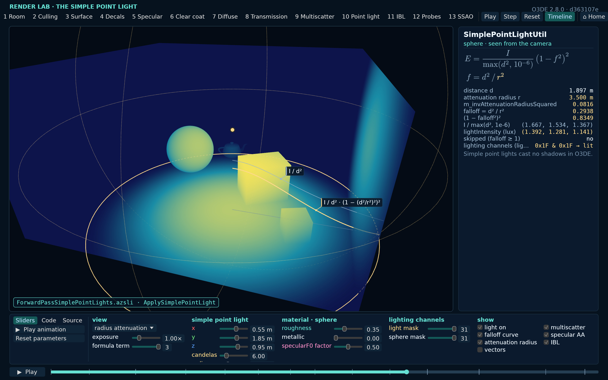
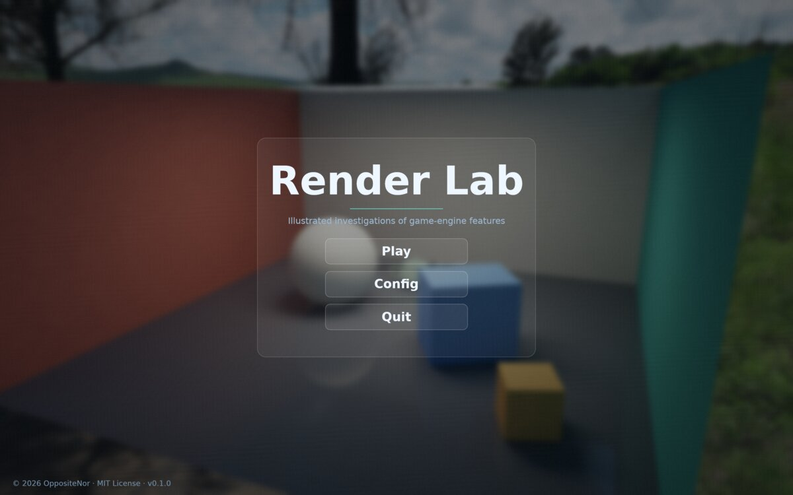
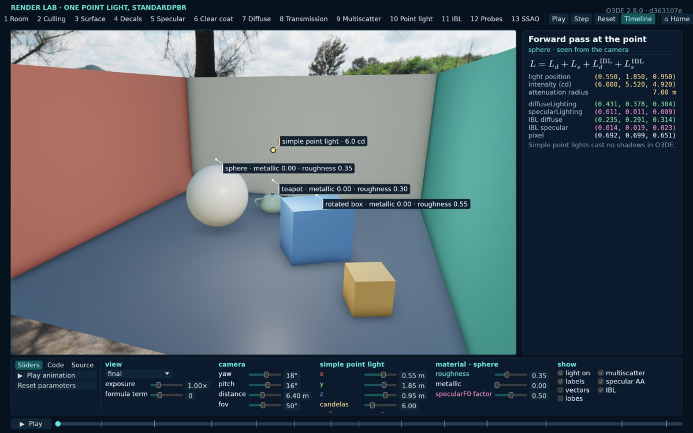
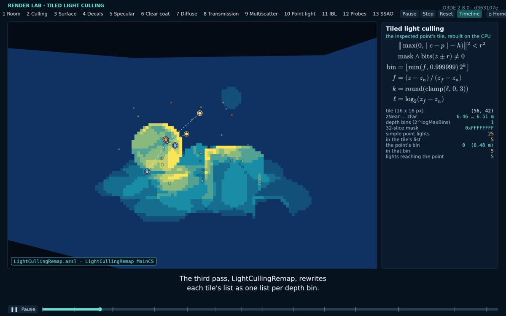
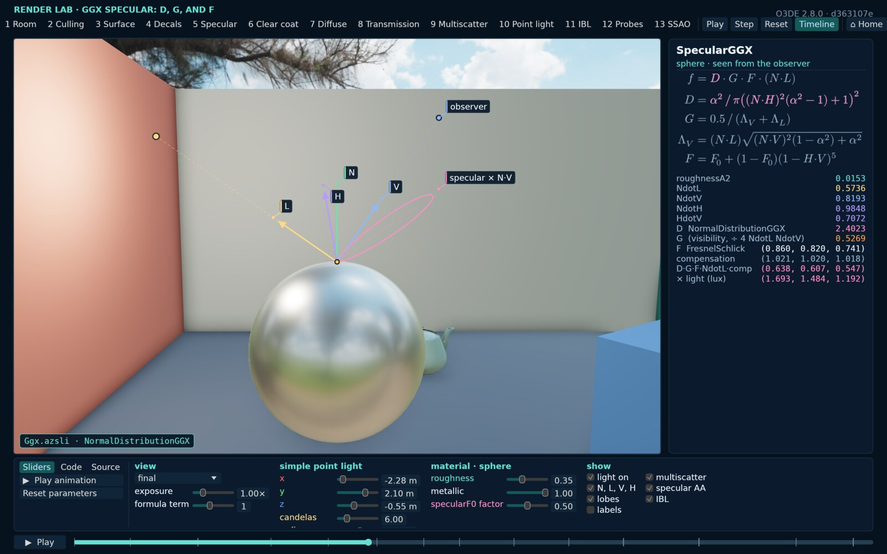

# Render Lab

[](https://github.com/OppositeNor/render-lab/actions/workflows/ci.yml)

English | [简体中文](README.zh-CN.md)

<p align="center">
  
</p>

A lab for rendering demonstrations and experiments, organised as **investigations of game-engine features**. Each
investigation rebuilds parts of one engine feature on prepared data and shows the data involved, step by step, in an
interactive viewer and in narrated videos that the lab records frame by frame.

> [!WARNING]
> Render Lab is at a very early stage of development. Its APIs and formats (the `Investigation` trait, the package
> manifest, the storyboard and script vocabulary, the command line) may change a lot, without notice or migration
> paths.

It uses **wgpu 30.0.1** on Vulkan (or, where wgpu picks them, Direct3D 12 on Windows and Metal on macOS), **winit 0.30.13**, **egui 0.37**, and **WGSL** shaders.

<p align="center">
  
  
</p>
<p align="center">
  
  
</p>

## What this repository contains

The shared lab (the homepage, the settings, and the code an investigation builds on) and the investigations of engines
whose license allows publishing code derived from them:

- **Open 3D Engine: Lighting model** ([`packages/o3de_lighting/src/o3de/lighting`](packages/o3de_lighting/src/o3de/lighting/README.md)). How O3DE 26.05's Atom
  renderer lights a frame, with its shader code ported to WGSL and run as its default pipeline does: the depth
  pre-pass, tiled light culling, the sun's cascaded shadows and their screen-space buffer, the forward pass and its five
  targets, the material model and the BRDF of its lighting models, the BRDF texture and multiscatter compensation,
  image-based light and reflection probes, SSAO, transmission, and terrain.
- **Godot Engine: SDFGI** ([`packages/godot_sdfgi/src/godot/sdfgi`](packages/godot_sdfgi/src/godot/sdfgi/README.md)). How Godot
  4.7's Forward+ renderer computes signed distance field global illumination, followed on the CPU at the engine's sizes:
  the cascades and their scrolling, voxelization, the jump-flood distance field, occlusion, light injection and bounce,
  probe tracing and its history, the octahedral probe maps, and the screen pass, ported to WGSL.
- **Godot Engine: screen-space reflections** ([`packages/godot_ssr/src/godot/ssr`](packages/godot_ssr/src/godot/ssr/README.md)). How
  Godot 4.7's Forward+ renderer reflects what is on screen, its passes ported to WGSL and mirrored on the CPU: the
  normal-roughness pre-pass, the half-size downsample, the Hi-Z pyramid, the trace through it, its validation and
  last frame's colour, the roughness filter, the bilateral resolve, and the opaque pass's blend.
- **Godot Engine: VoxelGI** ([`packages/godot_voxelgi/src/godot/voxelgi`](packages/godot_voxelgi/src/godot/voxelgi/README.md)). How
  Godot 4.7's Forward+ renderer computes its baked voxel global illumination, followed on the CPU at the engine's
  default subdivision: the bake's octree and distance field, the cells' records, the light, mip, and bounce passes, the
  dynamic-object path, and the per-pixel cone trace, ported to WGSL.

An optional module, not provided in this repo, can add local packages of its own to `packages/` (each with its own Cargo
workspace). Without it the lab runs with the public investigations alone.

## Quick start

See [BUILD.md](BUILD.md) for requirements, offline caches, and verification. From the repository root:

```bash
cargo build --release --locked
cargo run --release -- --list
cargo run --release
```

The homepage's **Play** opens installed investigations; **Config** sets the language, theme, volumes, and display options.
See [Using Render Lab](docs/usage.md) for the controls.

## Working with AI agents

The repository includes skills written for AI coding agents, in [`.agents/skills/`](.agents/skills) (the Agent Skills
layout, linked from `.claude/skills/` for Claude Code), with the rules every agent follows in [`AGENTS.md`](AGENTS.md).
Each skill guides one kind of task: `new-investigation`, `new-story` (with `new-story-engine` and `new-story-paper`),
`storytelling`, `packages`, `render-graph`, `knowledge-graph`, `experiments`, and `render-lab-lamlet`.

To start a new investigation, ask an agent:

```text
Please investigate on <investigation-topic>, for <engine-name>. The source of the engine is at <engine-source-path>.
Please utilize <source-index-utility-name> for indexing code.   (optional)
```

The agent loads `new-investigation` (and `new-story` for the narrated video) and follows its pipeline: research in the
engine's source, the package and its WGSL port, review, and validation. Only engines whose license allows publishing
derived code belong in the public repository; see `AGENTS.md`.

To investigate a paper instead:

```text
Please investigate on <paper-title>. The paper is at <pdf-path>. Its source code is at <code-path>.   (optional)
```

The agent loads `new-story-paper` with `new-story` and `new-investigation`: it reads the paper (its contributions, its
related work, its method), checks the authors' code against it when there is one, implements the method as the paper
describes it, and tells it in six kinds of chapter, from the introduction to the experiments run on your machine and
the references.

## Documentation

| Document | Contents |
|---|---|
| [Build](BUILD.md) | Requirements, dependencies, local caches, verification, assets, and sound |
| [Using Render Lab](docs/usage.md) | Homepage, settings, viewer layout, commands, and narrated videos |
| [Experiments and measurements](docs/experiments.md) | A/B comparison, quality metrics, GPU timings, frame graph, and headless runs |
| [Prerequisites and formulas](docs/learning-content.md) | Knowledge graph, target audience, and formulas |
| [Architecture and code map](docs/architecture.md) | Shared lab, packages, resources, shaders, and value declarations |
| [Adding an investigation](docs/adding-investigations.md) | Investigation libraries, negotiation, shading, and pass chains |
| [Video builder](tools/video/README.md) | Storyboards, checks, narration, timelines, captions, and recording |
| [Experiment reports](tools/experiments/README.md) | Result tables, plots, and image grids |

## License

Render Lab is released under the [MIT License](LICENSE), copyright © 2026 OppositeNor and Render Lab Contributors.
Bundled fonts, the teapot mesh, the environment, the sounds, and the vendored crates keep their own terms; see
[`THIRD_PARTY.md`](THIRD_PARTY.md).

## Acknowledgements

Thanks to everyone who has helped improve Render Lab.
See [Acknowledgements](ACKNOWLEDGEMENTS.md).
