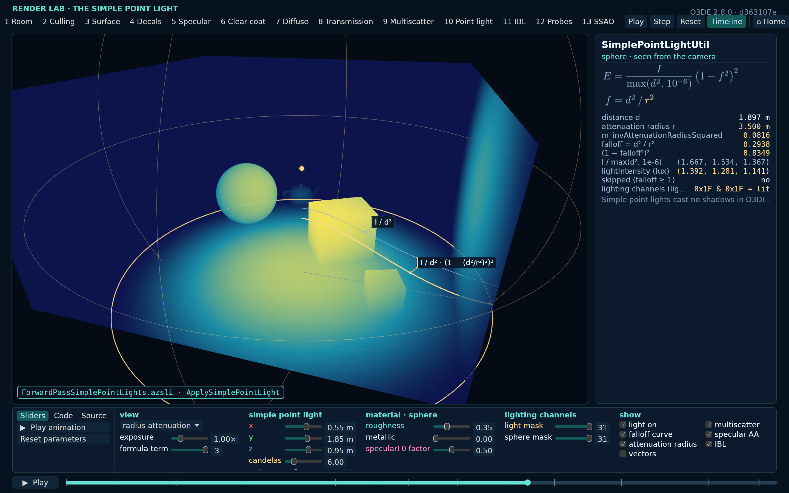
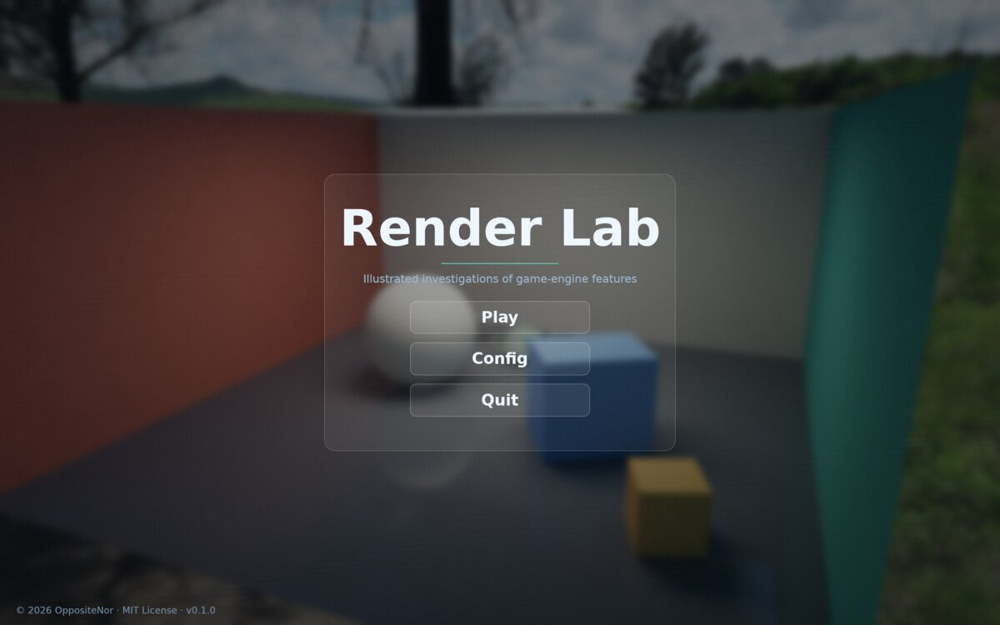
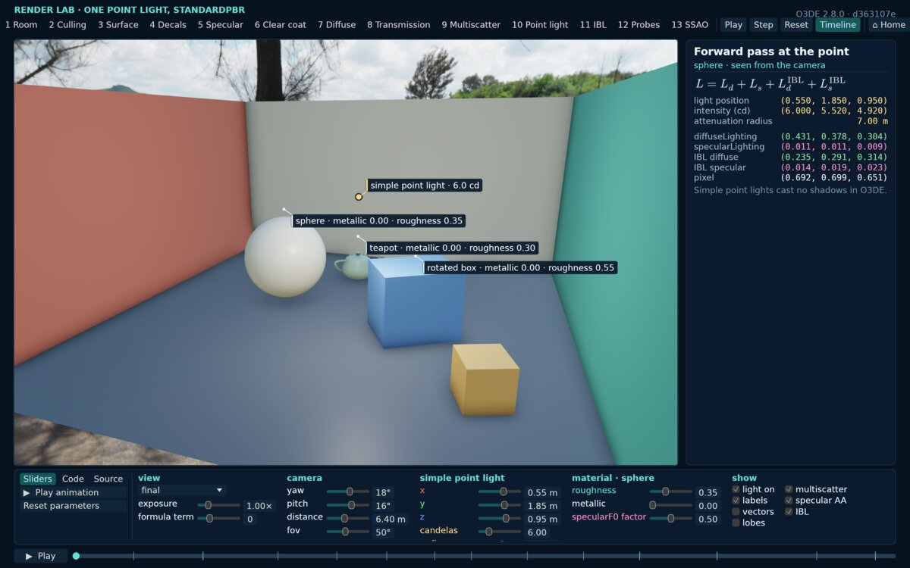
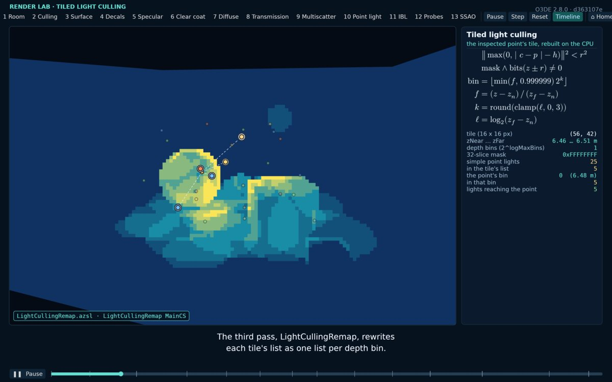
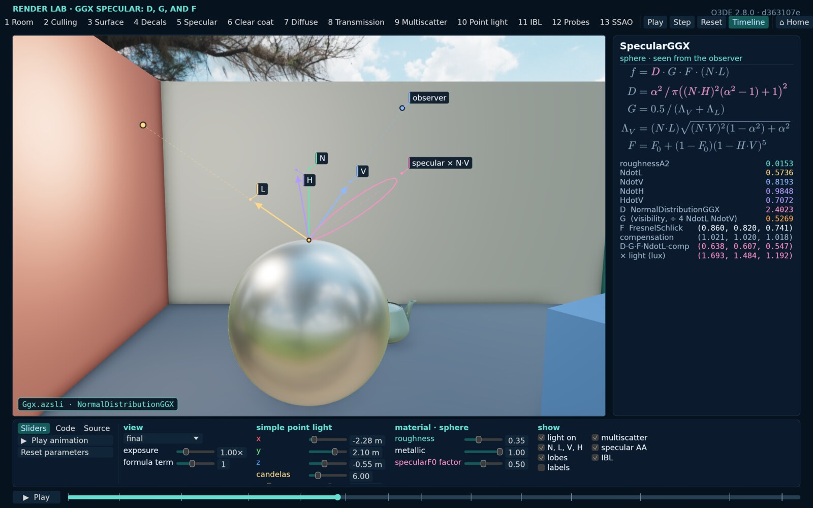

# Render Lab

[English](README.md) | 简体中文

<p align="center">
  
</p>

一个用于渲染演示与实验的实验室，按**游戏引擎功能的研究**（investigation）组织。每项研究在预先准备的数据上重建某个引擎功能的一部分，
并逐步展示其中涉及的数据：既在交互式查看器中，也在实验室逐帧录制的旁白视频中。

它使用 Vulkan 上的 **wgpu 30.0.1**、**winit 0.30.13**、**egui 0.37** 和 **WGSL** 着色器。

<p align="center">
  
  
</p>
<p align="center">
  
  
</p>

## 仓库内容

共享的实验室（主页、设置，以及研究所依赖的代码），以及那些许可证允许发布其衍生代码的引擎的研究：

- **Open 3D Engine：光照模型**（[`packages/o3de_lighting/src/o3de/lighting`](packages/o3de_lighting/src/o3de/lighting/README.md)）。O3DE 26.05 的 Atom 渲染器如何照亮
  一帧，其着色器代码已移植到 WGSL，并按默认管线的方式运行：depth pre-pass、分块光源剔除、太阳的级联阴影及其屏幕空间缓冲、forward pass
  及其五个 target、材质模型与各光照模型的 BRDF、BRDF 纹理与多重散射补偿、基于图像的光照与反射 probe、SSAO、透射，以及地形。
- **Godot Engine：VoxelGI**（[`packages/godot_voxelgi/src/godot/voxelgi`](packages/godot_voxelgi/src/godot/voxelgi/README.md)）。Godot 4.7 的 Forward+
  渲染器如何计算其烘焙体素全局光照，按引擎的默认细分在 CPU 上逐步复现：烘焙的 octree 与距离场、单元格的记录、光照、mip 与反弹 pass、
  动态物体路径，以及移植到 WGSL 的逐像素锥体追踪。

一个本仓库不提供的可选模块可以向 `packages/` 加入它自己的本地包（各有自己的 Cargo 工作区）。没有它时，实验室只包含公开的研究。

不带命令启动时，`render-lab` 先在标题画面背后的场景加载时显示加载页面，然后打开一个类似游戏的**标题画面**，位于磨砂玻璃之后，有**开始**、**设置**和**退出**三个按钮，
右上角是地球图标和当前语言（点击后打开设置页面的语言选项），左下角显示版权、许可证和版本。启动时先以设置的语言显示光敏性癫痫警告，点击**继续**后关闭；
保存的设置改变语言时，会再以新语言显示一次。

- **开始**打开选择页面：已安装研究中的引擎与功能。
- **设置**编辑 `~/.config/render-lab/config.toml`（或 `$XDG_CONFIG_HOME/render-lab/config.toml`）中的设置，每个类别一个标签页：
  - **界面**：**语言**（English 或中文：主页的文字，以及选择页面首先提供的旁白视频版本，某个特性没有这种语言的版本时使用英文版；演示也使用该语言）
    和**主题**，即主页和查看器的配色（见下）。
  - **渲染**：**全屏**。
  - **声音**：**音乐**和**旁白**的音量，每个音量都是一个滑块加一个静音按钮（静音时保留音量）。查看器的面板，以及视频播放时的时间轴，也可以设置旁白的音量；
    查看器关闭时会把它写入文件。

  **保存并应用**会立即应用界面和声音设置并写入文件。渲染设置的更改则先在十秒倒计时内试用：**应用**保留它并写入文件，而**恢复**、Esc
  或等待倒计时结束都会还原之前的设置。点击保存并应用之前不会写入任何内容。没有需要保存的内容时，第一个按钮是**返回**；有修改的标签页带一个圆点，
  与默认值不同的选项会被标记，并带有只恢复该项的**恢复**按钮；**放弃**丢弃修改，**恢复默认**显示默认值。
- **主题**是 TOML 文件，每个主题一个，以文件名（不含扩展名）命名（设置中写作 `theme = "tokyo-night"`）。实验室在运行时从程序旁边的
  `themes/` 读取它们，构建会把自带的主题（来自 [`themes/`](themes)：**One Dark Pro**、**Tokyo Night** 和 **VS Code**）放在那里；
  也从 `~/.config/render-lab/themes/` 读取，其中的文件取代程序旁边的同名文件。主题给出自己的名称并设置界面的每一种颜色；
  [`themes/one-dark-pro.toml`](themes/one-dark-pro.toml) 说明了每个键。实验室自己的配色是内置主题 **Render Lab**，它是默认主题，录制始终使用它，
  因此录制的画面从不依赖设置。
- **F11** 把窗口（主页或查看器）的截图保存到 `build/screenshots/`。

## 命令

在本目录下：

```bash
cargo run --release                                   # 主页
cargo run --release -- --list                         # 已安装的研究（--investigation 可用的取值）
cargo run --release -- home --snapshot home.png       # 离屏渲染标题画面（--page select、config、starting、viewer 或 viewer-timeline 渲染其他页面）
cargo run --release -- home --autotest home.json      # 离屏点击测试主页（使用自己的设置文件）
```

实验室还有 `render`（把时间线录制到 FFmpeg）、`selftest`、`layout` 和 `viewer-autotest`，每个命令都接受
`--investigation ENGINE/FEATURE`（默认：列表中的第一项）：

```bash
cargo run --release -- --investigation o3de/lighting selftest --report o3de.json   # 移植代码对照其 CPU 镜像、画面与源码引用
```

研究的旁白视频由 [`tools/video`](tools/video/README.md) 根据其分镜脚本构建：

```bash
bash tools/video/setup.sh --gpu                                     # 只需一次：在 .cache/ 下安装 Piper、FFmpeg、Node 和 Mermaid
python3 tools/video/build.py --investigation o3de/lighting          # packages/o3de_lighting/build/video/en/o3de-lighting.mp4
python3 tools/video/build.py --investigation o3de/lighting --lang zh-CN
```

屏幕上的文字可以以标签的形式包含公式：在文本表、字幕或读数面板（`Readout::formula`）中写 `{@ formula="\\frac{1}{1+n}"}`。
实验室在运行时自行排版这些公式（`lab/src/formula.rs`：MiTeX 把 LaTeX 转换为 Typst 数学公式，再由 Typst 排版），因此不需要 Node，
也不需要提交图片；`render-lab formulas --check FILE…` 按实验室的限制检查文件中的公式。分镜脚本使用同样的标签，镜头提示按旁白的词语计时
（见 [`tools/video`](tools/video/README.md#text-driven-shots-tags-in-a-sentence)），时间线关键帧的 `formula` 会在视口中打开公式卡片。

## 整体结构

| 路径 | 作用 |
|---|---|
| [`src/main.rs`](src/main.rs)、[`lab/`](lab/Cargo.toml)、[`lab/src/cli.rs`](lab/src/cli.rs) | 二进制程序，只负责运行实验室：实验室是一个 Rust dylib，二进制程序和每个包的库都链接它，因此共享同一个实验室（它的代码和状态）。命令行属于实验室。 |
| [`lab/src/home.rs`](lab/src/home.rs)、[`lab/src/frost.rs`](lab/src/frost.rs)、[`packages/rlstd/shaders/frost.wgsl`](packages/rlstd/shaders/frost.wgsl) | 主页：标题、设置和选择页面，背景是标题研究的场景（`investigations::title`，目前为 O3DE 的光照；加载完成前显示加载页面，`home --snapshot --page starting`），经过两次减半、模糊、着色并加上颗粒。 |
| [`lab/src/config.rs`](lab/src/config.rs)、[`lab/src/volume.rs`](lab/src/volume.rs) | 设置文件：它的位置、读取（使用 `toml_edit`）和写入；声音的音量（音量值和静音开关）及其滑块，用于设置页面和查看器的面板。 |
| [`lab/src/theme.rs`](lab/src/theme.rs)、[`lab/src/palette.rs`](lab/src/palette.rs)、[`themes/`](themes) | 主题：查找并读取主题文件（构建会把 `themes/` 复制到程序旁边），以及正在使用的界面颜色（`palette::theme()`、`palette::text()` 等），设置主题之前是实验室自己的配色；叠加图形的颜色保持不变。 |
| [`packages/rlstd/src/`](packages/rlstd/src/mod.rs) | 标准包的代码，编入实验室，即 `lab::utility`：各项研究共用、不必各自编写的部分，包括画中图及故事按键显示的图像（`inset`）、自检的报告、单帧与测试输入（`selftest`）、包的源码索引及其引用行与源码检出的核对（`sources`）、文本表（`text_table!`），以及演示“播放”动画的采样（`demo`）。 |
| [`lab/src/text.rs`](lab/src/text.rs)、[`lab/src/readback.rs`](lab/src/readback.rs)、[`lab/src/gpu.rs`](lab/src/gpu.rs) | 字体与文字、回读画面并保存为 PNG，以及 GPU 设备。文本表、伪代码清单和源码索引都是各层包中的资源，首次使用时读取（`i18n::Table`）。 |
| [`lab/src/formula.rs`](lab/src/formula.rs)、[`lab/src/rich_text.rs`](lab/src/rich_text.rs)、[`packages/rlstd/assets/mitex/`](packages/rlstd/assets/mitex) | 公式：LaTeX 由 Typst（通过 MiTeX 的 scope）排版为绘制时着色的覆盖遮罩，以及把带公式标签的文字排在同一条基线上。 |
| [`lab/src/scene.rs`](lab/src/scene.rs)、[`packages/rlstd/scenes/`](packages/rlstd/scenes/study-room.toml)、[`lab/src/terrain.rs`](lab/src/terrain.rs) | 实验室的场景，按 `SceneId` 区分：书房，以及天空下的丘陵地形。每个场景是一个数据文件，即资源 `scene/<key>`（其物体、形状、材质、光源、光照常数、相机从何处观看，以及地形的高度场），在首次构建场景时读取。每个演示显示其中一个（`Investigation::demo_scene`，默认为书房）；渲染器在某帧首次需要时准备场景，并保留它以便切换回来；当一项研究的演示使用多个场景时，查看器为每个场景显示一个标签页，旁边是该场景的演示。地形是网格上的高度场（`SHAPE_TERRAIN`），绘制为三角形，并在 GPU（`intersectTerrain`）和 CPU（`Terrain::intersect`）上逐格追踪；其高度来自给定的采样，或者（可选）固定种子的分形 Perlin 噪声。 |
| `lab/src/*.rs`（其余文件） | 场景渲染器、确定性录制器、查看器及其停靠面板、时间线播放器及其动画（`animation.rs`：缓动、路径、环绕、波动和 Play 片段）、故事在包代码中运行的动作（`actions.rs`，用 `#[lab::actions]` 声明）、包的着色器定义、由故事创建实例的 GPU 图像种类（`views.rs`；种类可用 `reads=` 读取包的 pass chain target）、结构体面板的记录（`layout.rs`、`packages/rlstd/shaders/types.wgsl`），以及 `Investigation` trait（`investigation.rs`）。 |
| [`lab/src/investigations.rs`](lab/src/investigations.rs)、[`lab/src/plugin.rs`](lab/src/plugin.rs) | 研究来自各个包的库。带代码的包写明它的 `library`（一个 cdylib）和 `negotiate` 符号；加载器在运行时打开这个库，用一个 C 结构体（加载器的接口版本、它的实验室构建，以及一个映射表）调用该函数。这个函数由 `lab::negotiate!` 生成，它把这些信息与自己编译时所用的实验室比对，再按名称把包的方法句柄（`investigations`）登记到映射表中，就像 Vulkan 加载器与层的协商。针对另一个实验室构建的库会被拒绝，不会被调用。 |
| [`tools/video/`](tools/video/README.md) | 旁白视频构建器：旁白、时间线、渲染、封装、字幕、文档和验证。 |
| [`lab/build.rs`](lab/build.rs)、[`lab/check/`](lab/check/src/lib.rs) | 每个包的构建检查它自己的着色器（用 naga）和文本表（实验室的构建检查 rlstd）；实验室的构建还为协商计算实验室构建的指纹。它们不生成任何文件。 |
| [`lab/src/packages.rs`](lab/src/packages.rs)、[`packages/`](packages) | 包：实验室的内容以 `packages/` 中的文件夹提供，每个文件夹有一个 `manifest.toml`（名称、作者、联系方式、许可证、它 `import` 的包、它 `export` 的键、带代码时它的 `library` 和 `negotiate` 符号，以及它 `provides` 的内容：资源集合，和演示——一条旁白时间线及其音频）。实验室在启动时扫描它们，并按导入关系排序。包用键指代自己的资源，用 `<package>.<key>` 指代其他包的资源，且只能是它导入的包所导出的键。[`rlstd`](packages/rlstd/manifest.toml) 包含所有研究共用的内容（天空、茶壶、场景、字体、实验室的 WGSL 和文本）；每个研究有自己的包（`Investigation::package`；[`o3de_lighting`](packages/o3de_lighting/manifest.toml)）。包是自包含的：它的清单、内容、代码（`src/`、`Cargo.toml`）以及它的工具写出的文件（`build/`：时间线、旁白）都在它的文件夹中，也可以在 `lib/` 中附带已构建的库。`render-lab packages` 列出它们，以及它们的库和句柄。 |
| [`lab/src/pipeline/`](lab/src/pipeline/mod.rs)、[`lab/src/resources.rs`](lab/src/resources.rs) | 已构建的包：加载器只读取二进制程序旁边的 `packages/`（`target/release/packages/<name>/`：每个包含清单、资源和库），按完整键（`rlstd.teapot`）读取资源。从源码检出运行时，实验室会先把检出中的包增量构建到那里（[`lab/src/cook.rs`](lab/src/cook.rs)）：每个资源按类型生成（`file` 和 `directory`：链接；`radiance`：把 HDRI 制作成环境光的各级；`mesh`：把 OBJ 制作成 BVH），只有当它的源文件、参数或处理器改变时才重新生成，因此修改在下次启动时生效。不是从该检出构建的已构建包按原样读取。`render-lab cook` 运行构建并报告结果；`render-lab resources` 列出资源。 |
| [`lab/src/shaders.rs`](lab/src/shaders.rs)、[`packages/rlstd/shaders.toml`](packages/rlstd/shaders.toml) | 运行时的 WGSL：包声明的每个 `[[shader]]` 由其 `parts` 依次组成（WGSL 资源或其他 shader；实验室的各 pass 模块以 `rlstd.shader/prelude` 开头），在实验室创建它时组合并由 naga 验证，因此修改后的着色器在下次启动时生效，错误会指出文件和行号。naga 还为结构体面板计算 `wgsl/types` 的布局。 |
| [`lab/src/values.rs`](lab/src/values.rs)、[`lab/src/shader_data.rs`](lab/src/shader_data.rs)、[`lab/derive/`](lab/derive/src/lib.rs) | 按键名访问的值：停靠面板、时间轴和故事文件设置的值，每个都带有类型、默认值、范围、单位、标签、名称、颜色和文字。Rust 结构体用 `#[derive(lab::Values)]` 声明它们（相机的 `camera.yaw`、`camera.x` 等；研究的见 `packages/o3de_lighting/src/o3de/lighting/values.rs`）；着色器在 `///` 注释中用 `{@ key=… default=… range=…}` 标签声明其 uniform 结构体的成员，实验室用 naga 读取它们，并每帧打包进缓冲区（标为 `derived` 的成员由研究填写）。这些声明是模式；镜头按键名以各自的类型存储每个值（`ShotState::values`：`state["key"]`、`p`、`set`、`set_value`，向量的分量用各自的键名），并用 serde 与类型化结构体互相转换（`view`、`store`）。时间轴按数值混合它们，开关和索引按其类型取整；时间轴或故事文件可以把值写成数字、`true`/`false`、向量（`lightPosition=0.4,1.9,0.8`）或选项名，实验室加载时按声明解析。选项值是一个 `#[derive(lab::Choice)]` 枚举，其变体就是选项（`viewMode=ndotl`）：着色器的标签指明它（`choice=ViewMode`），停靠面板列出它的选项，实验室每次加载研究时都会把它的 WGSL 常量写入包中被 git 忽略的 `build/generated/`（着色器组合的一个 `built = true` 资源；构建时的着色器检查在它存在后才检查它）。`render-lab choices` 列出它们。派生的结构体也可以用短键名读写字段（`camera.set_field("yaw", 30.0)`）。`Dock::values`、`Dock::value` 和 `Dock::choice` 根据声明绘制控件；`render-lab values [--label L]` 列出它们。 |
| [`lab/src/demo.rs`](lab/src/demo.rs) | 以数据描述的演示：研究的包声明其参数（上述的值结构体，或 `params.toml`）、演示的顺序，以及每个演示一个文件（标题、标签、提示、场景、清单、相机，以及它改变的参数，可共用预设），实验室据此构建每个演示的初始状态。演示绘制什么、其停靠面板和 Play 动画仍是研究的代码（示例见 `packages/o3de_lighting/demos/`）。 |
| [`lab/src/loading.rs`](lab/src/loading.rs) | 加载步骤：启动时不读取场景所需的任何内容。查看器打开时（或主页显示背景时），工作线程准备场景的资源、静态数据和渲染器，同时窗口显示进度；`home --snapshot --page loading` 在屏幕外绘制该页面。 |

### 添加研究

一项研究是 `packages/<engine>_<feature>/` 中的一个包：它的内容，以及它的代码——一个实现 `Investigation`（`lab/src/investigation.rs`）、并在协商时把它交给实验室的库（参照 [`packages/o3de_lighting/src/lib.rs`](packages/o3de_lighting/src/lib.rs)，并把这个包加入 `Cargo.toml` 的 workspace）。
凡是从引擎源码衍生的内容都放在研究的包里，不要放进共享的实验室；除非引擎的许可证允许，也不要放进仓库的任何公开副本
（允许时在 [`THIRD_PARTY.md`](THIRD_PARTY.md) 中注明出处）。

以自己的方式为场景着色的研究，从 `Investigation::scene_shading` 返回一个 `SceneShading`：拼接在场景模块之后的 WGSL，
包含一个片元入口、每帧 uniform（`FrameContent::shading`）和每帧数据（`FrameContent::shading_frame`）、静态数据，以及供其 selftest
使用的计算内核（`Renderer::run_shading_verify`）。对于通过多个渲染目标渲染的引擎，它也可以是一条 **pass 链**：片元着色器写入着色的
`outputs`（多重采样目标），其 `passes` 作为计算 pass 在固定绑定的具名目标上运行（`ShadingPass`），最后一个 pass 写入 `"hdr"`，
即画面所显示的内容。在研究的包中把它的 WGSL 声明为一个 `[[shader]]`，其 parts 以 `rlstd.shader/scene` 开头，并在 `SceneShading::module` 中写上该 shader；build.rs 会验证它，实验室加载时也会验证。没有结构体面板记录的画面可以在原处显示一个
`Readout`（名称与数值）。

## 构建与本地缓存

- **要求：** Rust 1.88 或更新版本，以及 Vulkan 驱动。着色器是 WGSL，因此不需要着色器 SDK。
- **crate 来源：** 新克隆的仓库用普通的 `cargo build` 即可构建，它会从 crates.io 下载锁定版本的 crate。若要把所有 crate 保存在项目内，
  运行一次 [`setup.sh`](setup.sh)（需要联网）：它把 crate vendor 到 `vendor/` 并写入 `.cache/cargo/config.toml`，这样使用
  `CARGO_HOME=$PWD/.cache/cargo` 的构建（视频工具即如此）会离线读取 `vendor/`。[`.cargo/config.toml`](.cargo/config.toml)
  把构建输出放在 `target/`。
- **字体：** DejaVu Sans 和 DejaVu Sans Mono，以及用于中文的思源黑体（Source Han Sans CN），连同它们的许可证一起放在
  [`packages/rlstd/assets/fonts`](packages/rlstd/assets/fonts)。
- **环境光：** 照亮书房并显示在其后的天空是 Poly Haven 的 "Tree Lined Driveway" HDRI（CC0），位于
  [`packages/rlstd/assets/environments`](packages/rlstd/assets/environments)；资源管线裁剪其中的太阳并缩放亮度（[`packages/rlstd/resources.toml`](packages/rlstd/resources.toml)），
  各研究自行设定其强度。
- **资源：** 实验室加载的文件（环境光、茶壶、字体、MiTeX 的 scope）由 [`rlstd`](packages/rlstd/manifest.toml) 包声明，
  在运行时首次需要时处理（格式见 `lab/src/packages.rs` 和 `lab/src/pipeline/mod.rs`）。研究在自己的包中声明自己的资源，用
  `Investigation::package` 指明它，并通过 `lab::resources` 读取。
- **声音：** 主页显示时播放循环音乐，点击控件时播放点击音效（演示和视频中都没有），通过 FFplay 播放（视频环境中的 FFplay、`FFPLAY`
  或 PATH 中的）；没有 FFplay 时实验室保持静音。[`packages/rlstd/assets/audio`](packages/rlstd/assets/audio) 中的声音由 soundza 授权，不适用 MIT 许可证：
  它们仅供本实验室使用（见 [`THIRD_PARTY.md`](THIRD_PARTY.md)）。

## 许可证

Render Lab 以 [MIT 许可证](LICENSE) 发布，版权所有 © 2026 OppositeNor。随附的字体、茶壶模型、环境光、声音以及 vendor 的 crate
保留各自的条款；见 [`THIRD_PARTY.md`](THIRD_PARTY.md)。
