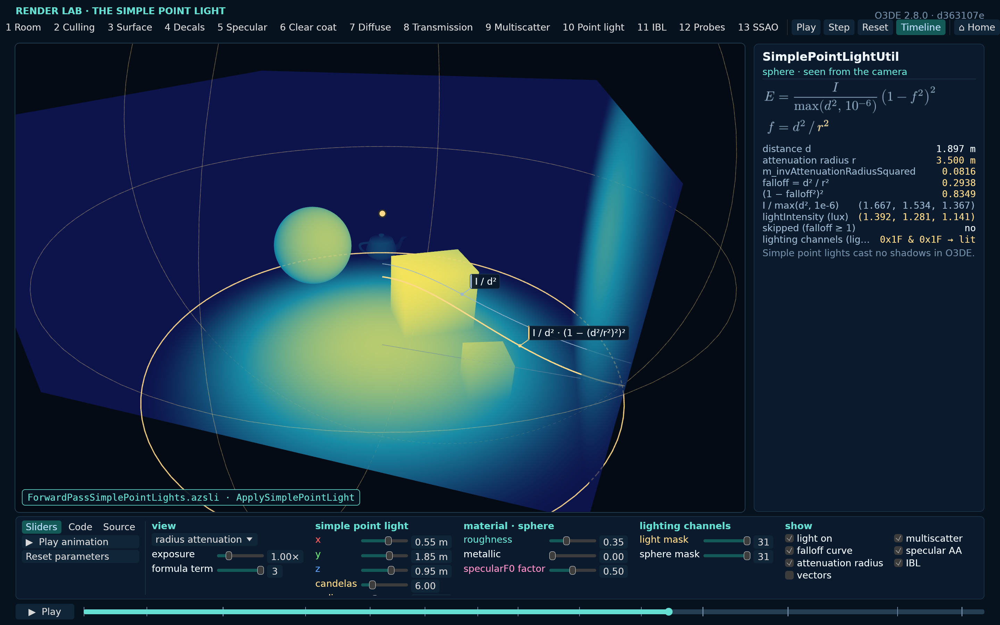
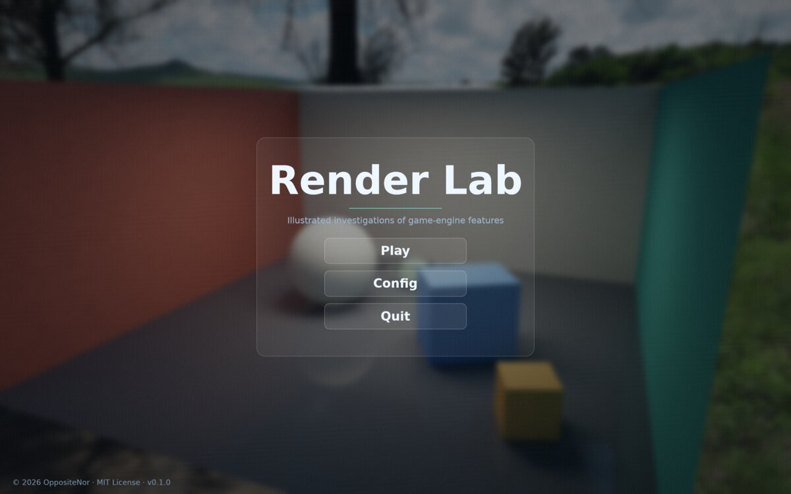
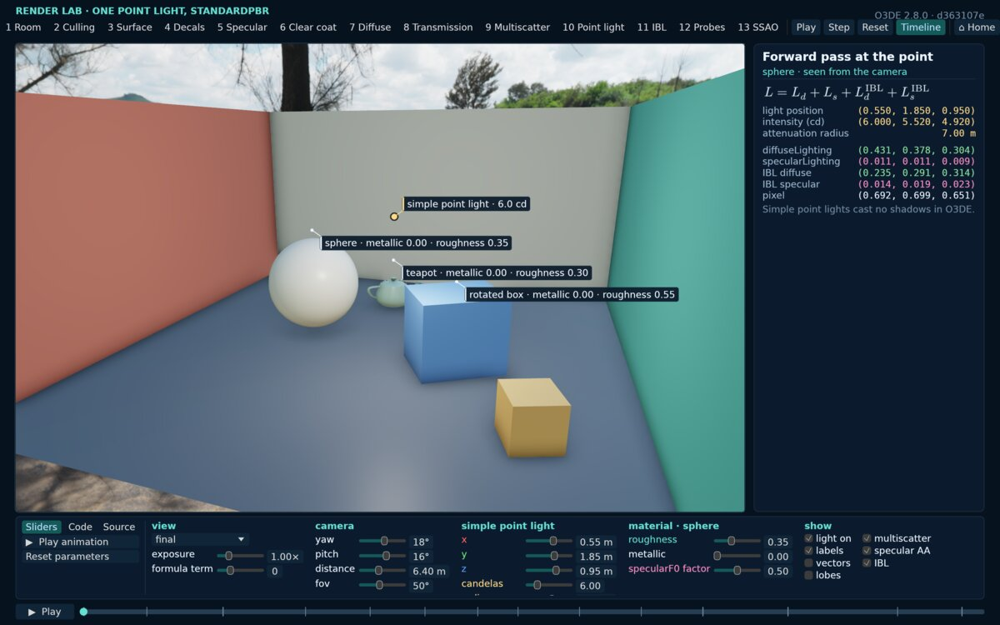
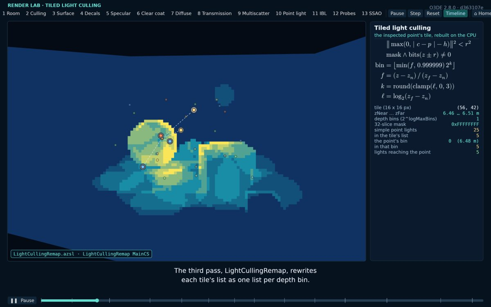
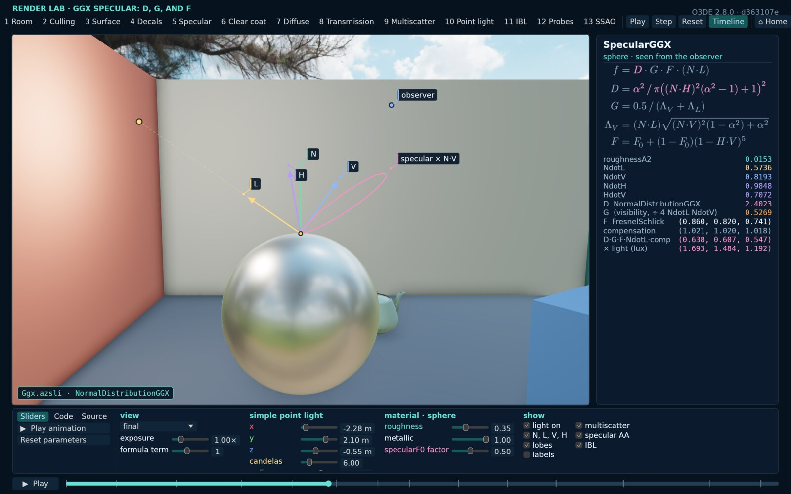

# Render Lab

[](https://github.com/OppositeNor/render-lab/actions/workflows/ci.yml)

[English](README.md) | 简体中文

<p align="center">
  
</p>

一个用于渲染演示与实验的实验室，按**游戏引擎功能的研究**（investigation）组织。每项研究在预先准备的数据上重建某个引擎功能的一部分，
并逐步展示其中涉及的数据：既在交互式查看器中，也在实验室逐帧录制的旁白视频中。

> [!WARNING]
> Render Lab 仍处于非常早期的开发阶段。它的 API 与格式（`Investigation` trait、包清单、故事板与脚本的词汇、命令行）
> 可能会有很大变化，且不会事先通知或提供迁移方式。

它使用 Vulkan（或 wgpu 选用的 Windows 上的 Direct3D 12、macOS 上的 Metal）上的 **wgpu 30.0.1**、**winit 0.30.13**、**egui 0.37** 和 **WGSL** 着色器。

<p align="center">
  
  
</p>
<p align="center">
  
  
</p>

## 仓库内容

共享的实验室（主页、设置，以及研究所依赖的代码），以及那些许可证允许发布其衍生代码的引擎的研究：

- **Open 3D Engine：光照模型**（[`packages/o3de_lighting/src/o3de/lighting`](packages/o3de_lighting/src/o3de/lighting/README.md)）。O3DE 26.05 的 Atom 渲染器如何照亮
  一帧，其着色器代码已移植到 WGSL，并按默认管线的方式运行：depth pre-pass、分块光源剔除、太阳的级联阴影及其屏幕空间缓冲、forward pass
  及其五个 target、材质模型与各光照模型的 BRDF、BRDF 纹理与多重散射补偿、基于图像的光照与反射 probe、SSAO、透射，以及地形。
- **Godot Engine：SDFGI**（[`packages/godot_sdfgi/src/godot/sdfgi`](packages/godot_sdfgi/src/godot/sdfgi/README.md)）。Godot 4.7 的 Forward+
  渲染器如何计算有符号距离场全局光照：级联与滚动、体素化、jump-flood 距离场、遮挡、光照注入与反弹、probe 追踪及其历史、八面体 probe 贴图和屏幕 pass。
- **Godot Engine：屏幕空间反射**（[`packages/godot_ssr/src/godot/ssr`](packages/godot_ssr/src/godot/ssr/README.md)）。Godot 4.7 的 Forward+ 渲染器如何反射屏幕上的内容：
  法线与粗糙度 pre-pass、半分辨率降采样、Hi-Z 金字塔、追踪及其验证、上一帧颜色、粗糙度滤波、双边解析和 opaque pass 的混合。
- **Godot Engine：VoxelGI**（[`packages/godot_voxelgi/src/godot/voxelgi`](packages/godot_voxelgi/src/godot/voxelgi/README.md)）。Godot 4.7 的 Forward+
  渲染器如何计算其烘焙体素全局光照，按引擎的默认细分在 CPU 上逐步复现：烘焙的 octree 与距离场、单元格的记录、光照、mip 与反弹 pass、
  动态物体路径，以及移植到 WGSL 的逐像素锥体追踪。

一个本仓库不提供的可选模块可以向 `packages/` 加入它自己的本地包（各有自己的 Cargo 工作区）。没有它时，实验室只包含公开的研究。

## 快速开始

构建要求、离线缓存和验证命令见 [BUILD.md（中文版）](BUILD.zh-CN.md)。在仓库根目录运行：

```bash
cargo build --release --locked
cargo run --release -- --list
cargo run --release
```

主页的**开始**打开已安装的研究，**设置**调整语言、主题、音量和显示选项。详细操作见[使用 Render Lab](docs/usage.zh-CN.md)。

## 与 AI 智能体协作

仓库包含为 AI 编程智能体编写的技能（skills），位于 [`.agents/skills/`](.agents/skills)（Agent Skills 布局，Claude Code
通过 `.claude/skills/` 中的链接使用），所有智能体遵循的规则见 [`AGENTS.md`](AGENTS.md)。每个技能指导一类任务：
`new-investigation`、`new-story`（及 `new-story-engine` 和 `new-story-paper`）、`storytelling`、`packages`、`render-graph`、`knowledge-graph`、`experiments` 和 `render-lab-lamlet`。

开始一项新研究时，可以这样告诉智能体：

```text
Please investigate on <investigation-topic>, for <engine-name>. The source of the engine is at <engine-source-path>.
Please utilize <source-index-utility-name> for indexing code.   (optional)
```

智能体会加载 `new-investigation`（制作讲解视频时还有 `new-story`）并按其流程进行：研究引擎源码、创建包并将着色器移植到
WGSL、审查和验证。只有许可证允许发布衍生代码的引擎才能放入公开仓库，详见 `AGENTS.md`。

研究一篇论文时：

```text
Please investigate on <paper-title>. The paper is at <pdf-path>. Its source code is at <code-path>.   (optional)
```

智能体会加载 `new-story-paper`、`new-story` 和 `new-investigation`：阅读论文（贡献、相关工作、方法），有作者代码时逐步核对代码与论文，
按论文的描述实现方法，并用六类章节讲述它，从引言到在你的机器上运行的实验和参考文献。

## 文档

| 文档 | 内容 |
|---|---|
| [构建](BUILD.zh-CN.md) | 要求、依赖、本地缓存、验证，以及资源和声音 |
| [使用 Render Lab](docs/usage.zh-CN.md) | 主页、设置、查看器布局、命令和旁白视频入口 |
| [实验与测量](docs/experiments.zh-CN.md) | A/B 对比、质量指标、GPU 耗时、帧图和离屏实验 |
| [前置知识与公式](docs/learning-content.zh-CN.md) | 知识图谱、观众层次和公式标签 |
| [架构与代码导览](docs/architecture.zh-CN.md) | 共享实验室、包、资源、着色器和数值声明 |
| [添加研究](docs/adding-investigations.zh-CN.md) | Investigation 库、协商、着色和 pass 链 |
| [视频构建器](tools/video/README.md) | 分镜、检查、旁白、时间线、字幕和录制 |
| [实验报告](tools/experiments/README.md) | 结果表格、图表和图像网格 |

## 许可证

Render Lab 以 [MIT 许可证](LICENSE) 发布，版权所有 © 2026 OppositeNor 和 Render Lab Contributors。
随附的字体、茶壶模型、环境光、声音以及 vendor 的 crate 保留各自的条款；见 [`THIRD_PARTY.md`](THIRD_PARTY.md)。
