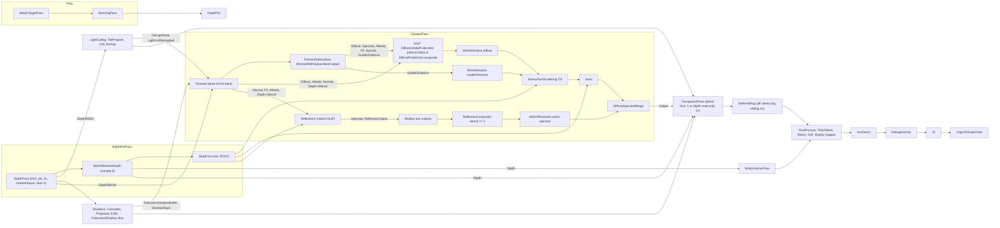
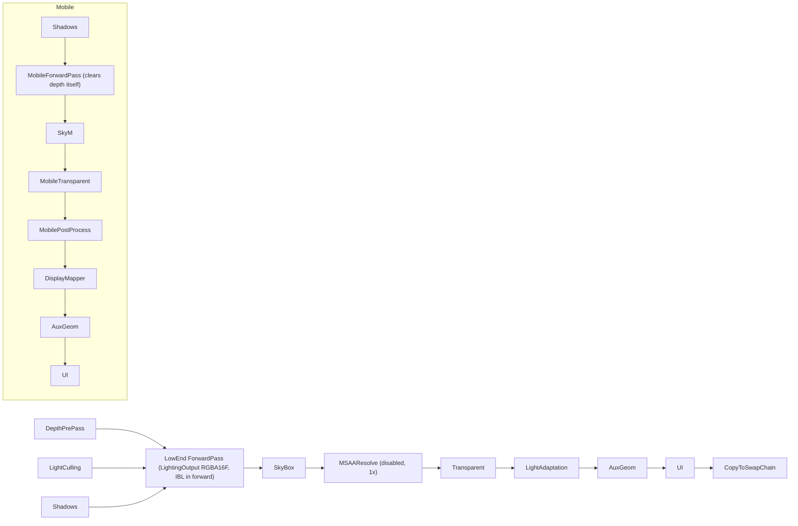

# O3DE lighting: research

O3DE 26.05 (engine.json version 2.6.0, tag 2605.0), commit `3db6943249d8bd7960b9ed7e9aee310b7668586e` (3db69432…), checkout `../../o3de` from the lab root (or `O3DE_SOURCE_DIR`). Everything below was read from that checkout and re-verified against it; nothing was run unless a line says so. "Derived from code, not run" marks a conclusion reached by reading. This file is the story's single source: it merges eight subtopic reports (frame and material pipeline, light culling and light types, material model and BRDF, shadows, indirect lighting, ambient occlusion, light through surfaces, terrain/vegetation/hair). It describes 26.05 only.

Claims are numbered `R<section>.<nn>` and each carries `path:line` and a symbol. Engine quotes are a few tokens at most. Where two reports disagreed, the claim says so and names the better-supported one; the contradictions between reports are collected under "Reconciled contradictions" in section 0, and the bugs, dead code and surprising defaults in section 9.

## Path abbreviations

All checkout paths are relative to the checkout root. Paths starting `lab:` are relative to the Render Lab root (section 10 only).

| Abbr | Path |
|---|---|
| `A:` | `Gems/Atom/Feature/Common/Assets` |
| `AP:` | `A:/Passes` |
| `SL:` | `A:/ShaderLib/Atom/Features` |
| `MP:` | `A:/Materials/Pipelines/MainPipeline` |
| `MT:` | `A:/Materials/Types` |
| `M:` | `A:/Shaders/Materials` |
| `C:` | `Gems/Atom/Feature/Common/Code` |
| `CS:` | `C:/Source` |
| `CL:` | `Gems/AtomLyIntegration/CommonFeatures/Code` |
| `AL:` | `CL:/Source/CoreLights` (light delegates, component controllers) |
| `RPI:` | `Gems/Atom/RPI` (so `RPI:/Assets/ShaderLib/Atom/RPI/Math.azsli`, `RPI:/Code/Source/RPI.Public/...`) |
| `B:` | `Gems/Atom/Bootstrap/Code/Source` |
| `ICP:` | `Gems/Atom/Asset/ImageProcessingAtom` |
| `DPG:` | `Gems/DiffuseProbeGrid` |
| `T:` | `Gems/Terrain` (`TA:` = `T:/Assets/Shaders/Terrain`, `TC:` = `T:/Code/Source/TerrainRenderer`) |
| `H:` | `Gems/AtomTressFX` |
| `Cfg:` | `CL:/Include/AtomLyIntegration/CommonFeatures/CoreLights` (component config headers) |

Other abbreviations: FP = feature processor; DPG = diffuse probe grid; SSS = screen-space subsurface scattering; G-buffer = the forward pass's multi-target output (there is no separate geometry pass).

## 0. The default configuration in one table

What a stock O3DE 26.05 DefaultProject scene runs, on desktop. Each row points to the claim that proves it.

| Item | Default | Claim |
|---|---|---|
| Render pipeline | Windows, Mac, Linux: `passes/MainRenderPipeline.azasset` (forward+ with a thin G-buffer). Android, iOS: Mobile (one-target forward, subpass-merged). XR in a game application: MultiView. LowEnd is chosen by no platform, only by the `r_renderPipelinePath` CVar. Editor viewport: the same MainRenderPipeline. `ToolsPipeline` is the material-editor/thumbnail preview renderer only | R1.01, R1.52 |
| MSAA | 2 samples (`MultisampleState.samples = 2`), `DefaultAAMethod = "MSAA"`; `r_antiAliasing` "" and `r_multiSampleCount` 0 leave it unchanged. TAA/SMAA do not change the sample count | R1.02, R1.04 |
| Depth | D32_FLOAT_S8X24_UINT, reverse-Z (clear 0), `GreaterEqual`; a depth pre-pass runs for opaque materials; MSAA depth resolve takes sample 0 only | R1.07, R1.15 |
| Forward targets (opaque) | 5 multisampled targets: Diffuse RGBA16F, Specular RGBA16F, Albedo RGBA8, F0 RGBA8, Normal RGB10A2 (+ ScatterDistance R11G11B10F for Enhanced/Skin). Opaque forward holds direct light + emissive only; IBL, SSS, AO come in later passes | R1.18, R1.19, R1.22 |
| Default material | StandardPBR (lighting model Standard): base colour white, metallic 0, roughness 1.0, `specularF0.factor` 0.5 (dielectric F0 0.04), specular AA on, IBL on, clear coat off, anisotropy off, SSS off, transmission None, emissive off. Imported meshes get `Materials/Presets/PBR/default_grid.material`; `basic_grey.material` sets base colour 0.18 | R3.05-R3.13, R3.40 |
| Multiscatter compensation | Shader-source default `true`, but every StandardPBR-family material that does not set `specularF0.enableMultiScatterCompensation` overwrites it with `false`: compensation is OFF by default (definite from the load path, not run) | R3.38 |
| Registered material pipelines | Only MainPipeline and LowEndPipeline (engine registry); Mobile and MultiView only in AutomatedTesting's registry | R1.37 |
| Direct light culling | Tiled, 16x16 px tiles, 32 depth slices, 1/2/4/8 bins per tile, 256 entries per tile (<= 248 lights+decals after 7 group markers); `ENABLE_LIGHT_CULLING` 1 | R2.02, R2.17, R2.23 |
| Light types lit by default | Directional, simple point, simple spot, point (sphere), disk, capsule, quad (LTC). Polygon lights contribute nothing under culling (derived from code, not run) | R2.25, R2.38, F17 |
| Directional light defaults | angular diameter 0.5, intensity 4.0 EV100 (= 40 lux), shadows on, `m_angularRadius` has no effect in forward | R2.39, F19 |
| Area light defaults | 100 lumen; auto attenuation radius `sqrt(lumens/0.1)` | R2.40 |
| Shadow filter (directional) | **None**: binary point-sampled compare (not PCF). 4 cascades x 1024, D32_FLOAT, split ratio 0.9 (component) vs 0.8 (feature-processor header), far clip 100, `shadowBias` 0.0015, `normalShadowBias` 2.5, receiver-plane bias on (acts only in PCF paths), cascade blending off, ESM passes off, fullscreen blur on | R4.12, R4.19 |
| Shadows for other lights | Off by default (`m_enableShadow=false`); only spot/disk, sphere (6 faces) and simple spot can cast; 256 max size, bias 0.1, filter None | R4.29 |
| Shadows read by | Opaque, cutout and terrain surfaces read the blurred R8 `FullscreenShadowBuffer`; transparent materials evaluate per pixel; hair evaluates the cascades directly | R4.26, R8.44 |
| Ambient occlusion | `Ssao` (the only AO method; no GTAO) on: strength 1.0, radius 0.05 (fraction of half-res image height), blur on, downsample on; modulates the whole diffuse buffer (direct + IBL diffuse), never specular or emissive | R6.01-R6.05, R6.31 |
| Material AO | `diffuseOcclusion`/`specularOcclusion` factors do nothing without a map (factor is an exponent) | R6.34 |
| Indirect specular | Global IBL cubemap (R9G9B9E5, 6 mips, mip = 5 x roughness) via `ReflectionGlobalFullscreen`; reflection probes only where placed (none in the default level); forward-pass IBL only for transparent, Skin, clear coat, and meshes with "Forward Pass IBL Specular" | R5.01-R5.07 |
| Indirect diffuse | The DiffuseProbeGrid gem is listed in the DefaultProject template, so in a default scene the stock `DiffuseGlobalFullscreenPass` is **disabled** (even with zero probe grids) and `DiffuseCompositePass` applies the global diffuse IBL (honours the IBL flag). Whether the zero-grid irradiance image reads as zero is unverified | R1.24, R5.41, R5.41b |
| SSR | Off (`SSROptions.m_enable=false`); needs the "Specular Reflections" component; half resolution, 96 steps | R5.34 |
| Default level contents | "Atom Default Environment"/"Global Sky": `EditorHDRiSkyboxComponent` (`goegap_4k_skyboxcm.exr`) plus a Global Skylight IBL component (`goegap_4k_iblglobalcm_ibldiffuse.exr` / `_iblspecular.exr`), exposure 0. No reflection probe, no diffuse probe grid, no SSR component, no fog | R5.00 |
| SSS / transmission | Off: `o_enableSubsurfaceScattering` false, `transmissionMode` None, and StandardPBR has neither (only EnhancedPBR, Skin, Eye). `SubsurfaceScatteringPass` runs every frame regardless; non-SSS pixels early-out | R7.01-R7.04, R7.26 |
| Skin / Eye | Skin lighting model: forward-only shader with `FORCE_IBL_IN_FORWARD_PASS 1`, Disney diffuse, dual specular option; Eye = Skin model + its own surface eval | R7.29-R7.36 |
| Deferred rendering | `r_deferredRenderingEnabled` false and the scaffold has no pass, no shader template, no consumer: inert | R1.48-R1.51 |
| Fog, SSR copy pass | `DeferredFogPass` and `ReflectionCopyFrameBufferPass` are `"Enabled": false` in the asset and switched on at run time (fog setting; SSR option) | R1.13 |
| Terrain, Vegetation, hair | Not in the default project (only in AutomatedTesting). Terrain draws through the stock Forward pass; Vegetation has no shaders; hair (AtomTressFX) is its own pass after `OpaquePass` | R8.01, R8.03, R8.35, R8.39 |
| Debug | `ENABLE_SHADER_DEBUGGING` 1 in MainPipeline templates; light-culling heatmap pass disabled and never enabled; no AO or SSS debug view | R1.19, section 2 debug views, R6.40 |

### Reconciled contradictions between the reports

1. **Directional transmission thickness is not metric.** R2 finding 4 and R7 first read `GetThickness` as a distance. R4 (F1) and R7 (round-1 Q1, settled) show `deltaDepth` is normalised to the cascade's own light-axis range but multiplied by the camera depth span `m_far_minus_near`, so it is an arbitrary per-cascade scale, not world units. Better supported: R4/R7 (R4.27, R7.14, F43).
2. **DiffuseProbeGrid disables the stock diffuse IBL pass in a DefaultProject scene.** R1 and R5 trace it to `SetEnabled(false)` at `DPG:/Code/Source/Render/DiffuseProbeGridFeatureProcessor.cpp:922`, independent of grid count. R6's pass-order text treats `DiffuseGlobalFullscreenPass` as running, without the gem caveat. Better supported: R1/R5 (R1.24); the stock pass runs only in projects without the gem.
3. **Decal order (26.05).** `InitializeLightingData` runs before decals and `Surface` is passed by value (R1, R2, R3, R5, R6, R7 agree). R1/R3/R7: the G-buffer albedo/F0/normal are written from the caller's pre-decal surface, so decals do not reach the fullscreen IBL. R5 adds that forward-IBL lookups (`ApplyIBL`) use the decal-modified local copy. All consistent (R1.21).
4. **`FORCE_IBL_IN_FORWARD_PASS` in MainPipeline.** R6 claim 37 says it is defined only in Mobile, MultiView and LowEnd; R1, R3, R5, R7 cite `MP:/ForwardPass_SkinLighting.azsli:23` (also `:17-27`) setting it for Skin. Better supported: R1/R3/R5/R7. So the "AO applied twice to forward IBL diffuse" case (R6.37) also covers Skin, not only transparents.
5. **Emscripten.** R1 claims 44 and finding 13 still list Emscripten for the Mobile pipeline; R1 claim 1 and R5 find no Emscripten trait header in 26.05. Better supported: no Emscripten entry (R1.01).
6. **Do probe render passes read albedo?** R1 (claim 23) says the reflection passes read albedo for specular occlusion; R5 (claim 29, settled by `.pass` slots and `grep`) shows only `ReflectionGlobalFullscreen` gets `AlbedoInput`; the probe Outer/Inner passes have no albedo and apply no specular occlusion. Better supported: R5 (R5.29).
7. **The 0.4 grey.** R1 finding 1 says it reaches the screen only if nothing writes a pixel (about Forward's `SpecularOutput` clear). R5 finding 2 is about the *reflection buffer's* own clear and shows flag-off pixels inside a probe's reduced inner volume keep it and have it added to specular. Different buffers; both stand (R1.18, R5.30, F8, F9).
8. **Where `FinalizeLighting` lives.** R6 cites `SL:/PBR/Lighting/LightingData.azsli:106-120`, R3 the BasePBR copy `M:/BasePBR/BasePBR_LightingData.azsli:86-107`. Both copies exist with identical multiplies; the material pipelines reach the BasePBR one (R3.31).
9. **Line ranges for `DiffuseSpecularMerge.azsl`** are `:37-86` (R1), `:31-70` (R6), `:31-73` (R7); the code is the same, only the quoted span differs (R1.32).
10. **Stencil reference lines.** `CS:/Mesh/MeshFeatureProcessor.cpp:2423-2429` (R1, R3) vs `:2422-2429` (R5): same statement block (R1.36).
11. **Eye direct lighting.** R3 read Eye as Skin's Disney diffuse + GGX + optional dual specular (it uses `Skin_LightingEval`); R7 shows `Eye_Defines.azsli:38` includes `StandardPBR_LightingBrdf`, so direct lighting is Lambertian + one GGX and the dual specular only reaches IBL. Better supported: R7 (R7.34).

## 1. Frame and material pipeline: forward+ with a thin G-buffer

O3DE's Atom renders opaque surfaces in one forward pass that writes lighting and a thin G-buffer, then finishes the picture in fullscreen passes. Alternatives: LowEnd, Mobile and MultiView draw a single colour target; a deferred scaffold exists but has no consumer.

### 1.1 Pipeline selection and MSAA

- **R1.01** `r_renderPipelinePath` defaults to `AZ_TRAIT_BOOTSTRAPSYSTEMCOMPONENT_PIPELINE_NAME`, set per platform (`B:/BootstrapSystemComponent.cpp:130`; trait headers `B:/Platform/*/BootstrapSystemComponent_Traits_Platform.h:9`). Windows, Mac, Linux: `passes/MainRenderPipeline.azasset`. Android, iOS: `passes/mobile/mobilerenderpipeline.azasset` (26.05 has no Emscripten entry: its trait header and platform files are gone). An XR system in a game application switches to `r_default_openxr_pipeline_name` (`passes/MultiViewRenderPipeline.azasset`) with XRLeft/Right pipelines (`BootstrapSystemComponent.cpp:131-133`, `610-657`). LowEndRenderPipeline is chosen by no trait, only by the CVar (e.g. `--r_renderPipelinePath=passes/LowEndRenderPipeline.azasset`, `AutomatedTesting/Gem/PythonTests/Atom/TestSuite_Smoke_GPU.py:41`).
- **R1.02** `AP:/MainRenderPipeline.azasset:5-16`:

  | Setting | Value |
  |---|---|
  | `RootPassTemplate` | `MainPipeline` |
  | `MaterialPipelineTag` | `MainPipeline` |
  | `AllowModification` | true (feature processors may add passes) |
  | `MultisampleState.samples` | 2 |
  | `DefaultAAMethod` | "MSAA" |
- **R1.03** `AP:/Mobile/MobileRenderPipeline.azasset`: samples 1, `AllowSubpassMerging` true, root `MobilePipelineTemplate`, tag `MobilePipeline`. `LowEndRenderPipeline.azasset`: samples 1, root `LowEndPipelineTemplate`, tag `LowEndPipeline`.
- **R1.04** `r_antiAliasing` accepts MSAA, TAA or SMAA (`B:/BootstrapSystemComponent.cpp:140`). `RenderPipeline::SetAAMethod` (`RPI:/Code/Source/RPI.Public/RenderPipeline.cpp:1031-1050`) only enables/disables the SMAA pass (`SMAA1xApplyLinearHDRColorPass`) and the TAA passes (`TaaPass`, `ContrastAdaptiveSharpeningPass`); with "MSAA" both are off. It never changes the sample count, so choosing TAA leaves 2x MSAA on unless `r_multiSampleCount` (default 0 = unchanged; `:141`; power of two, clamped 1..8, `BootstrapSystemComponent.cpp:~99-113`) is set.
- **R1.05** `MSAAResolveFullScreenPass::IsEnabled()` is true only if the pipeline sample count > 1 (`RPI:/Code/Source/RPI.Public/Pass/Specific/MSAAResolveFullScreenPass.cpp:28-40`). Every resolve template has `FallbackConnections` Input->Output, so non-MSAA pipelines alias the textures.

### 1.2 Pass tree (MainPipeline), in child order

`AP:/MainPipeline.pass` lists the children below; within a parent, attachment dependencies decide the real GPU order.

- **R1.06** Morph targets -> Skinning (connected from `MorphTargetDeltaOutput`, a compute stage) -> RayTracingAccelerationStructure.
- **R1.07** **DepthPrePass** (`DepthParentTemplate`, `AP:/DepthParent.pass`), three children.
  - `DepthPass` (`DepthMSAAPassTemplate`, draw list `depth`, `BindViewSrg`): attachment `DepthStencil`, `D32_FLOAT_S8X24_UINT`, size from `PipelineOutput`, multisample from the pipeline (2), cleared (`LoadAction`/`LoadActionStencil` Clear). Struct default clear is depth 0.0, stencil 0 (`Gems/Atom/RHI/Code/Include/Atom/RHI.Reflect/ClearValue.h:41-42`): reverse-Z, far = 0. Exported as pipeline-global `DepthMSAA`.
  - `MSAAResolveDepthPass` writes `Depth` (same format, 1 sample): a fullscreen shader, depth compare Always, writing `SV_Depth` from **sample 0** (`A:/Shaders/PostProcessing/MSAAResolveDepth.azsl:30-45`; R4 quotes `:26-41`, `int sampleIndex = 0`). Not a min or max; stencil is not resolved.
  - `DepthToLinearDepthPass` writes `DepthLinear`, R32_FLOAT: `linear = abs(FarZ*NearZ / ((FarZ-NearZ)*zDepth - FarZ))`, world-unit distance along the view axis (`A:/Shaders/PostProcessing/DepthToLinearDepth.azsl:39-41`; DepthParent.pass:57-115 for the chain and globals Depth/DepthMSAA/DepthLinear).
- **R1.08** **MotionVectorPass** (`MotionVectorParentTemplate`): CameraMotionVector from the resolved `Depth`, then MeshMotionVector.
- **R1.09** **LightCullingPass** (`AP:/LightCullingParent.pass`): transparent min/max depth draw, `LightCullingTilePrepareMSAA`, `LightCulling`, `Remap`; outputs `TileLightData` and `LightListRemapped` (section 2).
- **R1.10** **Shadows** (`ShadowParentTemplate`): Cascades, Projected, CascadesESM, ProjectedESM, FullscreenShadowPass, FullscreenShadowBlur; takes `Depth <- DepthPrePass.DepthMSAA`; the blurred result is pipeline-global `FullscreenShadowBuffer`, read by Forward (section 4).
- **R1.11** **OpaquePass** (`AP:/OpaqueParent.pass`): inputs the shadow maps, tile data, `DepthLinear`, `DepthStencil <- DepthPrePass.DepthMSAA`; its `Output` is `DiffuseSpecularMergePass.Output`. Children in order: `Forward`, `ForwardSubsurface`, `DiffuseGlobalFullscreenPass`; `ReflectionsPass` (Enabled true, `:278`), `SkyBoxPass` (`SkyBoxTwoOutputsTemplate`, `:327`), `ReflectionCompositePass`; `MSAAResolveDiffusePass`, `MSAAResolveSpecularPass`, `MSAAResolveScatterDistancePass`; `SubsurfaceScatteringPass` (compute, `:450`), `Ssao`, `DiffuseSpecularMergePass`.
- **R1.12** **TransparentPass** (`AP:/TransparentParent.pass`) follows OpaquePass: see R1.33-R1.34.
- **R1.13** `DeferredFogPass` has `"Enabled": false` in the asset (`MainPipeline.pass:288`) and `ReflectionCopyFrameBufferPass` is `false` (`:323`). Fog: `IsEnabled()` is false if CVar `r_enableFog` (default true, `C:/Source/ScreenSpace/DeferredFogPass.cpp:33`) is off, otherwise the fog post-process setting's enabled flag (`:203-225`). SSR copy: `SpecularReflectionsFeatureProcessor` calls `pass->SetEnabled(m_ssrOptions.m_enable)` (`C:/Source/SpecularReflections/SpecularReflectionsFeatureProcessor.cpp:108-115`); `m_enable` defaults false (`SpecularReflectionsFeatureProcessorInterface.h:61`); `ReflectionScreenSpacePass::IsEnabled` (`ReflectionScreenSpace/ReflectionScreenSpacePass.cpp:29-60`) also needs that feature processor and waits 10 frames (`FrameDelay`).
- **R1.14** **PostProcessPass** (`PostProcessParentTemplate`) takes `LightingInput <- DeferredFogPass`, `Depth`, `MotionVectors`: TAA/SMAA, bloom, DoF, display mapper; outputs `RawLightingOutput`, `LuminanceMipChainOutput` for the debug overlay. Then AuxGeomPass (draw list `auxgeom`), DebugOverlayPass, UIPass, `CopyToSwapChain` into `PipelineOutput`.

### 1.3 Depth pre-pass and forward depth/stencil state

- **R1.15** The pre-pass shader (`A:/Materials/Pipelines/Common/DepthPass.shader.template`) has depth Enable, `GreaterEqual`, default write, no stencil, vertex entry only. Its azsli (`Common/DepthPass.azsli:8-30`) defines `MATERIALPIPELINE_SHADER_HAS_PIXEL_STAGE 0`, includes the same `ForwardPassVertexData.azsli` as forward and runs the same `EvaluateVertexGeometry`. It runs only where `enableDepthPass = not isTransparent and not isTintedTransparent` (`A:/Materials/Pipelines/Common/ShaderEnable.lua:61-80`); materials with per-pixel depth or clip use the `depth_customZ` variant.
- **R1.16** Forward depth/stencil state (all `ForwardPass_*.shader.template`, plus LowEnd/Mobile copies): depth Enable, `GreaterEqual`, write on; stencil Enable, ReadMask 0x00, WriteMask 0xFF, Func Always, PassOp **Replace** (reference from the draw packet, R1.36). Forward's `DepthStencilInputOutput` is connected straight to `DepthMSAA` with no `LoadStoreAction`: it loads the pre-pass depth and its zero stencil.
- **R1.17** The forward pixel shader is `[earlydepthstencil]` unless `OUTPUT_DEPTH` (`MP:/ForwardPassVertexAndPixel.azsli:42-44`); `OUTPUT_DEPTH` is 0 in Base/Standard/Enhanced/Skin and 1 in `_CustomZ` variants. Opaque overdraw is avoided by pre-pass depth + `GreaterEqual` (accepts equal) + early-Z. Position invariance: both shaders declare `precise linear centroid float4 position : SV_Position` in the shared `SL:/Pipeline/Forward/ForwardPassVertexData.azsli:144` (guarded by `MATERIAL_USES_VERTEX_POSITION`) and call the same material `EvaluateVertexGeometry`; `precise` also on `SV_Depth` in `DepthPass_CustomZ.azsli:43`. This supports, but does not guarantee, equal depths across pipeline states. `_CustomZ` variants (parallax depth or alpha clip) write `SV_Depth = IN.position.z` with early-Z off and can overdraw.

### 1.4 The forward pass and its targets

- **R1.18** `ForwardPassTemplate` (`AP:/Forward.pass`, draw list `forward`); `ForwardSubsurface` (`AP:/ForwardSubsurface.pass`, draw list `forwardWithSubsurfaceOutput`, its own pass that re-declares the slots as `InputOutput`). Sizes from `PipelineOutput`; sample count from `DepthStencilInputOutput` (2).

  | Slot | Format | Clear (LoadAction Clear) |
  |---|---|---|
  | `DiffuseOutput` (SV_Target0) | R16G16B16A16_FLOAT | (0,0,0,0) |
  | `SpecularOutput` (SV_Target1) | R16G16B16A16_FLOAT | **(0.4,0.4,0.4,0)** (`Forward.pass:~107-111`) |
  | `AlbedoOutput` (SV_Target2) | R8G8B8A8_UNORM | (0,0,0,0) |
  | `SpecularF0Output` (SV_Target3) | R8G8B8A8_UNORM | (0,0,0,0) |
  | `NormalOutput` (SV_Target4) | R10G10B10A2_UNORM | (0,0,0,0) |
  | ForwardSubsurface `ScatterDistanceOutput` (SV_Target5) | R11G11B10_FLOAT | (0,0,0,0) |

  `Forward` clears the first five; `ForwardSubsurface` loads them and clears only `ScatterDistanceOutput`. The 0.4 specular clear is a background grey the sky overwrites on every stencil-0 pixel (F9).
- **R1.19** Pixel shader `MP:/ForwardPassVertexAndPixel.azsli:46-143`, struct `SL:/Pipeline/Forward/ForwardPassOutput.azsli:36-51`:
  - **Target0 `m_diffuseColor`**: `.rgb = lightingData.diffuseLighting` (`:69`; direct light only for opaque pixels, R1.22); `.a = -1` (`:70`, "no SSS"); with `OUTPUT_SUBSURFACE` and `o_enableSubsurfaceScattering` (`:104-111`) `.a = GetSubsurfaceScatteringFactorAndQuality` (`:29-36`) = `dot(round(float2(saturate(factor), quality) * 255), float2(256, 1))`, an integer 0..65535 in an fp16 channel (R7.24). The `* (o_enableSubsurfaceScattering ? 1:-1)` negative branch is unreachable.
  - **Target1 `m_specularColor`**: `.rgb = specularLighting[0]` (direct specular already times `specularOcclusion`), then `+= emissiveLighting` (`:101`, "historical reasons"): emissive lives in the **specular** target; `.a = 1.0`.
  - **Target2 `m_albedo`**: `.rgb = surface.albedo * lightingData.diffuseResponse * lightingData.diffuseAmbientOcclusion` (`:84`: albedo pre-multiplied so a later pass multiplies only by irradiance); `.a = lightingData.specularOcclusion` (`:85`).
  - **Target3 `m_specularF0`**: `.rgb = surface.GetSpecularF0()`, `.a = surface.roughnessLinear` (`:79-80`); 8 bits each.
  - **Target4 `m_normal`**: `.rgb = EncodeNormalSignedOctahedron(surface.GetDefaultNormal())` (`:89`); `.a = EncodeUnorm2BitFlags(applyIblInFullscreenPasses, o_specularF0_enableMultiScatterCompensation)` (`:93-98`); `applyIblInFullscreenPasses = o_enableIBL`, forced false when `FORCE_IBL_IN_FORWARD_PASS`.
  - **Target5 `m_scatterDistance`** (only `OUTPUT_SUBSURFACE`): `surface.scatterDistance`, else 0. **`SV_Depth`** (only `OUTPUT_DEPTH`): `IN.position.z`.
  - `DebugModifyOutput` (`SL:/Debug.azsli:125-154`) can overwrite specular with Normal, Tangent, Bitangent, BaseColor, Albedo, Roughness or Metallic and zero diffuse/albedo/F0; active only with `ENABLE_SHADER_DEBUGGING` (1 in MainPipeline templates, 0 in Mobile) and `SceneSrg::m_debuggingEnabled`.
- **R1.20** Encodings (`RPI:/Assets/ShaderLib/Atom/RPI/Math.azsli`). Signed octahedron (`:235-253`): encode `n /= |x|+|y|+|z|; y' = n.y*0.5+0.5; x' = n.x*0.5 + y'; y'' = n.x*-0.5 + y'; z = saturate(n.z * FLOAT_32_MAX)` (z keeps only its sign); decode `x = e.x-e.y; y = e.x+e.y-1; z = (e.z*2-1) * (1-|x|-|y|)`, normalise; stored 10/10/10 bits so z is effectively 1 bit. 2-bit flags (`:287-290`): `EncodeUnorm2BitFlags(f1, f2) = (f1 + 2*f2)/3`, levels 0, 1/3, 2/3, 1, tolerance `UNORM_2BIT_EPSILON = 10e-3`; flag1 = "IBL applied in fullscreen passes", flag2 = "multiscatter compensation". A cleared background pixel decodes to normal (0,-1,0) with both flags false.
- **R1.21** What forward completes. `EvaluateLighting_ForwardPass` (`SL:/Pipeline/Forward/ForwardPassEvaluateLighting.azsli:20-45`), in order: `InitializeLightingData`, light tile iterator (or `InitNoCulling` when `ENABLE_LIGHT_CULLING` is 0), `ApplyDecals_ForwardPass`, `ApplyDirectLighting_ForwardPass`, `ApplyIbl_ForwardPass`, `FinalizeLightingData`. In 26.05 the `Surface` parameter is **by value** and `InitializeLightingData` runs first; `ForwardPassDecals.azsli:32-40` loops `decalIndex` 0..`min(ENABLE_DECALS_CAP, m_visibleDecalCount)` calling `ApplyDecal(decalIndex, surface)`. Consequences (R1, R3, R7; derived from code, not run): decal changes to `surface.albedo`/`surface.normal` live only in the local copy, so they reach direct lighting and forward IBL but not the G-buffer (`m_albedo`, `m_normal`, `m_specularF0` are written from the caller's unmodified `surface`, `ForwardPassVertexAndPixel.azsli:79-89`) and therefore not the fullscreen IBL; NdotV, BRDF lookup, `diffuseResponse`, multiscatter are computed from the pre-decal surface (R3.04, R5.10).
- **R1.22** IBL split, `ApplyIbl_ForwardPass` (`SL:/Pipeline/Forward/ForwardPassIbl.azsli:24-41`): with `FORCE_IBL_IN_FORWARD_PASS` both diffuse and specular IBL run in forward; otherwise (opaque, `FORCE_OPAQUE` 1) `useDiffuseIbl = false`, `useSpecularIbl = o_meshUseForwardPassIBLSpecular || o_materialUseForwardPassIBLSpecular`; Blended and TintedTransparent (`FORCE_OPAQUE` 0) get both. So for standard opaque pixels the forward target holds **direct light + emissive only**; deferred to later passes: diffuse IBL (`DiffuseGlobalFullscreenPass` or its DPG replacement), specular IBL, probes and SSR (`ReflectionsPass`), SSS (`SubsurfaceScatteringPass`), AO (`Ssao`).
- **R1.23** **DiffuseGlobalFullscreenPass** (`AP:/DiffuseGlobalFullscreen.pass`, `A:/Shaders/DiffuseGlobalIllumination/DiffuseGlobalFullscreen.{shader,azsl}`): fullscreen triangle per sample (`SV_SampleIndex`) reading MSAA albedo, normal and depth, plus the stencil attachment. Stencil Enable, ReadMask 0x80, `Func Equal`, `StencilRef 128`; depth off. Blend colour `One + One`, alpha `Zero` source/`One` dest (alpha preserved). Adds `albedo.rgb * diffuseEnvMap(MultiplyVectorQuaternion(normal, m_iblOrientation)) * 2^m_iblExposure`. It never reads the normal flags, and computes a world position, `dirToCamera` and `NdotV` it never uses (F10).
- **R1.24** **Which diffuse IBL pass runs in a DefaultProject scene (definite from code).** `DiffuseProbeGridSystemComponent::Activate` registers its feature processor whenever the gem is enabled (`DPG:/Code/Source/Components/DiffuseProbeGridSystemComponent.cpp:80`); the DefaultProject template enables it (`Templates/DefaultProject/Template/project.json:27`). The default scene calls `atomScene->EnableAllFeatureProcessors()` (`B:/BootstrapSystemComponent.cpp:577-578`) -> `FeatureProcessorFactory::EnableAllForScene` (`RPI:/Code/Source/RPI.Public/FeatureProcessorFactory.cpp:111-136`, loop at `:122`). `Scene` calls `fp->AddRenderPasses(pipeline)` once per pipeline with `AllowModification` (`RPI:/Code/Source/RPI.Public/Scene.cpp:332-340`). `DiffuseProbeGridFeatureProcessor::AddRenderPasses` (`DPG:/Code/Source/Render/DiffuseProbeGridFeatureProcessor.cpp:890-935`) returns early only if the pipeline lacks `DiffuseGlobalFullscreenPass`; otherwise, if `DiffuseProbeGridUpdatePass` is absent (true for MainPipeline), it adds the probe-grid passes and calls `diffuseGlobalFullscreenPass->SetEnabled(false)` (`:922`). **No grid count is consulted**, so this happens with zero grids. Result: the stock pass is disabled and `DiffuseGlobalIlluminationPass` (inserted after `ForwardSubsurface`, same inputs) does the diffuse IBL through its `DiffuseCompositePass`, which honours flag1 (`DPG:/Assets/Shaders/DiffuseGlobalIllumination/DiffuseComposite.azsl:~140-160`, stencil 0x80 Equal): `(albedo/PI) * probeIrradiance * weight` if weight > 0, and global IBL `albedo * globalIrr * 2^iblExposure * (1 - weight)` only `if (probeIrradianceBlendWeight < 1 && enableIBL)`. `DiffuseProbeGridRenderPass::IsEnabled` is false with no grids (`DiffuseProbeGridRenderPass.cpp:53-70`) but nothing gates the composite pass (R5.41-R5.41b). Without the gem the stock pass runs. (R6 reads the stock pass as running; R1/R5 are better supported, Reconciled contradiction 2.)
- **R1.25** **ReflectionsPass** (`AP:/Reflections.pass`) children, all stencil-gated: `ReflectionProbeStencilPass`, `ReflectionProbeBlendWeightPass` (R16_FLOAT), `ReflectionGlobalFullscreenPass` (StencilRef 3), `ReflectionProbeRenderOuterPass`, `ReflectionProbeRenderInnerPass`, `ReflectionScreenSpacePass` (Enabled false in the asset). Only the global pass reads albedo (for specular occlusion in `.a`) (R5.29). `A:/Shaders/Reflections/ReflectionGlobalFullscreen.azsl:75-125` and `ReflectionProbeRenderCommon.azsli:28` return 0 if flag1 is clear; the shader then computes `specular = blendWeight * globalEnvSpec(roughnessMip) * multiScatterCompensation * (F0*brdf.x + brdf.y)`, `*= 2^iblExposure`, `*= specularOcclusion` (`albedo.a`). `ReflectionImage` is RGBA16F; output is a separate `ReflectionOutput`. Details: section 5.
- **R1.26** **SkyBoxPass**: `SkyBox_TwoOutputs.shader` (SkyBox.azsl with `SKYBOX_TWO_OUTPUTS=1`) writes the sky colour to both `SpecularInputOutput` and `ReflectionOutput` (`A:/Shaders/SkyBox/SkyBox.azsl:111-117, 202-206`); depth `GreaterEqual`. Because ReflectionComposite runs only where stencil >= 1, the sky is not added twice.
- **R1.27** **ReflectionCompositePass** (`A:/Shaders/Reflections/ReflectionComposite.{shader,azsl}`): stencil ReadMask 0x3F, `Func LessEqual`, `StencilRef 1` (stencil >= 1; `OpaqueParent.pass:383`); blend `One + One`; box-filters the MSAA reflection samples into every covered sample; outputs 0 if specular or indirect lighting is debug-disabled.
- **R1.28** **MSAAResolveDiffusePass / MSAAResolveScatterDistancePass** use `MSAAResolveColorTemplate`: a hardware resolve (`ScopeAttachmentUsage Resolve`), input loaded and stored DontCare. The diffuse alpha (packed SSS factor) is therefore **averaged** across samples, mixing -1 with positive packed values at SSS edges and possibly decoding wrongly (derived, not run).
- **R1.29** **SubsurfaceScatteringPass** (compute, fullscreen dispatch): inputs resolved diffuse, resolved scatter distance, linear depth; outputs `float4(rgb, 0)` for pixels with factor below epsilon or `w < 0` and `float4(outColor, 1.0)` for convolved pixels (the alpha 1 later triggers the 2x2 filter in the merge pass). In 26.05 the thread-group barrier sits **after** the early `return` (`ScreenSpaceSubsurfaceScatteringCS.azsl:~205-215`): a divergent barrier, undefined on some GPUs (F5). Details: section 7.
- **R1.30** **MSAAResolveSpecularPass** (`MSAAResolveCustomTemplate`, `OpaqueParent.pass:401-433`) uses `MSAAResolveCustom.shader`, `enableNeighborClamping = 1`, `maxNeighborContrast = 1.5` (template defaults 0 and 2.0). Per sample (`A:/Shaders/PostProcessing/MSAAResolveCustom.azsl:90-165`): `color *= min(1, maxNeighborContrast * brightestNeighborLuminance / sampleLuminance)` (brightest = max luminance over the four diagonal neighbours (+-1,+-1) across all samples; weights 0.299, 0.587, 0.114; `CLAMPING_STRATEGY = CLAMP_NEIGHBOR_MAX_LUMINANCE`), then `log(color)` per channel (`TONEMAPPING_STRATEGY = LOG`), averaged, then `exp`; alpha 1. A log average is a geometric mean: a sample with a zero channel zeroes that channel. The Reinhard+gamma 2.2 helpers are compiled out. Albedo, F0 and Normal are never resolved; fullscreen passes consume them as `Texture2DMS`.
- **R1.31** **Ssao** (`SsaoParentTemplate`, `AP:/SsaoParent.pass`; `OpaqueParent.pass:484-485`): in 26.05 there is no `AoParent` or GTAO; `DiffuseSpecularMergePass.InputDiffuse` reads `Ssao.Output` (`:510`); its `Modulate` input is the SSS output (section 6).
- **R1.32** **DiffuseSpecularMergePass** (`A:/Shaders/PostProcessing/DiffuseSpecularMerge.azsl:31-86`; spans differ by report): if `diffuse.w > 0` (SSS pixel) diffuse becomes a 2x2 filter of itself, the pixel above, left and upper-left (0.25 each; a neighbour counts only if its rgb sum > 0); output `float4(diffuse.rgb, 1.0) + specular` (alpha = 1 + `specular.a`). Format/size from `InputDiffuse`, linear sampler, no depth.
- **R1.33** **TransparentPass** (`AP:/TransparentParent.pass`; draw list `transparent`, `DrawListSortType KeyThenReverseDepth`, `PassSrgShaderAsset ForwardPassSrg.shader`): target `InputOutput <- OpaquePass.Output` (the resolved, single-sample merge output); depth `DepthStencil <- DepthPrePass.Depth` (1 sample), so transparent geometry is **not multisampled**; also reads `InputLinearDepth`; same shadow, tile-light and BRDF inputs as Forward. Sorted by `m_sortKey` then view depth back-to-front.
- **R1.34** Transparent shaders (`MP:/Transparent_*.shader.template`, `Common/TransparentPassVertexAndPixel.azsli`): depth `GreaterEqual`, write off (`"writeMask": "Zero"`); stencil Replace, WriteMask 0xFF; blend `BlendSource One`, `BlendDest AlphaSourceInverse`, Add. Pixel shader (`:46-100`): `OUT.m_color1.rgb = diffuse*alpha + emissive + specular`; specular `lerp(spec, spec*alpha, opacityAffectsSpecularFactor)`; alpha `lerp(FresnelSchlickWithRoughness(NdotV, alpha, roughness).x, alpha, opacityAffectsSpecularFactor)`. TintedTransparent uses dual-source blending (`BlendDest ColorSource1`): `m_color2 = (baseColor * (1-alpha), 0)`, `m_color1.a = 0`. With `FORCE_OPAQUE 0`, `ApplyIbl_ForwardPass` runs with `isTransparent` true: **both diffuse and specular IBL run in the forward shader**; no fullscreen IBL for transparents.

### 1.5 Stencil bits

- **R1.35** `C:/Include/Atom/Feature/RenderCommon.h:15-60`: `None` 0x00; `UseIBLSpecularPass` 0x3 (two bits so the probe stencil pass can use `Less` with DecrSat for nested volumes); `BlockSilhouettes` 0x40; `UseDiffuseGIPass` 0x80 (must match the 0x80 read masks). Reflection passes read and write only 0x3F, preserving 0x40 and 0x80.
- **R1.36** `CS:/Mesh/MeshFeatureProcessor.cpp:2423-2429` (`:2422` in R5) builds the reference per draw packet: `stencilRef = (m_descriptor.m_useForwardPassIblSpecular || materialRequiresForwardPassIblSpecular) ? None : UseIBLSpecularPass`; `|= UseDiffuseGIPass` (always); `|= BlockSilhouettes` if material property `block_silhouette`; `drawPacket.SetStencilRef(stencilRef)` (`:2429`). `materialRequiresForwardPassIblSpecular` is true if any enabled shader item has `o_materialUseForwardPassIBLSpecular == 1` (`:2879-2906`); exposed as material property "Forward Pass IBL Specular" (default false, `MT:/MaterialInputs/GeneralCommonPropertyGroup.json:97-104`); the clear-coat functor sets it to the coat enable (`MT:/StandardPBR_ClearCoatEnableFeature.lua:20-26`). Mesh option `m_useForwardPassIblSpecular` default false (`MeshFeatureProcessorInterface.h:185`; `MeshComponentController.h:52`). Terrain sets `UseDiffuseGIPass | UseIBLSpecularPass` explicitly (`T:/Code/Source/TerrainRenderer/TerrainMeshManager.cpp:336`). Stencil is written with Replace, so the last opaque draw's reference wins per sample.

### 1.6 How a material becomes shaders

- **R1.37** A material type's `lightingModel` (StandardPBR "Standard", EnhancedPBR "Enhanced", BasePBR "Base", Skin and Eye "Skin", StandardMultilayerPBR "Standard") makes it "Abstract" (`RPI:/Code/Source/RPI.Edit/Material/MaterialTypeSourceData.cpp:~895-905`); `MaterialTypeBuilder` (`RPI.Builders/Material/MaterialTypeBuilder.cpp:444-530`) then runs once per registered `.materialpipeline`. The list comes from `/O3DE/Atom/RPI/MaterialPipelineFiles` (`:358`); the engine default `Gems/Atom/Feature/Common/Registry/material_pipelines.setreg` lists **only MainPipeline and LowEndPipeline**; `AutomatedTesting/Registry/material_pipelines.setreg` also lists MultiView and Mobile. The runtime picks shaders by the render pipeline's `MaterialPipelineTag`. A project running Mobile or MultiView must register those files itself (this checkout only).
- **R1.38** `MP:/MainPipeline.materialpipeline:1-156` `shaderTemplates` ({`.shader.template`, `.azsli`, `tag`}):

  | Tag | Templates |
  |---|---|
  | `forward` | Base, Standard, Enhanced, Skin |
  | `forward_customZ` | Standard, Enhanced |
  | `transparent` | Standard, Enhanced |
  | `tintedTransparent` | Standard, Enhanced (Transparent azsli reused) |
  | `depth` / `depth_customZ` | `Common/DepthPass*` |
  | `shadow` / `shadow_customZ` | `Common/ShadowmapPass*` |
  | `depthPassTransparentMin/Max` | used by light culling |
  | `meshMotionVector` | `Common/MeshMotionVector` |

  Runtime properties (Bool): `isTransparent`, `isTintedTransparent`, `castShadows` (default true), `doubleSided`, `hasPerPixelDepth`, `hasPerPixelClip` (others default false). Functors `ShaderEnable.lua` and `DoubleSided.lua`. `ShaderEnable.lua:61-100`: `enableMainPass = enableDepthPass = not transparent and not tinted`; `enableShadowPass` also requires `castShadows`; per-pixel depth/clip swaps in `_customZ`; transparent shaders and the two depth-min/max shaders only if `isTransparent` or `isTintedTransparent` (both true is an error).
- **R1.39** `MP:/MainPipelineScript.lua:12-47` (`MaterialTypeSetup`): `ExcludeAllShaders()`, always includes `DepthPass`, `ShadowmapPass`, `MeshMotionVector`, then by lighting model: **Base** `ForwardPass_BaseLighting` only (never transparent); **Standard** Standard forward + `_CustomZ`, transparent and tinted variants and depth/shadow `_CustomZ`; **Enhanced** the same with Enhanced lighting; **Skin** `ForwardPass_SkinLighting` only (no `_CustomZ`, no transparent); else error.
- **R1.40** Compile-time switches (`MP:/ForwardPass_*.azsli:12-24`):

  | Switch | Base | Standard | Enhanced | Skin |
  |---|---|---|---|---|
  | `OUTPUT_DEPTH` | 0 | 0 | 0 | 0 |
  | `FORCE_OPAQUE` | 1 | 1 | 1 | 1 |
  | `OUTPUT_SUBSURFACE` | 0 | 0 | 1 | 1 |
  | `ENABLE_TRANSMISSION` | 0 | 0 | 1 | 1 |
  | `ENABLE_CLEAR_COAT` | 0 | 1 | 1 | 0 |
  | `ENABLE_ANISOTROPY` | | | | 0 (unused) |
  | `ENABLE_DUAL_SPECULAR` | | | | 1 |
  | `FORCE_IBL_IN_FORWARD_PASS` | | | | 1 |
  | `USE_HUMAN_SKIN_PROFILE` | | | | 1 |
  | Draw list | `forward` | `forward` | `forwardWithSubsurfaceOutput` | `forwardWithSubsurfaceOutput` |

  `_CustomZ` sets `OUTPUT_DEPTH 1`. Standard transparent azsli: `FORCE_OPAQUE 0`, `OUTPUT_SUBSURFACE 0`, `ENABLE_TRANSMISSION 0`, `ENABLE_CLEAR_COAT 1`; Enhanced transparent: `OUTPUT_SUBSURFACE 1`, `ENABLE_TRANSMISSION 1`, `ENABLE_CLEAR_COAT 1`. `MP:/Transparent_*.azsli` include `Pipeline/Forward/ForwardPassEvaluateLighting.azsli` and `Common/TransparentPassVertexAndPixel.azsli`.
- **R1.41** Skin and diffuse IBL: Skin sets `FORCE_IBL_IN_FORWARD_PASS`, so it adds diffuse IBL in forward and clears flag1; it still carries stencil 0x80. DefaultProject scene (DPG enabled): no double count (the stock pass is disabled, R1.24, and `DiffuseComposite` applies global IBL only if `enableIBL`, false for Skin). A project without the gem: the stock pass is active and ignores flag1, so by reading it adds diffuse IBL a second time (`albedo*diffuseResponse*AO*irradiance` in the fullscreen pass plus `iblDiffuse*exposure*AO` in forward; the two normals differ slightly: `GetDiffuseNormal` vs default normal). Not run.
- **R1.42** Draw lists and consumers: `depth` DepthPass; `shadow` Cascades and Projected; `forward` Forward; `forwardWithSubsurfaceOutput` ForwardSubsurface; `transparent` TransparentPass; `meshMotionVector` MeshMotionVector; `reflectionprobestencil`, `reflectionprobeblendweight`, `reflectionproberenderouter`, `reflectionproberenderinner` their passes; `auxgeom` AuxGeomPass; `lowEndForward`, `mobileForward` those pipelines. Default sort `KeyThenDepth` (`RasterPassData.h:42`); transparent `KeyThenReverseDepth`. Terrain (`T:/Assets/Shaders/Terrain/TerrainPBR_ForwardPass.shader`) uses draw list `forward` and the legacy `GetPbrLightingOutput` (`SL:/PBR/Lighting/StandardLighting.azsli:73-90`), which writes diffuse alpha = `alpha`, overwritten with -1 by terrain (`azsl:261`); the legacy path reads normal flag1 from `o_enableIBL` only; test material types and OpenParticle use the same helper (section 8).

### 1.7 Alternatives: LowEnd, Mobile, MultiView

- **R1.43** **LowEndPipeline** (`AP:/LowEndPipeline.pass`): Morph, Skinning, DepthPrePass, LightCulling, Shadows, **ForwardPass** (`LowEndForwardPassTemplate`, draw list `lowEndForward`), SkyBox, MSAAResolve, Transparent, LightAdaptation, AuxGeom, UI, CopyToSwapChain. `LowEndForward.pass` has one `LightingOutput` target, R16G16B16A16_FLOAT, cleared (0,0,0,0), multisample from `DepthStencilInputOutput`; no Reflections, SSS, AO or merge passes. Shaders (`MP:/../LowEndPipeline/ForwardPass_*.azsli:17-25`): `UNIFIED_FORWARD_OUTPUT 1`, `FORCE_IBL_IN_FORWARD_PASS 1`, `ENABLE_AREA_LIGHT_VALIDATION 0`, `OUTPUT_DEPTH 0`, `FORCE_OPAQUE 1`, `OUTPUT_SUBSURFACE 0`, `ENABLE_TRANSMISSION 0`, `ENABLE_SHADER_DEBUGGING 1`, `ENABLE_CLEAR_COAT 1`. Pixel shader (`LowEndForwardPassVertexAndPixel.azsli:30-55`): `rgb = diffuse + specular[0] + emissive`, `a = 1.0`, `[earlydepthstencil]` when `OUTPUT_DEPTH` is 0; same depth/stencil states as Main. `LowEndPipelineScript.lua`: Base as-is; Standard and Enhanced both use Standard shaders (Enhanced prints a warning); **Skin gets no forward shader** ("surface won't be rendered at runtime", `lua:43-49`), logged with `Error(...)` (`lua:44`) and then `return true` (whether the Error fails the asset job was not traced). Samples = 1, so the pipeline's MSAAResolvePass is disabled and aliases.
- **R1.44** `SL:/ShaderQualityOptions.azsli:13-73`: `QUALITY_LOW_END_TIER1` sets `UNIFIED_FORWARD_OUTPUT 1`, `FORCE_IBL_IN_FORWARD_PASS 1`, `ENABLE_AREA_LIGHT_VALIDATION 0`; `QUALITY_LOW_END_TIER2` sets `ENABLE_SHADOWS 0`, `ENABLE_LIGHT_CULLING 0`, `ENABLE_AREA_LIGHTS 0`, `ENABLE_MERGE_FILMIC_TONEMAP 1`, `ENABLE_DECALS 0`, `ENABLE_SHADER_DEBUGGING 0`, `ENABLE_REFLECTIONPROBE_PARALLAXCORRECTION 0`, `ENABLE_REFLECTIONPROBE_BLENDING 0`, `ENABLE_SPECULARAA 0`. Included only by `ForwardPassOutput.azsli` and the MaterialCanvas templates; the only shader defining `QUALITY_LOW_END_TIER1/2` is `A:/Shaders/SkyBox/MultiViewSkyBox.shader:4`; OpenParticle low-end shaders define `QUALITY_LOW_END=1` (matches no macro). Effectively legacy: the LowEnd, Mobile and MultiView azslis set the same switches directly.
- **R1.45** **Mobile pipeline** (`AP:/Mobile/Pipeline.pass` and subpass parents): no depth pre-pass, no light culling. Order: Morph, Skinning, `Shadows` (`MobileShadowParentTemplate`), `Subpass1`, `Subpasses`, `CopyToSwapChain` (Enabled false). Subpass1: `MobileForwardPass` (draw list `mobileForward`), SilhouetteGather (Enabled false), `MobileSkyBox`, `MSAAResolveColor`. Subpasses: Subpass2 (MobileTransparent, DeferredFog Enabled false), Silhouette (Enabled false), MobilePostProcess (Enabled true), Subpass3 (MobileDisplayMapper `AcesFitted`, AuxGeom, UI). `AllowSubpassMerging` true. Forward outputs: `LightingOutput` R16G16B16A16_FLOAT (cleared; ShaderReadWrite|Color) and `DepthStencilOutput` D32_FLOAT_S8X24_UINT (cleared depth and stencil; it writes depth itself). Shaders (`A:/Materials/Pipelines/Mobile/ForwardPass_StandardLighting.azsli:17-41`): `UNIFIED_FORWARD_OUTPUT 1`, `FORCE_IBL_IN_FORWARD_PASS 1`, `FORCE_EARLY_DEPTH_STENCIL 1`, `ENABLE_SHADOWS 1`, `ENABLE_FULLSCREEN_SHADOW 0`, `ENABLE_LIGHT_CULLING 0`, `ENABLE_AREA_LIGHTS 0`, `ENABLE_DECALS_CAP 5`, `ENABLE_SIMPLE_SPOTLIGHTS_CAP 5`, `ENABLE_SIMPLE_POINTLIGHTS_CAP 5`, `ENABLE_MOBILEBRDF 1`, `ENABLE_PARALLAX 0`, `ENABLE_MERGE_FILMIC_TONEMAP 0`. `MobilePipelineScript.lua:39` and `MultiViewPipelineScript.lua:36` log Skin with `Error` (the MultiView message wrongly says "low end pipeline"). A classic one-target forward pass is exactly this: direct light and IBL in forward, no G-buffer.
- **R1.46** **MultiView pipeline** (`A:/Materials/Pipelines/MultiView/`, `MultiViewRenderPipeline.azasset`): one-target forward, `FORCE_IBL_IN_FORWARD_PASS 1`, `ENABLE_SHADOWS 0`, `ENABLE_LIGHT_CULLING 0`, `ENABLE_MERGE_FILMIC_TONEMAP 1`; used for XR (`B:/BootstrapSystemComponent.cpp:132-134`).
- **R1.47** MSAA summary: default 2 samples; depth pre-pass, G-buffer targets, reflection, specular, diffuse and scatter-distance images are all multisampled. Depth resolve: sample 0, no stencil. Diffuse and scatter distance: hardware resolve. Specular: custom log-space resolve, neighbour clamp 1.5. Reflection and composite: shader box filter (`ReflectionComposite`). Fullscreen passes shade per sample (`SV_SampleIndex`, `Texture2DMS`; `DiffuseGlobalFullscreen.shader` has a `NoMSAA` supervariant with `--no-ms`). Transparent and post-process are single-sample. No custom sample positions in the default asset (Bootstrap strips them if unsupported).

### 1.8 The deferred scaffold

- **R1.48** What exists: `CS:/DeferredMaterial/` (`DeferredMaterialFeatureProcessor`, `DeferredDrawPacket`, `DeferredDrawPacketManager`, `DeferredMeshDrawPacket`); `SL:/Pipeline/Deferred/` (`DeferredPassEvaluateLighting`, `DeferredPassIbl`, `DeferredPassPipelineCallbacks`, `DeferredPassSrg`, `DeferredDrawSrg`, `DeferredPassVertexData`, `VisibilityBuffer`); `A:/Shaders/DeferredPassSrg.{shader,azsl}`.
- **R1.49** What it would do: a visibility raster pass writes at least the mesh-info index; one fullscreen draw per material type and shader-option combination reconstructs and shades the surface (`DeferredDrawSrg.azsli:15-28`). Visibility buffer (`SL:/Pipeline/Deferred/VisibilityBuffer.azsli:1-45`): two `Texture2D<float4>` `m_visibilityBuffer_0/_1`; buffer 0: x = `asfloat(flags | meshInfoIndex)` (30-bit index, bit 30 front face, bit 31 invalid), y = `asfloat(triangleId)`, zw = barycentrics.xy; buffer 1: xy = barycentric dx, zw = dy; clear `(-0.0, 0, 0, 0)`; the third barycentric is reconstructed. The pass SRG is the Forward pass SRG plus those textures (`DeferredPassSrg.azsli:16-60`). `DeferredPassEvaluateLighting.azsli:20-45` reuses forward direct lighting and decals (same by-value/initialise-first order as R1.21); `ApplyIbl_DeferredPass` uses the forward IBL option names.
- **R1.50** `r_deferredRenderingEnabled` defaults **false** (`CS:/DeferredMaterial/DeferredMaterialFeatureProcessor.cpp:18-24`); `Activate()` reads it into `m_enabled`; every other entry point early-outs on `!m_enabled` (`:190, 234, 280`). The processor is registered in `CS:/CommonSystemComponent.cpp:220`; `MeshFeatureProcessor::SetDeferredMaterialData` (`:2464-2484`) forwards models to it. `r_meshInfoEnabled` defaults true (`MeshInfoManager.cpp:30-37`; help text: required "for raytracing and deferred rendering"), so the meshInfo data is built regardless.
- **R1.51** Nothing uses it by default: no pass template, request or draw-list tag references deferred material shaders (the only "Deferred" matches in passes are Deferred**Fog**); `DeferredPassSrg.shader` is referenced by no pass; no `.materialpipeline` or shader template emits `DrawItemType::Deferred` (the only "deferred" tag is in RPI unit tests, `MaterialTypeSourceDataTests.cpp:1790`, `MaterialTypeAssetTests.cpp:1429`); the meshInfo "deferred" tag lookup is commented out (`MeshInfoManager.cpp:373-384`). `materialpipeline_shader_structure.md` says deferred pipelines "cannot have an ObjectSrg or a DrawSrg" (`:118`) and a type cannot easily serve forward+ and deferred (`:22`). It is design scaffolding without a consumer.
- **R1.52** The Editor viewport is not special: no editor-specific pipeline selection exists, so it uses MainRenderPipeline through the default Bootstrap scene (`B:/BootstrapSystemComponent.cpp:130, 610-657`; by absence of other references, not run). `ToolsPipeline.pass`/`ToolsPipelineRenderToTexture.pass` are referenced only by `Gems/AtomToolsFramework/Code/Source/PreviewRenderer/PreviewRenderer.cpp:66` (`m_rootPassTemplate = "ToolsPipelineRenderToTexture"`): the material editor and thumbnails. ToolsPipeline has the same children as MainPipeline but declares `DiffuseProbeGridUpdatePass` up front (`ToolsPipeline.pass:47-52`), so `AddRenderPasses` skips its block there, including the `SetEnabled(false)` (consequence unverified).

### 1.9 Pass and attachment dependencies

The diffuse fullscreen box `DGF` is the stock pass, or `DiffuseGlobalIlluminationPass` (DPG composite) in a DefaultProject scene.



The five forward targets (Diffuse RGBA16F, Specular RGBA16F, Albedo RGBA8, F0 RGBA8, Normal RGB10A2) are the "Forward" attachments; ForwardSubsurface continues into the same images and adds ScatterDistance (R11G11B10F). Albedo, F0 and Normal are consumed directly as multisampled textures and never resolved.

Low-end and mobile variants (single colour target; both drop the G-buffer, fullscreen IBL, SSS, AO and merge passes):



### 1.10 Section 1 structures

| Structure | Format / size / addressing | Notes |
|---|---|---|
| Depth-stencil (`DepthMSAA`) | D32_FLOAT_S8X24_UINT, 2 samples, pipeline size, reverse-Z clear 0 | stencil bits R1.35; no separate G-buffer depth |
| `Depth` | D32_FLOAT_S8X24_UINT, 1 sample (sample 0 of DepthMSAA) | motion vectors, transparents |
| `DepthLinear` | R32_FLOAT | view-space distance |
| Forward diffuse | RGBA16F MSAA | rgb diffuse (+ forward IBL, transmission); a = -1 / packed SSS / 0 undrawn |
| Forward specular | RGBA16F MSAA | rgb specular + emissive; a = 1; cleared 0.4 grey |
| Albedo | RGBA8 MSAA | `albedo*diffuseResponse*AO`; a = specular occlusion |
| F0 | RGBA8 MSAA | F0 rgb; a = roughness (linear, post specular AA) |
| Normal | RGB10A2 MSAA | octahedral (z effectively 1 bit); a = 2 flags at levels 0,1/3,2/3,1 |
| ScatterDistance | R11G11B10F MSAA | `scatterColor*scatterDistance`; 0 without SSS |
| Visibility buffer (scaffold) | 2 x float4 textures | R1.49 |
| Debug views | "Render Debug View Mode" (Normal, Tangent, Bitangent, BaseColor, Albedo, Roughness, Metallic, CascadeShadows) via `ViewSrg::m_renderDebugViewMode`, written into the specular target by `DebugModifyOutput` (`SL:/Debug.azsli:125-154`); `RenderDebugOptions` (`EnableDiffuseLighting`, `EnableSpecularLighting`, `EnableDirectLighting`, `EnableIndirectLighting`, `UseDebugLight`, `OverrideBaseColor`, ...); `LightCullingHeatmap`; DebugOverlay (`RawLightingInput`, `LuminanceMipChainInput`) | |

### 1.11 Section 1 configuration and defaults

| Switch | Default | Effect |
|---|---|---|
| Platform pipeline trait | MainRender on desktop; Mobile on Android, iOS | pass tree and shader set |
| `r_renderPipelinePath` | per platform | override (LowEnd for testing) |
| `r_multiSampleCount` | 0 (pipeline's: 2 Main, 1 Mobile/LowEnd) | sample count |
| `r_antiAliasing` | "" (pipeline `DefaultAAMethod` = MSAA) | enables TAA/SMAA passes |
| `lightingModel` | StandardPBR "Standard" | which forward template is built |
| `o_enableIBL` | true | normal flag1: gates reflection passes and DiffuseComposite |
| `o_meshUseForwardPassIBLSpecular`, `o_materialUseForwardPassIBLSpecular` | false | move specular IBL into forward, clear stencil bits 0x3 |
| `o_enableSubsurfaceScattering` | per material | packs diffuse alpha |
| DiffuseProbeGrid gem | DefaultProject: enabled | stock diffuse pass disabled even with zero grids; DiffuseComposite runs |
| `r_enableFog` and the fog setting | true / fog off | allows `DeferredFogPass` |
| SSR `m_enable` | false | enables ReflectionCopyFrameBuffer and the SSR passes |
| `r_deferredRenderingEnabled` | false | gates the scaffold only |
| `r_meshInfoEnabled` | true | builds the meshInfo buffer |
| `Reflections`/`SkyBox`/`SubsurfaceScattering` Enabled | true in the asset | fixed |
| `Ssao` | on (always) | only AO |

### 1.12 Section 1: still unclear

- Whether the downsampled probe irradiance texture holds valid zeros with no grid (so DiffuseComposite's global-IBL path is correct with zero grids): R5.39.
- Whether every project with the DPG gem builds scenes through Bootstrap (or any `EnableAllFeatureProcessors` path); an explicit feature-processor list would behave differently.
- Behaviour of the averaged diffuse alpha at SSS/non-SSS boundaries in practice.
- Which `MaterialPipelineTag` the preview renderer's ToolsPipeline resolves to (its descriptor sets none).
- Whether `ForwardPassSrg` bindings are consumed identically by Forward, ForwardSubsurface and Transparent.
- Whether an `Error()` in the LowEnd/Mobile/MultiView scripts fails the asset job.

### 1.13 Section 1: demonstration ideas

1. G-buffer inspector on the teapot: dock selector replacing the screen with each target (diffuse, specular with emissive inside, albedo, albedo.a, F0, roughness, decoded normal, flags as masks, SSS alpha), sliders for emissive/roughness/metallic/AO; "IBL off/on" shows diffuse IBL is absent from forward.
2. Stencil routing: teapot plus clear-coat teapot; show stencil per pixel (0x83 vs 0x80) and which pass touched it; toggle "Forward Pass IBL Specular".
3. Forward vs fullscreen IBL on one teapot (they should match); Skin shows single vs double diffuse IBL between the stock pass and DiffuseComposite.
4. MSAA specular resolve: glossy teapot edge against bright sky; hardware average vs log-space with neighbour clamp 1.5; sweep `maxNeighborContrast`; a zero channel in one sample zeroes the result.
5. Pre-pass overdraw: two stacked teapots, forward fragments with and without pre-pass, and with `_CustomZ`.
6. Pipeline compare: Main (5 targets plus fullscreen passes) vs LowEnd vs Mobile with pass count and attachment bytes per pixel (RGBA16F x2 = 16 B, RGBA8 x2 = 8 B, RGB10A2 = 4 B).
7. Transparent vs opaque IBL: blended teapot in front of an opaque one (own diffuse and specular IBL, no MSAA).

## 2. Direct light: culling and light types

Default path: `AP:/MainPipeline.pass:94` instantiates `LightCullingParentTemplate`. Forward lighting is `EvaluateLighting_ForwardPass` (`SL:/Pipeline/Forward/ForwardPassEvaluateLighting.azsli`). All MainPipeline lighting variants (`MP:/ForwardPass_*Lighting.azsli`) leave `ENABLE_LIGHT_CULLING` at its default 1 (`SL:/PBR/LightingOptions.azsli:25-27`); they set only `ENABLE_TRANSMISSION`, `ENABLE_CLEAR_COAT`, `ENABLE_SHADER_DEBUGGING`. Decals: in 26.05 the `Decal` struct has no `m_maxDrawDistance` (`SL:/Decals/DecalStructures.azsli`), and `CullDecals` (`A:/Shaders/LightCulling/LightCulling.azsl:260-283`) does only a sphere-vs-AABB test. Further abbreviation in this section: `LC:` = `A:/Shaders/LightCulling` (`LightCulling.azsl`, `LightCullingTilePrepare.azsl`, `LightCullingRemap.azsl`), `LCI:` = `SL:/LightCulling` (`LightCullingShared.azsli`, `LightCullingTileIterator.azsli`, `NVLC.azsli`).

### 2.1 Culling pipeline

- **R2.01** `LightCullingParentTemplate` (`AP:/LightCullingParent.pass:50-157`) runs DepthTransparentMinPass, DepthTransparentMaxPass, LightCullingTilePreparePass, LightCullingPass, LightCullingRemapPass. Transparent passes use draw-list tags `depthTransparentMin/Max` (`A:/Materials/Pipelines/Common/DepthPassTransparent{Min,Max}.shader.template`; Max uses `LessEqual` under reversed-Z so the furthest wins). `DepthMSAA` comes from DepthPrePass (`MainPipeline.pass ~170-180`). Outputs `TileLightData` and `LightListRemapped` go to Forward (TileLightData also to DebugOverlay, `MainPipeline.pass ~401`).
- **R2.02** Tile 16x16: `TILE_DIM_X/Y 16` (`LCI:/LightCullingShared.azsli:14-15`), mirrored in `C:/Source/CoreLights/LightCullingConstants.h:18-19`; `ComputeTileId = uint2(svPosition) >> 4` (`azsli:26-32`).
- **R2.03** `TileLightData`: R32G32B32A32_UINT, size `ceil(depthW*0.0625) x ceil(depthH*0.0625)` (`AP:/LightCullingTilePrepareMSAA.pass:313-330`; ceil at `RPI:/Code/Source/RPI.Reflect/Pass/PassAttachmentReflect.cpp:135`). Size source is `DepthMSAA`, whose size comes from `PipelineOutput` (`AP:/DepthMSAA.pass:30-36`; `MultisampleSource` = Pipeline): the full output resolution (no render scale in this path). Worked example at 1920x1080: ceil(120.0) x ceil(67.5) = 120 x 68 = 8160 tiles (the 68th row covers 1056..1071 and a half-covered 1072..1079); 2x MSAA does not change the tile count; 8160 x 16 B = 130,560 B; dispatch (1920,1080) = 120x68 groups of 256 threads; Remap 8160 groups of 32.
- **R2.04** `LightCount`: R32_UINT, tile-sized (`AP:/LightCulling.pass:189-202`).
- **R2.05** `LightList`: structured uint32, `tileW*tileH*256*4` bytes (`C:/Source/CoreLights/LightCullingPass.cpp:246-261`): 256 entries per tile (not per bin); 8,355,840 B (~8.0 MiB) at 1080p. Index `groupID.y*256*gridWidth + groupID.x*256 + offset` (`LightCullingShared.azsli:21-24`).
- **R2.06** `LightListRemapped`: R32_UINT, `tileW*tileH*8*256*4` bytes (`C:/Source/CoreLights/LightCullingRemap.cpp:30-34,117-125`); 66,846,720 B (~63.75 MiB) at 1080p (R16 is TODO ATOM-3975). Layout `((tileY*tileW+tileX)*8+bin)*256+i` (`LCI:/LightCullingTileIterator.azsli:40`; `Remap.azsl:93-97`).
- **R2.07** Dispatch: TilePrepare and LightCulling `totalThreads=(depthW,depthH,1)`, `numthreads(16,16,1)` (`TilePreparePass.cpp:52-58`; `LightCullingPass.cpp:95-101`). Remap `totalThreadsX = tileW*32`, `Y = tileH`, `numthreads(32,1,1)` (`LightCullingRemap.cpp:79-84`; `Remap.azsl:188`).
- **R2.08** Light lists reach the shader via `GetLightDataFromFeatureProcessor` (`LightCullingPass.cpp:206-235`): each feature processor's GPU buffer and count bound to PassSrg `m_simplePointLights, m_simpleSpotLights, m_pointLights, m_diskLights, m_capsuleLights, m_quadLights, m_decals` + counts. Forward reads `PassSrg::m_tileLightData`, `m_lightListRemapped` (`SL:/Pipeline/Forward/ForwardPassSrg.azsli:46-47`; `AP:/Forward.pass:66-78`). A stored light index is the position in the same GPU buffers the forward shader reads (ViewSrg).

### 2.2 TilePrepare (`LC:/LightCullingTilePrepare.azsl`)

- **R2.09** The `o_msaaMode` variant follows the depth attachment's sample count (`TilePreparePass.cpp:94-111`): None/Msaa2x/Msaa4x/Msaa8x; default 2x; 8x reuses the 4x path and reads samples 0-3 only (`azsl:309-312`).
- **R2.10** One thread per pixel; opaque samples 1 / 2 (`azsl:101-107`) / 4 (`109-117`). Transparent min/max are single taps `Load(uint3(uv,0))` from non-MSAA textures (`azsl:193-208`).
- **R2.11** Per pixel (2x, `azsl:283-308`): `minmaxTransparent = max(transparent, opaque.x)` (DEPTH_MIN = max; sample 0 only); sky replacement `(opaque.x == DEPTH_FAR && transparentMax != DEPTH_NEAR) ? transparentMax : samples` (`azsl:227-237`; tests only `.x`, the scalar result replaces all samples, F25); `ComputeDepthMinMaxFrom2Samples` (`NVLC.azsli:238-262`; sky mapped to the near plane for the far side via `InfDepthToNearPlane`); `ExpandMinMax(opaque, transparent)`.
- **R2.12** Group reduction: groupshared `InterlockedMax/Min` on float bits (`DEPTH_InterlockedMin = InterlockedMax`, `NVLC.azsli:52-53`); only on-screen threads (`azsl:212-225`).
- **R2.13** View z: `z = A/(d+B)` (`DepthBufferToViewSpace`, `NVLC.azsli:29`), `A=-P[2][3]`, `B=P[2][2]` (`TilePreparePass.cpp:71-86`); `zFar` bumped one ULP (`azsl:239-243,305`).
- **R2.14** Occupancy mask: 32 uniform slices zNear..zFar. Per sample `bit = saturate((z-zNear)/(zFar-zNear))*asfloat(asuint(32.0)-1)` (=31.999998; `NVLC.azsli:92`), mask `1u<<uint(bit)` (`NVLC.azsli:191-236`); samples at infinity (`d<=0`) give 0; combined with `InterlockedOr` (`azsl:119-123`).
- **R2.15** Transparent fill: if any transparent was drawn in the tile, a filled range from transparent min to max bit is OR-ed in (`CreateFilledBitmask`, `azsl:137-161`; in-between layers are unknown, so fill).
- **R2.16** Tile record (`azsl:169-191`): `.x=asuint(zNear)`, `.y=(asuint(zFar)&~7)|log2(binCount)`, `.z=mask`, `.w=0` (rewritten by Remap).
- **R2.17** Bin count: `logMaxBins=clamp(log2(|zFar-zNear|/1.0),0,3)`, `uint(logMaxBins+0.5)` (`azsl:174-181`): range < 1.414 m -> 1 bin, < 2.83 -> 2, < 5.66 -> 4, else 8. The NVIDIA `fRangeThreshold` refinement is not ported (ATOM-5554). Unpack ORs 7 into zFar's low bits (`NVLC.azsli:117`), conservative for negative RH z.

### 2.3 LightCulling shader (`LC:/LightCulling.azsl`)

- **R2.18** `BuildAabb` (`azsl:538-558`): 4 tile-UV corners at near/far depth unprojected by `m_projectionMatrixInverse`; min/max = exact 8-corner bounds. Depth from `ViewSpaceToDepthBuffer(-zNear)` = `P[2][3]/z - P[2][2]` (`azsl:518-524`). `m_gridPixel=16/depthW,16/depthH`, `m_gridWidth=tileW` (`LightCullingPass.cpp:150-166,190-197`).
- **R2.19** Group order in a tile list (`azsl:586-643`): decals, simple point, simple spot, point (sphere), disk, capsule, quad; each followed by an `END_OF_GROUP` entry; `NUM_LIGHT_TYPES 7`. 256 threads stride each array; passes append via `InterlockedAdd(shared_lightCount)`, slot clamped to 255 (`azsl:193-201`), copied to the global list at `min(lightCount+groupIndex,255)` (`203-211`). Entry = `idx<<16 | binMask`; marker `0xFFFE<<16|0xFF` written by `WriteEndOfGroup` after each group (`azsl:467-479`, called at `508-514`). Total including markers -> `m_lightCount`.
- **R2.20** Per-type tests (view space vs tile AABB); the final step `IsObjectInsideTile` (`NVLC.azsli:139-177`): z-interval -> slice range, AND with the mask, `overlap!=0`; per-bin bits from `g_binMask0/1` (8 bins x 4 slices, 4 x 8, 2 x 16, 1 x 32). Interval `z +- radius` (`ComputePointLightMinMaxZ`, `azsl:214-218`).
  - Simple point / point: `TestSphereVsAabbInvSqrt`: `dot(delta,delta)*invR2 < 1` (`azsl:77-82,285-301`).
  - Simple spot (`azsl:322-350`): `TestAabbVsLightHemisphere` (sphere test R + `dot(dir, aabbCenter-pos) >= -|halfExtents|`, `azsl:110-123`); `TestSphereVsCone` (Wronski; AABB bounding sphere, `cosa=cosOuter`, `size=R`; false positives noted, `azsl:94-108`); z-interval is the full sphere `z+-R` (cone unused).
  - Disk (`azsl:352-386`): position moved to apex `pos - bulbPositionOffset*dir`; hemisphere test radius `R+diskRadius`; with `UseConeAngle` a cone test `size=R+bulbPositionOffset`; z-interval `+-(R+bulbPositionOffset)` (`azsl:244-249`) (F26).
  - Capsule (`azsl:388-414`): bounding sphere at the midpoint radius `R+length/2`; z-interval `+-(|viewDir.z|*length/2+R)` (`azsl:251-258`); the capsule radius is not added (falloff is to the segment).
  - Quad (`azsl:416-465`): sphere (invR2) at the centre; if single-sided, the AABB bounding sphere must be above the light plane; z-interval `centre.z+-R`; tighter single-sided test is TODO ATOM-6170 (`azsl:238-242`).
  - Decals: group 0, sphere radius `|halfSize|` (`azsl:260-283`); bitonic sort in groupshared by `sortKey&0xFF`, ties by index (`azsl:131-191`): the only sorted group.
- **R2.21** With a `LightCullingPass` in the pipeline there is no CPU visibility culling (`CacheCPUCulledPipelineInfo` returns early, `C:/Source/CoreLights/LightCommon.cpp:25-33`). Not culled at all: directional (looped fully) and polygon (no polygon code in `LightCulling.azsl`, `LightCullingPass.cpp` or Remap; no polygon members in the cull SRG).

### 2.4 Remap (`LC:/LightCullingRemap.azsl`)

- **R2.22** `totalLights=m_lightCount`; `overflow = total > 255`; `total=min(total,255)` (`azsl:197-201`); entries beyond 255 are dropped, including later groups' markers. 32 threads stride the entries, set a bit in `shared_bin[bin][idx>>5]` for each bin in the entry's mask; position = `countbits(shared_bin & threadMask)` + prefix, so group order is preserved (`azsl:70-123`). Markers (mask 0xFF) land in every bin. After the last entry `NVLC_END_OF_LIST=0xFFFF` is written per bin at `writeIndices[bin]` (`azsl:156-166`, called at `214`). The worst-bin count -> `tileLightData.w`, bit 31 = overflow (`azsl:141-154`).
- **R2.23** Constants (`NVLC.azsli`): `NVLC_MAX_POSSIBLE_LIGHTS_PER_BIN 256`, `NVLC_MAX_BINS 8`, `LOG_MAX_BINS 3`, `END_OF_LIST 0xFFFF`, `END_OF_GROUP 0xFFFE`, `ALL_BIN_BITS 0xFF`. Light index is 16 bit (<= 0xFFFD). Capacity 255 entries including 7 markers => <= 248 lights+decals per tile.

### 2.5 Forward iteration (`LCI:/LightCullingTileIterator.azsli`)

- **R2.24** `Init` (`azsli:23-45`): `tileId`, `viewz=abs(svPosition.w)`, `Tile_UnpackData` (`NVLC.azsli:111-123`), `bin=NVLC_GetBin` (`NVLC.azsli:126-136`): `f=saturate((|z|-|zNear|)/(|zFar|-|zNear|))`, `bin=uint(min(f,0.999999)*(1u<<logMaxBins))`; `m_readIndex=((tileY*tileW+tileX)*8+bin)*256`. `m_overflow` is set, never read elsewhere. Tile width via `GetDimensions` per pixel (ATOM-4198, F30).
- **R2.25** `LoadAdvance` loads the next unless the current is `END_OF_LIST`; `IsDone = !(m_value < 0xFFFE)`. Each type: one `LoadAdvance()` (steps past the previous marker), then `while(!IsDone){idx=GetValue(); LoadAdvance(); Apply(idx);}`. Forward order (`SL:/Pipeline/Forward/ForwardPassDirectLighting.azsli:22-51`; `EvaluateLighting` `34-37`): decals; directional; (`o_enablePunctualLights`) simple point, simple spot; (`o_enableAreaLights`) point, disk, capsule, quad, polygon.
- **R2.26** `ENABLE_LIGHT_CULLING 0`: `InitNoCulling` (m_value=END_OF_LIST). Simple point/spot use CPU-culled `m_visible*Indices` capped at `ENABLE_SIMPLE_POINTLIGHTS_CAP`/`SPOTLIGHTS_CAP` = 20 (`ForwardPassSimplePointLights.azsli:47-49`; `SimpleSpotLights:63-65`); decals `ENABLE_DECALS_CAP` 20 (`SL:/PBR/Decals.azsli:22-23`); the 26.05 decal loop goes straight over `0..min(cap, m_visibleDecalCount)` without `ViewSrg::m_visibleDecalIndices` (`ForwardPassDecals.azsli:33-39`; the array is still declared in `A:/ShaderResourceGroups/Decals/ViewSrg.azsli:16`); area loops use `0..ViewSrg::m_pointLightCount` (F21). Set to 0 only in Mobile/MultiView/LowEnd variants, which also set `ENABLE_AREA_LIGHTS 0`/`ENABLE_DECALS 0`.

### 2.6 Per-type loops and evaluation

- **R2.27** Each non-directional type: channel test `IsSameLightChannel = (a&b)!=0` (`SL:/PBR/Lights/LightTypesCommon.azsli:205-209`); `Util::Init`; `if (GetFalloff() >= 1.0) return`; shadow lookup; `Apply`. Shadow fetch (section 4): simple spot and disk `ProjectedShadow::GetVisibility(srgLight.m_shadowIndex,...)`; point `ProjectedShadow::GetVisibility` with a cube-face index from `GetPointLightShadowCubemapFace/ComputeShadowIndex` (uint16x6 packed in uint3); directional `DirectionalLightShadow::GetVisibility*` (Thick/Thin variants only with `ENABLE_TRANSMISSION`); simple point, capsule, quad, polygon: none.
- **R2.28** Culling ignores lighting channels; the mask is tested per pixel. Default masks 1; terrain/OpenParticle `-1u` (F29).
- **R2.29** `o_area_light_validation` (default false, `LightingOptions.azsli:103`) is set globally by CVar `r_validateAreaLights` (default false; `C:/Source/CoreLights/CoreLightsSystemComponent.cpp:39-48`): point/disk/capsule/quad call `ApplySampled` (Hammersley, 512 samples; capsule 1024). `ENABLE_AREA_LIGHT_VALIDATION` defaults 1. Polygon has no `ApplySampled`.
- **R2.30** Falloff, common: `f=d^2*invR2`; `window=(1-f^2)^2`; skipped if `f>=1`; intensity `I/max(d^2,1e-6)*window` (1 mm clamp) (`SimplePointLight.azsli:48-53`; `SimpleSpotLight:59-64`; `PointLight:69-74`; `DiskLight:95-114`; QuadLight window ~`120`). Directional: no falloff.
- **R2.31** Simple point (`SimplePointLight.azsli:24-65`): point source, candela; not gated by `o_enableSimplePointLights` (unused, F23). Per light: `radiusAttenuation = (1 - falloff^2)^2`, `falloff = d^2 * invAttenuationRadiusSquared` (`:25-30,40-41`); `d^2 = max(1e-6, d^2)`; `lightIntensity = rgbIntensityCandelas / d^2 * radiusAttenuation` (`:46,53`); then `diffuseLighting += GetDiffuseLighting(surface, lightingData, lightIntensity, L) * litRatio` (`:56`) and `specularLighting[view] += GetSpecularLighting(..., lightIntensity, L, view) * litRatio` (`:63`). NdotL is inside the BRDF functions; the BRDF returns `fr*NdotL`. So `L_diffuse = albedo/PI * saturate(N.L) * diffuseResponse * I/d^2 * (1-(d^2/R^2)^2)^2 * litRatio` (Standard, no coat) and `L_spec = D*V*F*saturate(N.L) * multiScatterCompensation * I/d^2 * radiusAtt * litRatio`. Units chain: candela/m^2 = lux on a surface facing the light; `DiffuseLambertian = albedo * saturate(N.L) * INV_PI * diffuseResponse` (`SL:/PBR/Microfacet/Brdf.azsli:25-29`, via `StandardLighting.azsli:28-41`), `SpecularGGX(...) * lightIntensity` (`Brdf.azsli:105`); output is BRDF (with NdotL) x lux; exposure is applied later in post.
- **R2.32** Simple spot (`SimpleSpotLight.azsli:34-40,59-80`): `dot(toLight,-dir) < cosOuter` => `falloff=1`; penumbra `t=(dot-cosOuter)/(cosInner-cosOuter)`, `t^2(3-2t)` in cosine space; gobo `SampleGoboTexture(...)` multiplies intensity under `PIPELINE_HAS_PASS_SRG`. CPU clamps the cone to `[0.001, 90 deg]` (or `[0.001, MaxProjectedShadowRadians*0.5]` with shadow) (`C:/Source/CoreLights/SpotLightUtils.h:31-35,79-89`).
- **R2.33** Sphere/point (`PointLight.azsli:55-111`): diffuse Lambert from the centre; specular representative point `R=reflect(-V,N)`, `rpl=L-dot(L,R)R`, `Ladj=L-rpl*saturate(bulb/|rpl|)` (`~96`); normalisation `GetIntensityAdjustedByRadiusAndRoughness(a,r,d^2)`: `aAdj=saturate(a+r/(3d))`, `norm=(max(a,0.001)/aAdj)^2` (`LightTypesCommon.azsli:151-156`, used at `~99`). Back-lighting only with `ENABLE_TRANSMISSION` (section 7).
- **R2.34** Disk (`DiskLight.azsli:38-183`): `angleFalloff=dot(toLight,-dir)`; `GetFalloff()` returns 1 if `angleFalloff<=0`; cone tip `pos+offset*(-dir)`; with `UseConeAngle` and `dot(toTip,-dir)<cosOuter` => `angleFalloff=0`. Diffuse `I/d^2*window*angleFalloff/(diskRadius/distanceToPlane+1)` (`:119`) x cone smoothstep (`125-130`); direction = mean of near/far-side directions (`105-110`). Specular: ray-plane intersection (far point projected if `reflDotLight<0.0001`), shift by `saturate(r/len)`, sphere-style normalisation; representative point applied twice (`172-175`, F22). CPU `bulbPositionOffset = diskRadius*cos/sqrt(1-cos^2)` of the outer cone (`C:/Source/CoreLights/DiskLightFeatureProcessor.cpp:434-441`). Max cone 180 deg (170 deg with shadow) (`MaxDiskLightConeAngleDegree*`, `C:/Include/Atom/Feature/CoreLights/CoreLightsConstants.h`).
- **R2.35** Capsule (`CapsuleLight.azsli`): falloff to the segment; diffuse = analytic line Lambert integral `(NdotS+NdotE)/(dS*dE+S.E)/PI` with horizon truncation (`ratioVisible`), added as `surface.albedo*lightIntensity` (`:108`, not via `GetDiffuseLighting`); specular closest point on the segment to the reflection ray, shift `saturate(r/|offset|)`, `d^2=max(r^2,d^2)`, sphere normalisation x `sphereToCapsuleAreaRatio=2r/max(2r+length,EPSILON)` (`:154`).
- **R2.36** Quad (`QuadLight.azsli:87-236`): falloff from the centre only (`:93-97`, F28); single-sided off behind the plane; double-sided flips. LTC (default, `!UseFastApproximation && o_enableQuadLightLTC`, `:133`): `intensity=0.5/PI*window*nits` (`:150`), diffuse `albedo*diffuse*intensity`. Fast (`UseFastApproximation && o_enableQuadLightApprox`, `:161`): `RectangleSolidAngle`, 4 corners+centre each `solidAngle*0.2*window*L` (`:176`), specular two-step closest-point-on-rect with `GetIntensityAdjustedByRadiusAndRoughness(a,0,d^2)`. If flag and option disagree nothing is applied (only with per-mesh flags). Units nits; `ApplySampled` uses `L*area`.
- **R2.37** LTC (`SL:/PBR/Lights/Ltc.azsli`): tables `textures/ltc/ltc_mat_lutrgba32f.dds`, `ltc_amp_lutrg32f.dds` (`C:/Source/CoreLights/LtcCommon.cpp:15-16`), sources `A:/Textures/LTC/*.dds`, presets by suffix `LUT_RGBA32F`/`LUT_RG32F` (`Gems/Atom/Asset/ImageProcessingAtom/Assets/Config/ImageBuilder.settings:147-148`). Scene SRG `m_ltcMatrix` (Texture2D<float4>), `m_ltcAmplification` (Texture2D<float2>), linear clamp `LtcSampler` (`A:/ShaderResourceGroups/CoreLights/SceneSrg.azsli:19-20,36-48`; point under `AZ_TRAIT_DOWNGRADE_LINEAR_SAMPLE`); loaded async by `LtcCommon::LoadMatricesForSrg` (`LtcCommon.cpp:29-61`) from `QuadLightFeatureProcessor.cpp:58` and `PolygonLightFeatureProcessor.cpp:64`. Size: the files are git-LFS pointers here (8340 B, 16532 B); 8340=148+1024*8, 16532=148+1024*16 (148 = DDS+DX10 header) => 32x32, no mips; matches `LUT_SIZE=32` (`Ltc.azsli:54`) (inferred, headers unreadable, F31). Lookup `(roughnessLinear, acos(N.V)/(PI/2))*(31/32)+0.5/32` (`:49-59`); matrix `float3x3(1,0,w; 0,z,0; y,0,x)` from `t=(x,y,z,w)` (`:62-75`); amplification `specular*(amp.x*F0+(1-F0)*amp.y)` (`:419`). Steps: view-aligned basis (`:77-82`), `ClipQuadToHorizon` 16 configurations -> 3/4/5 vertices (`:136`), matrix, normalise, `IntegrateEdge` (`:90-108`: `a=5.42031+(3.12829+0.0902326c)c`, `b=3.45068+(4.18814+c)c`, clamp +-PI), diffuse `IntegrateEdgeDiffuse` (`:110-127`: `1.5708+(-0.879406+0.308609c)c`) with the identity matrix. Clear coat: a second pass with F0=0.04.
- **R2.38** Polygon (`PolygonLight.azsli:19-65`; `Ltc.azsli:590-706`): <= 64 points (`MaxPolygonPoints`, `PolygonLightFeatureProcessor.cpp:237`), `m_startEndIndex` 16/16 packed, sign of invR2 = double-sided, `LtcPolygonEvaluate` with per-edge horizon clip (`EvaluatePolyEdge`, `:474-504`). **Unreachable in the default pipeline (definite from source, not run).** Producer: the quad group is last, `CullQuadLights` then `WriteCullingDataToMainMemory` (`LightCulling.azsl:635-636`) calls `WriteEndOfGroup` (`:508-514, 467-479`), so the last entry is a `0xFFFE` marker; Remap writes `0xFFFF` directly after the last entry of each bin (`LightCullingRemap.azsl:156-166, 214`); each bin list ends `... quad lights, 0xFFFE, 0xFFFF` (unless truncated at 255). Consumer `ForwardPassPolygonLights.azsli:36-53`: after the quad loop `m_value==0xFFFE` and `m_readIndex` points at `0xFFFF`; polygon's first `LoadAdvance` loads `0xFFFF`; `IsDone() = !(0xFFFF < 0xFFFE)` is true; zero iterations. `ApplyPolygonLights` is called only from `ForwardPassDirectLighting.azsli:41`; `m_polygonLights` is read only in `ForwardPassPolygonLights.azsli:15`; no polygon pass exists in `A:/Passes`; `PolygonLightFeatureProcessor` only fills the `m_polygonLights`/`m_polygonLightPoints` buffers and the LTC tables. The same holds for the Camera pipeline; with culling 0 the loop uses the wrong count (F21).
- **R2.39** Directional (`SL:/PBR/Lights/DirectionalLight.azsli:39-71`; `ForwardPassDirectionalLights.azsli:11-100`): `dirToLight=normalize(-m_direction)`, `m_rgbIntensityLux`, no falloff; diffuse and specular x `litRatio`. CPU `m_angularRadius=angularDiameter*(PI/360)` (`C:/Source/CoreLights/DirectionalLightFeatureProcessor.cpp:456`); editor default `m_angularDiameter=0.5`, intensity 4.0 EV100 illuminance (`Cfg:/DirectionalLightComponentConfig.h:53-58`). One shadowed directional (`ViewSrg::m_shadowIndexDirectionalLight`). `m_angularRadius` has no forward effect (the `viewDirToLight` at `DirectionalLight.azsli:56-62` is unused, line 63 passes `dirToLight`; the SSR path does apply it, `A:/Shaders/Reflections/ReflectionScreenSpaceRayTracingCommon.azsli:104-106`, F19). Lighting-channel mismatch does `return;` (`ForwardPassDirectionalLights.azsli:55-58`), not `continue`, so it skips the remaining directional lights and the shadow debug block (`89-99`) (F18). Transmission: `currentTransmissionDistance` (`:63,70`) is computed but `:75` uses `transmissionDistance` for every directional light (F43).
- **R2.40** Units: GPU candela (simple point, simple spot, point, disk, capsule), nits (quad, polygon), lux (directional). All colours `TransformColor(LinearSRGB -> ACEScg)` in `SetRgbIntensity` (e.g. `SimplePointLightFeatureProcessor.cpp:157-170`; `DirectionalLightFeatureProcessor.cpp:434-443`). Conversion (`PhotometricValue.cpp:71-139`) via lumens: candela `lm=cd*effectiveSolidAngle`; nit `lm=nit*PI(*area)`; lux `lm=lux(*area)`. EV100 (`PhotometricValue.h:53-56`): illuminance constant 250, luminance constant 12.5, ISO 100, shutter 1: `lux=250*2^EV/100`, `nit=12.5*2^EV/100` (default 4 EV = 40 lux). Effective solid angles (`AL:/*Delegate.h`): 4 PI for simple point, sphere, capsule; PI for simple spot (`SimpleSpotLightDelegate.h:61-64`), disk, quad, polygon. Editor default 100 lumen (`Cfg:/AreaLightComponentConfig.h:50-56`); auto attenuation radius `sqrt(lumens/0.1)` (`CutoffIntensity=0.1`) for sphere, disk, quad, polygon, simple point, simple spot (e.g. `SphereLightDelegate.cpp:21-26`); capsule solves a separate equation and returns `radius*candela`, linear in intensity (`AL:/CapsuleLightDelegate.cpp:23-49`, F27).
- **R2.41** `o_enablePunctualLights` false (`ForwardPassDirectLighting.azsli:30-34`): `ApplySimplePointLights/SpotLights` are the only code calling `LoadAdvance` for those groups (`ForwardPassSimplePointLights.azsli:37-43`, `SimpleSpotLights:52-58`), so skipping them leaves the iterator at the simple-point group; the next `ApplyPointLights` (`ForwardPassPointLights.azsli:133-139`) reads those indices as sphere-light indices and every later type is shifted by one group (F20). Decals are the contrast: `ForwardPassDecals.azsli:23-28` advances even when `o_enableDecals` is false. Defaults: the option is true; StandardPBR has no `enablePunctualLights` property (only StandardMultilayerPBR, PbrTerrain, ReflectionProbeVisualization, the MaterialCanvas StandardPBR node, hair/OpenParticle). Reasoned from code, not rendered.
- **R2.42** Simple spot photometrics: `SimpleSpotLightDelegate::GetEffectiveSolidAngle` returns `DirectionalEffectiveSteradians = PI` (`AL:/SimpleSpotLightDelegate.h:61-64`; constant `PhotometricValue.h:60`), so in lumen mode `cd = lumen/PI` (`PhotometricValue.cpp:110-111`), independent of cone angle. Auto radius `sqrt(lumens/0.1)` (`SimpleSpotLightDelegate.cpp:29-34`). Cone defaults: `m_enableShutters=false`, `m_innerShutterAngleDegrees=35`, `m_outerShutterAngleDegrees=45` (`Cfg:/AreaLightComponentConfig.h:63-65`; `SetShutterAngles` -> `SetConeAngles(DegToRad(inner), DegToRad(outer))`, `SimpleSpotLightDelegate.cpp:41-47`, clamps `SpotLightUtils.h:79-89`); feature-processor struct default `m_cosInnerConeAngle = m_cosOuterConeAngle = 0.707f` (45 deg; `SimpleSpotLightFeatureProcessor.h:36,38`). The shutter angles are cone half-angles (`SpotLightUtils.h:~108`).
- **R2.43** Section 2 findings pointers: polygon never lit (F17), directional return (F18), unused direction (F19), iterator misalignment (F20), non-culled loops (F21), disk twice (F22), dead options (F23), heatmap (F24), sky sample 0 (F25), disk radii (F26), capsule radius (F27), quad centre falloff (F28), channels (F29), `GetDimensions` (F30), LTC pointers (F31).

### 2.7 Section 2 structures

| Structure | Format / size / addressing | Contents |
|---|---|---|
| TileLightData | RGBA32_UINT, 1 texel per 16x16 tile | `.x` zNear float bits (negative RH view z); `.y` zFar bits, low 3 bits = log2(binCount); `.z` 32-slice occupancy mask; `.w` worst-bin entry count (incl. 7 markers), bit 31 overflow (Remap) |
| LightCount | R32_UINT per tile | entries incl. markers |
| LightList | uint32 x 256 per tile | `idx<<16 \| binmask`; marker `0xFFFE<<16\|0xFF` |
| LightListRemapped | uint32 x 8 bins x 256 per tile | indices; `0xFFFE` between groups; `0xFFFF` terminator per bin |
| LTC tables | 2 DDS (matrix RGBA32F, amplification RG32F), 32x32 (inferred) | R2.37 |
| GPU light structs | `SL:/PBR/Lights/LightStructures.azsli`; C++ in `C:/Include/Atom/Feature/CoreLights/*Interface.h`, `DirectionalLightFeatureProcessor.h:71`, `SimplePointLightFeatureProcessor.h:33`, `SimpleSpotLightFeatureProcessor.h:30` | below |

| Struct | Fields | Bytes |
|---|---|---|
| DirectionalLight | dir3, angularRadius, rgbLux3, affectsGIFactor, bool affectsGI, mask, pad2 | 48 |
| SimplePointLight | pos3, invR2, rgbCd3, affectsGIFactor, bool, mask, pad2 | 48 |
| SimpleSpotLight | float4x4 viewProj, pos3, invR2, dir3, cosInner, rgbCd3, cosOuter, uint shadowIndex, uint goboTexIndex, affectsGIFactor, bool, mask; pad_to(16) | 144 (132 padded) |
| PointLight | pos3, invR2, rgbCd3, bulbRadius, uint3 shadowIndices, affectsGIFactor, bool, mask, pad2 | 64 |
| DiskLight | pos3, invR2, rgbCd3, diskRadius, dir3, flags, cosInner, cosOuter, bulbPositionOffset, shadowIndex, affectsGIFactor, bool, mask, pad | 80 |
| CapsuleLight | start3, radius, dir3, length, rgbCd3, invR2, affectsGIFactor, bool, mask, pad | 64 |
| QuadLight | pos3, invR2, left3, halfWidth, up3, halfHeight, rgbNits3, flags, affectsGIFactor, bool, mask, pad | 80 |
| PolygonLight | pos3, startEndIndex, rgbNits3, invR2 (sign = double-sided), dir3, mask | 48 |

C++ `m_shadowIndex` is `uint16_t` where the shader has `uint`. Buffers grow to the next power of two, 64 KiB minimum (`C:/Source/Utils/GpuBufferHandler.cpp:21,40,80`). Flags: `QuadLightFlag` None 0, EmitsBothDirections 1, UseFastApproximation 2; `DiskLightFlag::UseConeAngle = 1`.

Debug views: the heatmap pass (`AP:/LightCullingHeatmap.pass`; `LC:/LightCullingHeatmap.azsl`): colour from `tileLightData.w - 7` via `sqrt(count/75)` over dark blue, blue, green, yellow, red (at >= 75), white + "999" on overflow, tile border x0.75, printed digits (4x6 glyphs). The pass is `"Enabled": false` (`DebugOverlayParent.pass:31-33`); nothing in the checkout enables it or sets `m_heatmapOpacity` (the shader comment: must be > 0 to be seen). Debug view modes in `SL:/Debug.azsli` (None, Normal, Tangent, Bitangent, BaseColor, Albedo, Roughness, Metallic, CascadeShadows) and `RenderDebugOptions` have no culling mode. `UseDebugLight` replaces all direct lighting with one debug light (`ForwardPassDirectLighting.azsli ~48-62`).

### 2.8 Section 2 configuration and defaults

- `ENABLE_LIGHT_CULLING` 1 (`LightingOptions.azsli:25-27`); 0 for LOW_END_TIER2 (`ShaderQualityOptions.azsli:39-41`) and Mobile/MultiView variants. Defines default 1: `ENABLE_SHADOWS`, `ENABLE_DECALS`, `ENABLE_AREA_LIGHT_VALIDATION`, `ENABLE_AREA_LIGHTS`; `ENABLE_SPHERE/DISK/CAPSULE/QUAD_LIGHTS` and `ENABLE_POLYGON_LTC_LIGHTS` default to `ENABLE_AREA_LIGHTS`.
- Options (`LightingOptions.azsli:82-103`) all true except `o_enableSubsurfaceScattering` and `o_area_light_validation` (false).
- Material properties `enableDirectionalLights/PunctualLights/AreaLights` (default true) exist in `StandardMultilayerPBR.materialtype:273-305`, `PbrTerrain.materialtype`, `ReflectionProbeVisualization.materialtype`, the MaterialCanvas StandardPBR node; `StandardPBR.materialtype` has none.
- Per-mesh shader option flags (`MarkMeshesWithFlag`) are gated by `r_enablePerMeshShaderOptionFlags`, default false (`C:/Include/Atom/Feature/Mesh/MeshFeatureProcessorInterface.h:29-35`).
- CVars: `r_validateAreaLights` false, `r_maxVisiblePointLights` -1, `r_maxVisibleSpotLights` -1 (only without GPU culling).
- Pipelines with the culling pass: Main, Camera, EnvironmentCubeMap, LowEnd; shaders use culling in Main and Camera only.

### 2.9 Section 2: still unclear

- LTC table sizes are inferred from file sizes (LFS pointers).
- DepthMSAA clear/format assumed reversed-Z float from shader macros (format `D32_FLOAT_S8X24_UINT`, `AP:/DepthMSAA.pass`).
- External code (AtomSampleViewer) might enable the heatmap.
- C++ `bool` padding in the light structs (affects GI only).

### 2.10 Section 2: demonstration ideas

1. Tile heatmap on the teapot scene with ~40 point lights; sweep attenuation radius; draw `(bin entries - 7)` with the `sqrt(count/75)` ramp (the engine's own heatmap is not wired).
2. Depth-slice view of one tile: zNear/zFar, 32 occupancy bits, 1/2/4/8 bins (thresholds 1.41/2.83/5.66 m); move the camera across a threshold.
3. A light in an empty depth gap passes the AABB test but fails the mask; add a transparent object to fill the range.
4. Per-pixel `NVLC_GetBin` colouring at a depth discontinuity.
5. Falloff window: plot `1/d^2` vs `(1-(d^2/R^2)^2)^2/d^2` as R sweeps.
6. Spot cone: sweep inner/outer, smoothstep in cosine space; cone-vs-AABB cull.
7. Area approximations: sweep bulb radius/quad size/roughness; representative point and norm factor; LTC vs fast quad with `r_validateAreaLights` as reference.
8. LTC lookup visualisation for a pixel; a quad crossing the horizon (clip cases).
9. Directional light: angular diameter slider showing no forward effect vs the SSR version.
10. Channel mask: two directional lights, mismatch on light 0 stops the loop.
11. Polygon light toggle showing it contributes nothing under culling.

## 3. Surface and BRDF

Further abbreviations in this section: `RPI.Public` = `RPI:/Code/Source/RPI.Public`; line numbers are per file.

### 3.1 From lighting model to the Forward pass

- **R3.01** `MP:/MainPipelineScript.lua` picks shaders by the material type's `lightingModel`: Base -> `ForwardPass_BaseLighting` only; Standard -> `ForwardPass_StandardLighting` (+`_CustomZ`), `Transparent_StandardLighting`, `TintedTransparent_StandardLighting`, depth/shadow variants; Enhanced -> the same set with `_EnhancedLighting`; Skin -> `ForwardPass_SkinLighting` only (R1.39). `lightingModel` is set at `MT:/BasePBR.materialtype:47` (Base), `StandardPBR.materialtype:68` and `StandardMultilayerPBR.materialtype:364` (Standard), `EnhancedPBR.materialtype:136` (Enhanced), `Skin.materialtype:165` and `Eye.materialtype:153` (Skin).
- **R3.02** Draw lists (`MP:/*.shader.template:48/57`): Base, Standard `forward`; Enhanced, Skin `forwardWithSubsurfaceOutput`; Transparent variants `transparent`. Per-pipeline defines (`MP:/ForwardPass_*Lighting.azsli`): Base OUTPUT_SUBSURFACE 0, TRANSMISSION 0, CLEAR_COAT 0; Standard 0, 0, 1; Enhanced 1, 1, 1; Skin 1, 1, CLEAR_COAT 0 plus `ENABLE_DUAL_SPECULAR 1`, `FORCE_IBL_IN_FORWARD_PASS 1`, `USE_HUMAN_SKIN_PROFILE 1` (`ENABLE_ANISOTROPY 0` unused) (R1.40).
- **R3.03** `SpecularGGXMobile` compiles only where `ENABLE_MOBILEBRDF 1`: `A:/Materials/Pipelines/Mobile/ForwardPass_BaseLighting`, `ForwardPass_StandardLighting`, `_CustomZ`, `Transparent_StandardLighting`; `SL:/PBR/LightingOptions.azsli:76-78` defaults 0. It never runs in the desktop MainRenderPipeline (F37).
- **R3.04** Pixel-shader order (`SL:/Pipeline/Forward/ForwardPassEvaluateLighting.azsli`). In 26.05: EvaluateSurface (`ForwardPassVertexAndPixel.azsli:59`); `EvaluateLighting_ForwardPass(Surface surface, ...)` (`:20`, surface passed BY VALUE) runs `InitializeLightingData` first (`23`), then ApplyDecals_ForwardPass (`34`), ApplyDirectLighting_ForwardPass (`37`), ApplyIbl_ForwardPass (`40`), FinalizeLightingData (`42`). Consequences: the BRDF LUT sample, `diffuseResponse`, multiscatter compensation, AO/emissive copies and `NdotV` come from the pre-decal surface; decals change `albedo` and `normal` only for the direct lighting (and forward IBL) evaluated afterwards; and since the surface is by value, the caller (`ForwardPassVertexAndPixel.azsli:61-98`) writes the albedo, F0 and normal G-buffer targets from the UNdecalled surface, so decals do not reach the fullscreen IBL (R1.21, F6).

### 3.2 Surface setup

- **R3.05** Base colour: a material Color property is converted LinearSRGB->ACEScg on the CPU at upload (`RPI.Public/Material/Material.cpp:789`; `:787-790`). A sampled texture is converted in the shader (`M:/MaterialInputs/BaseColorInput.azsli:55`, `LinearSrgb_To_AcesCg`) only if `o_baseColor_useTexture`. `BlendBaseColor`: with a texture `ApplyTextureBlend(baseColor, sampled, factor, o_baseColorTextureBlendMode)` (default Multiply; Overlay swaps arguments); without, `baseColor *= factor`.
- **R3.06** Metallic workflow (`SL:/PBR/Surfaces/StandardSurface.azsli:101-111`; `SL:/PBR/MaterialUtils.azsli:46-55`): `dielectricF0 = 0.08 * specularF0Factor` (`MaxDielectricSpecularF0`, `MaterialUtils:16`); `albedo = lerp(baseColor, 0, metallic)`; `specularF0 = lerp(dielectricF0, baseColor, metallic)`. Default `specularF0.factor` 0.5, so dielectric F0 = 0.04. The F0 map multiplies the factor (`SpecularInput.azsli`).
- **R3.07** Skin has no metallic (`M:/Skin/Skin_SurfaceData.azsli:80-87`): `albedo = baseColor`, scalar `specularF0 = 0.08*factor`, `metallic = 0`; `GetSpecularF0()` returns `.xxx`. Enhanced forces `metallic = 0` when `o_enableSubsurfaceScattering` (`EnhancedPBR_SurfaceEval.azsli:96-101`).
- **R3.08** Roughness input (`RoughnessInput.azsli:52`): texture -> `lerp(lowerBound, upperBound, tex.r)`, else `factor`; defaults factor 1.0, lower 0, upper 1.
- **R3.09** `CalculateRoughnessValues` (`SL:/PBR/MaterialUtils.azsli:28-44`): `roughnessLinear = max(roughnessLinear, 0.024)` (`MinRoughnessLinear`, `:20`); `roughnessA = roughnessLinear^2`; `roughnessA2 = roughnessA^2`; if `o_applySpecularAA`: `roughnessA2 = CalculateSpecularAA(normal, roughnessA2)`, `roughnessA = sqrt(roughnessA2)`, `roughnessLinear = sqrt(roughnessA)`. So the LUT lookup, the IBL mip and the F0-target roughness see the widened value.
- **R3.10** Specular AA (`SL:/PBR/SpecularAA.azsli:28-40`, Tokuyoshi/Square Enix): `dndu = ddx_fine(normal)`, `dndv = ddy_fine(normal)`; `variance = 0.25*(dot(dndu,dndu)+dot(dndv,dndv))` (screenVariance 0.25); `kernel = min(2*variance, 0.18)` (varianceThresh); `roughnessA2 = saturate(roughnessA2 + kernel)`. `ENABLE_SPECULARAA` defaults 1; option `o_applySpecularAA`, on by default via `applySpecularAA` `defaultValue: true` (`MT:/MaterialInputs/GeneralCommonPropertyGroup.json:17-24`), imported by Base, Standard, Enhanced, Skin. Uses the post-normal-map normal. Not applied to clear coat (`Brdf.azsli:155-158` commented out, F38).
- **R3.11** Normal map: sample `.xy` (ASTC remap `*2-1`; BC5_SNORM on PC), optional flips (flipX negates `.y`, flipY negates `.x`), `GetWorldSpaceNormal(xy, vertexNormal, T, B, uvMatrix, strength)` with z reconstructed; back faces multiply by `mad(isFrontFace,2,-1)` (`NormalInput.azsli`). Default factor 1 (softMax 2). Enhanced adds a detail normal. No map: `normalize(vertexNormal)`.
- **R3.12** Occlusion (`OcclusionInput.azsli:30-47`): `1.0` unless a texture is used; with a texture `pow(tex.r, factor)`. The factor (default 1, softMax 2) does nothing without a map. Diffuse and specular occlusion are separate. Base has none (Init sets 1). Eye sets both to 1.0f explicitly (F34).
- **R3.13** Emissive (`EmissiveInput.azsli:35`): `factor * lerp(1, alpha, affectedByAlpha) * emissiveColor`, times `TransformColor(tex, LinearSRGB, ACEScg)` if textured. The `ConvertEmissiveUnit` functor (`EmissivePropertyGroup.json`) converts EV100 or nit to nits: `12.5*2^EV/100` (`PhotometricValue.h:54`, `.cpp:90`); default unit Ev100, intensity 4 (range -10..20) = 2 nit; `enable` default false. Added as `OUT.m_specularColor.rgb += emissiveLighting` (`MP:/ForwardPassVertexAndPixel.azsli:101`) after finalize, so unaffected by occlusion (F40). Base never sets emissive.
- **R3.14** Parallax: height-map depth offset (`ShouldHandleParallax`, `MT:/StandardPBR.azsli`), disabled when SSS is on (`EnhancedPBR.azsli:34-36`).
- **R3.15** Decals (`SL:/PBR/Decals.azsli`): box test |decalUVW| <= 1 (`:59` flips y). Modifies `albedo = lerp(albedo, decalColor, albedoOpacity)` (`97`) and `normal = normalize(lerp(normal, decalNormalWS, normalOpacity))` (`101`); not roughness, metallic, F0, occlusion or the coat normal. `albedoOpacity = baseMap.a*m_opacity*atten`; `normalOpacity = baseMap.a*m_normalMapOpacity*atten`. Angle attenuation (`28-35`): `smoothstep(0.55, 1, clamp(dot(vertexNormal, decalUp), 0.55, 1))`, `lerp(1, dotAtten, m_angularAttenuation)`. The base map is used without ACEScg conversion (F39). 26.05 supports texture arrays 0-4 only (5 arrays, `Decals.azsli:86`), has no `specularF0` blend toward the decal colour for metals (there is no `GetMetallic()` in `StandardSurface.azsli`, the Base/Standard/Enhanced/Skin SurfaceData or the hair Surface), so a fully metallic surface (albedo 0) shows no decal colour; the no-culling path loops `decalIndex` 0..min(`ENABLE_DECALS_CAP`, `m_visibleDecalCount`) (`ForwardPassDecals.azsli:35-37`). The default pipeline has light culling on, so it uses the tile-iterator path. Mobile pipelines define `ENABLE_DECALS_CAP 5` (default 20, `Decals.azsli:22`). Decals run after lighting init on a by-value surface (R3.04).

### 3.3 BRDF functions (`SL:/PBR/Microfacet/`)

- **R3.16** GGX D (`Ggx.azsli:36-40`): `b = (NdotH*a2 - NdotH)*NdotH + 1; D = a2/(PI*b*b)`, `a2 = roughnessLinear^4`, float.
- **R3.17** Height-correlated Smith visibility (`Ggx.azsli:52-58`): `ggxV = NdotL*sqrt((-NdotV*a2+NdotV)*NdotV + a2)`; `ggxL = NdotV*sqrt((-NdotL*a2+NdotL)*NdotL + a2)`; `V = 0.5/max(ggxV+ggxL, GGX_EPSILON)`, `GGX_EPSILON = 1e-8` (`:22`). `1/(4 NdotL NdotV)` is folded in.
- **R3.18** Schlick (`Fresnel.azsli:19-33`): `F0 + (F90-F0)*pow(1-HdotV, 5)`; `FresnelSchlick` has F90 = 1.
- **R3.19** `FresnelSchlickWithRoughness` (`Fresnel.azsli:50-56`): `F0 + (max(1-roughness, F0) - F0)*pow(1-saturate(NdotV), 5)`, per-channel max, called with `roughnessLinear`.
- **R3.20** `SpecularGGX` (`Brdf.azsli:87-108`): `((D*G)*NdotL) * FresnelSchlick(HdotV, F0) * multiScatterCompensation`, D and G clamped >= 0.
- **R3.21** `DiffuseLambertian` (`Brdf.azsli:25-29`): `albedo*saturate(N.L)/PI*diffuseResponse` (`diffuseResponse` is per pixel and view-dependent).
- **R3.22** `NormalizedDisneyDiffuse` (`Brdf.azsli:33-48`, Frostbite p.10), r = roughnessLinear: `energyBias = 0.5r`; `energyFactor = lerp(1, 1/1.51, r)`; `fd90 = energyBias + 2*HdotV^2*r`; `ls = FresnelSchlickF90(NdotL,1,fd90)`, `vs = FresnelSchlickF90(NdotV,1,fd90)`; `albedo*ls*vs*energyFactor*NdotL/PI`. Ignores `diffuseResponse` (F36).
- **R3.23** `DiffuseTitanfall` (`Brdf.azsli:52`) is never called by a material BRDF: dead (F37).
- **R3.24** `AnisotropicGGX` (`Brdf.azsli:110-129`, `Ggx.azsli:70-96`, Filament): factors `max(0.01, (roughnessA*(1+k), roughnessA*(1-k)))`; `D = a2*w2^2/PI`, `a2 = at*ab`, `v = (ab*TdotH, at*BdotH, a2*NdotH)`, `w2 = a2/max(EPSILON, dot(v,v))`; `G = 0.5/(lambdaV+lambdaL)`, `lambdaV = NdotL*length(at*TdotV, ab*BdotV, NdotV)`, symmetric L, `min(v, FLOAT_16_MAX)`; result `multiScatterCompensation*(D*G*F*NdotL)`. Angle `anisotropicAngle*PI` rotates the vertex tangent only if > 0.01; `AnisotropicSurfaceData::Init` uses `tangents[0]` and `roughnessA` (post-AA). Factor range [-0.95, 0.95], angle [0,1].
- **R3.25** Clear coat (`Brdf.azsli:151-185`): `F_cc = FresnelSchlick(HdotL, 0.04)*factor` (fixed F0 0.04, IOR 1.5); coat alpha `max(coatRoughness^2, 0.0005)`; `out = specular*(1-F_cc) + D(a2 = alpha^2)*0.25/max(HdotL^2,1e-4)*F_cc*NdotL` (Kelemen visibility). Coat roughness input `max(roughness*map, 1e-3)` (`ClearCoatInput.azsli:101`). Defaults: enable false, factor 1, roughness 0, normalStrength 1 (max 2). Base F0 modification `ApplyClearCoatToSpecularF0` (`MaterialUtils.azsli:58-64`): `f0' = ((1-5*sqrt(F0))/(5-sqrt(F0)))^2`, `F0 = lerp(F0, f0', factor)` (in surface evaluation, so everything downstream sees it).
- **R3.26** Coat diffuse energy loss, applied TWICE on direct diffuse (F32): init `diffuseResponse *= 1 - FresnelSchlickWithRoughness(NdotV, 0.04, coatRoughness)*factor` (`StandardPBR_LightingEval.azsli:39`), and per light `diffuse *= 1 - FresnelSchlick(HdotV, 0.04)*factor` (`StandardPBR_LightingBrdf.azsli:43`, `EnhancedPBR_LightingBrdf.azsli:52`). Forward IBL: specular `(1-F)^2` (`Ibl.azsli:148-149`).
- **R3.27** Dual specular (Skin/Eye; `Skin_LightingBrdf.azsli:43-50`): `spec1 = SpecularGGX(F0, a2)`; if `o_enableDualSpecular`: `spec2 = SpecularGGX(dualF0, dualA2)`, `specular = lerp(spec1, spec2, dualSpecFactor)`; both use the primary multiscatter value. Setup (`MaterialInputs/DualSpecular.azsli:23-37`): `dualRoughness = pow(roughnessLinear, exponent)*multiplier` then `CalculateRoughnessValues` (so the 0.024 minimum and AA apply); `dualF0 = F0.x*f0Multiplier`. Defaults: factor 0.15, exponent 1 (0.1..5), multiplier 1 (0..5), f0Multiplier 1 (0..5). `enableDualSpecular` has no defaultValue, so false; the shader option default is false.
- **R3.28** `SpecularGGXMobile` (`Brdf.azsli:131-149`): `D = (NdotH*a2-NdotH)*NdotH + 1.000001`; `denom = 4*PI*D*D*max(0.1, LdotH^2)*(roughnessLinear+0.5)`; `term = clamp(a2/denom - FLOAT_16_MIN, 0, 100)`; `term*NdotL*F0`. No Fresnel variation, no multiscatter. Not used on desktop.

### 3.4 Which material calls what (runtime)

- **R3.29**

  | | Base | Standard | Enhanced | Skin / Eye |
  |---|---|---|---|---|
  | Diffuse | Lambertian x diffuseResponse | same, x(1-F_cc(HdotV)) if coat | `o_enableSubsurfaceScattering`: NormalizedDisney, else Lambertian; coat factor as Standard | NormalizedDisney always (Skin); Eye: Lambertian (R7.34) |
  | Specular | SpecularGGX | SpecularGGX, then ClearCoatSpecular if `o_clearCoat_feature_enabled` | `o_enableAnisotropy`: AnisotropicGGX else SpecularGGX; then ClearCoatSpecular | SpecularGGX (+dual lerp) |
  | Init/finalize | BasePBR_LightingEval | StandardPBR_LightingEval | StandardPBR_LightingEval (`MT:/EnhancedPBR.azsli:53`) | Skin_LightingEval (AO, spec occlusion; no emissive) |
  | Extras | none | coat | coat, anisotropy, SSS, transmission, detail maps | dual specular, SSS, transmission, wrinkle maps |
  | Metallic | yes | yes | yes (0 under SSS) | no |
  | Specular IBL | fullscreen | fullscreen; forward when coat on | like Standard | forward (`FORCE_IBL_IN_FORWARD_PASS`) |
  | Draw list | forward | forward (+transparent) | forwardWithSubsurfaceOutput (+transparent) | forwardWithSubsurfaceOutput |

  `o_enableSubsurfaceScattering` default false (`LightingOptions.azsli:49`; property default false, `SubsurfaceAndTransmissionPropertyGroup.json:11`).

### 3.5 Init, energy, finalize

- **R3.30** `InitializeLightingData_BasePBR` (`M:/BasePBR/BasePBR_LightingEval.azsli`): `dirToCamera = normalize(view-pos)`, `NdotV = saturate(dot(specularNormal, dirToCamera))`, `brdfUV = (NdotV, 1-roughnessLinear)`, `brdf = SampleBrdfMap(brdfUV)` (`46-47`, via the `MySampleBrdfMap` wrapper `23-25`, an azslc workaround); `diffuseResponse = 1 - FresnelSchlickWithRoughness(NdotV, F0, roughnessLinear)` (`56-57`); `multiScatterCompensation = GetMultiScatterCompensation(F0, brdf[0], o_specularF0_enableMultiScatterCompensation)` (`60`), view 0 only. Standard copies emissive, AO, specular occlusion (`31-33`) and applies the coat factor to `diffuseResponse` (`39`). `GetMultiScatterCompensation` (`SL:/PBR/LightingUtils.azsli:24-39`, Turquin): `1 + F0*(1/(brdf.x+brdf.y) - 1)`; `1` if disabled.
- **R3.31** `FinalizeLighting` (`BasePBR_LightingData.azsli:86-107`; a second copy at `SL:/PBR/Lighting/LightingData.azsli:106-120`, R6.35): `specularLighting *= specularOcclusion` (`88`; all direct and forward-IBL specular), `diffuseLighting *= diffuseAmbientOcclusion` (`95`; direct diffuse too), zeroed by the debug toggles; transmission adds `translucentBackLighting*tint` (Enhanced/Skin) (`:105`).
- **R3.32** Forward outputs (`MP:/ForwardPassVertexAndPixel.azsli:79-98`): F0 target `(F0, roughnessLinear)`; albedo target `albedo*diffuseResponse*diffuseAmbientOcclusion`, a = specularOcclusion; normal.a = `EncodeUnorm2BitFlags(applyIblInFullscreenPasses, o_specularF0_enableMultiScatterCompensation)` (R1.19).
- **R3.33** Where compensation applies: direct inside `SpecularGGX`/`AnisotropicGGX` (base specular only, before coat; not mobile, not diffuse); the fullscreen global reflection (`A:/Shaders/Reflections/ReflectionGlobalFullscreen.azsl:85,113-115`: LUT re-sampled with `max(NdotV,0.01)`, `specular = blend*env*comp*(F0*brdf.x+brdf.y)*specularOcclusion`); the probe render (`ReflectionProbeRenderCommon.azsli:34-67`); forward IBL (`Ibl.azsli:131`).
- **R3.34** IBL split-sum: `env(mip = roughness*5) * (F0*brdf.x + brdf.y)` (`Ibl.azsli:76`; `LightingUtils.azsli` `GetRoughnessMip`, maxRoughnessMip 5). `EnvBRDFApprox` (Lazarov, `Ibl.azsli:49`) is unused (F37).
- **R3.35** Debug views (`SL:/Debug.azsli:73-84`): Normal, Tangent, Bitangent, BaseColor, Albedo, Roughness, Metallic, CascadeShadows (overwrite `outSpecular`, zero diffuse/albedo/F0); options OverrideBaseColor/Roughness/Metallic, EnableNormalMaps, Enable{Diffuse,Specular,Direct,Indirect}Lighting, UseDebugLight; need `SceneSrg::m_debuggingEnabled`.

### 3.6 Eye

- **R3.36** Eye uses the Skin lighting model and `Skin_LightingEval` (`MT:/Eye.azsli:25`), but direct lighting is Lambertian + single GGX (R7.34). The special part is `M:/Eye/Eye_SurfaceEval.azsli`: a sigmoid iris/sclera mask (`PseudoSigmoid(distanceToPupilCenter, irisRadius, limbusSize)`, `:43-46`; distances in a normalised space where eye radius is 0.5, `USE_NORMALIZED_SPACE_ALGORITHM 1`); the normal is `normalize(lerp(irisNormal, scleraNormal, mask))` (`108`) with separate iris and sclera normal maps; base colour and roughness are each blended iris/sclera by the same mask. Iris textures are sampled with a refracted UV offset (`110-150`, after Jimenez "Stare into the future"): `refract(viewDir, vertexNormal, airIOR/innerEyeIOR)`, `height = max(dot(gazeDir, positionDir)*0.5 - irisDepth, 0)`, the refracted ray in object space gives `refractionUVOffset = -ray.xz`, then `irisUvScale` about (0.5, 0.5). So the "refraction" is a parallax-like UV shift, not a traced refraction or a separate cornea layer. F0 from `SetAlbedoAndSpecularF0` (non-metallic 0.08 factor), occlusions fixed at 1.0, dual specular and SSS/transmission inputs as Skin. Eye has its own clamp sampler (`GetEyeSampler`).

### 3.7 The BRDF look-up texture

- **R3.37** `A:/Textures/BRDFTexture.attimage`: 256x256, `Format: 24` = `R16G16_FLOAT`, ShaderRead|ShaderWrite, name `$BrdfTexture`, no mips; R = scale A, G = bias B: `specular = F0*A + B`. `A:/Passes/BRDFTexture.pass`: ComputePass, ThreadCountX/Y 256, Z 1, shader `Shaders/BRDFTexture/BRDFTextureCS.shader`, entry `MainCS` (`[numthreads(8,8,1)]`), output slot LoadAction Clear; `BRDFTexturePipeline.pass` is a ParentPass with one request. Created by `B:/BootstrapSystemComponent.cpp:690-724` (`RunBRDFPipeline`): `m_executeOnce = true` (`712`), one pipeline per device `BRDFTexturePipeline_<viewport>_<device>`, called at `643` and (console mode) `477`; kept alive in `m_brdfTexture` (`696-705`). Generator `A:/Shaders/BRDFTexture/BRDFTextureCS.azsl:21-76` (UE4 Real Shading p.7): `roughness = (id.y+0.5)/size`, `NdotV = (id.x+0.5)/size`, `a = roughness^2`, `a2 = a^2`; V = (sqrt(1-NdotV^2), 0, NdotV), N = (0,0,1); 1024 Hammersley samples, `ImportanceSampleGGX`; `L = normalize(2*dot(V,H)*H - V)`; skip NdotL <= 0; `G_Vis = G*4*VdotH*NdotL/NdotH` (G = correlated Smith V); `Fc = (1-VdotH)^5`; `A += (1-Fc)*G_Vis`, `B += Fc*G_Vis`; divide by 1024; written at `(x, size-1-y)`. Lookup `GetBRDFTexCoords(roughness, NdotV) = (saturate(NdotV), 1-roughness)` (`LightingUtils.azsli:46-54`); bilinear; input is `roughnessLinear` (post-AA). Bound as `m_brdfMap` in `Forward.pass:12` (`BRDFTextureInput`, connected at `~298`) and the reflection passes; read via `SL:/SampleBrdfMap.azsli` (`.rg`; the no-pass-SRG variant returns (0,0)). No engine debug view of the LUT.
  - Format 24 evidence: `Gems/Atom/RHI/Code/Include/Atom/RHI.Reflect/Format.h` has `Unknown = 0` at `:18`, then one enumerator per line with no explicit values; `:45` `R8G8B8A8_UNORM` (19) ... `:51` `R16G16_FLOAT` (24), `:52` `R16G16_UNORM` (25), `:53` `R16G16_UINT` (26). Index derived from the contiguous list.

### 3.8 Multiscatter default, traced

- **R3.38** Definite: a StandardPBR material that does not set `specularF0.enableMultiScatterCompensation` gets `o_specularF0_enableMultiScatterCompensation = false` (compensation OFF).
  - Property: `MT:/MaterialInputs/SpecularPropertyGroup.json:49-57`: Bool, no `defaultValue`, connection ShaderOption `o_specularF0_enableMultiScatterCompensation`.
  - Loader: `RPI:/Code/Source/RPI.Edit/Material/MaterialPropertySerializer.cpp:227` `LoadNonNumericValues<bool>(property, false, ...)`; at `172-181` with no `defaultValue` member it sets `m_value = false`.
  - Type asset: `MaterialTypeSourceData.cpp:756-776`: the value is valid (false), so `SetPropertyValue(propertyId, false)` stores it as the type's default.
  - Material init: `Material.cpp:109` `m_materialProperties.Init(layout, materialAsset->GetPropertyValues())`, `114` `SetAllPropertyDirtyFlags()`; the Compile loop at `535-550` applies every dirty property's output connections: `TryApplyPropertyConnectionToShaderOption` (`448-465`) calls `SetShaderOption` (`807-816`). So the option is overwritten with false regardless of the shader-source default `= true` (`LightingOptions.azsli:82`).
  - Material files: `A:/Materials/basic_grey.material` sets only baseColor.color 0.18 and useTexture=false for baseColor/metallic/normal/roughness/specularF0: off. The default material for imported meshes is `Materials/Presets/PBR/default_grid.material` (`Registry/sceneassetimporter.setreg:21-25`, `MaterialConverter.DefaultMaterial`): only baseColor/normal/roughness maps: off. Presets that turn it on: `Materials/Presets/PBR/metal_*.material`, MacBeth `00_illuminant.material`, Sponza vase/flagpole/curtain, TestData `007_MultiscatteringCompensationOn.material`.
  - Skin/Eye import the same property group (hidden by `Skin_SpecularF0.lua`, whose Process does nothing): off. StandardMultilayerPBR defines its own `general.enableMultiScatterCompensation` (`StandardMultilayerPBR.materialtype:241-249`, no defaultValue): off. Terrain: the flag is set by `GetPbrLightingOutput` from the shader option default (true), so its fullscreen IBL applies multiscatter (R8.28).
  - Uncertainty: the code path was read, not run; a mesh with no material at all falls back to the registry default above; the fallback PBR material (`SL:/FallbackPBRMaterial/FallbackPBRMaterial.azsli`) was not read (F35).

### 3.9 Clear-coat IBL doubling: resolved, none

- **R3.39** `MeshFeatureProcessor.cpp:2423-2429` (R1.36) leaves stencil low bits 0 for forward-IBL-specular materials (coat). The fullscreen reflection (`A:/Passes/Reflections.pass:154` `"StencilRef": 3`; `A:/Shaders/Reflections/ReflectionGlobalFullscreen.shader:9-24` stencil enabled, ReadMask 0x3F, WriteMask 0, Func `Equal`, ops Keep) tests `(stored & 0x3F) == 3`; a coat mesh writes `0|0x80`, low bits 0, so it is skipped. The probe passes use ReadMask 0x3F too (`ReflectionProbeRenderOuter.shader:18-22` Equal; `ReflectionProbeRenderInner.shader:18-22` LessEqual; `ReflectionProbeStencil.shader:20-31` Less) and `ReflectionProbe.cpp:182-194` references `UseIBLSpecularPass`; the stencil pass only increments where stored >= those bits, so 0 stays 0. Conclusion: opaque materials with forward-pass IBL specular are masked out of the fullscreen global and probe reflections: no double counting. Skin has stencil 3 but its normal.a IBL flag is false, so `ReflectionGlobalFullscreen.azsl:81-86` outputs black (R5.24 shows the exception for pixels inside a probe's inner volume). Side effect: the forward-IBL path uses its own probe cubemap from the ObjectSrg (`Ibl.azsli:117-160`), so such materials miss screen-space reflections and fullscreen probe blending (SSR not verified).

### 3.10 Section 3 structures

| Structure | Format / size | Contents |
|---|---|---|
| BRDF LUT `$BrdfTexture` | 256x256 R16G16_FLOAT, no mips, point-of-use bilinear | `(F0 scale A, bias B)` at `(NdotV, 1-roughness)` |
| Roughness values | float x3 per pixel | `roughnessLinear` (min 0.024, post-AA), `roughnessA = linear^2`, `roughnessA2` |
| G-buffer F0/albedo/normal | RGBA8 / RGBA8 / RGB10A2 | R1.18-R1.20 |
| LightingData | struct | dirToCamera[], NdotV, diffuseResponse, multiScatterCompensation, brdf, emissive, AO, specularOcclusion, diffuse/specular/translucent accumulators |
| Debug views | Normal ... CascadeShadows, `RenderDebugOptions` | R3.35 |

### 3.11 Section 3 configuration and defaults

- **R3.40** Defaults: roughness factor 1.0, metallic 0, `specularF0` factor 0.5, base colour white, clear coat off, anisotropy off, dual specular off, SSS off, emissive off, specular AA on, normal factor 1, `o_enableIBL` true (`GeneralCommonPropertyGroup.json:85-92`), `forwardPassIBLSpecular` false, `o_clearCoat_feature_enabled` false (set from coat `enable`). Multiscatter: material default off, shader-source default on (R3.38).

### 3.12 Section 3: still unclear

- Runtime confirmation of the multiscatter default (code path is definite).
- Whether SSR and probe blending skip coat meshes beyond what the stencil shows.
- The fallback PBR material's use of the multiscatter option (not read).
- Format-24 index relies on the contiguous enum list.

### 3.13 Section 3: demonstration ideas

1. Sphere grid roughness x metallic; plots of D, V, F; the 0.024 clamp and a, a^2.
2. Lobes: polar plot of D*V*F*NdotL vs Lambert vs Disney vs NdotV; Standard vs Skin diffuse.
3. White-furnace sphere with multiscatter off/on (engine default is off); LUT inset with `brdf.x`, `brdf.y` and the compensation `1+F0(1/(x+y)-1)`.
4. Specular AA heatmap on a high-frequency normal map.
5. Clear coat sweep, with the double diffuse attenuation as a labelled quirk.
6. Skin dual-specular exponent/multiplier sliders; Eye iris/sclera mask and refracted UV offset.

## 4. Shadows

Further abbreviations: `CS:` = `C:/Source` (so `CS:/CoreLights/DirectionalLightFeatureProcessor.cpp`, `CS:/Shadows/...`); `FP` = `CS:/CoreLights/DirectionalLightFeatureProcessor.cpp` unless stated. Every cited file was read at this commit.

### 4.1 Pass graph

- **R4.01** `ShadowParentTemplate` (`AP:/ShadowParent.pass`) children, in order: Cascades (`CascadedShadowmapsTemplate`, DrawListTag `shadow`, view tag `DirectionalLightView`, `l.87-102`), Projected (`ProjectedShadowmapsTemplate`, tag `shadow`, view tag `ProjectedShadowView`, `l.104-120`), CascadesESM and ProjectedESM (`EsmShadowmapsTemplate`, LightType directional/projected), FullscreenShadowPass, FullscreenShadowBlur (`FastDepthAwareBlurTemplate`). MainPipeline instantiates it as "Shadows" (`AP:/MainPipeline.pass:121`). Pipeline-global `FullscreenShadowBuffer` = FullscreenShadowBlur Output (`ShadowParent.pass:48-52, 66-72`).
- **R4.02** Cascade image: one D32_FLOAT Texture2DArray (`AP:/CascadedShadowmaps.pass` `ShadowmapImage`), size = `GetBaseShadowmapSize()`^2, arraySize = atlas slice count (`CS:/CoreLights/CascadedShadowmapsPass.cpp` `UpdateShadowmapImageSize`). Cascade i draws to slice i (`CreateChildShadowMapPass`, `SetArraySlice(i)`, viewport/scissor = full size). Each slice cleared to 1.0 (`ShadowmapPass::BuildInternal`; `m_clearEnabled = true`, `ShadowmapPass.h:86`). The directional atlas is trivial: equal sizes -> `Finalize` puts cascade i at location `[i]`. Default 4 x 1024^2 x 4 B = 16 MiB.
- **R4.03** Caster shader `A:/Shaders/Shadow/Shadowmap.shader` (StandardPBR uses `A:/Materials/Pipelines/Common/ShadowmapPass.shader.template`): vertex-only, depth `LessEqual`, raster `depthBias = 10`, `depthBiasSlopeScale = 4` (comment: lights expose their own bias). Terrain casts with `T:/Assets/Shaders/Terrain/Terrain_Shadowmap.shader` (same values, draw list `shadow`).
- **R4.04** Only one directional light gets shadows (`m_shadowingLightHandle`, "[GFX TODO][ATOM-2012]"). `SetShadowEnabled` resets the handle and sets it only if enabled, so the last enabling light wins. With none, passes shrink to `ShadowmapSize::None = 1` (`SleepShadowmapPasses`) and ESM is off. Forward applies the shadow only to the light whose index == `ViewSrg::m_shadowIndexDirectionalLight` (`SL:/Pipeline/Forward/ForwardPassDirectionalLights.azsli:19-26, 62-70`); other directional lights get litRatio 1.

### 4.2 Cascades (CPU)

- **R4.05** Splits, `UpdateBorderDepthsForSegments` (`FP.cpp:1321-1346`), automatic: `uniD = n+(f-n)(i+1)/N`, `logD = n*pow(f/n,(i+1)/N)`, `borderFar[i] = ratio*logD+(1-ratio)*uniD` for i<=N-2, `borderFar[N-1] = f`; `f = min(camera far, shadowDepthFar)` (`GetDepthFar`, `FP.cpp:88`); cascade 0 starts at camera near. Ratio 0 = uniform, 1 = log. Manual: `borderFar[i]` = running max of `defaultFarDepths` (defaults `shadowFarClip*(1..4)/4`). Ratio default: FP header 0.8 (`FP.h:162`) but the component applies 0.9 (`DirectionalLightComponentConfig.h`), so 0.9 runs (F55). Computed table (n=0.1, f=100, N=4):

  | ratio | s1 | s2 | s3 | s4 |
  |---|---|---|---|---|
  | 0 | 25.075 | 50.05 | 75.025 | 100 |
  | 0.5 | 12.819 | 26.606 | 46.404 | 100 |
  | 0.8 | 5.465 | 12.54 | 29.231 | 100 |
  | 0.9 | 3.014 | 7.851 | 23.507 | 100 |
  | 1.0 | 0.562 | 3.162 | 17.783 | 100 |
- **R4.06** Camera: component `m_cameraEntityId` else the active camera (`DirectionalLightComponentController::GetCameraConfiguration`, `AL:/DirectionalLightComponentController.cpp`); if fov == 0 falls back to {pi/2, 0.1, 100, 100, 100}. `m_shadowFarClipDistance` default 100. `SetBaseConfiguration` clamps FoV to [pi/1e4, pi-pi/1e4] (`FP.cpp:47-53`).
- **R4.07** Bounding sphere per cascade (`CalculateShadowViewAabb` `FP.cpp:1476-1550`, `GetWorldCenterPosition` `:1575`, `GetRadius` `:1589`, `GetDepthCenter` `:98-114`): `k = 1+tan^2(fovY/2)(1+aspect^2)`, `dC = (dN+dF)/2*k`; centre on the camera axis at `min(dC,dF)`; radius = `sqrt((dF-dC)^2+dF^2(k-1))` if `dC<dF` else `dF*tan(fovY/2)*sqrt(1+aspect^2)`. For 90 deg vertical FoV at 16:9, k = 5.16 so dC > dF for all cascades: centre on the far plane, radius = far-plane diagonal. Computed (n=.1, f=100, ratio .9): radii 6.147/16.01/47.95/203.97 m; texel (2r/1024) 0.012/0.031/0.094/0.398 m. X,Z extents = centre +- radius. Y extent stretched: `minY = min(minYSegment, entireFrustumCenterY - entireFrustumRadius, cameraLightY - cameraDepthFar)`, `maxY` = the segment's; ortho near/far = `aabb.min/max.Y` (`FP.cpp:1407-1408`). Whole-frustum sphere: `UpdateFrustums` (`:1063-1112`). Ground-height correction (`m_isViewFrustumCorrectionEnabled`, default false) applies to all but the last cascade.
- **R4.08** Snapping, `SnapAabbToPixelIncrements` (`FP.cpp:1369-1387`, from Microsoft CascadedShadowMaps11): `wut = (max-min)/size` per axis; `min = floor(min/wut)*wut`, `max = floor(max/wut)*wut` (floor on both, so the extent can change by a texel). Snapped min/max feed `MakeOrthographicMatrixRH(min.x, max.x, min.z, max.z, cascadeNear, cascadeFar)` (`:1417-1420`); snapped Y unused. Always on, no toggle.
- **R4.09** `r_excludeItemsInSmallerShadowCascades` (default true, `FP.cpp:35`): for cascade i>0 an exclude matrix of the previous snapped AABB culls items fully inside the smaller cascade (`:1423-1446`); with blending on it is shrunk by `CascadeBlendArea = 0.015` (`FP.h:263`).
- **R4.10** `SetShadowParameterToShadowData` (`FP.cpp:1708-1735`): `m_lightViewToShadowmapMatrices[i] = ClipToShadowmapTexture * viewToClip` with {0.5,0,0,0.5; 0,-0.5,0,0.5; 0,0,1,0; 0,0,0,1} (`CS:/CoreLights/Shadow.cpp:19-31`; Y flipped, depth [0,1]); `m_worldToLightViewMatrices[i] = view->GetWorldToViewMatrix()`; `m_far_minus_near = farDepth - nearDepth` of the CAMERA range (F43). Also `m_shadowBias = 0.0015`, `m_normalShadowBias = 2.5`, `m_slopeBiasBase[i] = texelDiameter/depthRange` (`:1544-1548`), `m_boundaryScale` (unused). The struct is a StructuredBuffer in ViewSrg (`A:/ShaderResourceGroups/CoreLights/ViewSrg.azsli:~79-95`, `MaxCascadeCount = 4`).
- **R4.11** Limits (`C:/Include/Atom/Feature/CoreLights/ShadowConstants.h`): sizes {None=1,256,512,1024,2048}; `MaxNumberOfCascades = 4`; `MaxPcfSamplingCount = 64`; filter {None,Pcf,Esm,EsmPcf}; sample count {PcfTap4,PcfTap9,PcfTap16}. The controller clamps size to the four sizes and cascades to [1,4].
- **R4.12** Directional component defaults (`Cfg:/DirectionalLightComponentConfig.h`): shadowEnabled true; size 1024; cascades 4; far clip 100; ratio 0.9 (auto split); **filter None**; sample count 32 (-> PcfTap16); normalShadowBias 2.5; shadowBias 0.0015; receiverPlaneBias true; cascadeBlending false; cascade correction false; debug colouring false; fullscreen blur true, constFalloff 2/3, depthFalloffStrength 50; angular diameter 0.5. Shader option defaults: `o_directional_shadow_filtering_method = None` (`DirectionalLightShadow.azsli:32`), receiver bias true (`:33`), blend false (`:34`), `o_directional_shadow_filtering_sample_count = PcfTap16` (`DirectionalLightShadowCalculator.azsli:15`); overwritten every frame (R4.15).
- **R4.13** Sample-count mapping (`FP.cpp:610-632`): clamp to 64; <=4 Tap4; <=9 Tap9; else Tap16 (32 -> 16-tap). Projected: shader `<=4` 4-tap, `<=9` 9-tap, else 16 (`ProjectedShadow.azsli:158-169`); area default 12 -> 16-tap.
- **R4.14** Debug: `SetDebugColoringEnabled(true)` sets `DebugDrawAll = ~0` (bits 0b001 colouring, 0b010 boxes; `DirectionalLightFeatureProcessorInterface.h:34-41`). Boxes: AuxGeom OBBs Red/Green/Blue/Yellow per cascade (`DrawCascadeBoundingBoxes`). Colouring: `AddDebugColoring` (`DirectionalLightShadow.azsli:143-175`): average colour of cascades min..max, `color = color*0.75 + debug*0.25`, applied in forward to `lightingData.specularLighting[view]` only (`ForwardPassDirectionalLights.azsli:88-97`); the `m_maxCascade < cascadeCount` guard (int vs uint) excludes -1. RenderDebugViewMode `CascadeShadows` (`RenderDebugConstants.h:58`) shows the LIT RATIO (`customDebugFloats.rgb = litRatio`, `SL:/PBR/Lights/DirectionalLight.azsli:66-69`; `ForwardPassDirectionalLights.azsli:80-86`; `Debug.azsli:145`; `ForwardPassDirectLighting.azsli:44-50`). CVars: `r_excludeItemsInSmallerShadowCascades` (true), `r_directionalShadowFilteringMethod` (-1; 0..3), `r_directionalShadowFilteringSampleCountMode` (-1; 0..2), `r_cullShadowmapOutsideViewFrustum` (true; `CS:/Shadows/ProjectedShadowFeatureProcessor.cpp:33-40`).

### 4.3 Directional lookup (GPU)

- **R4.15** `Simulate` (`FP.cpp:205-235`) sets global shader options each frame: filter method (CVar override), sample count, receiver-plane bias, `o_blend_between_cascades_enable = cascadeCount>1 && blend`. The filter method is a shader variant.
- **R4.16** `ComputeShadowCoords` (`DirectionalLightShadowCalculator.azsli:168-202`), in order: `offset = normal*normalShadowBias*(2/size)` (`NormalOffsetShadows.azsli:19-22`; default 2.5*2/1024 = 0.0049 m, same for all cascades, F49); per cascade `lsp = worldToLightView[i]*(worldPos+offset)`; `lsp.z += shadowBias`; `clip = lightViewToShadowmap[i]*lsp`; `coord[i] = clip.xyz/clip.w`. Then `GetShadowCascadeRange`; then `ddx_fine/ddy_fine` of the coords if receiver bias is on (compute variant off: `USING_COMPUTE_SHADER_DIRECTIONAL_LIGHT = 0`).
  - **Sign of shadowBias (verified).** The shadow view is built in `UpdateShadowmapViews` (`FP.cpp:1394-1396`): `lightTransform = Matrix3x4::CreateLookAt(0, 0+direction)` with `direction = light.m_direction` (travel direction, from the entity's `GetBasisY()`, `AL:/DirectionalLightComponentController.cpp` `UpdateLightTransform`). `CreateLookAt` (`Code/Framework/AzCore/AzCore/Math/Matrix3x4.cpp:360-385`) makes the forward axis (Y) point along the light direction. `View::SetCameraTransform` (`RPI:/Code/Source/RPI.Public/View.cpp:207-229`) multiplies by a 90 deg X rotation ("an identity view matrix looks along the negative Z-axis") and inverts: view -Z = light travel direction, view +z points toward the light. So `lightSpacePos.z += 0.0015` moves the shaded point 0.0015 world units toward the light (before the ortho matrix), reducing acne. Depth in the map = (distance along the light - near)/(far-near), so the bias in depth units is `0.0015/(far-near)` of that cascade.
- **R4.17** Cascade selection `GetShadowCascadeRange` (`:106-136`): `PIXEL_MARGIN = 1.5`, `DEPTH_MARGIN = 1e-8`. First cascade whose `xy*size` lies in `[1.5, size-1.5]` on both axes = min; `max = min` but while `shadowCoords[index].z > 1-1e-8` increment the index; max = index. None contains -> min=max=-1 -> lit (1) (F53).
- **R4.18** Slope bias is off: `static const bool useSlopeBias = false` (`:228`, Todo), `m_slopeBias[i] = 0`; `m_slopeBiasBase` uploaded but dead (F50). Active biases: shadowBias, normalShadowBias, receiver-plane (PCF paths only), rasterizer bias.
- **R4.19** None (default): `IsShadowed` (`:204-211`): point `SampleLevel(PointSampler,(uv,c),0)`; shadowed if `depth != 1.0 && coord.z - depth > 0`. Any of cascades min..max shadowing -> 0 else 1. Binary (F57).
- **R4.20** PCF (`:324-347`, `SamplePcfBicubic` `:290-322`): `lit = min` over cascades min..max (early out `lit <= 0.01`). Sampler `SceneSrg::m_hwPcfSampler` (`A:/ShaderResourceGroups/CoreLights/SceneSrg.azsli:23-34`): comparison, Linear min/mag, `ComparisonFunc = Less`, Clamp; each tap is a bilinear-compared 2x2 PCF. Kernels (`SL:/Shadow/BicubicPcfFilters.azsli`): 4-tap (3x3): `w0=3-2f, w1=1+2f`, offsets `(2-f)/w0-1`, `f/w1+1`, /16; 9-tap (5x5): `w0=4-3f, w1=7, w2=1+3f`, offsets `(3-2f)/w0-2`, `(3+f)/7`, `f/w2+2`, /144; 16-tap (7x7): `w={5f-6, 11f-28, -(11f+17), -(5f+1)}`, offsets `(4f-5)/w0-3`, `(4f-16)/w1-1`, `-((7f+5)/w2)+1`, `-(f/w3)+3`, /2704; `f = frac(uv*size+0.5)`. **Every kernel returns the square** (`shadow*shadow`, `l.76,125,177`, F51). Per-tap compare value `z + min(dot(rpBias, offsetUV),0)` clamped `min(.., 1-1e-3)`. `ComputeReceiverPlaneDepthBias` (`ReceiverPlaneDepthBias.azsli:43-59`) solves the 2x2 derivative system in UV units; returns 0 if `denom < EPSILON` (signed, F54).
- **R4.21** Cascade blending (PCF only, `:333-344`): `a = min(min(u,v), min3(1-u,1-v,1-z))/0.015` on maxCascade coords (`:406-413`); if `a<1` and `max+1<cascadeCount`: `lit = lerp(PCF(next), lit, a)`. Band 1.5% of cascade UV (~15 texels at 1024). None/ESM ignore blending.
- **R4.22** ESM directional (`:349-404`): per cascade min..max, `dmin = m_esmsDirectional[c].m_lightDistanceOfCameraViewFrustum`, `diff = z - dmin`; if `diff>=0`: `d = diff/(1-dmin)`, `occluder = LinearSampler(ESMmap,(uv,c)).r`; if `occluder < 1-1e-3`: `lit = saturate(exp(-87*(d-occluder)))` (`EsmExponentialShift = 87`, `Shadow.azsli:~103`). `dmin = (minYSegment-minY)/(maxYSegment-minY)` (`FP.cpp:1536-1537`). EsmPcf: if `exp(..) > 1.04` replace by `SamplePcfBicubic`. Returns on the first cascade with an occluder, else 1. Exponent fixed at 87 for directional.
- **R4.23** ESM map build (`AP:/EsmShadowmaps.pass`, `CS:/CoreLights/EsmShadowmapsPass.cpp`, `A:/Shaders/Shadow/DepthExponentiation.azsl`, `KawaseShadowBlur.azsl`): children Exponentiation, KawaseBlur0, KawaseBlur1 (compute, 16x16x1 groups over size x size x arraySize). Directional ESM output R32_FLOAT, same dims as the depth array (`ShadowParent.pass:128-145`). Directional exponentiation writes `(depthInClip - dmin)/(1-dmin)` (re-normalised linear depth, not an exponential), only where `m_isEnabled`. Kawase: 4 taps at `(+-(it+0.5), +-(it+0.5))` texels (it = 0,1), each `GatherRed` of 4 texels, average of 16; clipped to the map's own bounds. Kawase0 -> `FilteredImage` (R32_FLOAT), Kawase1 -> parent `EsmShadowmaps`. So directional "ESM" blurs DEPTH then applies `exp(-87(zr-zo))` (F52). Enabled by `SetShadowFilterMethod` -> `SetEnabledComputation(Esm||EsmPcf)` (`FP.cpp:595-607`); `UpdateFilterEnabled` (`:1240-1280`).
- **R4.24** Fullscreen shadow (`AP:/FullscreenShadow.pass`, `A:/Shaders/Shadow/FullscreenShadow.azsl`, `CS:/Shadows/FullscreenShadowPass.cpp`): R8_UNORM at PipelineOutput size, DontCare/Store, fullscreen triangle, no depth test. Constants: screenSize, lightIndex, filterMode, sampleCountMode, blendEnable, receiverBiasEnable. `o_msaaMode` from the depth sample count (`FullscreenShadowPass.cpp:36-49`); Msaa2x sample position `pixelCenter + (4,4)/16`. Position and normal are reconstructed from `DepthLinear` only (`m_depth` MSAA declared, never read): two Gathers give centre/left/right/up/down; per axis picks the neighbour difference with smaller |dz|; `normalVS = normalize(cross(diffX, diffY))` (faceted face normal, not the vertex normal). Then the same `DirectionalShadowCalculator`; `OUT = saturate(vis)`.
  - **DepthLinear under 2x MSAA.** `DepthParent.pass:57-105`: `DepthPass` -> `MSAAResolveDepthPass` -> `DepthToLinearDepthPass` (R1.07). The resolve (`MSAAResolveDepth.azsl:26-41`) does `int sampleIndex = 0; OUT.m_depth = m_depthTexture.Load(coord, sampleIndex)`: **sample 0, not min/max**; `DepthToLinearDepth.azsl:39-41` converts. This agrees with the fullscreen pass sampling at the 2x sample-0 position (4,4)/16.
- **R4.25** Fullscreen blur (`AP:/FastDepthAwareBlur.pass` Ver then Hor; `A:/Shaders/PostProcessing/FastDepthAwareBlur{Common.azsli,Hor.azsl,Ver.azsl}`): compute on R8_UNORM (format from BlurSource); `BLUR_RADIUS = 8`, 3 pixels per thread, group 64x2; per direction two accumulations (forward/backward) each `*0.5`. Step: `falloff = saturate(1 - |prevSlope-curSlope|*strength)*constFalloff`, `cur = lerp(cur, prev, falloff)`, slope = DepthLinear difference between neighbours; threshold 0 (`FP.cpp:1800-1845`), strength 50, constFalloff 2/3. `m_fullscreenBlurEnabled` toggles `SetEnabled`; disabled -> the fallback connection passes BlurSource to Output.
- **R4.26** When forward reads the fullscreen texture (`UseFullscreenShadows`, `DirectionalLightShadow.azsli:56-68`): `ENABLE_FULLSCREEN_SHADOW` defaults 1 (`:17-19`); 0 only in Mobile `ForwardPass_StandardLighting/_BaseLighting/_CustomZ` and `Transparent_StandardLighting` (`A:/Materials/Pipelines/Mobile`). `#if FORCE_OPAQUE` -> true; else `o_opacity_mode == Opaque || Cutout`. MainPipeline forward passes define `FORCE_OPAQUE 1` (StandardLighting, BaseLighting, EnhancedLighting, SkinLighting and `_CustomZ`; `MP:/*.azsli:16`), so every Forward/ForwardSubsurface surface reads `PassSrg::m_fullscreenShadow.Load(int3(screenUv.xy,0)).x`. `Transparent_StandardLighting` and `Transparent_EnhancedLighting` define `FORCE_OPAQUE 0`, so Blended/TintedTransparent take the per-pixel path with the vertex normal. `ShadowCatcher.azsl` (`A:/Materials/Special`) has `o_opacity_mode` default Blended (`:18`): per pixel; `SkyAtmosphereCommon.azsli:541` and Hair (`HairLightTypes.azsli:373`) call `GetVisibility` as well.
  - **Terrain (resolved).** `TerrainPBR_ForwardPass.azsl` includes `DirectionalLightShadow.azsli` and defines no `FORCE_OPAQUE`, so `o_opacity_mode` (`SL:/PBR/AlphaUtils.azsli:11`, no initialiser) decides. `RPI:/Code/Source/RPI.Reflect/Shader/ShaderOptionGroupLayout.cpp:144-149` (verified): in the `ShaderOptionDescriptor` constructor, for each (name,index) pair `AddValue(...)` then `if (m_defaultValue.IsEmpty()) { m_defaultValue = pair.first; }`: with no declared default the FIRST enumerator is the default. For OpacityMode that is `Opaque`, so terrain takes the fullscreen path (assuming the compiler emits an empty default for an initialiser-less option and nothing sets the option for terrain; no setter found).
- **R4.27** Thickness from cascades (used by section 7): `GetThickness` (`DirectionalLightShadowCalculator.azsli:138-166`): 0 if `size<=1` or `m_maxCascade<0`; `shadowCoord = coords[maxCascade]`; loop `cascade=min..max while depth==1.0` but always samples `m_maxCascade` (F44); `thickness = m_far_minus_near * max(shadowCoord.z - depth, 0)`. **Not metric (F43):** `deltaDepth` is normalised to the cascade's own light-axis Y range, `m_far_minus_near` is the camera depth span (R7.14). Called only with transmission (ThickObject `GetVisibilityThickTransmission` `:84-104`; ThinObject `:106-128`, with `worldPos - shrinkFactor*normal`). `ENABLE_TRANSMISSION = 1` only in Enhanced and Skin forward and Transparent_Enhanced (`MP:/*.azsli:18`). Visibility for opaque stays the fullscreen texture; thickness is always from the cascades. Projected: `ProjectedShadow::GetThickness` (`ProjectedShadow.azsli:255-284`) = `max(Unproject(depthInMap)-Unproject(z),0)`, `Unproject(d) = -B/(d+A)`, A,B = `m_unprojectConstants`: world units.
- **R4.28** How litRatio is applied: `DirectionalLight::Apply` (`SL:/PBR/Lights/DirectionalLight.azsli:39-70`) receives `litRatio`: `lightingData.diffuseLighting += GetDiffuseLighting(...) * litRatio` (`l.51`) and per view `specularLighting[v] += GetSpecularLighting(...) * litRatio` (`l.63`): it multiplies the already-evaluated BRDF result, after the BRDF and light intensity. It is NOT applied to transmission: `translucentBackLighting += GetBackLighting(...)` (`l.44-48`) uses the thickness instead (F56). The caller passes `currentLitRatio` = the shadow visibility only for the shadowing light index, 1.0 for others (`ForwardPassDirectionalLights.azsli:59-71`). IBL/ambient are not shadowed by this.

### 4.4 Projected shadows

- **R4.29** Casters: `AreaLightComponentConfig::SupportsShadows()` (`AL:/AreaLightComponentConfig.cpp:119-122`) = SpotDisk, Sphere, SimpleSpot only; Capsule, Quad, Polygon, SimplePoint: none. Defaults (`AreaLightComponentConfig.h`): `m_enableShadow=false`, `m_bias=0.1`, `m_normalShadowBias=0`, `m_shadowmapMaxSize=256`, filter None, sampleCount 12, `m_esmExponent=87`, NoCaching.
- **R4.30** Views: Disk/SimpleSpot: one ShadowId; `SpotLightUtils::UpdateShadowDescriptor` (`CS:/CoreLights/SpotLightUtils.h:94-121`): `fovY = max(2*acos(cosOuterConeAngle), 0.01)`, aspect 1, near = bulbPositionOffset, far = attenuationRadius + bulbPositionOffset, view moved back along -direction by the bulb offset. Point (sphere): 6 ShadowIds (`NumShadowFaces = 6`, `PointLightFeatureProcessorInterface.h:35`); `PointLightFeatureProcessor::UpdateShadow` (`CS:/CoreLights/PointLightFeatureProcessor.cpp:281-315`): face look-ats -X,+X,-Y,+Y,-Z,+Z (`l.44-49`), `fovY = 91 deg`, aspect 1, near `sqrt(0.5)*bulbRadius`, far `attenuationRadius+bulbRadius`. The face is chosen in the shader by the max-magnitude axis of the biased position (`ForwardPassPointLights.azsli:8-34`; 6 uint16 indices packed in 3 uints).
- **R4.31** `UpdateShadowView` (`CS:/Shadows/ProjectedShadowFeatureProcessor.cpp:281-333`): `nearDist = max(far/1000, near)`; `MakePerspectiveFovMatrixRH(max(fov,0.001), aspect, near, far)`; `m_bias = nearDist*m_bias*0.01`; ESM constants `nf = n*f`, `f_n = f-n`, `f`; `depthBiasMatrix = ClipToShadowmapTexture*worldToLightClip`; `m_unprojectConstants = (viewToClip[2][2], viewToClip[2][3])`.
- **R4.32** Atlas (`CS:/CoreLights/ShadowmapAtlas.cpp`; `ProjectedShadowFeatureProcessor.cpp:801-863`): D32_FLOAT 2D array `ProjectedShadowAtlas` (bind Depth) and R32_FLOAT `ProjectedShadowAtlasESM` (ShaderReadWrite) only if some shadow uses ESM. Base size = max requested; slices = maxArraySlice+1; rebuilt from scratch on any change (`:803`). Packing (`Finalize` `:33-62`): sizes processed large to small; a map of size `base/2^k` has location `[slice, d1..dk]`, digit bit0 = +x half, bit1 = +y half; `SucceedLocation` = base-4 counter carrying into the slice; `GetOrigin` sums `size/2^j` offsets. Base 1024: 1 map per slice at 1024, 4 at 512, 16 at 256; min 256. With default 256 every map is a whole slice (a point light = 6 slices). Index table `Buffer<uint2>` (R32G32_UINT, `ShadowmapIndexNode{nextTableOffset, shadowmapIndex}`) used only by ESM compute (`GetShadowmapIndex`, `SL:/Shadow/ShadowmapAtlasLib.azsli:209-238`, `MinShadowmapSize=256`); lit shaders use SRG `m_shadowmapOriginInSlice/m_shadowmapSize/m_shadowmapArraySlice`. Lookup `GetAtlasPosition(uv) = (uv*size+origin, slice)/atlasSize` (`ProjectedShadow.azsli:331-340`). Viewport/scissor per shadow `[origin, origin+size)`, `SetClearEnabled(false)`; the first pass of a slice clears (`UpdateShadowPasses` `:877-940`); cached shadows use a `ClearShadow.shader` draw.
- **R4.33** Lookup (`ProjectedShadow.azsli`): `SetShadowPosition` (`:317-329`) `offset = normal*normalBias*2/size`, `pos = depthBiasMatrix*(world+offset)`, `bias = m_bias/w`. None (`IsShadowed` `:286-315`): needs `x>=0`, `x*size < size-1.5` (same y); point sample; shadowed if `depthInMap - z < -bias`. PCF (`:145-170`): compare `z - bias`, kernels with `shadowMapSize = atlas size`; no bounds test (F48); `receiverPlaneDepthBias` never assigned (F47). ESM (`:172-209`): `depth = PerspectiveDepthToLinear(z-bias,(nf,f_n,f))`, `lit = saturate(exp(-depth*exponent)*occluder)` (`SampleESM`, `ESM.azsli:15-21`), exponent per-shadow (default 87). EsmPcf: `ratio>1.04` -> PCF. `PerspectiveDepthToLinear` (`RPI:/Assets/ShaderLib/Atom/RPI/Math.azsli:337-340`) = `n*f/(f-(f-n)d)`, world units. Writer for spot: `exp(linear*pass.m_esmExponent)` (pass default 5.0, `EsmShadowmapsPass.h:110`), then the same Kawase (blurs exponentials = true ESM; F46).
- **R4.34** `ProjectedShadowmapsPass` is a ParentPass with `m_flags.m_createChildren = false`; children `ProjectedShadowmapPass.<id>` are added/removed per shadow (`CS:/CoreLights/ProjectedShadowmapsPass.cpp`). `PrepareViews` (`ProjectedShadowFeatureProcessor.cpp:675-720`) skips shadows whose light sphere (radius = far) misses every main-view frustum when `r_cullShadowmapOutsideViewFrustum`. The ESM exponent for the writer pass is set in `UpdateEsmPassEnabled` (`:573-595`, F45).

### 4.5 Section 4 structures

| Structure | Dim / format | Addressing |
|---|---|---|
| Directional shadow map | Texture2DArray D32_FLOAT, size^2 (256..2048), N slices = cascades, clear 1.0 | `(uv, cascade)` |
| Directional ESM | Texture2DArray R32_FLOAT same dims; exponentiation temp (R32), Kawase0 `FilteredImage` (R32), Kawase1 final | `(uv, cascade)`; value `(z-dmin)/(1-dmin)`, 1.0 = empty |
| Fullscreen shadow | Texture2D R8_UNORM, pipeline size; blur Ver and Hor targets same format/size | `Load(int3(pixel,0)).x` |
| DirectionalLightShadow (ViewSrg) | StructuredBuffer: 4 lightViewToShadowmap, 4 worldToLightView, slopeBiasBase[4], boundaryScale, size, cascadeCount, shadowBias, normalShadowBias, sampleCountMode, debugFlags, filterMethod, far_minus_near | by shadowing light index |
| `m_esmsDirectional` | StructuredBuffer FilterParameter {isEnabled, origin uint2, size, lightDistanceOfCameraViewFrustum, nf, f_n, f}; 4 slots reserved (`FP.cpp:897-905`) | by cascade |
| Projected atlas | Texture2DArray D32_FLOAT (+R32_FLOAT ESM twin), base^2, slices | `(origin+uv*size)/atlas`, slice from SRG |
| Projected ShadowData | StructuredBuffer {depthBiasMatrix, arraySlice, filterMethod, boundaryScale, sampleCount, unprojectConstants, bias, normalShadowBias, esmExponent} | by ShadowId |
| Index table | Buffer<uint2>: root (slice count) then 4-entry subtables | quadtree walk |

Debug views: cascade colouring + OBB lines (`m_isDebugColoringEnabled`), RenderDebugViewMode `CascadeShadows` (lit ratio), CVars in R4.14.

### 4.6 Section 4 configuration and defaults

Default directional shadow: on, 4 x 1024 D32F, ratio 0.9, far 100, filter None (binary, point-sampled), fullscreen blur on (R=8, 2/3, 50), normal bias 2.5, bias 0.0015, receiver bias on (acts only in PCF paths), blending off. ESM passes disabled by default. PCF never runs unless content or a CVar sets it. Opaque/cutout (and terrain) read the fullscreen buffer; transparent re-evaluates per pixel. Mobile/LowEnd pipelines differ (Mobile `ENABLE_FULLSCREEN_SHADOW 0`).

### 4.7 Section 4: still unclear

- Whether any shader-option setter or material pipeline overrides `o_opacity_mode` for terrain (none found); the first-enumerator default only applies if the compiled option has no explicit default.
- The exact meaning of `depthBias = 10` on D32_FLOAT (driver/RHI-defined; RHI not read).
- Whether sample levels or the editor default level override the component defaults above.
- F45 (exponent mismatch) and F46 (overflow) are from code reading, not execution.

### 4.8 Section 4: demonstration ideas

1. One worked texel (teapot on ground): print `worldPos + 2.5*2/1024*N`, `worldToLightView[c]`, `+0.0015` on z (toward the light), ortho -> `(u,v,z)`, `depth(uv)` from the slice, `z - depth` vs 0, then the PCF taps; draw the cascade AABB and sphere.
2. Split sweep: ratio 0..1 with the table; cascade count 1..4; far clip; texel size `2r/size` per cascade; debug colouring (0.75/0.25).
3. Filter comparison: None/PCF4/9/16/ESM/ESM+PCF at one edge with kernel footprints (3x3, 5x5, 7x7) and the squared weighting; map size sweep.
4. Snapping on/off (lab-side toggle) with sub-texel camera moves.
5. ESM: stored depth map, Kawase kernel, ramp width `87*dz = 1` -> dz = 0.0115 of the normalised cascade range.
6. Point light: 6 faces at 91 deg, overlap, face selector, atlas slices.
7. Bias study: rasteriser / shadowBias / normalShadowBias / receiver-plane on a slanted surface.
8. Fullscreen vs per-pixel: depth-reconstructed face normal vs vertex normal; blur on/off.

## 5. Indirect lighting: IBL, probes, SSR, DiffuseProbeGrid, sky

Further abbreviations: `DPG:` = `Gems/DiffuseProbeGrid`; `ICP:` = `Gems/Atom/Asset/ImageProcessingAtom`. "Unverified at runtime" marks code reading.

- **R5.00** The default level (`Templates/DefaultProject/Template/Levels/DefaultLevel/DefaultLevel.prefab:481-516`): the entity "Atom Default Environment"/"Global Sky" has an `EditorHDRiSkyboxComponent` (asset `lightingpresets/highcontrast/goegap_4k_skyboxcm.exr`) and an IBL component with `goegap_4k_iblglobalcm_ibldiffuse.exr` / `_iblspecular.exr`; no exposure fields (default 0), no reflection probe, no diffuse probe grid, no Specular Reflections (SSR) component. The default level therefore exercises global IBL through the DPG-replaced diffuse path with ZERO grids (R5.41b), global-only specular, a sky and IBL from the same source set but separate cubemap assets, and SSR off.

### 5.1 Where indirect lighting runs

- **R5.01** Opaque forward writes no indirect lighting by default. Forward calls `ApplyIbl_ForwardPass` (`SL:/Pipeline/Forward/ForwardPassEvaluateLighting.azsli:40`) -> `ApplyIBL` (`SL:/Pipeline/Forward/ForwardPassIbl.azsli:26-39`). `FORCE_IBL_IN_FORWARD_PASS`=0: `useDiffuseIbl = isTransparent`; `useSpecularIbl = isTransparent || o_meshUseForwardPassIBLSpecular || o_materialUseForwardPassIBLSpecular`. `isTransparent` = `o_opacity_mode == Blended || TintedTransparent`, constant false when `FORCE_OPAQUE` (1 in MainPipeline `ForwardPass_*Lighting.azsli`, 0 in `Transparent_{Standard,Enhanced}Lighting.azsli`); Cutout counts as opaque.
- **R5.02** `FORCE_IBL_IN_FORWARD_PASS`=1 for Skin in the main pipeline (`MP:/ForwardPass_SkinLighting.azsli:23`), and in LowEnd/Mobile/MultiView and `QUALITY_LOW_END_TIER1` (`SL:/ShaderQualityOptions.azsli:21`). Skin: diffuse+specular IBL in forward; `ENABLE_CLEAR_COAT 0`, `ENABLE_DUAL_SPECULAR 1`.
- **R5.03** Forward tells the fullscreen passes whether to apply IBL: `normal.a = EncodeUnorm2BitFlags(applyIblInFullscreenPasses, o_specularF0_enableMultiScatterCompensation)` (`MP:/ForwardPassVertexAndPixel.azsli:93-101`); `applyIblInFullscreenPasses = o_enableIBL`, forced false by `FORCE_IBL_IN_FORWARD_PASS`. `o_enableIBL` default true (`SL:/PBR/LightingOptions.azsli:101`), material property `enableIBL` default true (`MT:/MaterialInputs/GeneralCommonPropertyGroup.json:85`). `ApplyIBL` itself never reads it.
- **R5.04** Clear coat forces specular IBL into forward: `MT:/StandardPBR_ClearCoatEnableFeature.lua:20-26` sets `o_materialUseForwardPassIBLSpecular = enable`; `ENABLE_CLEAR_COAT`=1 for Standard, Enhanced and the Transparent forward shaders.
- **R5.05** MeshFeatureProcessor stencil (`CS:/Mesh/MeshFeatureProcessor.cpp:2422-2429`; R1.36): `stencilRef = (mesh.m_useForwardPassIblSpecular || materialRequiresForwardPassIblSpecular) ? 0 : 0x3; |= 0x80; |= 0x40 if blockSilhouettes`. Constants `C:/Include/Atom/Feature/RenderCommon.h:17-46`. Forward templates use stencil Always/Replace, write mask 0xFF. So every opaque mesh has 0x80; 0x3 unless forward IBL specular.
- **R5.06** Probe data reaches forward shaders only for meshes that opt in: `UpdateObjectSrg` (`MeshFeatureProcessor.cpp ~2807`) requires `m_useForwardPassIblSpecular || m_hasForwardPassIblSpecularMaterial`; picks `reflectionProbeHandles.back()` = the smallest inner volume whose outer AABB overlaps the mesh AABB (`:2848-2851`); else `m_useReflectionProbe=false`. So Skin and ordinary transparent materials never get probe reflections (global only) unless the mesh component sets "Use Forward Pass IBL Specular"; one probe per mesh, not per pixel (F61).
- **R5.07** Instancing is disabled for forward-IBL-specular meshes (`MeshFeatureProcessor.cpp:2077-2090`).

### 5.2 Global IBL

- **R5.08** Feature processor (`CS:/ImageBasedLights/ImageBasedLightFeatureProcessor.cpp`): uploads `m_specularEnvMap`, `m_diffuseEnvMap`, `m_iblExposure`, `m_iblOrientation` each Simulate. Defaults exposure 0, orientation identity (`.h:72-73`). Default cubemaps `textures/default/default_iblglobalcm_iblspecular.dds` / `_ibldiffuse.dds`. Orientation = entity rotation (`ALI:/ImageBasedLightComponentController.cpp:85`, `ALI` = `Gems/AtomLyIntegration/CommonFeatures/Code/Source`). Exposure slider soft -5..5, hard -20..20 (`EditorImageBasedLightComponent.cpp:62-65`). Two separate assets. `GetInstanceForImage` returns null (not default) for an invalid id; a non-cubemap falls back to the default.
- **R5.09** Diffuse IBL is a cosine-convolved cubemap, not SH: `GetIblDiffuse = diffuseResponse * albedo * m_diffuseEnvMap.Sample(m_samplerEnv, GetCubemapCoords(rotate(normal, m_iblOrientation)))` (`SL:/PBR/Lights/Ibl.azsli:34-47`). `GetCubemapCoords(v)=(-v.x, v.z, -v.y)` (`SL:/PBR/LightingUtils.azsli:13`). The cube stores mean cosine-weighted radiance (no 1/pi in the shader).
- **R5.10** `diffuseResponse = 1 - FresnelSchlickWithRoughness(NdotV, F0, roughness)` (`M:/BasePBR/BasePBR_LightingEval.azsli:56-57`); `Fresnel = F0 + (max(1-roughness, F0) - F0)*(1-saturate(NdotV))^5` (`SL:/PBR/Microfacet/Fresnel.azsli:50-56`); computed from the pre-decal surface in 26.05 (R1.21). Standard clear coat multiplies `diffuseResponse` by `1 - F_coat*factor` (`StandardPBR_LightingEval.azsli:39`). The IBL cubemap lookups in `ApplyIBL` use the decal-modified local surface (normal, F0, roughness), whereas the BRDF-LUT `brdf`, `diffuseResponse` and multiscatter used the pre-decal one (R3.04).
- **R5.11** Forward specular (`Ibl.azsli:60-108`): `reflectDir = rotate(reflect(-V,N), iblOrientation)`; `global = m_specularEnvMap.SampleLevel(m_samplerEnv, GetCubemapCoords(reflectDir), GetRoughnessMip(roughnessLinear)) * (F0*brdf.x + brdf.y)`. `GetRoughnessMip(r)=r*5` (`LightingUtils.azsli:58-66`, F60). `m_samplerEnv` is Linear/Linear/Linear, Wrap (`A:/ShaderResourceGroups/SceneSrg.azsli ~55`): trilinear, fractional mips.
- **R5.12** `brdf` from the BRDF LUT (R3.37) at `(NdotV, 1-roughness)` (`LightingData.azsli:88-95`). `iblSpecular *= multiScatterCompensation`, `= 1 + F0*(1/(brdf.x+brdf.y) - 1)` (`LightingUtils.azsli:20-35`), from `brdf[0]`, gated by `o_specularF0_enableMultiScatterCompensation`.
- **R5.13** Clear coat in `ApplyIBL` (`Ibl.azsli:128-143`): `coatNdotV = max(saturate(dot(coatN,V)), 0.01)`; own LUT lookup; F0=0.04; same cube/probe path with `coat.roughness`; no multiscatter; `coatResponse = FresnelSchlickWithRoughness(coatNdotV, 0.04, coat.roughness)*coat.factor`; `iblSpecular = base*(1-coatResponse)^2 + coatIbl*coat.factor`.
- **R5.14** Dual specular (Skin): `lerp(iblSpecular, dualSpecular, dualSpecFactor)` with `dualSpecF0.xxx`, `dualSpecRoughness` (`Ibl.azsli:145-153`).
- **R5.15** Exposure: `exposure = probe.m_useReflectionProbe ? 2^probe.m_exposure : 2^m_iblExposure` (`Ibl.azsli ~155`); diffuse always `2^m_iblExposure`. In forward the blended global+probe radiance is scaled by the probe exposure alone (differs from the fullscreen path, R5.27; F59).
- **R5.16** AO: forward IBL diffuse is added as `iblDiffuse*2^exposure*diffuseAmbientOcclusion`; `FinalizeLighting` then multiplies all `diffuseLighting` by `diffuseAmbientOcclusion` and `specularLighting` by `specularOcclusion` (`LightingData.azsli ~112-120`): forward-path IBL diffuse (transparent, Skin) gets AO twice (R6.37, F33). `IsIndirectLightingEnabled()` gates `ApplyIBL` (debug toggle; `ENABLE_SHADER_DEBUGGING` default 1, `Debug.azsli:18-19, 183`).
- **R5.17** Parallax correction (`LightingUtils.azsli:77-110`): position and direction to probe-local space; the ray is intersected with the OUTER OBB `[-h,+h]`; `distance=min3(max((max-p)/r,(min-p)/r))`; new direction `(p + r*distance) - 0` (origin = probe centre, i.e. capture point assumed = OBB centre); normalise, rotate back. Compiled by default (`ENABLE_REFLECTIONPROBE_PARALLAXCORRECTION 1`), applied if `m_useParallaxCorrection` (component default true).

### 5.3 Cubemap generation (offline, ICP)

- **R5.18** Routing in `ICP:/Assets/Config/ImageBuilder.settings:123-134`: `_iblglobalcm`/`_cm`/`_cubemap` -> `IBLGlobal` (`GenerateIBLOnly`, specular preset `IBLSpecular`, diffuse preset `IBLDiffuse`); `_iblskyboxcm` -> `IBLSkybox` (R9G9B9E5, min 256, also generates both); capture suffixes `_iblspecularcm64/128/256/512/1024` -> `IBLSpecularVeryLow/Low/(IBLSpecular)/High/VeryHigh`. Output suffixes `_iblspecular`, `_ibldiffuse` (`Processing/ImageConvert.cpp:86-87`).
- **R5.19** `IBLSpecular*.preset`: face fixed per preset 64/128/256 (default)/512/1024; R9G9B9E5 all platforms; Linear->Linear; `Filter=GGX`; `MipAngle 7.0`, `MipSlope 2.3` (unused by the GGX path); `EdgeFixup=-431602080` (0xCCCCCCCC float garbage) => no fixup (F63).
- **R5.20** Mip count exactly 6: `Cubemap.cpp:535-546` forces `maxMipCount=6` ("PBR shader currently requires 6 mip levels [0..5]"). 256 face -> 256,128,64,32,16,8. Mip 0 = source resampled, not convolved (`Cubemap.cpp ~619-635`).
- **R5.21** GGX filter (`External/CubeMapGen/CCubeMapProcessor.cpp:1591-1700`): `smoothness = max(1 - mip/maxMipIndex, 0)`, perceptualRoughness = mip/5, `alpha = pr^2`, `alphaSqr = alpha^2`. 256 Hammersley samples/texel (`SampleCountGGX=256`, `Cubemap.cpp:643`), GGX importance sampling, weight `NdotL`, normalised by weight sum, N=V=R, `pdf = D*VdotH/(4*VdotH)`, source mip chosen `0.5*log2(solidAngleSample/solidAngleTexel)+1`, trilinear. Source mips built by box filter (`Cubemap.cpp:566-575`).
- **R5.22** IBLDiffuse: `Filter=Cosine`, `Angle=180`, size 32..128 power of two, BC6UH desktop / R9G9B9E5 android, ios, mac, 1 mip; kernel `solidAngle*max(dot,0)` over the sphere / weight sum (`CCubeMapProcessor.cpp ~735-745`).
- **R5.22b** The default global cubemaps are not readable here: `A:/Textures/Default/default_iblglobalcm.dds` and `default_skyboxcm.dds` are 152-byte Git-LFS pointer files, so their face size and format cannot be read. The runtime loads `default_iblglobalcm_iblspecular/_ibldiffuse`, produced by the asset builder with the presets above (256 R9G9B9E5 x 6 mips and 32..128 BC6UH if the source face is large enough: inference).

### 5.4 Reflection pipeline (fullscreen path)

- **R5.23** Order in `AP:/Reflections.pass`: Stencil -> BlendWeight -> GlobalFullscreen -> RenderOuter -> RenderInner -> (ScreenSpace, `"Enabled": false`). OpaqueParent.pass: Forward, ForwardSubsurface, DiffuseGlobalFullscreen, ReflectionsPass, SkyBox (writes the reflection buffer too), ReflectionComposite (StencilRef 1, `:383`), MSAA resolves.
- **R5.24** Stencil pass (`ReflectionProbeStencil.shader`): draws each probe's reduced inner box (scale `m_innerExtents - 0.1`, `ReflectionProbe.cpp ~122`, "avoid seams"; unit cube +-0.5). Draw ref 0 (`StencilRefs::None`), Read/WriteMask 0x3F, func `Less`, Cull None; depth GreaterEqual, no write; back-face depth-fail `IncrementSaturate`, front-face depth-fail `DecrementSaturate`. A forward-IBL-specular pixel starts at 3 and ends at 3 + (number of reduced inner volumes containing its surface point); stencil-0 pixels are untouched.
- **R5.25** BlendWeight (R16_FLOAT MSAA, additive One/One/Add; `ReflectionProbeBlendWeight.azsl ~45-90`): draws OUTER boxes, Cull Front, stencil Equal (ref 3) on the back face; reconstructs the surface position from depth; discards if not inside this probe's outer OBB; weight 1 inside the inner OBB else `ComputeLerpBetweenInnerOuterOBBs`. Sums all probes.
- **R5.26** GlobalFullscreen (`ReflectionGlobalFullscreen.azsl:57-110`): stencil Equal 3 (ReadMask 0x3F, StencilRef 3) = pixels in no inner volume. Flag off -> outputs 0. Else `blend = 1 - min(blendWeightSum,1)`; `specular = blend * globalSpecular(mip=roughness*5) * multiScatter * (F0*brdf.x+brdf.y)`, `* 2^m_iblExposure * specularOcclusion (albedo.a)`; NdotV `max(..,0.01)`. No blend state: it overwrites (also clearing the grey for those pixels).
- **R5.27** RenderOuter (additive; stencil Equal 3; Cull Front; `ReflectionProbeRenderOuter.azsl ~70-110`): `ComputeProbeSpecular` (`ReflectionProbeRenderCommon.azsli:15-75`): outer-OBB containment, normal+flags from `normal`, BRDF LUT, optional parallax on the outer half-lengths, probe cube at `roughness*5`, multiscatter, `F0*brdf.x+brdf.y`; then `*2^probe.m_exposure`; `blend = 1` if in the inner OBB else lerp; `blend /= max(1, sumWeights)`; `specular *= blend`.
- **R5.28** RenderInner (`ReflectionProbeRenderInner.azsl`): stencil `LessEqual`, ref 3, mask 0x3F (>= 3); no blend state => overwrites at 100%; `ComputeProbeSpecular` with INNER half-lengths as containment; `*2^exposure`. Sort key = index in the list sorted by descending inner volume (`FeatureProcessor.cpp:141-150`): the smallest is drawn last and wins in nesting.
- **R5.29** **Probe passes do not apply specular occlusion (settled).** `specularOcclusion` lives in `albedo.a`. `AP:/ReflectionProbeRenderOuter.pass` declares input slots `SpecularF0Input` (`:27`) and `ReflectionBlendWeightInput` (`:32`) (plus depth/normal); `ReflectionProbeRenderInner.pass` declares `SpecularF0Input` (`:27`) and no blend-weight input; neither has an `AlbedoInput`. In `Reflections.pass` the Outer connections are ReflectionInputOutput, DepthStencilTextureInput, NormalInput, DepthStencilInput, SpecularF0Input, ReflectionBlendWeightInput; the Inner ones the same minus the blend weight. Only `ReflectionGlobalFullscreen` gets `AlbedoInput` ("needed for the alpha channel which has specularOcclusion", `ReflectionGlobalFullscreen.pass`). Shader side: Outer/Inner PassSrg have no `m_albedo`; `grep m_albedo|specularOcclusion` over `ReflectionProbeRender{Outer,Inner}.azsl` and `ReflectionProbeRenderCommon.azsli` is empty; `ComputeProbeSpecular` returns `probeSpecular * multiScatterCompensation * (F0*brdf.x + brdf.y)` with no occlusion. Probe reflections in the fullscreen path skip specularOcclusion; global reflections apply it; forward-path IBL gets it through `FinalizeLighting` (F58).
- **R5.30** Reflection buffer: RGBA16F MSAA (size/MS from SpecularF0); the `ReflectionOutput` slot of `ReflectionGlobalFullscreen.pass` is cleared to **(0.4, 0.4, 0.4, 0.0)** (`LoadAction: Clear`, `.pass:62-67`). `ReflectionComposite`: skip if `!IsSpecularLightingEnabled() || !IsIndirectLightingEnabled()`; box-average MSAA samples; add One/One/Add into specular; stencil LessEqual ref 1, mask 0x3F (stencil >= 1).
- **R5.31** Probe volumes: cull LOD `screenCoverageMin = 1/1080` (`ReflectionProbe.cpp ~270`); no max probe count in code. `ComputeLerpBetweenInnerOuterAABBs` (`RPI Math.azsli ~190-212`): `c` = closest inner-box point to `p`; ray from `c` through `p` to the outer box; `blend = saturate(shortestDistance/|outerHit - c|)` (a ratio along that ray, not per-axis); `p`,`c` abs-folded. Inside the inner box `normalize(p-c)=normalize(0)`; it returns 1.0 only because `totalDistance > 0` is false for NaN. The forward path calls it with no containment test; the fullscreen shaders guard with `ObbContainsPoint` (F59).
- **R5.32** Probe capture: `EnvironmentCubeMapPass` RGBA16F, `CubeMapFaceSize=1024` (`Atom/RPI EnvironmentCubeMapPass.h:41`, `.cpp:124`); during bake global IBL and skybox exposure are overwritten with the bake exposure (`CubeMapRenderer.cpp:60-92`). Component defaults: `m_bakedCubeMapQualityLevel=Medium` (256), `m_useBakedCubemap=true`, `m_renderExposure=m_bakeExposure=0`, extents 8 (inner and outer), parallax true, visualisation shown. The baked `.dds` is then convolved by the `IBLSpecular*` presets via suffix (same GGX chain). `CubeMapCapture` makes `_ibldiffusecm`.

### 5.5 Sky

- **R5.33** Separate cubemap `SceneSrg::m_skyboxCubemap` with its own `m_cubemapExposure` and rotation (`A:/Shaders/SkyBox/SkyBox.azsl ~140-190`), not `m_specularEnvMap`; the physical sky (Hosek-Wilkie) is the alternative. The sky is converted to ACEScg; IBL samples are not (F64). `SkyBox_TwoOutputs` writes the same colour to the specular target and the reflection buffer. Depth GreaterEqual (draws only where nothing was drawn). HDRi Skybox sets the sky cube; Global Skylight (IBL) the two IBL maps; `_iblskyboxcm` can feed both.

### 5.6 SSR

- **R5.34** `SSROptions` defaults (`C:/Include/Atom/Feature/SpecularReflections/SpecularReflectionsFeatureProcessorInterface.h:56-69`): enable=false, coneTracing=false, maxRayDistance=50, maxDepthThreshold=0.1, maxRoughness=0.31, roughnessBias=0, halfResolution=true, method=HybridWithFallback, rayTraceFallbackSpecular=false, temporalFiltering=true, strength=1.0, luminanceClamp=true, maxLuminance=1.5. Off unless the "Specular Reflections" component calls `SetSSROptions`. `ReflectionScreenSpacePass` `"Enabled": false` in `Reflections.pass`; `ReflectionCopyFrameBufferPass` `"Enabled": false` in `MainPipeline.pass:321-335`; `UpdatePasses` enables both. No RT hardware => method forced to `ScreenSpace`.
- **R5.35** Trace (`A:/Shaders/Reflections/ReflectionScreenSpaceTrace.azsli:41-171`): modified McGuire/Mara screen-space DDA, `MaxSteps=96` (step = whole ray/96, so long rays skip thin geometry), no hierarchical depth (full-res `m_depthLinear`), hit if `rayZMin < sceneDepth && rayZMax >= sceneDepth - maxDepthThreshold`, then `BinarySearchSteps=16`. View-space ray length `m_maxRayDistance`; early-out if the end is behind the camera.
- **R5.36** The binary search is effectively 3-4 steps (unverified at runtime): `dPQK *= strideAndDirection` accumulates while `stride` also halves; multipliers 0.5, 0.125, 0.0156, 0.00098... (F62).
- **R5.37** Trace shader (`ReflectionScreenSpaceTrace.azsl:70-175`): discards at depth==0 and `roughness > m_maxRoughness`; `roughness = saturate(roughness + bias)`; MSAA sample 0; colour from the PREVIOUS frame (`ReflectionCopyFrameBufferPass` copy of the post-DeferredFog image) reprojected via `m_viewProjectionPrevMatrix`; edge fade `ScreenFadeDistance=0.95`, `alpha = 1 - max(fade.x, fade.y)`; `rgb *= specularF0.rgb` only (no BRDF LUT, exposure, occlusion). Outputs colour+alpha and hit coords.
- **R5.38** Half resolution by default (0.5x trace/filter/depth-downsample targets). Formats RGBA16F (reflection, coords, previous frame); downsampled linear depth `R32G32_FLOAT`, 4 mips (`ReflectionScreenSpaceDownsampleDepthLinear.pass:35-36`).
- **R5.39** Filter (`ReflectionScreenSpaceFilter.azsl ~70-130`): samples at `mip = roughness*(mipLevels-1)`; temporal: history point-sampled at the reprojected UV, `weight = min(|Lcur-Lhist|*1.5*(1/strength)/max(Lcur,Lhist),1)`, `lerp(history, current, weight)`; luminance clamp to `m_maxLuminance`. `ScreenSpaceReflectionImage` has no `MipLevels` in the `.pass`, so the descriptor default 1 (`ImageDescriptor.h:91`) makes the desktop roughness blur chain a no-op; only the Mobile pass sets `MipLevels: 8` (`ReflectionScreenSpaceBlurMobile.pass:27`). Unverified at runtime.
- **R5.40** SSR composite (`ReflectionScreenSpaceComposite.azsl`): discards where `reflection.a <= 0` or `roughness > m_maxRoughness` (keeps the probe/global result); blend `AlphaSource/AlphaSourceInverse` over the reflection buffer: `out = ssr*a + (probes+global)*(1-a)` (replaces, not adds); no stencil gate. Upsample: trivial accept within `DepthTolerance=0.001`, else a 9x9 search, which is dead because `invDimensions` is `uint2` = `1.0f/(uint2(w,h)*scale)` truncates to 0 (`azsl ~92-95`). RT modes use ray-traced hit coords and `m_fallbackColor`; RT shaders not read.

### 5.7 Diffuse probe grid (DPG)

- **R5.41** The DPG gem is in `Templates/DefaultProject/Template/project.json:27`, `AutomatedTesting/project.json:26`, `engine.json:33`. Bootstrap enables all feature processors (`B:/BootstrapSystemComponent.cpp:575-578`). `DiffuseProbeGridFeatureProcessor::AddRenderPasses` (`DPG:/Code/Source/Render/DiffuseProbeGridFeatureProcessor.cpp:890-927`), for any pipeline containing `DiffuseGlobalFullscreenPass`, adds Prepare (after DepthPrePass), Update (after Prepare), Render (after ForwardSubsurface), the SSR-RT query pass, the visualisation pass, and calls `diffuseGlobalFullscreenPass->SetEnabled(false)` (`:922`). This happens with zero grids. Mac: `AZ_TRAIT_DIFFUSE_GI_PASSES_SUPPORTED`=0 and the FP returns early; Linux/Windows 1. No gem => DiffuseGlobalFullscreen runs (R1.24, F7).
- **R5.41b** Zero-grid case (settled by code, runtime effect unverified). `DiffuseProbeGridRenderPass::IsEnabled` returns false when `GetProbeGrids().empty()` (`DPG:/Code/Source/Render/DiffuseProbeGridRenderPass.cpp:53-73`); `DiffuseProbeGridDownsamplePass::IsEnabled` likewise (`DownsamplePass.cpp:28-44`). `DiffuseCompositePass` is a child of `DiffuseGlobalIlluminationPass` (`DPG:/Assets/Passes/DiffuseGlobalIllumination.pass:158-160`), a plain `FullScreenTriangle` (`DiffuseComposite.pass:8`) with no `IsEnabled` override or grid check; the only code referencing it is the scale update (`DiffuseGlobalIlluminationFeatureProcessor.cpp:138-140`). So the composite still runs, with its stencil 0x80 gate. It reads `w = saturate(downsampledIrradiance.a)` from `IrradianceImage` (RGBA16F, 0.25x). With zero grids nothing that writes this image runs: its `Clear` LoadAction (value 0,0,0,0) sits on the parent's `IrradianceOutput` slot (`GlobalIllumination.pass ~28-44`) and the `DiffuseProbeGridRender.pass` `Output` slot has no clear. Whether the image is zero (then `w=0` -> the `(1-w)` branch gives full global IBL, `albedo*irradiance*2^exposure`, if the `enableIBL` flag is set) or undefined cannot be settled from source. If zero, the default level gets normal global diffuse IBL; if the read is of an uncleared transient image, results are undefined. Check with a frame capture.
- **R5.42** DiffuseGlobalFullscreen (`A:/Shaders/DiffuseGlobalIllumination/DiffuseGlobalFullscreen.azsl:55-95`): `diffuse = albedo.rgb * diffuseEnvMap.Sample(...) * 2^m_iblExposure`, `albedo` = G-buffer albedo premultiplied by diffuseResponse and AO. Stencil Equal, ReadMask 0x80, ref 128; blend One/One/Add (alpha Zero/One). Ignores the `normal.a` flag (R1.23).
- **R5.43** DiffuseComposite (`DPG:/Assets/Shaders/DiffuseGlobalIllumination/DiffuseComposite.azsl:90-170`): same stencil/blend. Pass chain Downsample -> RenderPass -> Composite. Irradiance image RGBA16F at NormalInput size x quality multiplier (Low 0.25 default, Medium 0.5, High 1.0; `DiffuseGlobalIlluminationFeatureProcessor.cpp`). `w` as above; if `w>0`: `diffuse = (albedo/PI)*probeIrradiance*w` (normal+depth-aware upsample: `dot>0.99`, `|dDepth|<=0.001`, else search `extent=floor(imageScale*0.5)`); if `w<1 && enableIBL`: `diffuse += albedo*globalIrradiance*2^exposure*(1-w)`. Honours the `enableIBL` flag and the Diffuse/Indirect debug toggles (the stock shader does not).
- **R5.44** DPG constants (`DPG:/Code/Source/Render/DiffuseProbeGrid.cpp/.h`; `DiffuseProbeGridFeatureProcessorInterface.h`): spacing 2.0, extents 8.0 (4x4x4 probes by `floor(extent/spacing)`), rays/probe default 288 (144..1008 step 144, each a precompiled supervariant). Irradiance `R16G16B16A16_FLOAT`, per probe (6+2)^2 texels, 2D layout `(probeCountY*probeCountZ) x probeCountX` probes (z-up LH), i.e. `8*pY*pZ` by `8*pX` (`DiffuseProbeGrid.cpp:307-335, 367-368`); distance `R32G32_FLOAT`, (14+2)^2 per probe (`:385-386`); ray-trace image `R32G32B32A32_FLOAT`; probe data `RGBA16F` `pX x pY`; grid buffer 112 bytes. Max texture dimension 8192 (`.h:403`); per-axis count packed into 8 bits. Hysteresis 0.95, maxRayDistance 30, distanceExponent 50 (scaled `max(50*maxSpacing/1.5, 50)`), irradiance threshold 0.2, brightness threshold 1.0, encoding gamma 5.0, min front-face distance 1.0, backface thresholds 0.1/0.25, 100 relocation iterations, normal bias `0.1+0.15*maxSpacing/2`, view bias 0.2. Component defaults: runtime/editor mode RealTime, scrolling false, edgeBlendIbl true, frameUpdateCount 1, transparency ClosestOnly, ambient/emissive multipliers 1.0. Modes RealTime/Baked/AutoSelect; baked files `Irradiance_lutrgba16f.dds`, `Distance_lutrg32f.dds`, `ProbeData_lutrgba16f.dds`. Real-time needs RT (`UpdatePass` disabled with `NoDevices`, `FeatureProcessor.cpp:981-990`; `CanBakeTextures` `:499-502`).
- **R5.45** Readable: `DiffuseComposite.azsl`, `DiffuseProbeGridDownsample.azsl`, `DiffuseProbeGridVisualizationComposite.azsl` and all C++. Precompiled only: Classification, Relocation, BlendIrradiance, BlendDistance, BorderUpdate row/column, RayTracing, Query, QueryFullscreen, Render, Prepare (NVIDIA RTXGI, "Nvidia RTX-GI License.txt").

### 5.8 Section 5 structures

| Structure | Format / size / addressing |
|---|---|
| Global specular cube | R9G9B9E5, 6 mips, face 256 default (64..1024 by preset); mip m = GGX for perceptual roughness m/5; addressed `(-x,z,-y)` of the rotated reflection dir at LOD `roughness*5` |
| Global diffuse cube | BC6UH, 1 mip, 32..128 face |
| Probe cube | as global specular after convolution; capture RGBA16F, 1024/face |
| Reflection buffer (`ReflectionImage`) | RGBA16F MSAA; written by SkyBox (sky), Global (overwrite), Outer (add), Inner (overwrite), SSR composite (alpha blend); ReflectionComposite adds it into specular. Blend-weight buffer: R16F MSAA additive |
| Stencil (7 bits used) | 0x80 diffuse GI/IBL; 0x40 BlockSilhouettes; low bits (mask 0x3F) = 3 (`UseIBLSpecularPass`) + number of inner volumes |
| DPG textures | R5.44 |
| Debug | `ViewSrg::m_renderDebugOptions` bits (`SL:/Debug.azsli:45-68`): EnableDiffuse/Specular/Direct/IndirectLighting, UseDebugLight, material overrides; probe visualisation sphere (`m_showVisualization`, default true); DPG visualisation (default off); the reflection buffer's 0.4 grey clear. No `AZ_CVAR` in ReflectionProbe, ImageBasedLights, ReflectionScreenSpace, SpecularReflections, SkyBox, CubeMapCapture or DPG Code |

### 5.9 Section 5 configuration and defaults

Forward IBL: transparent, Skin, clear coat, meshes with "Forward Pass IBL Specular", and pipelines with `FORCE_IBL_IN_FORWARD_PASS` (LowEnd/Mobile/MultiView). Opaque Standard/Enhanced/Base: fullscreen. DPG gem on (default template): diffuse IBL via DiffuseComposite (R5.41b); off: DiffuseGlobalFullscreen. SSR off. IBL exposure and orientation are scene constants, default 0/identity. No probe-count limit in fullscreen; one probe per mesh in forward. Parallax on by default.

### 5.10 Section 5: still unclear

- Whether the DPG irradiance image is zero when no grid exists (R5.41b), i.e. whether a default level without probe grids gets full global diffuse IBL through DiffuseComposite.
- Default cubemaps are LFS pointers (R5.22b): size/format unknown.
- RT SSR shaders and the SSR query pass not read; DPG precompiled shaders unreadable.
- NaN behaviour of `ComputeLerpBetweenInnerOuterAABBs` across backends.
- Runtime confirmation of F8 (the 0.4 grey), F62 (SSR); Terrain/Hair IBL not examined here (Hair has its own `ApplyIBL`, `HairLightTypes.azsli:454`).

### 5.11 Section 5: demonstration ideas

1. One reflection ray and its mip: pick a point on the teapot, draw `reflect(-V,N)`, the `(-x,z,-y)` lookup and the mip strip (256..8); sweep roughness, LOD = 5r, trilinear between mips; the GGX lobe of mip m with alpha=(m/5)^2.
2. Split sum: `(F0*brdf.x+brdf.y)` and multiscatter `1+F0*(1/(x+y)-1)` as bars; clear-coat second lookup with `(1-coatResponse)^2`.
3. Parallax on/off: probe box (inner/outer), floor point, ray hits the outer box, corrected direction `(hit - centre)`; capture point offset from the centre shows where the model breaks.
4. Inner/outer blend: teapot walking from outside through the lerp zone to inside; the ray from the closest inner point and weight 0->1; two overlapping probes show `/max(1,sum)` and global `1-min(sum,1)`.
5. Stencil inspector colouring pixels 0/3/4/5; forward-vs-fullscreen toggle (stencil 3 -> 0, probe data appears in ObjectSrg).
6. SSR: 96-step line in the depth buffer, thickness window, previous-frame sample, 0.31 roughness cut, alpha replace over probes.
7. DPG: the (6+2)^2 irradiance tile, downsample + normal-aware upsample, `w` blend with global IBL.

## 6. Occlusion: SSAO, material AO and specular occlusion

Further abbreviation: `CS:` = `C:/Source` (so `CS:/PostProcessing/SsaoPasses.cpp`). Settings headers are under `C:/Include/Atom/Feature/PostProcess/Ssao/`.

### 6.1 Which method runs, and where it sits

- **R6.01** The AO block is the "Ssao" child of OpaqueParent (`AP:/OpaqueParent.pass:484-485`, `"Name": "Ssao"`, template `SsaoParentTemplate`). `Modulate` <- `SubsurfaceScatteringPass.Output`; `DepthLinear` <- parent `DepthLinear`. `DiffuseSpecularMergePass.InputDiffuse` <- `Ssao.Output` (`OpaqueParent.pass:510`); `InputSpecular` <- `MSAAResolveSpecularPass.Output`. Order: Forward (diffuse RT) -> DiffuseGlobalFullscreenPass or its DPG replacement (blends into the same Forward `DiffuseOutput`; R1.24) -> MSAAResolveDiffusePass -> SubsurfaceScatteringPass -> Ssao -> DiffuseSpecularMerge. SSS has fallback `InputDiffuse -> Output`, so with SSS disabled the diffuse passes through.
- **R6.02** AO is a post-process on resolved (non-MSAA) buffers. It multiplies the whole accumulated diffuse buffer and never touches the specular buffer.
- **R6.03** There is no AoParent and no GTAO in 26.05: `SsaoParent` is wired straight into OpaqueParent, SSAO is the only AO method and there is no method switch (`grep Gtao|GTAO` over `Gems/Atom` finds nothing).
- **R6.04** Enable/fallback (`SsaoParams.inl`): `Enabled` true (`:15`), `EnableBlur` true (`:30`), `EnableDownsample` true (`:52`). `SsaoParentPass::IsEnabled()` (`CS:/PostProcessing/SsaoPasses.cpp:35-63`) returns true when there is no PostProcessFeatureProcessor, level settings or SsaoSettings (SSAO then runs with the C++ default constants), otherwise `ssaoSettings->GetEnabled()`. `Modulate` is an InputOutput edited in place, so disabled SSAO leaves the buffer unmodulated.
- **R6.05** `SsaoComputePass::FrameBeginInternal` (`SsaoPasses.cpp:132-196`): defaults from `SsaoConstants.h`: `Ssao::DefaultStrength = 1.0f`, `Ssao::DefaultSamplingRadius = 0.05f`. If `ssaoSettings->GetEnabled()` they come from SsaoSettings (`GetStrength()`, `GetSamplingRadius()`, `:168-169`); otherwise strength = 0 (`:173`). `m_outputSize` from the output attachment (half res); `m_pixelSize = 1/size`; `m_halfPixelSize = 0.5*pixelSize`.
- **R6.06** Blur defaults (`Ssao::DefaultBlur*`): `ConstFalloff = 0.85f`, `DepthFalloffThreshold = 0.0f`, `DepthFalloffStrength = 200.0f`, pushed in `SsaoParentPass::FrameBeginInternal` (`SsaoPasses.cpp:83-118`) to both blur passes. The blur parent is toggled by `EnableBlur`; downsample and upsample passes both by `EnableDownsample`.

### 6.2 SSAO chain (`AP:/SsaoParent.pass`), in order

- **R6.07** `DepthDownsample`: input parent `DepthLinear` = R32_FLOAT linear view depth (`AP:/DepthToLinearDepth.pass:39`). Output R32_FLOAT, width/height x0.5 (`AP:/DepthDownsample.pass`). `A:/Shaders/PostProcessing/DepthDownsample.azsl`: `m_depthHalfRes[t] = m_depthFullRes[t*2]` (top-left of each 2x2, no averaging, by design: real depths, uniform spacing).
- **R6.08** `SsaoCompute` (`AP:/SsaoCompute.pass`): input half-res depth; output attachment "Ssao" R8_UNORM sized from `LinearDepth` (half res), LoadAction Clear; `BindViewSrg: true`.
- **R6.09** `SsaoBlur` (`FastDepthAwareBlurTemplate`): VerticalBlur first, then HorizontalBlur (`HorizontalBlur.BlurSource` = `VerticalBlur.Output`; parent `Output` = `HorizontalBlur.Output`). Output format follows `BlurSource` = R8_UNORM.
- **R6.10** `Upsample` (`DepthUpsampleTemplate`, `A:/Shaders/PostProcessing/DepthUpsample.azsl`): full-res depth + half-res depth + blurred AO -> R8_UNORM full res.
- **R6.11** `ModulateWithSsao` (`ModulateTextureTemplate`, `ModulateTexture.azsl`): `Input` = upsampled AO, `InputOutput` = `Parent.Modulate` (SSS output = diffuse buffer); compute, `FullscreenDispatch`. Body: `modifier = m_modifier.SampleLevel(LinearSampler, pixelCentreUV, 0).r; sampleColor.rgb *= modifier.xxx;` written back in place; alpha untouched (the SSS factor). No per-channel term, no colour bleeding.

### 6.3 `SsaoCompute.azsl` (whole body read)

- **R6.12** 16x16 threads per group, one per half-res pixel; `groupshared float LDS[1024]` = 32x32 depth tile (`PADDING 8`, `LDS_WIDTH 32`).
- **R6.13** Depth gather: each thread `Gather`s `m_linearDepth` (point sampler) at `ldsPosition = thread_id.xy << 1`, adds `GetHalfPixelSize()` to the UV (to avoid rounding onto the same pixels), writes the .w/.z/.y/.x lanes into the 2x2 block; `GroupMemoryBarrierWithGroupSync`.
- **R6.14** Threads are reshuffled so 16 consecutive threads form a 4x4 pixel subgroup; `ldsPosition = newThreadID + (8,8)`.
- **R6.15** Position: `ViewSrg::GetViewSpacePosition(uv, linearDepth)` (`A:/ShaderResourceGroups/ViewSrg.azsli:63`): `screenRay = uv*m_unprojectionConstants.xy + .zw; return float3(screenRay*linearDepth, linearDepth)` (Z forward, Y up). The test is done in view space, in world units.
- **R6.16** Normal reconstructed from depth only (`CalculateNormalFromLDS`): `diffX` = whichever of `pos-posLeft`, `posRight-pos` has the smaller `abs(.z)`; likewise `diffY`; `normal = normalize(cross(diffX, diffY))`. Geometry/normal-map normals are not used (F67).
- **R6.17** Phase I: `LOCAL_SAMPLE_COUNT 12` taps from `localSamplesForLDS` (half-res pixel offsets): (0,-4), (-4,0), (4,0), (0,4), (-4,-4), (4,-4), (-4,4), (4,4), (0,-8), (-8,0), (8,0), (0,8). Entries 12-23 ((+-4,+-8), (+-8,+-4), (+-8,+-8)) are never used (F66). Fixed in pixels, not world units.
- **R6.18** `AccumulateOcclusion` (`SsaoCompute.azsl:210-257`). The live weighting is "Option 4", `:240-242`: `const float minDistanceSq = 0.07f; weight = rsqrt(distanceSq + minDistanceSq); weight *= weight;` i.e. `1/(distanceSq+0.07)`. Options 1, 2, 3 (`:228-237`) and 5 (`:244-250`) are comments; the block is marked TODO (`:224-226, 252`). `:255-256`: `totalOcclusion += saturate(cosineFalloff) * weight; totalWeight += weight;` with `diff = occluder - position` (`:213`), `cosineFalloff = dot(diff*invDistance, normal)` (`:219-220`). `invDistanceSq` (`:216`) is computed and unused. No range check, no depth-difference rejection: far samples keep a small weight in the denominator (F65).
- **R6.19** Totals are declared once at `:313-314`. Phase I loop (`:317-322`) calls `AccumulateOcclusion(... totalOcclusion, totalWeight)` at `:321`. `:324-325`: `totalWeight = max(totalWeight, EPSILON); float finalAO = totalOcclusion/totalWeight;` with the reset (`:327-328`) commented out. Phase II outer loop (`:342-386`) calls it at `:362` (the thread's own fetched sample), the inner loop (`:374-382`) at `:381` (3 shared positions), into the same totals. `:388-391`: `finalAO = totalOcclusion/totalWeight;` (the 50/50 blend with Phase I's value, `:390`, is commented out). So the Phase I value at `:325` is dead (overwritten at `:391`); the result is the ratio over all 52 samples.
- **R6.21** Phase II: `OUTER_SAMPLE_LOOPS 10` x `INNER_SAMPLE_COUNT 4`. Each iteration a thread fetches one depth (`SampleLevel(PointSampler, sampleUV, 0)`, `:360`), reconstructs its position, writes it to LDS (X, Y, Z in three 256-float quarters), then reads 3 more written by other threads of its 4x4 subgroup (`GetNextLinearIndex(ldsIndex, 4)`). Sample position: `sampleFactor = (linear_id&15 + 1)/16`; `sampleRadius = sqrt(sampleFactor) * (outputSize.y * m_samplingRadius)` (half-res pixels, `:345`); `sampleAngle = sampleFactor*(OUTER_SAMPLE_ANGLE/16) + subgroupAngleOffset` with `OUTER_SAMPLE_ANGLE = 2*pi/10`, `subgroupAngleOffset = ((linear_id>>4)&15) * (OUTER_SAMPLE_ANGLE/SUBGROUP_COUNT)` and `+= OUTER_SAMPLE_ANGLE` per iteration; `samplePixel = subgroupCentre + (cos,sin)*radius`, then `floor` and pixel centre. The disc is centred on the subgroup centre (group*16 + subgroup*4 + 2), not on the pixel; a pixel's own offset in the subgroup is up to 2 pixels.
- **R6.22** 52 samples per pixel (12 LDS + 10 fetched + 30 shared). No per-pixel random rotation, so noise is structured; the blur hides it.
- **R6.23** Radius is a fraction of the half-res image height: 0.05 * 540 = 27 half-res px (54 full-res px) at 1080p; it does not scale with depth, so the world-space reach grows with distance (F69).
- **R6.24** Output: `output = mad(-finalAO, strength, 1.0)` = `1 - finalAO*strength`, then `output = pow(output, 2.2f)` (gamma compensation), stored R8_UNORM. Strength 1, mean AO 0.3 -> 0.7^2.2 = 0.456. No clamp (strength > 1 can go negative before the R8 clamp). A flat plane gives AO 0 -> 1.

### 6.4 Blur (`FastDepthAwareBlur{Hor,Ver}.azsl`, `FastDepthAwareBlurCommon.azsli`) and upsample

- **R6.25** Separable; `BLUR_RADIUS 8` half-res pixels per pass; 3 output pixels per thread (`OUTPUT_PIXEL_PER_THREAD 3`); groups 64x2 (Hor) and 2x64 (Ver); LDS `depthLDS[512]`, `valueLDS[512]`. Hor/Ver embed a pasted copy of the Common code (the include fails in the Asset Processor), so they must be kept in sync by hand (F70).
- **R6.26** Not a Gaussian: a running mix in each direction. `BlurStep`: `currentValue = lerp(currentValue, previousValue, falloff)`, `falloff = CalculateDepthFalloff(prevSlope, curSlope) * constFalloff`; `CalculateDepthFalloff = saturate(1 - (abs(prevSlope-curSlope) - threshold)*strength)`; `slope = depth[i]-depth[i-1]`. Flat plane: 0.85. Edge: slope change * 200 zeroes the falloff. Each of the two directions adds `0.5*currentValue` per output pixel. First sample: `lerp(prev, cur, constFalloff)`.
- **R6.27** Upsample (`DepthUpsample.azsl`): each thread writes a 2x2 block from 3 gathers (half depth, half AO, full depth). Weights: bilinear `0.75*0.75, 0.25*0.75, 0.75*0.25, 0.25*0.25` times `GetDepthFactor = 1/(abs(fullDepth-halfDepth)+1e-5)^2`; divided by the weight sum; output pixel `dispatch*2 - 1`. Pass fallback `HalfResSource -> Output`.
- **R6.28** 26.05 has no GTAO: `GtaoParent.pass`, `GtaoCompute.*`, `AoParent.pass`, `GtaoPasses.*`, `GtaoParams.inl` do not exist. Do not cite GTAO for O3DE 26.05.

### 6.5 What the AO darkens

- **R6.31** The DiffuseGlobalFullscreenPass (or its DPG composite) adds into the forward diffuse target in place: `AP:/DiffuseGlobalFullscreen.pass:30-34` slot `DiffuseInputOutput`, `InputOutput`, `RenderTarget`, no LoadStoreAction (load existing contents; bound in `OpaqueParent.pass` to `Forward.DiffuseOutput`); `A:/Shaders/DiffuseGlobalIllumination/DiffuseGlobalFullscreen.shader` blend `Enable true, BlendSource One, BlendDest One, BlendOp Add`, `BlendAlphaSource Zero, BlendAlphaDest One` (alpha keeps the destination = the SSS factor); stencil `ReadMask 0x80`, Func `Equal`, `StencilRef: 128` (`pass:51`); shader output `diffuse = albedo.rgb * irradiance * 2^iblExposure`, `m_color = float4(diffuse, 1)`. Therefore the diffuse buffer at the AO pass = forward direct diffuse (+ in-forward IBL for transparent/forced pipelines) + global diffuse IBL; SSAO multiplies all of it. Screen-space AO darkens direct diffuse light too, and never specular, reflections or emissive (emissive goes to the specular buffer, `ForwardPassVertexAndPixel.azsli`, "historical reasons"); it cannot be restricted to indirect light (F68). The merge (`DiffuseSpecularMerge.azsl`, R1.32): `diffuse = m_diffuseFrameBuffer.Sample(LinearSampler, uv)`; `if (diffuse.w > 0.0)` a 2x2 box filter; `OUT.m_color = float4(diffuse.rgb, 1.0) + specular` (alpha = 1 + `specular.a`, F71); depth test off.
- **R6.32** `ModulateTexture` multiplies rgb by the single AO channel: no per-channel term.

### 6.6 Material occlusion

- **R6.33** Inputs: `MT:/MaterialInputs/OcclusionPropertyGroup.json`, group `occlusion`: `Diffuse AO` (`m_diffuseOcclusionMap`, `diffuseUseTexture` default true, UV default Tiled, `diffuseFactor` default 1.0, min 0.0) and `Specular Cavity` (`m_specularOcclusionMap`, same pattern). Shader side: `COMMON_SRG_INPUTS_OCCLUSION`, `COMMON_OPTIONS_OCCLUSION` (`o_diffuseOcclusion_useTexture`, `o_specularOcclusion_useTexture`) in `M:/MaterialInputs/OcclusionInput.azsli`.
- **R6.34** `GetOcclusionInput` (`OcclusionInput.azsli:29-49`): `occlusion = 1; if (useTexture) { occlusion = pow(map.Sample(...).r, factor); }`: red channel; the factor is an exponent (0 -> 1 i.e. no occlusion, 1 -> map, > 1 darker); with no texture the result is 1 whatever the factor. Three sample paths: `SampleGrad`, `SampleLevel(...,0)` under `CS_SAMPLERS`, `Sample`. `StandardPBR_SurfaceEval.azsli:56-59` fills `surface.diffuseAmbientOcclusion`/`specularOcclusion`; `StandardPBR_LightingEval.azsli:32-33` copies to `lightingData`. Defaults 1 (`StandardPBR_SurfaceData.azsli:124-125`; `LightingData::Init` `:79-80`; `BasePBR_LightingEval.azsli:36-37`).
- **R6.35** Applied in three places: (a) forward direct light: `LightingData::FinalizeLighting()` (`SL:/PBR/Lighting/LightingData.azsli:106-120`): `:111 specularLighting[i] *= specularOcclusion;` `:118 diffuseLighting *= diffuseAmbientOcclusion;`; the BasePBR copy (`M:/BasePBR/BasePBR_LightingData.azsli:88, 95`) is reached through `FinalizeLightingData_BasePBR` (`BasePBR_LightingEval.azsli:63-66`); called from `ForwardPassEvaluateLighting.azsli:42`. Material AO also darkens direct diffuse and direct specular, like SSAO (F34). (b) IBL diffuse, fullscreen: `OUT.m_albedo.rgb = surface.albedo * lightingData.diffuseResponse * lightingData.diffuseAmbientOcclusion` (`MP:/ForwardPassVertexAndPixel.azsli:84`); the diffuse pass multiplies it by irradiance (AO once). (c) IBL specular, fullscreen: `OUT.m_albedo.a = lightingData.specularOcclusion` (`:85`, RGBA8, 8 bits); `ReflectionGlobalFullscreen.azsl:87` `float specularOcclusion = albedo.a;` and `:121` `specular *= specularOcclusion;` (after exposure); the pass comment (`AP:/ReflectionGlobalFullscreen.pass:31`) notes the alpha is needed for it.
- **R6.37** **Double application (derived from code, not rendered).** `Ibl.azsli` `ApplyIBL` line 121: `lightingData.diffuseLighting += (iblDiffuse * globalIblExposure * lightingData.diffuseAmbientOcclusion);` (AO applied when the IBL term is added). Then `ForwardPassEvaluateLighting.azsli` runs `ApplyIbl_ForwardPass` (`:40`) and `FinalizeLightingData` (`:42`), reaching `LightingData::FinalizeLighting` `diffuseLighting *= diffuseAmbientOcclusion;` over the whole sum (direct + IBL). So IBL diffuse gets AO^2 and direct diffuse AO^1 whenever forward applies diffuse IBL. Condition (`ForwardPassIbl.azsli:15-35`): `useDiffuseIbl = FORCE_IBL_IN_FORWARD_PASS || isTransparent`. Opaque Standard/Enhanced/Base on MainPipeline: false (diffuse AO once, via albedo). Transparent forward shaders use the same code (`Transparent_StandardLighting.azsli:43`, `Transparent_EnhancedLighting.azsli:43`); **Skin also sets `FORCE_IBL_IN_FORWARD_PASS 1` in MainPipeline** (`MP:/ForwardPass_SkinLighting.azsli:23`; R6's first reading said only Mobile/MultiView/LowEnd, corrected by R1/R3/R5/R7), so Skin gets AO^2 on its IBL diffuse too (F33). Specular IBL added in forward gets `specularOcclusion` once (Finalize only).
- **R6.38** `normal.a` flag: `applyIblInFullscreenPasses = o_enableIBL` (or false under `FORCE_IBL_IN_FORWARD_PASS`), `EncodeUnorm2BitFlags(...)` (`ForwardPassVertexAndPixel.azsli:94-101`). `ReflectionGlobalFullscreen` early-outs with 0 when the bit is clear; the stock `DiffuseGlobalFullscreen` does not read the flag (R1.23).
- **R6.39** Other materials: EnhancedPBR is the same (`EnhancedPBR_SurfaceEval.azsli:152-153` with the same `GetOcclusionInput` calls; `MT:/EnhancedPBR.azsli:27` uses `COMMON_OPTIONS_OCCLUSION()` and `:53` includes `StandardPBR_LightingEval.azsli`; StandardMultilayerPBR includes the same file, `MT:/StandardMultilayerPBR.azsli:73`, layer blend not read). Skin: `Skin_SurfaceEval.azsli:266-267` same calls; `Skin_LightingEval.azsli:30-31` copies them; `FinalizeLightingData_SkinPBR` (`:34-36`) calls `FinalizeLightingData_BasePBR`.
- **R6.40** Debug views: no AO view. `RenderDebugViewMode` (`SL:/Debug.azsli:71`) = None, Normal, Tangent, Bitangent, BaseColor, Albedo, Roughness, Metallic, CascadeShadows (`Albedo` shows the albedo as passed to `DebugModifyOutput`, before the `diffuseResponse*AO` product). `RenderDebugOptions` has Enable{Diffuse,Specular,Direct,Indirect}Lighting etc., only with `ENABLE_SHADER_DEBUGGING`; `FinalizeLighting` zeroes diffuse/specular when off. No `AZ_CVAR` in the AO passes (the only ones in `CS:/PostProcessing` are `r_enableDOF`, `r_enableBloom`, one in `LookModificationCompositePass.cpp`). AO is controlled via SsaoSettings (post-process level settings, blendable, `ApplySettingsTo`).

### 6.7 Section 6 structures

| Structure | Dimension / format | Contents |
|---|---|---|
| "DownsampledDepth" | R32_FLOAT, W/2 x H/2 | top-left texel of each 2x2 of `DepthLinear` |
| "Ssao" (SsaoCompute output) | R8_UNORM half res | `pow(1 - AO*strength, 2.2)`; 1 = unoccluded |
| "BlurOutput" | R8_UNORM half res | same encoding; vertical then horizontal |
| "UpsampledOutput" | R8_UNORM full res | depth-weighted bilinear of the blur |
| SSAO group LDS | `float LDS[1024]` | phase I: 32x32 depths; phase II: XYZ in three 256 quarters |
| Blur LDS | `depthLDS[512]`, `valueLDS[512]` | gathered depth/AO |
| Forward albedo RT (material AO carrier) | RGBA8 | rgb = albedo * diffuseResponse * diffuseAO; a = specularOcclusion |
| SsaoConstants | uint2 outputSize, float2 pixelSize, float2 halfPixelSize, float strength, float samplingRadius | per frame; C++ and AZSL copies must match |

AO is addressed by screen UV at pixel centres, linear-sampled in ModulateTexture. No debug view for AO.

### 6.8 Section 6 configuration and defaults

`Enabled` true, `EnableBlur` true, `EnableDownsample` true; SSAO strength 1.0, radius 0.05; blur 0.85 / 0 / 200. No method setting. All are SsaoSettings per post-process volume; without a feature processor or SsaoSettings the C++ defaults apply and SSAO still runs. Material: the use-texture flags default true but without an image the occlusion is 1. AO runs after MSAA resolve with a resolved depth.

### 6.9 Section 6: still unclear

- Whether any default content uses `o_meshUseForwardPassIBLSpecular` / `o_materialUseForwardPassIBLSpecular`.
- DepthLinear's own source pass beyond its R32_FLOAT format (see R1.07).
- StandardMultilayerPBR's layer blending of the occlusion inputs not read.
- The double application (R6.37) was derived from code, not rendered.

### 6.10 Section 6: demonstration ideas

1. One pixel in a crease: draw the 52 SSAO samples as points (12 fixed cross/diagonal taps and 40 on the sqrt-radius spiral), colour by `saturate(dot(dir, normal))`, size by `1/(d^2+0.07)`; show the reconstructed normal, the running `totalOcclusion/totalWeight`, then `1 - AO*strength` and `pow(.,2.2)`. Sweep radius (0.01 to 0.2) and move the camera back to show the reach growing in world units; sweep strength.
2. "What AO darkens": teapot under a strong direct light, SSAO on/off: the lit side darkens (direct diffuse is in the buffer) while the specular highlight does not; pair with a baked diffuse-AO map and the factor exponent sweep (0, 0.5, 1, 2); show the albedo target's alpha (specular occlusion) as an image and its effect on the reflection only.
3. Pipeline strip: depth -> half-res depth -> raw SSAO -> vertical blur -> horizontal blur -> upsample -> modulate, each R8 target as an image; at an edge pixel show the 4 upsample weights and their depth factors.
4. Blur slope test: depth along a scanline with an edge, plot the `falloff`.
5. Double-AO demo: a Blended transparent material (or Skin) with a diffuse AO map vs the same opaque (AO once vs squared).

## 7. Light through surfaces: transmission, SSS, Skin, Eye, foliage

Derived-from-code statements (half-float behaviour, uninitialised members, shadow-bias sign mapping) were not compiled or run.

### 7.1 What compiles transmission in

- **R7.01** `ENABLE_TRANSMISSION` defaults to 1 (`SL:/PBR/LightingOptions.azsli:68-69`); the comment at `:8-16` says basic materials strip "transmission related code used for foliage".
- **R7.02** `option enum class TransmissionMode {None, ThickObject, ThinObject} o_transmission_mode;` (`LightingOptions.azsli:109-111`), no initialiser. Property `transmissionMode` default "None" (`MT:/MaterialInputs/SubsurfaceAndTransmissionPropertyGroup.json`), so the default is no transmission.
- **R7.03** Main-pipeline shader headers (`MP:/`):

  | Header | ENABLE_TRANSMISSION | OUTPUT_SUBSURFACE |
  |---|---|---|
  | ForwardPass_StandardLighting (.azsli, `_CustomZ`), Transparent_StandardLighting, ForwardPass_BaseLighting (`:18` / `:17`) | 0 | 0 |
  | ForwardPass_EnhancedLighting (`:17-18`), `_CustomZ`, Transparent_EnhancedLighting (`:18`) | 1 | 1 |
  | ForwardPass_SkinLighting (`:17-27`) | 1 | 1 |

  The Skin header also sets `ENABLE_DUAL_SPECULAR 1`, `ENABLE_ANISOTROPY 0`, `ENABLE_CLEAR_COAT 0`, `FORCE_IBL_IN_FORWARD_PASS 1`, `USE_HUMAN_SKIN_PROFILE 1`.
- **R7.04** StandardPBR (the default material) has neither transmission nor SSS; only the Enhanced (EnhancedPBR) and Skin (Skin, Eye) lighting models do.
- **R7.05** `MP:/MainPipelineScript.lua:12-62`: Enhanced gets `ForwardPass_EnhancedLighting`, its CustomZ, `Transparent_` and `TintedTransparent_EnhancedLighting`; Skin gets only `ForwardPass_SkinLighting` (no cutout/transparent variants for Skin/Eye).
- **R7.06** The Mobile/LowEnd/MultiView scripts replace Enhanced with Standard (a warning, e.g. `Mobile/MobilePipelineScript.lua:25-30`); Skin is not supported there (logged as Error; still returns true and renders nothing, F11). Transmission/SSS exist only in the main pipeline.

### 7.2 The math (`SL:/PBR/BackLighting.azsli`)

`GetBackLighting_Default` `:40-110` (default `GetBackLighting`, `:41`); `switch(o_transmission_mode)` `:54`; None -> 0. Both modes use `surface.GetVertexNormal()`, never the normal-mapped normal (F72).

- **R7.07** ThickObject (`:59-67`), Brisebois and Bouchard 2011:
  ```
  thickness     = max(transmissionDistance, transmission.thickness)
  transmittance = pow(saturate(dot(V, -normalize(L + N_vertex*distortion))), power) * scale
  lamberAtten   = exp(-thickness*attenuationCoef) * saturate(1 - thickness)
  result        = transmittance * lamberAtten * lightIntensity
  ```
  V = `lightingData.dirToCamera[0]`, L = `dirToLight`. No N.L, albedo or scatterDistance. Defaults (thickness 0.5, attenuation 4): baseline exp(-2)*0.5 = 0.068; `saturate(1-t)` kills it at t >= 1.
- **R7.08** ThinObject (`:71-106`), Jimenez et al 2010:
  ```
  if (transmissionDistance < 0) result = 0                              // :77
  E       = albedo * saturate(NdLBias + dot(-N_vertex, L))              // :86
  C       = 300.0                                                       // :90
  s       = transmissionDistance * C * transmission.thickness           // :91
  invScat = rcp(max(transmission.scatterDistance, 0.00001))             // :94
  generic : TransmissionKernel(s, invScat) * lightIntensity * E * scale // :98 (!USE_HUMAN_SKIN_PROFILE)
  skin    : T(s) * lightIntensity * E * scale                           // :101
  result /= max(1.0, attenuationDistance^2 * distanceAttenuation)      // :105
  ```
- **R7.09** `TransmissionKernel(t, s) = 0.25*(1/exp(s*t) + 3/exp(s*t/3))` (`:20-24`), = 1 at t=0, per channel. `T(s)` (`:29-37`) d'Eon/Luebke six Gaussians, variances 0.0064, 0.0484, 0.187, 0.567, 1.99, 7.41; weights R (0.233,0.1,0.118,0.113,0.358,0.078), G (0.455,0.336,0.198,0.007,0.004,0), B (0.649,0.344,0,0.007,0,0); each channel sums to 1.
- **R7.10** `USE_HUMAN_SKIN_PROFILE` only in the Skin lighting header, so Skin and Eye (`Eye.materialtype:153` uses lighting model Skin) use T(s) and ignore scatterDistance for transmission; Enhanced uses the generic kernel.
- **R7.11** E's albedo is `surface.albedo`, which for EnhancedPBR is `baseColor * (1 - metallic)`: `SetAlbedoAndSpecularF0` (`M:/EnhancedPBR/EnhancedPBR_SurfaceData.azsli:102-109`) calls `GetAlbedo` (`SL:/PBR/MaterialUtils.azsli:46-49`); metallic is forced 0 when `o_enableSubsurfaceScattering` (`EnhancedPBR_SurfaceEval.azsli:96-101`). For Skin/Eye it is baseColor (`Skin_SurfaceData.azsli:80-86`, metallic 0). The same `surface.albedo` feeds the diffuse BRDF.

### 7.3 Where thickness comes from

- **R7.12** Material thickness: `m_transmissionTintThickness` float4 (tint.rgb, thickness). The thickness texture's red multiplies only w (`M:/MaterialInputs/TransmissionInput.azsli:44-62`, `o_transmission_useTexture`, set by `EnhancedPBR_SubsurfaceState.lua` when mode != None, useThicknessMap and a texture is bound). The tint is not textured.
- **R7.13** Directional light (`SL:/Pipeline/Forward/ForwardPassDirectionalLights.azsli:11-47`): `transmissionDistance` starts -1 (`:20`). Only if `o_enableShadows && shadowIndex < directionalLightCount`: thick -> `DirectionalLightShadow::GetVisibilityThickTransmission` (`SL:/Shadow/DirectionalLightShadow.azsli:84-104`); thin -> `GetVisibilityThinTransmission(..., shrink)` (`:106-128`). Visibility comes from the fullscreen shadow buffer when `UseFullscreenShadows()` (true under FORCE_OPAQUE, i.e. all Enhanced/Skin opaque shaders, `:56-68`). Thickness always from `DirectionalShadowCalculator::GetThickness()` (R4.27), re-reading the cascade shadow map in the forward shader: 0 if `m_shadowmapSize <= 1`; the coordinate of `m_maxCascade`; PointSampler read of slice `m_maxCascade`; `deltaDepth = max(shadowCoord.z - depth, 0)`; returns `m_far_minus_near * deltaDepth`. Thin: visibility first, then `calc.SetWorldPos(worldPos - shrink*normal); ComputeShadowCoords()` (`:122-123`); the shrink affects only thickness.
- **R7.14** **Units of the directional thickness (settled): NOT world units.** Cascade projection: `viewAabb = CalculateShadowViewAabb(...)`, `cascadeNear = viewAabb.GetMin().GetY()`, `cascadeFar = viewAabb.GetMax().GetY()` (`CS:/CoreLights/DirectionalLightFeatureProcessor.cpp:1407-1408`); `MakeOrthographicMatrixRH(viewToClip, minX, maxX, minZ, maxZ, cascadeNear, cascadeFar)` (`:1420-1423`). The depth row is `1/(near-far)`, `near/(near-far)` (`Code/Framework/AzCore/AzCore/Math/MatrixUtils.cpp:104-124`, reverseDepth false): stored depth is linear [0,1] over [cascadeNear, cascadeFar] along the light axis (light-space Y -> view -Z, confirmed in R4.16). That Y range is the cascade's own AABB Y range, extended toward the light: `minY = min(minYSegment, entireCenterY - entireFrustumRadius, cameraLightY - cameraDepthFar)` (`:1516-1531`), max = segment boundary-sphere centre + radius; so per cascade it is roughly the cascade's sphere diameter plus the extension, different per cascade. `m_far_minus_near = farDepth - nearDepth` (`:1730-1732`) where `GetDepthNearFar(handle, cameraView, near, far)` (`:1568-1573`) = camera near of cascade 0 to `m_borderFarDepth` of the last cascade (`:1553-1566`): the CAMERA depth span, not any cascade's light-axis range. The shader's thickness = `deltaDepth_normalised(R_c) * R_camera`; the world distance would be `deltaDepth * (cascadeFar - cascadeNear)` of `m_maxCascade`. Reported = world_delta x (R_camera / R_c): an arbitrary per-cascade factor, usually > 1 for near cascades. The material thickness (thick-mode max) and the thin `C*thickness` are not comparable to it as metres. Contrast `ProjectedShadow::GetThickness` (`ProjectedShadow.azsli:255-284`), which unprojects both depths and gives a view-space metric difference. (R2's finding 4 and R4's F1 agree; F43.) The `for cascade` loop always samples slice `m_maxCascade` (F44).
- **R7.15** Punctual lights: point (`ForwardPassPointLights.azsli:100-112`) and disk (`ForwardPassDiskLights.azsli:46-58`): thick -> `ProjectedShadow::GetThickness(shadowIndex, position)`, thin -> at `position - shrink*vertexNormal`; static wrapper `ProjectedShadow.azsli:124-138` (normal vector 0, so no normal offset). Only for shadowed lights. Capsule, quad and all `ApplySampled` paths use `transmissionDistance=-1, attenuationDistance=0` (`LightTypesCommon.azsli:51-60`, `CapsuleLight.azsli:110-120`, `QuadLight.azsli:187-205`): thick falls back to the material thickness, thin gives nothing. SimplePointLight, SimpleSpotLight, PolygonLight have no back-lighting code.
- **R7.16** Accumulation: directional `DirectionalLight.azsli:44-48` (not multiplied by litRatio; attenuationDistance = camera-to-surface distance); point `PointLight.azsli:80-83` (times litRatio; attenuationDistance = length(surfaceToLight)); disk `DiskLight.azsli:137-139` (times litRatio; passes `m_lightDistanceSquared`, squared again by the formula -> d^4, F73); capsule `CapsuleLight.azsli:120` (intensity already contains albedo, `:107`, F80); quad `QuadLight.azsli:197-204`.
- **R7.17** Final add: `LightingData_BasePBR::FinalizeLighting(surface)` (`M:/BasePBR/BasePBR_LightingData.azsli:83-108`): specular *= specularOcclusion, diffuse *= diffuseAmbientOcclusion, then `diffuseLighting += translucentBackLighting * surface.transmission.tint` (`:105`) if mode != None. AO never attenuates transmission (F81); the result lands in the diffuse buffer so SSS blurs it. Transmission is analytic lights only; no IBL, probe or GI transmission (forward IBL diffuse, `Ibl.azsli:118-122`, uses the flipped `GetDiffuseNormal()`).
- **R7.18** A flat double-sided leaf lit from behind by the directional light, thin mode. Assumptions: opaque cutout leaf, EnhancedPBR, double-sided (the shadow pass is also CullMode None via `DoubleSided.lua:12-27`, so the leaf is in the cascade map), castShadows true, component defaults (1024 map, `m_normalShadowBias` 2.5, `m_shadowBias` 0.0015: `DirectionalLightComponentConfig.h:70,115,126`), `shrinkFactor` 0.005, viewer on the front (+N) side, light behind so travel direction d has `d.N = cos(theta) > 0`. Steps (`DirectionalLightShadow.azsli:106-128`, `DirectionalLightShadowCalculator.azsli:168-189`):
  1. `SetWorldPos(P - shrink*N)` moves P toward the light by 0.005 m; the light-axis depth changes by `-0.005*cos(theta)`.
  2. `ComputeShadowCoords`: `shadowOffset = N * 2.5 * 2/1024 = N * 0.00488` (`NormalOffsetShadows.azsli:18-22`), independent of cascade size; moves P away from the light by `+0.00488*cos(theta)` (the unflipped vertex normal points away from a back-lit light on the front side, the wrong way for acne, but it cancels the shrink).
  3. `lightSpacePos.z += shadowBias` (`:183`): +0.0015 in view z = toward the light (sign verified in R4.16).
  4. Net shift along the light axis = `(0.00488 - 0.005)*cos(theta) - 0.0015 = -0.00012*cos(theta) - 0.0015`, about -0.0015 m (toward the light).
  5. Stored depth = point-sampled depth of the nearest occluder = the leaf's own surface at that texel, equal to P's depth up to the in-texel slope error `+-(tan(angle between leaf and light plane) * texel/2)`; cascade texel width `2*boundaryRadius/1024`.
  6. `deltaDepth = max(depth(P') - stored, 0)`: depth(P') is about 0.0015 m *less* than the stored leaf depth, so deltaDepth is 0 unless the slope error exceeds about 0.0015 m (steep leaf, large far-cascade texels). For a flat leaf in a near cascade the answer is about 0, not about shrink; with texel slope error it is noisy 0..few mm.
  7. `transmissionDistance = deltaDepth * m_far_minus_near / R_c` (R7.14): any nonzero value is rescaled.
  8. `BackLighting.azsli`: `s = transmissionDistance*300*thickness`; with distance about 0 the generic kernel -> 1 and skin T(0) -> 1, so thin transmission is at full strength times E and the distanceAttenuation divide (`d^2*0.5`, d = camera distance for the directional light).
  Caveat: other map sizes or biases change the cancellation; with the 2048 preset (`LightingPreset.h:68`) the normal offset is 0.00244 so net shift -0.0027*cos - 0.0015 (still negative, still 0). A flat leaf measured against its own depth gives about 0; thickness is non-zero only where another object (a second leaf) sits between leaf and light (F83).

### 7.4 Material properties and colour space

- **R7.19** Defaults (`SubsurfaceAndTransmissionPropertyGroup.json`): enableSubsurfaceScattering false; subsurfaceScatterFactor 1.0 (0..1); influenceMap none, useInfluenceMap true; scatterColor (1.0, 0.27, 0.13); scatterDistance 8 (softMax 20); quality 0.4 (0.2..1); transmissionMode None; thickness 0.5; transmissionTint (1.0, 0.8, 0.6); transmissionPower 6; transmissionDistortion 0.1; transmissionAttenuation 4; shrinkFactor 0.005; transmissionNdLBias 0.1; distanceAttenuation 0.5; transmissionScale 1.0.
- **R7.20** Packing (`C:/Source/Material/SubsurfaceTransmissionParameterFunctor.cpp:44-89`): `m_scatterDistance` float3 = `scatterColor.rgb * scatterDistance` (default (8, 2.16, 1.04)), always written; the functor's `m_enabled` is never read (F77). `m_transmissionParams` float4: thick = (attenuation, power, distortion, scale); everything else including None = (shrink, NdLBias, distanceAttenuation, scale) (`:66-80`). `m_transmissionTintThickness` = (tint, thickness). Getters `SL:/PBR/Surfaces/TransmissionSurfaceData.azsli:13-42`. Evaluated at `EnhancedPBR_SurfaceEval.azsli:117-133`, `Skin_SurfaceEval.azsli:255-278`, `Eye_SurfaceEval.azsli:214-240`.
- **R7.21** Colour space: NOT converted for these two. `Material::SetPropertyValue`'s `Color` -> LinearSRGB->ACEScg `TransformColor` (`RPI:/Code/Source/RPI.Public/Material/Material.cpp:787-790`) applies only to values written to `m_materialShaderParameter` directly (properties with a ShaderInput connection to a Color shader parameter, e.g. baseColor). `scatterColor` and `transmissionTint` have no such connection; the functor reads them as raw `Color` (`SubsurfaceTransmissionParameterFunctor.cpp:59,61`) and writes `Vector3`/`Vector4` through `SetParameter`, whose `Vector3`/`Vector4` branches (`Material.cpp:769-786`) do no transform. They are used as authored (linear sRGB numbers) in an ACEScg pipeline while baseColor is converted (F82). No render test.

### 7.5 Screen-space SSS

- **R7.22** Switch: `o_enableSubsurfaceScattering` (`LightingOptions.azsli:100`) default false; only the material property turns it on; no CVar, no pass switch. It also changes Enhanced shading: Disney diffuse when on (`EnhancedPBR_LightingBrdf.azsli:37-45`), metallic forced 0, parallax disabled (`EnhancedPBR.azsli:34-36`).
- **R7.23** Forward output: Enhanced and Skin shaders carry DrawList `forwardWithSubsurfaceOutput` (`ForwardPass_EnhancedLighting.shader.template:48`, CustomZ, Skin); Standard/Base use `forward`. `OpaqueParent.pass` has `Forward` and `ForwardSubsurface` (`:135-232`) on the same five targets, the latter also writing target 5, `m_scatterDistance` float3 (`SL:/Pipeline/Forward/ForwardPassOutput.azsli:36-55`), attachment `ScatterDistanceImage` R11G11B10_FLOAT, MSAA, cleared to 0. `m_scatterDistance = surface.scatterDistance` if SSS on else 0 (`MP:/ForwardPassVertexAndPixel.azsli:104-116`).
- **R7.24** Alpha packing (`:29-36, :69-70, :105-111`): `uint f = dot(round(float2(saturate(factor), quality)*255), float2(256,1))`; `diffuse.a = f * (o_enableSubsurfaceScattering ? 1 : -1)`; Standard/Base shaders write -1 (`:70`). Unpack (`A:/Shaders/PostProcessing/ScreenSpaceSubsurfaceScatteringCS.azsl:151-154`): `frac(w / float2(65536,256))`; `factor = x<0.99 ? x : 1`; same for quality; so factor = byte/256. Half-float (derived): integers exact to 2048 only, spacing 32 for 32768..65504. With factor 1.0 and quality 0.4 (w=65382 -> 65376) decoded quality = 0.375; quality resolves only in steps 0.125 at factor 1. 255*256+255 = 65535 overflows half (>= 65520 -> inf); `frac(inf)=NaN` and `NaN < 0.99` is false, so factor and quality decode as 1.0 by accident (F3).
- **R7.25** MSAA: `MSAAResolveDiffusePass` is plain `MSAAResolveColorTemplate` (hardware average), so edge pixels average packed alpha with -1/0 from non-SSS samples (derived; F4). Alpha is preserved by the diffuse GI blend (`DiffuseGlobalFullscreen.shader:30-37`, BlendAlpha Zero/One) and the AO modulate (`ModulateTexture.azsl`, rgb only).
- **R7.26** Gating: `SubsurfaceScatteringPass` (`OpaqueParent.pass:448-482`, `"Enabled": true`, ComputePassData, FullscreenDispatch). `C:/Source/PostProcessing/SubsurfaceScatteringPass.cpp:39-56` only sets `m_screenSize`; no gating: it runs every frame and pixels without SSS early-out (F79). Inputs: resolved diffuse, R32_FLOAT linear depth (metres), resolved scatter distance. Output: same format as diffuse; then Ssao, then DiffuseSpecularMerge.
- **R7.27** CS (16x16 threads): `NUMBER_OF_SAMPLE 200`, `SAMPLE_RATIO_1 0.3`, `SAMPLE_RATIO_2 0.6`, `FOOTPRINT_SMALL 1`, `FOOTPRINT_MEDIUM 4`, `PAD 2`, `SHARED_MEMORY_SIZE 400` (20x20 tile, separate R,G,B,depth float arrays), `EPSILON 10e-5` = 1e-4 (`RPI Math.azsli:14`).
  1. Exit with `float4(rgb, 0)` if `factor < EPSILON || colorX.w < 0` (`:205-212`); the group barrier follows at `:214` (after the early-out: divergent barrier, F5).
  2. `s = rcp(scatterDistanceTex + EPSILON)` (1/mm), `minS = min(s)`.
  3. `profileToScreenX = (P[0][0]/depthX) * 1e-3 / (1/screenW)`; Y with P[1][1] (`:237-238`); radius in mm.
  4. `maxRadius = InverseCDF(0.9, minS)`; `maxFootPrint = uint(max(maxRadius*profToX, maxRadius*profToY))`.
  5. `numSample = uint(200*quality*(footprint<=4 ? (footprint<=1 ? 0.3 : 0.6) : 1))`. Default quality 0.4: 80 / 48 / 24. Quality 0.2: 40/24/12. Quality 1: 200/120/60.
  6. `GetSample` (`:130-139`): `r = GetSampleInverseCDFApprox(VanDerCorput(i), s)` = `3*log((1 + 1/G^(1/3) + G^(1/3))/(4*(1-u)))/s`, `G(x) = 4x(2x+sqrt(1+4x^2))+1` (`:94-106`), Burley normalised diffusion; angle `SF(i) = 2*PI*i*2/(1+sqrt5)`; rotated by 4 angles (0,180,90,270) by `gridIndex = (y%2)*2 + x%2` (`:119-122, 258`); the comment says "0-7", only 4 used. Sample 0 has r=0, weight 0.
  7. Offsets rounded to pixels; outside the 20x20 tile -> global load (the `<0` test on uint2 is dead; wrap-around is caught by the `>=` test).
  8. A neighbour is skipped if `depthNbr <= 0` or rgb sum 0. No SSS mask, no stencil.
  9. `r = sp.z` (mm), `d = |depthX - depthNbr|*1000` (mm), `l = sqrt(r^2 + d^2)`; `Kernel = (exp(-s*l)+exp(-s*l/3)) / (exp(-minS*r)+exp(-minS*r/3))` per channel, 0 if l <= 0 (`:88-91`). Output `totalSum/(weightSum+EPSILON)`.
  10. `outColor = lerp(colorX.rgb, sss, factor)`, alpha 1.0 (`:325-328`).
  The convolved quantity is the already-albedo-multiplied diffuse (forward diffuse + forward IBL + fullscreen diffuse GI + transmission): no albedo pre/post split. The footprint maths uses full W with P00 while one NDC unit is W/2 pixels, so the on-screen profile is 2x too wide relative to physical (derived, not measured, F84).
- **R7.28** `DiffuseSpecularMerge` (`DiffuseSpecularMerge.azsl:31-73`): if `diffuse.w > 0` a 2x2 box filter: centre + (0,-1), (-1,0), (-1,-1) texels, each weight 0.25, neighbours with rgb sum 0 skipped; output `diffuse.rgb + specular`, alpha 1 (R1.32).

### 7.6 Skin and Eye

- **R7.29** `Skin.materialtype`: groups base colour, occlusion, normal, roughness, specular, dual specular, detail maps, subsurface/transmission, wrinkle layers, general (includes doubleSided). No metallic, opacity, emissive, clear coat. Lighting model Skin; `Skin.azsli:33` includes `Skin_LightingBrdf`.
- **R7.30** Diffuse: always `NormalizedDisneyDiffuse` (`Skin_LightingBrdf.azsli:33-38`; `SL:/PBR/Microfacet/Brdf.azsli:33-48`), independent of SSS. Specular: `SpecularGGX` with scalar F0 (0.08*factor, `Skin_SurfaceData.azsli:80-86`, `MaterialUtils.azsli:16`); if `o_enableDualSpecular` a second GGX is combined as `lerp(spec, dualSpec, dualSpecFactor)` (`:41-54`), same multiScatterCompensation. Inputs (`M:/MaterialInputs/DualSpecular.azsli:21-40`): `dualRoughness = pow(roughness, exponent)*multiplier`, `dualF0 = F0*multiplier`; `o_enableDualSpecular` default false (`:13`); the property has no default (false); factor 0.15, exponent 1, multipliers 1 (R3.27).
- **R7.31** IBL forced in forward (`ForwardPassIbl.azsli:26-28`); `ApplyIBL` (`SL:/PBR/Lights/Ibl.azsli:110-167`) adds Lambertian-style IBL diffuse with diffuseResponse and the dual-specular lerp (`:153-160`). `m_normal.a` flags tell the fullscreen passes to skip IBL (`ForwardPassVertexAndPixel.azsli:93-98`).
- **R7.32** Wrinkles: `Skin_SurfaceEval.azsli:118-144`; vertex-colour weights are discarded when `o_wrinkleLayers_enabled`, though the property text (`Skin.materialtype:59`) says COLOR0 (F75).
- **R7.33** `Eye.materialtype`: groups clamp sampler, iris (base colour/normal/roughness), sclera (same), eye parameters (irisDepth 0.423, irisRadius 0.19, irisUvScale 1, innerEyeIOR 1.336, limbusSize 0.03), specular, dual specular, subsurface/transmission, general; lighting model Skin (`:153`).
- **R7.34** Eye direct lighting: `Eye_Defines.azsli:38` includes `StandardPBR_LightingBrdf` and `Eye.azsli:34` includes `Skin_LightingEval` (not `Skin_LightingBrdf`). So Eye direct lighting = Lambertian diffuse with `diffuseResponse` + a single GGX (`StandardPBR_LightingBrdf.azsli:34-68`): not Disney, no dual specular for direct lights; Eye still computes dual-spec inputs (`Eye_SurfaceEval.azsli:208-212`) used only by the IBL dual lerp (F76). (R3 first read Eye as Disney + dual specular; this claim, with its include evidence, is better supported.)
- **R7.35** Mask: `PseudoSigmoid(distFromCenter, irisRadius, limbusSize)` (`RPI:/Assets/ShaderLib/Atom/RPI/Math.azsli:425-432`, limbusSize clamped [0.0001, 0.1]), `distFromCenter = sqrt(1 - dot(normalize(local),(0,1,0))^2)*0.5` (`Eye_SurfaceEval.azsli:77-92`); normal/colour/roughness `lerp(iris, sclera, mask)`.
- **R7.36** Refraction (`:112-170`): `refract(viewDir, vertexNormal, 1/IOR)`, `height = max(dot(gazeDir, posDir)*0.5 - irisDepth, 0)`, UV offset `-objectRefractedRay.xz`, applied to the iris colour/roughness UVs, scaled about 0.5 by irisUvScale. After Jimenez "Stare into the Future". Occlusion fixed 1.0 (`:228-229`); uses `GetNormalInputWS` with `isFrontFace`.

### 7.7 Double-sided and foliage

- **R7.37** `doubleSided` (`GeneralCommonPropertyGroup.json:7-15`, default false) -> internal property -> `DoubleSided.lua:12-27` sets CullMode_None on every shader of the material (`MainPipeline.materialpipeline:130-153`).
- **R7.38** Normals: `GetNormalInputWS` (`M:/MaterialInputs/NormalInput.azsli:92-107`) and the detail path (`DetailMapsInput.azsli:120-142`) multiply the final normal by +-1 (`AdjustBackFaceNormal`, `NormalInput.azsli:84-89`). Tangent-frame generation gets `!isFrontFace` (`EvaluateTangentFrame.azsli:33`) but the backface mode defaults NONE (`RPI TangentSpace.azsli:201-217`), so no effect. `surface.vertexNormal` is never flipped (`EnhancedPBR_SurfaceEval.azsli:60`; `EnhancedPBR_SurfaceData.azsli:93`); it drives the shadow normal offset (`ForwardPassDirectionalLights.azsli:28,34`, point/disk) and both transmission modes. Skin does not flip `surface.normal` either (`Skin_SurfaceEval.azsli:146-190`) though it exposes `doubleSided` (F72).
- **R7.39** No foliage-specific shading anywhere: searches (foliage, leaf, vegetation, wind, two-sided, backface, translucen) in Atom shaders/material types/Lua hit only the comment at `LightingOptions.azsli:8-16`, the MacBeth colour-chart `04_foliage.material`, and wind in AtomTressFX hair. The Vegetation gem has no shaders/materials (R8.35).
- **R7.40** The engine's own foliage-like sample: `Gems/AtomContent/TestData/Assets/TestData/Materials/StandardPbrTestCases/015_SubsurfaceScattering_Transmission_Thin.material`: EnhancedPBR, `general.doubleSided` true, baseColor (0.0277, 0.1926, 0.0139), ThinObject, thickness 0.2, tint (0.00914, 0.198, 0.011), rest default. Others: `015_SubsurfaceScattering.material` (SSS on, scatterColor (1,0.2,0.0706), distance 40, checker influence map), `015_SubsurfaceScattering_Transmission.material` (SSS on, distance 64.65, ThickObject, checker thickness), `SkinTestCases/001_hermanubis_regression_test.material` (Skin, SSS on, distance 15, factor 0.43, ThickObject, attenuation 15, distortion 0.35, power 16.4, scale 0.1).
- **R7.41** An O3DE foliage material is EnhancedPBR: doubleSided true; transmissionMode ThinObject (green tint, thickness about 0.2); for leaf cutouts opacity.mode Cutout (`StandardPBR_HandleOpacityMode.lua:21-25` -> hasPerPixelClip, `ShaderEnable.lua:63-72` swaps in `*_CustomZ` depth/shadow/forward; `ForwardPass_EnhancedLighting_CustomZ` keeps `ENABLE_TRANSMISSION 1` and `OUTPUT_SUBSURFACE 1`; opacity default mode Opaque, factor 0.5); castShadows true. No wind, no leaf-specific lobes.

### 7.8 Section 7 structures

| Structure | Format | Contents |
|---|---|---|
| Forward diffuse target | RGBA16F, MSAA 2x | rgb diffuse (+transmission +forward IBL); a = packed(factor byte*256 + quality byte) signed; -1 for Standard/Base; 0 where undrawn |
| Scatter distance target | R11G11B10_FLOAT, MSAA, cleared 0 | scatterColor*scatterDistance (mm); 0 if SSS off |
| Normal target | RGB10A2 | octahedral `GetDefaultNormal()`; a = flags (IBL-in-fullscreen, multiscatter); IBL flag 0 for Skin/Eye |
| Linear depth | R32_FLOAT | view-space metres |
| SSS output | as diffuse | rgb filtered; a=1 filtered, 0 not |
| SSS shared memory | 400 x (R,G,B,depth) floats | 20x20 tile |
| `m_transmissionParams` | float4 | thick (att, power, distortion, scale); else (shrink, NdLBias, distAtt, scale) |
| `m_transmissionTintThickness` | float4 | (tint.rgb, thickness) |
| `m_scatterDistance` | float3 | scatterColor*scatterDistance, default (8, 2.16, 1.04) |
| Directional shadow map | Texture2DArray, one slice per cascade, linear ortho depth [0,1] over [cascadeNear, cascadeFar] | thickness source |

Debug views: none dedicated to SSS/transmission; Skin has `wrinkleLayers.showBlendValues`.

### 7.9 Section 7 configuration and defaults

SSS off, transmission None by default; StandardPBR has neither; only the main pipeline supports both. Directional thin transmission needs shadows; punctual transmission needs the light's shadows; capsule/quad/validation give material thickness (thick) or nothing (thin). `distanceAttenuation` 0.5 divides by `max(1, d^2*0.5)`: none below d about 1.41 m, 1/12.5 at 5 m, 1/50 at 10 m (directional: d = camera distance). The SSS sample count follows quality (0.4) and footprint.

### 7.10 Section 7: still unclear

- Compiled output not checked (uninitialised member, half-float).
- The sign mapping light-space Y -> view z (R4.16 verified it; R7's own derivation was inferred).
- The 2x SSS footprint is derived, not measured.
- The functor colour-space conclusion rests on reading `Material.cpp:769-790` and the functor; no render test.
- Reflection-probe / diffuse-probe-grid handling of SSS-flagged pixels not traced.

### 7.11 Section 7: demonstration ideas

1. Back-lit curved double-sided sheet (teapot lid, bent card), directional light behind; sweep light azimuth, scale, thickness, distanceAttenuation; camera distance shows the d^2 term.
2. Thick vs thin on the same mesh: view-dependent glow (power, distortion) vs N.L-driven albedo-weighted glow.
3. Show the measured thickness as a debug colour (cascade-scaled, R7.14) and the tint colour-space mismatch.
4. Skin T(s) vs generic kernel curves per channel.
5. Sphere SSS footprint: sweep scatterDistance and quality; show sample-count steps (24/48/80 at defaults) and profile width vs camera distance.
6. Eye: sweep innerEyeIOR, irisDepth, view angle, limbusSize.

## 8. Terrain, vegetation, hair

Further abbreviations: `T:` = `Gems/Terrain`, `TA:` = `T:/Assets/Shaders/Terrain`, `TC:` = `T:/Code/Source/TerrainRenderer`, `H:` = `Gems/AtomTressFX`.

- **R8.01** None of the three gems is in the default project. Terrain, Vegetation and AtomTressFX appear only in `AutomatedTesting/project.json` (lines 16, 68, 71) and in no template's `project.json`. They attach to the default pipeline through feature-processor-added passes and draw lists (F95).

### 8.1 Terrain: passes and where it draws

- **R8.02** `TerrainFeatureProcessor::AddRenderPasses` (`TC:/TerrainFeatureProcessor.cpp:147-156`) inserts `Passes/TerrainPassRequest.azasset` **before** `DepthPrePass`: a plain ParentPass `TerrainParentPass` (`T:/Assets/Passes/TerrainParentPass.pass`) holding `TerrainMacroClipmapGenerationPass` and `TerrainDetailClipmapGenerationPass` (compute). `TerrainClipmapDebugPass` is added before `DebugOverlayPass` only if that pass exists.
- **R8.03** Terrain has **no raster pass of its own**. `PbrTerrain.materialtype` lists three shaders: `TerrainPBR_ForwardPass.shader` (DrawList `forward`, drawn by the stock Forward pass into the same five targets; depth GreaterEqual; stencil Replace, mask 0xFF), `Terrain_DepthPass.shader` (`depth`), `Terrain_Shadowmap.shader` (`shadow`, depthBias 10, slope 4, source `Terrain_DepthPass.azsl`).
- **R8.04** The compute passes run only if `m_clipmapEnabled` (`TC:/Passes/TerrainClipmapComputePass.cpp:239`); default **false** (`TC:/TerrainClipmapManager.h:50`). `o_useClipmap` defaults false (`TA:/TerrainCommon.azsli:34`), set at `TC:/TerrainClipmapManager.cpp:130`. Default terrain samples macro and detail materials directly in the pixel shader (`GatherSurfaceDataFromMaterials`, `TA:/TerrainPBR_ForwardPass.azsl:55-81`). The clipmap path is opt-in ("Clipmap Enabled" on the Terrain World Renderer component).

### 8.2 Terrain mesh

- **R8.05** Query resolution default (verified): `m_heightQueryResolution` and `m_surfaceDataQueryResolution` both default **1.0 m** (`T:/Code/Source/Components/TerrainWorldComponent.h:48-49`, pushed at `TerrainWorldComponent.cpp:167-169`; `TerrainSystemSettings` defaults `T:/Code/Source/TerrainSystem/TerrainSystem.h:292-293`; getters `TerrainSystem.cpp:186-193`). The numbers below (32-quad, 32 m sector; 1024^2 detail ID image) stand for a default world. For another resolution r: quadsPerSector = uint(128/r/4) rounded down to a power of two, clamped [8,128]; sector size = gridSize*r.
- **R8.06** Sector grid. `UpdateGridSize` (`TC:/TerrainMeshManager.cpp:111-132`): quadsPerSector = uint(firstLodDistance / queryResolution / 4); power-of-two round down; clamp [8,128] (x/y must fit 8 bits). Defaults (`TC:/TerrainMeshManager.h:56-59`): renderDistance 4096, firstLodDistance 128, clodEnabled true, clodDistance 16. With r = 1: 32 quads/sector, 32 m at LOD0; LOD n sectors are gridMeters*2^n (`:245, 1135`); vertex count per sector is constant.
- **R8.07** LOD count = ceil(log2(max(1, renderDistance/firstLodDistance)) + 1) (`:480`) = 6 by default. `m_1dSectorCount` = ceil(2*firstLodDistance / gridMeters) + 2 (`:470-477`). LOD gaps are filled by quadrant draws (quarter index counts, `:371-375, 1288-1320`).
- **R8.08** Vertex streams (`TC:/TerrainMeshManager.h:119-125`): xy R8G8_UNORM (grid index / gridSize), height R16_UNORM (uint16), normal xy R8G8_SNORM (int8). A second height+normal stream holds the coarser "LOD" values for continuous LOD.
- **R8.09** Height quantisation (`TC:/TerrainMeshManager.cpp:1020, 1049-1050`): quantised = uint16(clamp(h/zExtents,0,1)*32767 + 0.5), stored *2; 65535 is reserved for "no terrain". Shader: `height = zMin + z*zExtents` (`TA:/TerrainCommon.azsli:63`); z == 1.0 outputs NaN to cull the vertex (`:56-61`).
- **R8.10** Continuous LOD in the VS (`TA:/TerrainCommon.azsli:64-76`): clodDistance = firstLodDistance*2^lod - |camera - pos|; blend = saturate(clodDistance*rcpClodDistance*rcpLodLevel); z and normal xy are lerped between LOD and full values. `rcpLodLevel` = 1/(lod+1) (`TC:/TerrainMeshManager.cpp:1187`). Active when `o_useTerrainClod` (default true).

### 8.3 Terrain normal

- **R8.11** CPU, per vertex, central differences of the height query (`TC:/TerrainMeshManager.cpp:1061-1101`): xSlope = (hLeft - hRight)/(2*vertexSpacing); one-sided over one spacing if a neighbour is missing; 0 if both are missing. normalX = xSlope/sqrt(xSlope^2+1) (comment "sin(arctan(xSlope))"); normalY likewise; stored int8 lround(n*127).
- **R8.12** PS: interpolated xy, z = saturate(sqrt(1 - x^2 - y^2)) (`TA:/TerrainCommon.azsli:78`), then `normalize(input.m_normal)`. Not the exact normal ((-sx,-sy,1)/sqrt(1+sx^2+sy^2)): each axis is normalised separately and z rebuilt, so steep two-axis slopes are slightly off; per vertex, step 1/127 = 0.008 per axis (F94).
- **R8.13** Without a macro normal map there is no per-pixel normal at all: `macroNormal` is initialised to `surface.vertexNormal` (`TA:/TerrainPBR_ForwardPass.azsl:124`) and nothing perturbs it unless a macro normal map or a detail material with a normal exists (detail normals are tangent-space, reoriented onto it, R8.22). The default look is the interpolated, renormalised vertex normal (F85).

### 8.4 Terrain macro material

- **R8.14** Grid: 64 m tiles, 4 macro materials per tile (`TC:/TerrainMacroMaterialManager.h:44-45`).
- **R8.15** `SampleMacroTexture` (`TA:/TerrainMacroHelpers.azsli:15-91`): toroidal tile index; the **first** macro material whose bounds contain the point wins (`break`), no blending between macros. Colour via `SampleGrad` with `m_macroSampler` (Clamp, linear, aniso 16), then `TransformColor(LinearSRGB -> ACEScg)` (`:68`). UV is bounds-relative, v flipped.
- **R8.16** Normal map: `GetTangentSpaceNormal_Unnormalized` (xy swapped, z rebuilt, factor) with flip flags. **A macro normal map replaces the mesh normal** (`TA:/TerrainMacroHelpers.azsli:88`, `TerrainPBR_ForwardPass.azsl:99`); terrain is z-up so tangent = world space (F85).
- **R8.17** Colour space of the base colour 0.18 and the macro colour. With no macro material the colour is `TerrainMaterialSrg::m_baseColor.rgb` (`TA:/TerrainMacroHelpers.azsli:17`), the material property `baseColor.color` (type Color, "displayed as sRGB, stored as linear", `PbrTerrain.materialtype:~83-95`; `DefaultPbrTerrain.material` sets 0.18,0.18,0.18). It reaches the SRG through a ShaderInput connection and `Material::SetShaderParameterValue`, whose Color branch applies `TransformColor(LinearSRGB -> ACEScg)` (`RPI:/Code/Source/RPI.Public/Material/Material.cpp:787-790`, reached from `436-443`). So 0.18 is **linear sRGB, converted to ACEScg on upload**, not gamma-encoded; a grey stays essentially grey. A macro colour texture is converted explicitly in the shader and so is assumed to be sampled as an sRGB-decoded image (the macro image's format choice was not checked). Detail colours get the same conversion, then are `sqrt`ed for blending and squared back (`TA:/TerrainDetailHelpers.azsli:109-110, 562`).
- **R8.18** Bug: `TA:/TerrainMacroHelpers.azsli:63` `ddy_macroUv = positionDdx / macroUvSize` uses ddx for ddy, so the y gradient (aniso/mip) is wrong; `macroUvScale` (`:61`) is unused (F86).

### 8.5 Terrain detail materials

- **R8.19** ID image (`TC:/TerrainDetailMaterialManager.cpp:795`) `R8G8B8A8_UINT`: x = material1 id, y = material2 id, z = blend (0 all material1, 255 all material2), w padding. 255 = none, so max 255 materials. Size = 2*round(renderDistance/surfaceQueryResolution) = 1024 with defaults (detail renderDistance 512 m, fadeDistance 64, scale 1; `TC:/TerrainDetailMaterialManager.h:40-43`); toroidal, camera-centred; shader scale `m_detailMaterialIdScale` = 1/queryResolution (`cpp:254`). Per texel the top two surface-tag weights are kept (`cpp:838-925`); two materials -> blend = (1 - first/total)*255 (`cpp:918-921`); none matched -> region default (or passthrough) (`cpp:911-916`). A texel with a single matched material keeps material2 = 255 and blend 0: that material draws at full weight right up to where its weight reaches 0, a hard edge (F90).
- **R8.20** Passthrough material (`cpp:988-1002`): flags = BlendModeMultiply, other fields at the C++ defaults of `DetailMaterialShaderData` (`TC:/TerrainDetailMaterialManager.h:95-139`): baseColor (1,1,1), baseColorFactor 1, normalFactor 1, metalFactor 0, roughnessScale 1, roughnessBias 0, specularF0Factor 0.5, occlusionFactor 1, no textures.
- **R8.21** Default terrain with no detail material assigned: the terrain draws macro only, in effect. (a) No detail-material area entity at all -> `FindRegionForPosition` returns null (`cpp:976-986`) and every ID texel is the passthrough id (`cpp:863-868`); (b) an area exists with no default/mapping -> `defaultMaterial = passthrough` (`cpp:911-916`). In both, within detail distance `GetDetailSurface` returns true (no 0xFF) and evaluates the passthrough: colour = lerp(white, white*macro, 1) = macro (sqrt-space and back); roughness 1.0; F0 factor 1.0*0.5 = 0.5; metalness 1.0*0 = 0; occlusion 1; normal (0,0,1), for which `ReorientTangentSpaceNormal(macroNormal, (0,0,1))` returns macroNormal exactly (z' = (sz+1)*sz, xy = (sz+1)*sxy -> normalise). That equals the no-detail branch (macro colour, F0 factor 0.5, roughness 1, metalness 0): macro colour only (0.18 grey in `DefaultPbrTerrain.material`, converted to ACEScg) with the interpolated vertex normal; it just costs the detail path. `lightingData.diffuseAmbientOcclusion` is 1.
- **R8.22** Per-material data (`DetailMaterialData`, `TA:/TerrainSrg.azsli:39-76`): uvTransform, baseColor, base colour factor, normal/metal factors, roughness scale+bias, F0 factor, occlusion factor, height factor+offset, heightBlendFactor, heightWeightClampFactor, flags, 7 bindless image indices. Colour blend modes: Lerp, LinearLight, Multiply, Overlay, none (`color *= factor`). Surface per material (`TA:/TerrainDetailHelpers.azsli:244-253`): roughness = bias + tex*scale (scale only without a texture); metalness = tex(or 1)*metalFactor; F0 = tex(or 1)*F0Factor; occlusion = tex(or 1)*occlusionFactor; height = offset + tex*heightFactor (heightFactor only without a texture).
- **R8.23** Spatial blend (`GetDetailSurface`, `:349-564`): four `Load`s around `detailMaterialIdCoord`, bilinear weights (1-fx)fy, fx*fy, fx(1-fy), (1-fx)(1-fy) from `frac`; the smoothstep refinement is commented out (`:382`). Any texel with material1 == 0xFF -> no detail. Fast path when the four texels agree; otherwise up to 8 contexts.
- **R8.24** Height-based blending: shader option default true (`TA:/TerrainDetailHelpers.azsli:56`), but C++ overrides it from `DetailMaterialConfiguration::m_useHeightBasedBlending`, default **false** (`TC:/TerrainDetailMaterialManager.h:40`; set at `cpp:305-308`), so blending is plain weighted averaging out of the box (F87). When on: w += h*min(1, clampFactor*w) (clampFactor stored 1/max(0.0001, 0.1)); maxWeight, minDepth = max(w - max(0.001, heightBlendFactor (0.5))); w = max(0,(w - localMinDepth)/(maxWeight - localMinDepth)); renormalise. Height comes from the height map, or parallax*10 unless `terrain.overrideParallaxSettings` (`cpp:730-745`).
- **R8.25** Detail fade: detailFactor = saturate((viewDistance - fadeDistance)/max(fadeLength, EPSILON)); in the clipmap path fadeDistance = min(fadeDistance, detailMaxRenderRadius - fadeLength). The material's fade distance/length/UV multiplier are overwritten by C++ at `cpp:296-298` (448 / 64 / 1.0 with defaults). Detail sampled only when detailFactor < 1.

### 8.6 Terrain forward shader (`TA:/TerrainPBR_ForwardPass.azsl`)

- **R8.26** It includes `PBR/Lighting/StandardLighting.azsli`, `Lights/IblForward.azsli`, `Shadow/DirectionalLightShadow.azsli`, `PBR/Decals.azsli` directly; no material-pipeline wrapper, so none of the pipeline `#define`s (FORCE_OPAQUE etc.) apply. `StandardLighting.azsli`: `ENABLE_TRANSMISSION 0` (`:11`); clear coat compiled in but `InitializeToZero()` and `o_clearCoat_feature_enabled` false; diffuse `DiffuseLambertian(albedo, N, L, diffuseResponse)`; specular `SpecularGGX(..., multiScatterCompensation)`. PS order (26.05): `lightingData.Init` (`TA:/TerrainPBR_ForwardPass.azsl:177`), `diffuseAmbientOcclusion` (`180`), Fresnel responses, then `ApplyDecals` (`190-191`), `ApplyDirectLighting` (`194`), `ApplyIblForward`, `FinalizeLighting`, `GetPbrLightingOutput`; so a decal's normal/roughness change does not reach NdotV, the BRDF lookup, Fresnel response or multiscatter, only albedo/normal in later terms (decals: arrays 0-4, no metal F0 blend, R3.15).
- **R8.27** Constants (`:143-145`): macroRoughness 1.0, macroSpecularF0 0.5, macroMetalness 0.0; dielectric F0 = `MaxDielectricSpecularF0` 0.08 (`SL:/PBR/MaterialUtils.azsli:16`) x factor -> macro F0 = **0.04**. With detail: colour = lerp(detail, macro, detailFactor), F0 and roughness likewise, metalness = detail*(1-detailFactor); normal = normalize(lerp(Reorient(macroNormal, detailNormal), macroNormal, detailFactor)). `diffuseAmbientOcclusion` = detail occlusion (1 by default), `specularOcclusion` 1, no emissive, alpha 1, `lightingChannels = -1u`, `m_diffuseColor.w = -1` (SSS off).
- **R8.28** Differences from StandardPBR: **no multiscatter compensation in direct lighting** (it sets `diffuseResponse/specularResponse` itself and never calls `CalculateMultiscatterCompensation`; factor stays 1, `SL:/PBR/Lighting/LightingData.azsli:77`; StandardPBR calls it, `BasePBR_LightingEval.azsli:60`). **The fullscreen specular IBL still applies multiscatter**: `GetPbrLightingOutput` writes normal.a = `EncodeUnorm2BitFlags(o_enableIBL, o_specularF0_enableMultiScatterCompensation)` (`StandardLighting.azsli:85`), both true; `ReflectionGlobalFullscreen.azsl:77,85` decodes them (F88). No clear coat, transmission, emissive, parallax, specular AA, opacity; the materialtype's `applySpecularAA` property is inert (the terrain shader never reads `o_applySpecularAA`; default false, F89).
- **R8.29** Fullscreen shadow (resolved): `UseFullscreenShadows()` (`SL:/Shadow/DirectionalLightShadow.azsli:56-68`) = `ENABLE_FULLSCREEN_SHADOW` (default 1, `:17-18`) and `FORCE_OPAQUE` (undefined in terrain -> `#if` is 0) -> `o_opacity_mode == Opaque || Cutout`. `o_opacity_mode` has no initialiser (`SL:/PBR/AlphaUtils.azsli:11`); `ShaderOptionDescriptor` takes the first enumerator as default (`ShaderOptionGroupLayout.cpp:144-149`); the terrain material has no opacity property -> **Opaque** -> terrain **reads `m_fullscreenShadow`**, like StandardPBR (R4.26).
- **R8.30** Forward IBL (`ApplyIbl_ForwardPass`, `ForwardPassIbl.azsli:25-38`): `FORCE_OPAQUE` undefined -> isTransparent false; useDiffuseIbl false; useSpecularIbl = `o_meshUseForwardPassIBLSpecular || o_materialUseForwardPassIBLSpecular` (both false; terrain property `forwardPassIBLSpecular` false). IBL happens in the fullscreen passes. Terrain writes the same five targets (`m_albedo = albedo*diffuseResponse*AO`, `m_specularF0 = (F0, roughness)`), so GI, reflections and AO treat it as ordinary opaque; its stencil is `UseDiffuseGIPass | UseIBLSpecularPass` (R1.36).
- **R8.31** Debug: `r_debugTerrainLodLevels` -> `o_debugTerrainLodLevels` (per-LOD tint, red quad-edge lines 0.04 of spacing, yellow next-LOD lines, blue sector edges, clod tint) is the only wireframe-like view; `r_debugTerrainAabbs` (AuxGeom sector AABBs); `r_terrainDebugDetailMaterials` -> `o_debugDetailMaterialIds` (hue = (id*25043 % 256)/256, seam lines); `r_terrainDebugDetailImageUpdates`.

### 8.7 Clipmaps (opt-in)

- **R8.32** Defaults (`TC:/TerrainClipmapManager.h:36-87`): size 1024 (512/1024/2048); macro radius 2048 m, max resolution 2 texels/m, scale base 2; detail radius 256 m, max resolution 2048 texels/m, base 2; margins 4/4, extended 2; blend size 256 texels; max 16 levels. Stack (`cpp:80-110`): macro min 256 -> radii 2048,1024,512 -> **4 levels**; detail min 0.25 -> 256 down by halving to 0.5 -> **11 levels**. Level n covers 2^n x the area of n-1. Top macro level 4 m/texel, finest 0.5 m/texel; finest detail 1/2048 m/texel.
- **R8.33** Images (Texture2DArray 1024^2, one layer per level; `cpp:466-535`): MacroColor R8G8B8A8_UNORM (rgb, a = HAS_NORMAL flag); MacroNormal R16G16_SNORM (xy); DetailColor R8G8B8A8_UNORM (rgb, a = HAS_DETAIL); DetailNormal R16G16_SNORM (tangent xy); DetailHeight R16_FLOAT; DetailRoughness, DetailSpecularF0, DetailMetalness R8_UNORM; DetailOcclusion R16_FLOAT. The detail height clipmap is **not read by the forward shader** (debug only, F89). Addressing: toroidal; per-level texel centre and world centre; world = worldCenter + wrap(texel - center)*scale (`TA:/ClipmapComputeHelpers.azsli:76-109`); <= 6 update regions per level, 8x8 compute threads.
- **R8.34** Level selection: count levels whose valid circle (radius 512 - 4 - 2 = 506 texels) contains the point; closest = stack - uint(1+count); weight = clamp((dist - (506 - 256))/256, 0, 1); trilinear via manual `Load`s, alpha via `min()`. Outside the max render radius (square test) no macro/detail. Generation: macro = `SampleMacroTexture` with ddx/ddy = clipmapToWorldScale; detail samples the macro clipmap first (so blend modes see the macro colour), then `GetDetailSurface`; no detail -> baseColor with NO_DETAIL and zeros. Debug: overlay palette of 6 colours at 0.25; CVars `r_terrainClipmapDebugEnable` (false), `...DebugOverlay` (0/1 macro/2 detail), `...DebugClipmapId` (0-8, default 2), `...DebugClipmapLevel` (0), `...DebugScale` (0.5), `...DebugBrightness` (1) (`TC:/TerrainClipmapManager.cpp:20-70`; `Passes/TerrainClipmapDebugPass.cpp:19-25`); height view x0.01, occlusion x0.1.

### 8.8 Vegetation (`Gems/Vegetation`)

- **R8.35** No GPU content: no `.azsl/.azsli/.shader/.pass/.materialtype/.material`, only legacy CryEngine `.mtl` files (`Assets/materials`) and ImageGradients. Dependencies: LmbrCentral, SurfaceData, CommonFeaturesAtom, GradientSignal. Instances are ordinary spawned prefabs: `PrefabInstanceSpawner::CreateInstance` (`Gems/Vegetation/Code/Source/PrefabInstanceSpawner.cpp:318-353`) builds a Transform (alignment*rotation, position, uniform scale) and calls `SpawnAllEntities` of a Spawnable with a pre-spawn callback setting the root transform; `ValidateAssetContents` (`:186-217`) rejects prefabs with an `AreaComponentBase`. The prefab's Mesh/Material components render through the normal MeshFeatureProcessor; no batching/instancing/GPU culling.
- **R8.36** Wind/sway/foliage/translucency: a word-boundary grep of Atom, AtomContent, AtomLyIntegration, AtomTressFX, PhysX finds none; only a comment in `SL:/PBR/LightingOptions.azsli:15` and an `opacityAffectsSpecular` description naming hair and grass (`MT:/MaterialInputs/OpacityPropertyGroup.json:68`). No vertex-animation shader (the only wind is in hair simulation, R8.43).
- **R8.37** What a grass/leaf is shaded with: whatever material the prefab's mesh has; typically **StandardPBR** (lighting model Standard, `ENABLE_TRANSMISSION 0`), opacity mode Cutout, `general.doubleSided`. Real example: `AtomContent/Sponza/Assets/objects/sponza_mat_leaf.material` (StandardPBR, Cutout, alphaSource Split, factor 0.2, doubleSided true, applySpecularAA, clear coat). Thin translucency exists only in EnhancedPBR (R7.41).
- **R8.38** A double-sided StandardPBR leaf, end to end:
  1. Property `general.doubleSided` (Bool, `MT:/MaterialInputs/GeneralCommonPropertyGroup.json:7-14`; renamed from `opacity.doubleSided`, `StandardPBR.materialtype:8`) is an InternalProperty `doubleSided`, declared in the pipeline's runtime properties (default false; `MP:/MainPipeline.materialpipeline:122-125`); the pipeline lists the Lua functors `ShaderEnable.lua` (`:143`) and `DoubleSided.lua` (`:150`).
  2. `DoubleSided.lua` (`A:/Materials/Pipelines/Common/DoubleSided.lua:12-27`): for **every** shader of the material (forward, depth, shadow and their customZ variants) `GetRenderStatesOverride():SetCullMode(CullMode_None)` when true, else `ClearCullMode()`: back faces are rasterised in the main pass, depth pre-pass and shadow maps.
  3. `isFrontFace` enters the main PS as `SV_IsFrontFace` (`MP:/ForwardPassVertexAndPixel.azsli:46`) -> `EvaluatePixelGeometry(IN, SV, isFrontFace, ...)` (`:57`).
  4. Vertex normal: `geoData.vertexNormal = normalize(normalWS)` (`M:/BasePBR/BasePBR_PixelGeometryEval.azsli:33`), **not flipped**; `surface.vertexNormal` (`BasePBR_SurfaceEval.azsli:55`) is also unflipped; the shadow code (normal offset/bias) uses the front-face normal even on back faces.
  5. Generated tangent frame: `PrepareGeneratedTangent` calls `SurfaceGradientNormalMapping_Init(normal, worldPos, !isFrontFace)` (`RPI:/Assets/ShaderLib/Atom/RPI/TangentSpace.azsli:267`) but with the default `BACKFACE_MODE_NONE` the flip factor is 1 (`:212-217`).
  6. Surface normal (`BasePBR_SurfaceEval.azsli:60-70` -> `GetNormalInputWS`, `NormalInput.azsli:92-107`): normal-mapped or plain `normalize(normal)`, then **`AdjustBackFaceNormal`** (`:84-90`): `normal *= mad(isFrontFace, 2, -1)` = -1 on back faces. `surface.normal` is the flipped normal; `GetDefaultNormal()` (written to the normal target) and the clear-coat normal (`ClearCoatInput.azsli:99`) flip likewise. For a normal-mapped leaf the map is applied in the unflipped frame and the whole result flipped.
  7. Lighting: direct lights use `surface.normal`/`GetDiffuseNormal()` (`StandardLighting.azsli:30, 47`) and the fullscreen IBL/GI passes use the flipped encoded normal, so a back face lights as a normal surface facing the camera. **A leaf lit from behind (light on the side opposite the visible face) is dark on the camera side**: N_flipped.L < 0 so Lambert diffuse and GGX are 0; there is no transmission (StandardPBR `ENABLE_TRANSMISSION 0`), only ambient IBL and light from the camera's side show (F93).
  8. Cutout shadow clip (the same alpha test): `hasPerPixelClip` = (opacity mode == Cutout) (`MT:/StandardPBR_HandleOpacityMode.lua:32`) -> `ShaderEnable.lua` (`:63-71`) switches `shadow` to `shadow_customZ` and `depth` to `depth_customZ`. The customZ shaders have a pixel stage (`DepthPass_CustomZ.azsli`: `MATERIALPIPELINE_SHADER_HAS_GEOMETRIC_PIXEL_STAGE 1`, PS calls `EvaluateSurface` "pixel clipping can be done here", writes SV_Depth) -> `GetAlphaAndClip` (`M:/StandardPBR/StandardPBR_SurfaceEval.azsli:49`; `M:/MaterialFunctions/StandardGetAlphaAndClip.azsli:19`) -> `CheckClipping(alpha, opacityFactor)` = `clip(alpha - (1 - opacityFactor))` (`SL:/PBR/AlphaUtils.azsli:13-34`, active for `o_opacity_mode == Cutout`). Same alpha, same factor, in depth pre-pass, shadow maps and forward. The plain `shadow`/`depth` templates have no pixel stage (`MATERIALPIPELINE_SHADER_HAS_PIXEL_STAGE 0`, `DepthPass.azsli`).

### 8.9 Hair (`Gems/AtomTressFX`)

- **R8.39** Pass structure. `HairFeatureProcessor::AddHairParentPass` does `AddPassAfter(hairParentPass, "OpaquePass")` (`H:/Code/Rendering/HairFeatureProcessor.cpp:325-366`) from `Passes/AtomTressFX_PassRequest.azasset`; connections name OpaquePass.Output, DepthPrePass.Depth/DepthLinear, Shadows.* and LightCullingPass.* (all exist in `MainPipeline.pass`). ShortCut vs PPLL: the shipped request uses `HairParentShortCutPassTemplate` (PPLL line commented out, `AtomTressFX_PassRequest.azasset:12-15`); `m_usePPLLRenderTechnique = (templateName == "HairParentPassTemplate")` (`cpp:354`); the constructor defaults to false (`:49`). ShortCut is the default; PPLL is a one-line switch in the request. The gem has an Unsupported module for non-supporting platforms; Metal is disabled in some shaders.
- **R8.40** ShortCut parent pass (`H:/Assets/Passes/HairParentShortCutPass.pass`): compute passes GlobalShapeConstraints, CalculateStrandLevelData, VelocityShockPropagation, LocalShapeConstraints, LengthConstraintsWindAndCollision, UpdateFollowHair; `RenderTargetCopyPass`; then **DepthAlpha**: keeps the K=3 nearest depths per pixel in `R32_UINT` (3-layer array) with `InterlockedMax` (reverse Z); for alpha > 0.98 it does not push farther depths; writes `1 - alpha` to `R32_FLOAT` with blend Zero/ColorSource (multiplicative accumulation of (1-alpha)); rejects alpha < `SHORTCUT_MIN_ALPHA` 0.02; coverage hard-coded 1.0 (AA disabled); no depth write. **ResolveDepth**: fullscreen, writes the 3rd (farthest) stored depth to SV_Depth. **GeometryShading**: shades only fragments passing against that depth (GreaterEqual, no write, earlydepthstencil); writes `R16G16B16A16_FLOAT` `HairColorRenderTarget` additively (One/One) as float4(shaded*alpha, alpha); thickness = saturate(1 - accumInvAlpha). **ResolveColor**: discards fAlpha = 1 - invAlpha < 0.02; rgb = color*fAlpha/weightSum, a = invAlpha; blend src One, dst AlphaSource -> framebuffer' = hair + background*invAlpha, into **OpaquePass.Output** (the lit scene colour, after DiffuseSpecularMerge), not the five forward targets. **DepthToDepthLinear** copies the updated depth to DepthLinear. Hair gets no fullscreen IBL/AO/SSR/GI (those ran earlier); it does its own IBL.
- **R8.41** Lighting model: `o_hairLightingModel` (`HairLightTypes.azsli:33`) from `HairGlobalSettings` (default **Marschner**, `H:/Code/Rendering/HairGlobalSettings.h:34`); options GGX, Marschner, Kajiya; lobe toggles `o_enableMarschner_R/TT/TRT`, `o_enableLongtitudeCoeff`, `o_enableAzimuthCoeff` default true. Marschner diffuse is 0 (`HairLightTypes.azsli:43-47, 96-98`); everything is `GetSpecularLighting` = BSDF x light intensity, with **no NdotL factor**. The normal is synthesised per light: normalize(cross(cross(T,V),T)) facing the camera (`SetNormalAndUpdateLightingParams`, `HairLightTypes.azsli:124-139`).
- **R8.42** Setup (`H:/Assets/Shaders/HairLightingEquations.azsli:149-190`): n = 1.55; f0 = ((1-n)/(1+n))^2 = 0.0465; n2 = 1.19/cosLd + 0.36*cosLd; Wi = dirToLight, Wr = dirToCamera, NPi/NPr = projections perpendicular to T; cosO = NPi.NPr; cosO2 = sqrt(0.5*cosO+0.5); Li = acos(Wi.NPi), Lr = acos(Wr.NPr), Lh = (Lr+Li)/2, Ld = (Lr-Li)/2. Longitudinal: all `GaussianNormalized(Lh, a, b)` = exp(-0.5((Lh-a)/b)^2)/(b*sqrt(2*pi)) with roughnessA2 = (roughness^2)^2: M_R a = cuticleTilt, b = 0.5*rA2; M_TT same; M_TRT a = 1.5*tilt, b = 1.0*rA2. Defaults roughness 0.65 -> rA2 = 0.1785; tilt 0.08 rad. Azimuth: N_R = FresnelSchlick(sqrt(0.5*Wi.Wr+0.5), f0)*0.25*cosO2, then R is scaled by (1 - saturate(-Wi.Wr)*thickness)^2. N_TT: a = 1/n2, h = (1 + a(0.6 - 0.8cosO))*cosO2, F = (1 - FresnelSchlick(cosLd*sqrt(1-h^2), f0))^2, absorption albedo^(sqrt(1-h^2a^2)/(2cosLd)), distribution exp(-3.65cosO - 3.98); TT scaled by (1 - thickness). N_TRT: h = sqrt(3)/2, F = (1-F')^2*F' with F' = FresnelSchlick(cosLd*sqrt(1-h^2), f0), absorption albedo^(0.8/max(cosLd,0.001)), distribution exp(17cosO - 16.78). Result R + TT + TRT (each M*N). Surface setup (`HairLighting.azsli:190-243`): F0 factor 0.04 (the comment questions it) -> F0 = 0.0032, used only by the GGX option and the responses.
- **R8.43** Defaults (`H:/External/Code/src/TressFX/TressFXSettings.h:98-120`): fibre radius 0.002, base/tip colour (1,1,1,0.63), roughness 0.65, cuticle tilt 0.08, Kajiya Kd 0.22, Ks1 0.0012, Ex1 14.4, Ks2 0.136, Ex2 11.8. `m_HairShadowAlpha` 0.35, fibre spacing 0.4, max shadow fibres 50 are passed to the shader but unused by shading. The wind term is marked "does not work yet" in the simulation shader (`H:/Assets/Shaders/HairSimulationCompute.azsl:315`) (F92). Kajiya is a stub: `SimplifiedHairLighting` (`HairLighting.azsli:123-181`) uses three hard-coded demo lights and ignores scene lights/shadows ("for reference only / not connected to Atom"). Bug: `HairLightingEquations.azsli:158-159` `float Ti = T * dot(T, Wi);` (and `Tr`) assigns a float3 to a scalar, so `Wi - Ti` subtracts a scalar from a vector (read only; not compiled, F91).
- **R8.44** Shadows and composition. Hair defines its own `o_opacity_mode = Blended` (`H:/Assets/Shaders/HairUtilities.azsli:41-49`), so `UseFullscreenShadows()` is false: hair evaluates the cascade shadow maps directly (`PassSrg::m_directionalLightShadowmap`) using `surface.vertexNormal` (the synthesised normal); it does not read `m_fullscreenShadow` though its PassSrg declares it. Lights: directional, simple point/spot, point, disk, looped without culling (`InitNoCulling`; `ApplyCulledSimplePointLights` unused); quad/polygon/capsule are not applied. The directional direction is bent toward the reflection vector by min(angularRadius, distance) (`HairLightTypes.azsli:385-391`). `GetHairBackLighting` returns 0 for Marschner and Kajiya (only GGX uses a thin-object kernel). IBL: `ApplyIBL` reads `SceneSrg::m_diffuseEnvMap`/`m_specularEnvMap` directly with `iblExposure` (diffuse = diffuseResponse*albedo*sample*(1-thickness)); the shader comment says WIP; global IBL only. Hair depth is written into depth and linear depth, so later passes see it; AO that already ran does not.
- **R8.45** Depth worth in a video: at most one beat. The Marschner model is self-contained and well commented (3 Gaussian lobes, simplified azimuth, n = 1.55, Karis multipliers) but needs strand geometry, tangents, a K=3 depth pre-pass and a weighted resolve. Not recommended: PPLL, simulation compute, Kajiya.

### 8.10 Section 8 structures

| Structure | Format / size | Addressing |
|---|---|---|
| Terrain vertex | xy R8G8_UNORM, height R16_UNORM (65535 = none), normal xy R8G8_SNORM; second LOD stream | sector grid, 32 quads at r = 1 m |
| Detail ID image | R8G8B8A8_UINT 1024^2 (default), toroidal | (mat1, mat2, blend, pad) |
| Macro grid | 64 m tiles, 4 macro materials per tile | first match wins |
| Clipmaps (opt-in) | Texture2DArray 1024^2, 4 macro + 11 detail levels | toroidal; R8G8B8A8, R16G16_SNORM, R16_FLOAT, R8_UNORM |
| Hair DepthAlpha | R32_UINT x3 layers + R32_FLOAT (1-alpha) | per pixel K=3 |
| Hair colour | R16G16B16A16_FLOAT | additive (colour*alpha, alpha) |

### 8.11 Section 8 configuration and defaults

| Item | Default | Where |
|---|---|---|
| Terrain clipmaps | off | `TC:/TerrainClipmapManager.h:50` |
| Height-based detail blending | off in C++ (shader default true) | `TC:/TerrainDetailMaterialManager.h:40` |
| Continuous LOD | on | `TC:/TerrainMeshManager.h:58` |
| Height/surface query resolution | 1.0 m / 1.0 m | `TerrainWorldComponent.h:48-49` |
| Terrain IBL | fullscreen passes; forward specular IBL off | `forwardPassIBLSpecular` false |
| Terrain shadows | fullscreen shadow (Opaque) | R8.29 |
| Hair technique | ShortCut | `AtomTressFX_PassRequest.azasset` |
| Hair lighting model | Marschner, three lobes on | `HairGlobalSettings.h:34` |
| Hair shadows | cascade maps direct | `HairUtilities.azsli` |
| Vegetation shading | the prefab's own material, usually StandardPBR | n/a |

### 8.12 Section 8: still unclear

- How the terrain macro colour image's format (sRGB decode) is chosen; the shader assumes a linear sRGB value.
- Whether the shader compiler warns on or rejects the hair `float Ti = T * dot(...)` truncation (it is in the current source).
- `ClipmapBounds` update-region logic (<= 6 per level) not read in full; the hair `RenderTargetCopyPass` consumer.
- Packaged-build variant fallback behaviour of `o_useClipmap`, `o_useTerrainClod`, `o_terrainUseHeightBasedBlending`.

### 8.13 Section 8: demonstration ideas

1. Terrain on the lab's 97x97 Perlin heightfield (20 m, spacing about 0.208 m): side-by-side normals (O3DE two-axis `s/sqrt(s^2+1)` with rebuilt z, exact, int8-quantised) with an angle-error heat map; sweep clod distance across the LOD boundary; fixed macro shading (roughness 1, F0 0.04) with a toggle for direct-light multiscatter; two-material detail blend with/without height blending; detail fade sweep; concentric clipmap level rings with the overlay palette; macro normal map replacing vs perturbing the normal.
2. Hair: one strand set under a rotating directional light, toggle R/TT/TRT, sweep tilt and roughness, back-light to reveal TT.
3. Vegetation: one line, "a leaf is StandardPBR, Cutout, double sided"; a card lit from behind going dark (flipped normal, no transmission) and the same card in the shadow map with its alpha cut.

## 9. Findings: bugs, dead code, surprising defaults

Every finding was read from the 26.05 source. None was reproduced at run time unless stated; "derived from code, not run" marks conclusions the reports flagged that way (reasoned from code order, half-float arithmetic, uninitialised members, shader-option defaults). The claim in brackets carries the path:line evidence.

### Frame and material pipeline
- **F1** The MSAA specular resolve is a geometric mean of the samples with neighbour-luminance clamping (factor 1.5), not the hardware average; a sample with a zero channel zeroes that channel (R1.30; `MSAAResolveCustom.azsl:90-165`).
- **F2** The depth resolve takes sample 0 only and does not resolve stencil; transparents depth-test against a single sample, so MSAA edges of opaque geometry can z-fight with them (R1.07, R1.33). Derived from code, not run.
- **F3** `GetSubsurfaceScatteringFactorAndQuality` packs an integer up to 65535 into an fp16 alpha: integers exact to 2048 only, spacing 32 above 32768, 65535 overflows half to inf (decoded as factor and quality 1.0 by accident); the quality byte is quantised (R1.19, R7.24). The negative branch `* (o_enableSubsurfaceScattering ? 1 : -1)` is unreachable. Derived from code, not run.
- **F4** The hardware diffuse resolve averages the packed SSS alpha with -1/0 from non-SSS samples at edges (R1.28, R7.25). Derived from code, not run.
- **F5** In 26.05 the SSS compute shader's `GroupMemoryBarrierWithGroupSync()` sits after the divergent early `return` (`ScreenSpaceSubsurfaceScatteringCS.azsl:205-214`): threads of non-SSS pixels return before a barrier the SSS pixels of the group still wait on; undefined on some GPUs (R1.29, R7.27). Unverified at run time.
- **F6** 26.05 decal order: `EvaluateLighting_ForwardPass` takes `Surface` by value and runs `InitializeLightingData` first, so decal albedo/normal reach direct lighting and forward IBL but not the G-buffer albedo/F0/normal targets nor the fullscreen IBL; NdotV, BRDF lookup, `diffuseResponse` and multiscatter use the pre-decal surface; metals show no decal colour (R1.21, R3.04, R3.15). Derived from code order, not run.
- **F7** The DiffuseProbeGrid gem (enabled by the DefaultProject template) disables the stock `DiffuseGlobalFullscreenPass` on every pipeline that has it, even with zero grids (`DiffuseProbeGridFeatureProcessor.cpp:922`); whether the zero-grid composite reads a zeroed irradiance image is unresolved (R1.24, R5.41, R5.41b). In projects without the gem the stock pass runs, ignores the `normal.a` IBL flag and, by reading, adds Skin's diffuse IBL twice (R1.41, F10). Unverified at run time.
- **F8** The stencil starts at 3 (`UseIBLSpecularPass`) for every pixel without a forward-IBL opt-in, including Skin and `enableIBL=false` pixels, so the reflection passes run and return 0 (wasted work, R1.36). In addition, a flag-off pixel inside a probe's reduced inner volume has stencil >= 4, is skipped by Global and Outer (Equal 3), is visited by Inner (LessEqual 3) which `discard`s, and so keeps the reflection buffer's (0.4,0.4,0.4,0) clear, which ReflectionComposite (stencil >= 1) adds to the specular: a real bug in inner volumes only (R5.24, R5.28, R5.30). Derived from code, not run.
- **F9** The 0.4 grey: `Forward`'s `SpecularOutput` and the reflection buffer both clear to 0.4 (R1.18, R5.30). The forward clear reaches the screen only where nothing draws (no sky, no geometry); the sky overwrites it.
- **F10** `DiffuseGlobalFullscreen.azsl:34-50` computes `positionWS`, `dirToCamera` and `NdotV` and returns only `irradiance`: dead code (also in `DiffuseComposite.azsl`'s `SampleGlobalIBL`) (R1.23). The stock pass never checks flag1, so a material with "Enable IBL" off still receives diffuse IBL from it.
- **F11** On LowEnd, Mobile and MultiView a Skin or Eye material gets no forward shader and disappears; the script logs `Error()` (26.05) and returns true (whether the job fails was not traced); the MultiView message wrongly says "low end pipeline" (R1.43, R1.45, R7.06).
- **F12** Mobile and MultiView material pipelines are not in the default registry (only AutomatedTesting's), although the platform traits select the Mobile render pipeline for Android and iOS; the trait path is lower-case (`passes/mobile/mobilerenderpipeline.azasset`) against the `Passes/Mobile` directory and works only because the asset catalog is case-insensitive (R1.01, R1.37).
- **F13** `ShaderQualityOptions.azsli`'s TIER1/TIER2 macros are set by exactly one shader (`MultiViewSkyBox.shader`); the pipelines define the same macros directly; OpenParticle's `QUALITY_LOW_END=1` matches nothing (R1.44).
- **F14** Stale or duplicated pieces: `MainPipeline.materialpipeline:82-86` has a commented-out `MeshMotionVector` with a TODO although a `meshMotionVector` template exists at `:98-102`; `ForwardSubsurface` is its own pass (not an instance of `Forward.pass`) and binds the BRDF texture separately; ToolsPipeline already contains `DiffuseProbeGridUpdatePass`, so `AddRenderPasses` skips its whole block there (R1.52).
- **F15** The deferred scaffold is inert: no pass, no shader template, nothing emits `DrawItemType::Deferred`; `r_deferredRenderingEnabled` false (R1.48-R1.51).
- **F16** Pre-pass/forward depth equality is supported only by `precise` on `SV_Position` and a shared vertex function; the hardware may still differ between pipeline states (R1.17).

### Direct light
- **F17** Polygon lights never light under tiled culling (the default): the quad group is last, the list ends `0xFFFE, 0xFFFF`, and the polygon loop's first `LoadAdvance` loads `0xFFFF` so `IsDone()` is true at once (`ForwardPassPolygonLights.azsli:36-53`, `LightCulling.azsl:635-636`, `LightCullingRemap.azsl:156-166`) (R2.38). Definite from source; not run.
- **F18** `ForwardPassDirectionalLights.azsli:55-58` does `return;` (not `continue`) on a lighting-channel mismatch inside the loop (`:51`), skipping the remaining directional lights and the debug-colouring block (`89-99`). Latent at default masks (R2.39).
- **F19** `DirectionalLight.azsli:56-62` computes `viewDirToLight` but `:63` passes `dirToLight`: `m_angularRadius` has no forward effect (the SSR path applies it); the unnormalised direction could divide 0/0 (R2.39).
- **F20** Light-list iterator misalignment when a group's consumer is skipped: `o_enablePunctualLights` false, `ENABLE_DISK_LIGHTS 0` alone, or `ENABLE_DECALS 0` with culling on shifts every later type by one group. Shipped configurations zero them together; the default StandardPBR path never sets it false (R2.41). Reasoned from code, not rendered.
- **F21** Non-culled area loops use `ViewSrg::m_pointLightCount` as the count (Disk `:87`, Capsule `:55`, Quad `:57`, Polygon `:48`); unreachable in shipped pipelines (R2.26, R2.38).
- **F22** Disk specular applies the representative point twice and mutates state (`DiskLight.azsli:172-175`, `viewm_posToLight`); `distanceToDisk2` (`:103`) is unused (R2.34).
- **F23** Unused or dead in the light code: `o_enableSphereLights/DiskLights/CapsuleLights/PolygonLights/SimplePointLights/SimpleSpotLights` (only set as per-mesh flags; no shader reads them), `NumBinsPerTile=32`, `ViewSrg::m_tileGridWidth`, the use of `TileLightData.overflow`, the second `BuildAabb(float4 tileRect,...)` (`NVLC.azsli:265`) (R2.31).
- **F24** The heatmap pass is disabled and its opacity never set; it counts the worst bin, not total lights (section 2 debug views).
- **F25** TilePrepare's sky replacement tests only sample 0 and overwrites the whole sample vector (`LightCullingTilePrepare.azsl:227-237`) (R2.11).
- **F26** Disk culling radii disagree (`R+diskRadius` vs `R+bulbPositionOffset`); narrow cones (< 45 deg) may clip the faint far edge (R2.20). Derived, untested.
- **F27** The capsule auto radius returns `radius*candela`, linear in intensity where the others use sqrt (`CapsuleLightDelegate.cpp:23-49`) (R2.40).
- **F28** Quad falloff is computed from the centre only (`QuadLight.azsli:93-97`) (R2.36).
- **F29** Culling ignores lighting channels; the mask is tested per pixel (R2.28).
- **F30** `GetDimensions` per pixel in the tile iterator (ATOM-4198) (R2.24).
- **F31** The LTC textures are Git-LFS pointers in this checkout (sizes inferred) (R2.37).

### Material model and BRDF
- **F32** The clear-coat diffuse energy loss is applied twice to direct diffuse: once in `diffuseResponse` at init and once per light (`StandardPBR_LightingBrdf.azsli:43`, `EnhancedPBR_LightingBrdf.azsli:52`) (R3.26).
- **F33** Forward-pass IBL diffuse gets AO twice: `Ibl.azsli:121` multiplies `diffuseAmbientOcclusion`, then `FinalizeLighting` multiplies all diffuse again. Applies to Blended/TintedTransparent materials and Skin (`FORCE_IBL_IN_FORWARD_PASS`), not to opaque Standard/Enhanced/Base (R6.37, R5.16). Derived from code, not rendered.
- **F34** AO and specular occlusion darken direct light as well as ambient; the diffuse/specular occlusion factor is an exponent that does nothing without a map (R6.34, R6.35). Eye sets both to 1.0 (R3.12).
- **F35** Multiscatter default mismatch: shader source `true`, but every standard material type overwrites it with `false` unless the material sets the property (R3.38). Derived from the load path, not run.
- **F36** Skin's Disney diffuse ignores `diffuseResponse`, while the albedo target still stores `albedo*diffuseResponse` for IBL (R3.22).
- **F37** Dead or unused on desktop: `DiffuseTitanfall`, `EnvBRDFApprox`, `SpecularGGXMobile` (R3.03, R3.23, R3.34).
- **F38** Clear coat has no specular AA (`Brdf.azsli:155-158` commented out) (R3.10).
- **F39** The decal base map is used without ACEScg conversion; decals do not touch roughness (R3.15).
- **F40** Emissive is added after finalize, so it is unaffected by occlusion and by the debug "specular off" toggle (R3.13).
- **F41** NdotV in the fullscreen reflection and coat IBL is clamped to >= 0.01 ("band-aid ATOM-4466") (R3.33).
- **F42** `SL:/PBR/Lighting/StandardLighting.azsli` duplicates the Standard BRDF (fallback/legacy: terrain, test types, OpenParticle), not the default forward path; Enhanced shares Standard's lighting evaluation (R3.29).

### Shadows
- **F43** Directional-light thickness is not metric: `deltaDepth` is normalised to the cascade's own light-axis range but multiplied by `m_far_minus_near` (camera depth span, `DirectionalLightFeatureProcessor.cpp:1729-1732`), so it is identical in form for every cascade and wrong in metres; projected thickness is in world units. Also R2's observation that `currentTransmissionDistance` is unused (`DirectionalLight.azsli:63,70,75`) (R4.27, R7.14, R2.39). Derived from code, not run.
- **F44** The `GetThickness` loop never uses its variable: it always samples slice `m_maxCascade` (`DirectionalLightShadowCalculator.azsli:153-156`) (R4.27).
- **F45** `ProjectedShadowFeatureProcessor::UpdateEsmPassEnabled` (`:581-594`) calls `SetEsmExponent` only for shadows visited before the first ESM-enabled one (the loop `break`s at it), so if every projected shadow uses ESM the writer exponent stays at its constructor default 5.0 while the reader uses each light's own (default 87); the TODO comment suggests the intent was a per-shadow set. Code reading, not run (R4.34).
- **F46** The spot/projected ESM writer is `exp(linearDepth*exponent)` with linear depth in world units: it overflows float when `linearDepth*exponent > ~88.7` (about 1 m at 87, 17.7 m at 5). Likely fragile; unrun (R4.33).
- **F47** `receiverPlaneDepthBias` is never assigned in `ProjectedShadow::GetVisibilityPcf` (`:150-156`) (R4.33).
- **F48** Projected PCF has no map-bounds test; wide kernels can read neighbouring atlas tiles (R4.33).
- **F49** Normal offset scales with map size only (`NormalOffsetShadows.azsli:19-22`), not cascade texel size: the cascade-3 texel is about 33x the cascade-0 texel (0.398 vs 0.012 m) with the same 0.0049 m offset (R4.07, R4.16).
- **F50** Slope bias is dead (`useSlopeBias=false`); `m_slopeBiasBase` is computed and uploaded but unused (R4.18).
- **F51** PCF kernels return the square of the weighted sum (R4.20).
- **F52** Directional ESM blurs depth, projected ESM blurs exponentials; the `ESM.azsli` comment describes only the projected one (R4.23, R4.33).
- **F53** `GetShadowCascadeRange` can set `max == cascadeCount` (`:128-132`), after which `shadowCoords[max]`/`IsShadowed(cascadeCount)` read out of range (`:280-287`); rare given the stretched Y extent (R4.17).
- **F54** `denom < EPSILON` is signed (`ReceiverPlaneDepthBias.azsli:46`): a negative determinant gives zero bias (R4.20).
- **F55** The feature-processor header ratio default is 0.8 but the component applies 0.9; `m_boundaryScale` and ViewSrg `m_filteringSampleCountMode` are unused by the shader (R4.05).
- **F56** `DirectionalLight::Apply` multiplies diffuse and specular by `litRatio` but not `translucentBackLighting` (`DirectionalLight.azsli:44-51, 63`); `viewDirToLight` (`:57-62`) is unused (R4.28).
- **F57** The default directional shadow filter is None (binary, point-sampled): PCF and ESM never run unless content or a CVar sets them; other inactive-by-default code: the compute variant of FullscreenShadow, the unused `m_depth` binding, `PcfFilterMethod_BoundarySearch` (enum only), cascade correction, and Mobile's `ENABLE_FULLSCREEN_SHADOW 0` (R4.12, R4.19).

### Indirect lighting
- **F58** Probe Outer/Inner passes omit specular occlusion; the global pass applies it (R5.29).
- **F59** Forward and fullscreen probe blending differ: forward scales the blended radiance by the probe exposure alone and has no containment test (the lerp is evaluated outside the outer volume, abs-folded; inside the inner volume it relies on a NaN comparison) (R5.15, R5.31).
- **F60** `GetRoughnessMip` is perceptual-linear (5r), coupled to the 6-mip build (`smoothness = 1 - mip/5`) (R5.11, R5.20).
- **F61** Forward-only meshes pick one probe by mesh-AABB overlap; Skin and ordinary transparent materials never get probes (R5.06).
- **F62** SSR: super-exponentially shrinking binary search (effectively 3-4 steps); dead `uint2 invDimensions` upsample search; the desktop roughness blur chain is a no-op (image has 1 mip); no BRDF/exposure on SSR light; reads the previous frame's final colour; off by default (R5.36, R5.39, R5.40). Unverified at runtime.
- **F63** IBL preset `EdgeFixup` is the garbage value `0xCCCCCCCC`; `MipAngle`/`MipSlope` are unused by the GGX path (R5.19).
- **F64** The sky is converted to ACEScg while the IBL cubes are not (R5.33).

### Occlusion
- **F65** SSAO has no range check or depth-difference rejection; only the `1/(d^2+0.07)` weight, the other weighting options are comments marked TODO (R6.18).
- **F66** Phase I uses 12 of 24 table entries (12 dead); the Phase I `finalAO` at `SsaoCompute.azsl:325` is overwritten at `:391` (R6.17, R6.19).
- **F67** SSAO reconstructs its normal from depth only (ignores normal maps) (R6.16).
- **F68** SSAO modulates the combined diffuse buffer (direct + IBL), never specular or emissive (R6.31).
- **F69** SSAO's radius is a fraction of the half-res image height (no world-radius setting); the world-space reach grows with distance (R6.23).
- **F70** The blur Hor/Ver/Common sources are triplicated by design (Asset Processor include problem) and must be kept in sync by hand (R6.25).
- **F71** The alpha of the `DiffuseSpecularMerge` output is `1 + specular.a` (R6.31).

### Transmission, SSS, Skin, Eye
- **F72** `surface.vertexNormal` is never flipped for back faces (it drives shadow normal offset and both transmission modes); Skin does not flip `surface.normal` either (R7.38).
- **F73** Disk-light transmission attenuation is d^4 (`DiskLight.azsli:138` passes `m_lightDistanceSquared`, `BackLighting.azsli:105` squares again) vs d^2 for point lights (R7.16).
- **F74** Point/disk `m_transmissionDistance` is not initialised in `Init` (`PointLight.azsli:36-45`, `DiskLight.azsli:38-68`), set only in the shadowed branch; `ForwardPassDiskLights.azsli:46` declares `transmissionDistance` outside `#if ENABLE_TRANSMISSION`: read uninitialised when shadows are off. Compiled output not checked.
- **F75** Skin wrinkle vertex-colour weights are discarded when `o_wrinkleLayers_enabled` (`Skin_SurfaceEval.azsli:118-144`), though the property text says COLOR0 (R7.32).
- **F76** Eye dual specular only affects IBL; its direct lighting is Lambertian + one GGX (R7.34).
- **F77** The functor's `m_enabled` is unused; thin parameters are packed for mode None; scatterDistance defaults are written even with SSS off (R7.20).
- **F78** `C = 300` and the T(s) variances (mm^2 in GPU Gems) are applied to a scaled, non-metric shadow-map distance: a tuning value only (R7.08, R7.14).
- **F79** The SSS pass runs unconditionally (non-SSS pixels early-out) and has no neighbour SSS mask or stencil (R7.26, R7.27).
- **F80** Capsule transmission uses a light intensity that already contains albedo (R7.16).
- **F81** AO never attenuates transmission (R7.17).
- **F82** `transmissionTint` and `scatterColor` are not converted LinearSRGB->ACEScg, unlike baseColor (R7.21). By reading; no render test.
- **F83** For a flat leaf with default biases the thin-mode distance is about 0: the normal offset +0.00488 cancels the shrink 0.005 and `shadowBias` pulls the point toward the light (R7.18). Analysis, not run.
- **F84** The SSS footprint maths uses full W with P00 while one NDC unit is W/2 pixels, so the on-screen profile is 2x too wide relative to physical (R7.27). Derived, not measured.

### Terrain, vegetation, hair
- **F85** A terrain macro normal map replaces the geometric normal; without one there is no per-pixel normal at all (R8.13, R8.16).
- **F86** `TerrainMacroHelpers.azsli:63` uses ddx for the y gradient; `macroUvScale` (`:61`) unused (R8.18).
- **F87** Height-based detail blending is off in practice (C++ default false overrides the shader default true) (R8.24).
- **F88** Terrain direct lighting has no multiscatter compensation, but the fullscreen specular IBL applies it (both flags true) (R8.28).
- **F89** The detail height clipmap is not read by the forward shader; the materialtype's `applySpecularAA` is inert for terrain (R8.28, R8.33).
- **F90** A terrain texel with a single matched material keeps material2 = 255 and blend 0: a hard edge where the weight reaches 0 (R8.19).
- **F91** `HairLightingEquations.azsli:158-159` `float Ti = T * dot(T, Wi);` assigns a float3 to a scalar; read only, not compiled (R8.43).
- **F92** Hair Kajiya is a stub (three demo lights); the wind term "does not work yet"; `m_HairShadowAlpha`, fibre spacing and max shadow fibres are passed but unused by shading (R8.43).
- **F93** A StandardPBR cutout leaf lit from behind is dark on the camera side (flipped normal, no transmission); O3DE has no foliage-specific shading, and the Vegetation gem has no shaders (R7.39, R8.35-R8.38).
- **F94** The terrain vertex normal normalises each axis separately and rebuilds z: steep two-axis slopes are slightly off; int8 quantised (R8.12).
- **F95** Terrain, Vegetation and AtomTressFX are not in the default project (R8.01).

## 10. Where the lab differs

Facts below were read from the lab (read-only), paths relative to the Render Lab root. They list what the lab necessarily does differently from O3DE; they say nothing about what an investigation decides to build on top. "lab" means the shared lab, not the O3DE package.

### 10.0 The lab's baseline

- **Scene pass.** One forward raster pass draws every object into an MSAA RGBA16F target that resolves (hardware resolve, store Discard on the multisampled image) to the single-sample `hdr` image (`lab/src/renderer.rs:91-94`, `:919`; `lab/src/gpu.rs:8`), over a sky drawn first as a fullscreen triangle without depth (`renderer.rs:987-990`; `packages/rlstd/shaders/scene.wgsl:103-105`). The depth target is `Depth32Float` (`gpu.rs:13`) with no stencil (`stencil_ops: None`, `renderer.rs:974-981`), cleared to 0.0 (reversed depth) and tested `Greater` with writes, or `GreaterEqual` without writes after an optional pre-pass (`lab/src/pipelines.rs:353`). Colour targets have no blend state (`pipelines.rs:355`).
- **MSAA.** One constant for everything: `MSAA = 4` (`gpu.rs:14`), used by the scene, overlay and depth targets (`renderer.rs:91-94`) and by every chain output (`renderer.rs:228`), and by the scene pipelines (`pipelines.rs:368, 380`). The fragment shader can write a `sample_mask` to fade objects (`scene.wgsl:36, 61-66`, a share of 4 samples).
- **Default shading.** `sceneFS` (`scene.wgsl:40-67`) shades analytically in the fragment shader: it flips the normal to face the viewer (terrain: turned to grazing, `:45-48`), then calls `shadeFloor` for the floor and `shadeSurface` for everything else (`common.wgsl:575-579`, `:667-675`). There is no G-buffer, no resolve pass of its own, no AO pass, no probes, no IBL cubemap: indirect light is a flat ambient term `ambientColor * (0.55 + 0.45 n.y) * PI` (`common.wgsl:569-573`), the sky is an RGB9E5 equirectangular environment texture (`renderer.rs:388-396`; `lab/src/environment.rs`), and only the floor traces a mirror ray (`common.wgsl:634-654`, `:667-675`) weighted by Karis's analytic environment-BRDF fit (`common.wgsl:656-664`), not O3DE's BRDF texture. The composite pass tonemaps with Narkowicz's ACES fit and encodes sRGB (`common.wgsl:687-692`; `scene.wgsl:93-97`).
- **Objects.** Shapes: plane, box, sphere, panel (emissive rectangle), mesh (the teapot, a BVH of triangles), terrain (`lab/src/scene.rs:20-27`, parsed at `:254-261`; `common.wgsl:6-11`). The study room has nine objects: floor, three walls, panel, sphere, two boxes, teapot (`scene.rs:35-43`; `packages/rlstd/scenes/study-room.toml`); `study-room-grounds.toml` is the same room on a 600 m floor; `terrain.toml` has the terrain and a panel standing in for the sun.
- **Light.** The scene's light is one rectangular emissive panel (`scene.rs:148-154`, `Lighting` `:164-173`), sampled on a fixed 4x4 grid with a ray-traced shadow ray per sample (`common.wgsl:468-497`, `shadowVisibility` `:429-461`: analytic ray tests against sphere, box, mesh and terrain objects). There are no point, spot, directional, disk, capsule, quad or polygon lights, no light list and no culling in the shared lab; the scene description has one `light` key (`study-room.toml:11-17`).
- **Pass chain.** An investigation may supply its own scene shading (`SceneShading`, `lab/src/investigation.rs:84-115`; README `:138-146`): multisampled outputs written by the fragment shader, then compute passes over named targets (formats and divisors per target, `renderer.rs:220-232`), an optional depth pre-pass, `early` compute passes before the scene pass, and depth-only "views" (shadow-map style depth arrays drawn first, one layer per entry, reversed depth cleared to 0; `renderer.rs:924-947`). The chain's last pass writes `hdr`. Raster passes beyond the scene pass and these depth views do not exist; later stages are compute.

### 10.1 Frame and material pipeline

- The lab has no forward+ pass tree: one raster scene pass plus an investigation's compute chain, so O3DE's Forward/ForwardSubsurface/ForwardPass, fullscreen raster passes (DiffuseGlobalFullscreen, ReflectionGlobal/Probe passes, ReflectionComposite, DiffuseSpecularMerge, TransparentPass) must be re-expressed as compute passes over multisampled targets or as additional outputs of the scene fragment shader (`renderer.rs:298`, `:917`).
- No stencil buffer (`Depth32Float`, `gpu.rs:13`): O3DE's routing bits (0x3, 0x40, 0x80, R1.35-R1.36) have to be carried as data (a target channel or buffer), not as stencil state.
- Sample count is 4, not 2, and is a constant shared by every target (`gpu.rs:14`); O3DE's 2x MSAA, sample-0 depth resolve and custom log-space specular resolve are not native. The lab's resolve of `hdr_msaa` is the hardware average (`renderer.rs:919`); a custom resolve must be a compute pass reading the multisampled chain targets.
- Depth is reversed with `Greater`/`GreaterEqual` (`pipelines.rs:353`), matching O3DE's reverse-Z (R1.07, R1.16); the doc comment in `investigation.rs:88-92` says `LessEqual`, the code uses `GreaterEqual`.
- No colour blending in the scene pipelines (`pipelines.rs:355`), so O3DE's blended transparent pass and dual-source tinted blend (R1.34) are not natively available.
- There are no material pipelines, shader templates, `.materialpipeline` scripts or runtime shader options: objects carry albedo, roughness, emissive and a shape (`scene.rs:121-136`; the TOML keys `albedo`, `roughness`, `emissive`). The lighting-model split (Base/Standard/Enhanced/Skin) and `FORCE_IBL_IN_FORWARD_PASS` are what an investigation's WGSL chooses.
- Mobile/LowEnd/MultiView variants (one-target forward) are the lab's native shape: its default scene pass already writes one HDR colour target.
- The deferred scaffold has no analogue and nothing to compare.

### 10.2 Direct light: culling and light types

- The shared lab has only the rectangular panel light (4x4 area samples, ray-traced shadows), no light buffers, no depth pre-pass by default and no tile grid; an investigation that wants O3DE's 16x16 tiles, 32-slice masks, bins and remap must build them (the chain's buffers are sized by tile, `renderer.rs:231-236`) and supply the light lists itself.
- O3DE's units chain (candela, nits, lux, EV100 constants, R2.40) has no counterpart: the lab's light is radiance (`emissive-strength`, e.g. 6.0 in the study room, `study-room.toml:56-65`) times an area, divided by 16 samples, with scene `exposure` in the tonemap (`common.wgsl:468-497`, `:687-692`).
- The lab's colour space is the lab's own linear working space with an sRGB output encode; there is no ACEScg conversion.
- The lab's falloff is physical inverse-square from sampled panel points; O3DE's windowed `(1-(d^2/R^2)^2)^2` and attenuation radius are investigation code.

### 10.3 Surface and BRDF

- The lab's default surface is a Lambert albedo plus (for the floor only) a mirror reflection weighted by an analytic split-sum fit with `f0` from the scene's `[lighting]` (`study-room.toml:12-17`; `common.wgsl:656-675`); no GGX direct lobe, no BRDF texture, no multiscatter, no specular AA, no clear coat, no decals, no normal maps in the shared shading. An investigation's WGSL ports O3DE's functions (R3.16-R3.34); the BRDF look-up texture would be built by the investigation (the lab has no compute-generated attachment of that kind unless a chain pass writes it).
- The lab's objects have a single `roughness` and `albedo`; metallic, specular F0 factor, clear coat, anisotropy and occlusion/emissive maps are not shared object properties (`scene.rs:121-136`).
- Mesh: only the teapot's triangles (BVH, `common.wgsl:214-299`); the vertex carries only position, normal and object index (`scene.wgsl:5-9`), with no tangents, UV sets or textures on objects, so texture-driven properties (normal, occlusion, thickness, detail) need investigation-side data.

### 10.4 Shadows

- The shared lab does not shadow with shadow maps: it casts shadow rays against analytic shapes, the teapot BVH and the terrain grid (`common.wgsl:429-461`), with a small fixed self-hit bias for the terrain (`TERRAIN_SELF_SHADOW_BIAS 0.03`, `common.wgsl:12`). O3DE's cascades, bounding spheres, snapping, bias terms, PCF/ESM filters, atlas and fullscreen buffer have no shared equivalent.
- The lab can draw depth-only views: square depth arrays, one layer per entry, reversed depth cleared to 0, drawn before the frame and redrawn when the objects, light or shading values change (`investigation.rs:105-115`; `renderer.rs:924-947`, `depth_views_key` `:336`). That is the extension point for cascade maps; the cascade matrices, the depth comparison and any ESM/PCF filtering are investigation code.
- Only objects with `occludesLight` (box, sphere, mesh, terrain) cast shadows; planes and panels do not (`common.wgsl:46-48`). A faded-out object shadows partially (`shadowVisibility`).
- The fullscreen-shadow-buffer indirection (R4.24-R4.26) and per-pixel transparent evaluation have no lab counterpart; a chain can build them as compute targets.

### 10.5 Indirect: IBL, probes, SSR, DPG, sky

- The lab's sky/IBL source is one equirectangular RGB9E5 environment kept at 3 levels, lighting reading level 2 (1024 x 512) (`lab/src/environment.rs:14-22`; `common.wgsl:526-555`), loaded as a 2D texture (`renderer.rs:388-396`), not a cubemap with 6 GGX mips and not a BC6UH diffuse cube. O3DE's `(-x,z,-y)` cube addressing, 6-mip GGX chain, R9G9B9E5/BC6UH formats and exposure/orientation scene constants (R5.08-R5.22) must be produced by an investigation (cube data is not a shared resource kind).
- No reflection probes, probe stencil logic, SSR, DPG or hardware ray tracing in the shared lab; the lab's only reflection is the floor's analytic ray trace. The environment is not a separate sky cubemap with its own exposure; sky and light share the lab environment (`common.wgsl:526-555`).
- Hardware-specific O3DE facts (RT-only real-time DPG, RTXGI shaders precompiled, R5.44-R5.45) cannot be mirrored; the lab runs wgpu/WGSL on Vulkan (README `:13`) with compute; the lab's ray tests are WGSL code (`common.wgsl:111`, `:214`), not a hardware ray-tracing API.

### 10.6 Occlusion

- No AO pass in the lab; `ambientVisibility` is a cheap analytic occlusion from spheres and boxes (`common.wgsl:499-521`), not SSAO. O3DE's SSAO (half-res depth, 52 samples, blur, upsample, modulate; R6.07-R6.27) needs an investigation chain with a linear-depth target (a pre-pass is optional, `investigation.rs:88-92`) and R8_UNORM-style targets, and resolved single-sample inputs (the chain's outputs are multisampled, `renderer.rs:228`).
- Material AO maps do not exist on lab objects (section 10.3).

### 10.7 Light through surfaces

- The lab has no double-sided surface, no cutout or alpha-test material, no thickness data and no per-pixel back-face flag in the shared shader; `sceneFS` flips the normal toward the viewer for every object (`scene.wgsl:41-52`), the equivalent of O3DE's flipped surface normal but without its separate unflipped vertex normal (R7.38). Transmission therefore needs an investigation-supplied vertex normal and thickness source.
- Directional-light thickness from the cascade (R7.14) needs the cascade depth arrays of section 10.4; the lab's rays could give an exact world-space thickness instead, but that would differ from O3DE's non-metric scale and must be labelled as such.
- SSS needs a diffuse target with the packed alpha, a scatter-distance target, linear depth and a compute pass over a 20x20 tile; the chain model (multisampled outputs, compute passes with divisors) supports that, but the fp16 alpha packing (F3) and the hardware-averaged alpha (F4) depend on the target format the investigation picks (`target_format`, `pipelines.rs:354`).
- There are no Skin/Eye material types; the teapot and sphere stand in (the project preference for demo subjects).

### 10.8 Terrain, vegetation, hair

- The lab has one terrain: a regular heightfield grid (`resolution = 97`, half-size 10 m, height 4 m, fractal Perlin noise: `packages/rlstd/scenes/terrain.toml:19-23`; `lab/src/terrain.rs:12-35`), two triangles per cell split along the cell diagonal from the low corner (`terrain.rs:119-121`), vertex normals by central differences normalised as `(-dx, 1, -dz)` (`terrain.rs:108-116`, mirrored in `common.wgsl:71`), a Möller-Trumbore/DDA ray intersection shared by CPU and WGSL (`terrain.rs:150`; `common.wgsl:111`), one instance (`terrain.rs:36-39`). There are no sectors, LODs, continuous LOD, height quantisation, clipmaps, macro/detail materials, tags or surface-tag weights (R8.05-R8.34). A 97x97 grid has spacing 20/96 = 0.208 m, so O3DE's 1 m query resolution and 32-quad sectors do not apply as such.
- The terrain in the lab is shaded like every other object (albedo 0.30, 0.38, 0.20, roughness 0.9, `terrain.toml:26-30`), through the lab's Lambert/ambient shading with the 0.03 m self-shadow bias; it has no macro colour/normal map, no detail blend and no per-terrain stencil routing.
- The lab's terrain normal is the exact smooth central-difference normal interpolated in the fragment shader, not O3DE's per-axis `s/sqrt(s^2+1)` with rebuilt z at int8 precision (R8.11-R8.12); a comparison needs an investigation that implements the O3DE form.
- Vegetation and hair: the lab has no instanced prefabs, no cutout materials, no strand geometry, no tangents and no weighted-OIT-style hair passes; a card/leaf and strands would be built from lab shapes (the teapot, sphere) or investigation data.

### 10.9 What carries over unchanged

Reversed-Z depth, a floating-point HDR scene target, an sRGB-encoded output after a tonemap, WGSL compute for chained passes, depth-only layered views, and per-frame values set through the dock and timelines (README, `lab/src/values.rs`) are the lab's tools for the demonstrations proposed in sections 1-8.
