# The knowledge graph (draft)

This is the draft content for `packages/rlstd/knowledge.toml` and the three public investigations' `knowledge.toml`. The plan is in
[knowledge-graph.md](knowledge-graph.md). An edge u → v means that understanding v requires u. The draft is acyclic,
transitively reduced, and every node reaches a base. It was checked by script; once the loader exists, the
`knowledge` command does this check. The diagram is regenerated by `knowledge --mermaid`.

There are 117 nodes and 207 edges.

## Bases

| Key | Topic | Covers | Requires |
|---|---|---|---|
| `gpu` | GPU parallel execution | Invocations running one program in lockstep groups (subgroups, warps, wavefronts), workgroups, hiding memory latency by switching groups, branch divergence, throughput over latency | — |
| `cg` | Radiometry | Solid angle and projected solid angle; flux, intensity, irradiance, exitance and radiance; radiance constant along a ray; the inverse-square law | — |
| `rt` | The graphics pipeline | Vertex processing, triangle setup and rasterization, pixel coverage, perspective-correct attribute interpolation, the programmable stages around them | — |

## GPU

| Key | Topic | Covers | Requires |
|---|---|---|---|
| `gpu-queues` | Queues and command submission | The device and its queues, recording command buffers and submitting them, the CPU and GPU running asynchronously, reading results back | `gpu` |
| `gpu-resources` | Buffers, textures, views | Uniform and storage buffers, 1D/2D/3D/cube textures and arrays, mip levels, views of a resource, bind groups | `gpu` |
| `gpu-formats` | Texel formats and bit packing | UNORM/SNORM normalized integers, fixed point, half and full floats, packing several values into one 32-bit word | `gpu-resources` |
| `gpu-hdr-formats` | HDR packed formats | Shared-exponent RGB9E5, R11G11B10 float, RGBA16F; fitting a high dynamic range into few bits with an exponent or a scale | `gpu-formats`, `cg` |
| `gpu-compute` | Compute shaders and shared memory | Dispatching grids of workgroups, invocation and workgroup ids, workgroup (shared) memory, workgroup barriers, storage buffers and textures | `gpu-resources` |
| `gpu-atomics` | Atomic operations | Atomic read-modify-write on shared and global memory, lost-update races, counters, serialization when many invocations hit one address | `gpu-compute` |
| `gpu-scan` | Reduction, prefix sum, compaction | Parallel reduction, prefix sum (scan), stream compaction; counting, then offsets from a scan, to build compact lists | `gpu-compute` |
| `gpu-sync` | Barriers and synchronization | Execution and memory dependencies, barriers between dispatches and passes, resource state transitions, read-after-write hazards, fences and semaphores | `gpu-compute`, `gpu-queues` |
| `gpu-passes` | Render passes and targets | Attachments, render targets and multiple render targets, rendering to a texture, loading and storing attachments, depth-only passes | `gpu-resources`, `rt` |
| `gpu-frame` | Frame graphs | A frame as passes declaring what they read and write; ordering, culling unused passes, transient resources with aliased memory, barriers placed automatically; async compute | `gpu-passes`, `gpu-sync` |
| `gpu-amortize` | Amortized work and history | Updating a share of the work each frame, interleaving, history buffers, ring buffers, exponential moving averages (hysteresis) | `gpu-frame` |

## Real-time rendering

| Key | Topic | Covers | Requires |
|---|---|---|---|
| `rt-spaces` | Coordinate spaces and projection | Local, world, view and clip spaces; orthographic and perspective projection and the depth they produce; transforms between spaces, including a light's view | `rt` |
| `rt-depth` | The depth buffer | Depth test and write, visibility in any draw order, nonlinear depth from the projection, reversed Z, depth formats | `gpu-passes` |
| `rt-early-z` | Early-Z and depth pre-pass | The depth test run before the pixel shader, what disables it (discard, shader depth writes), a depth pre-pass, overdraw | `rt-depth` |
| `rt-stencil` | The stencil buffer | Stencil test and operations, reference value and masks, marking pixels so later passes run only on them | `rt-depth` |
| `rt-aliasing` | Sampling and aliasing | A pixel as a sample of a signal, aliasing and the Nyquist limit, prefiltering and reconstruction filters, why edges and textures alias | `rt` |
| `rt-msaa` | Supersampling and MSAA | Supersampling versus multisampling: coverage sub-samples shaded once per fragment, centroid sampling, resolve, its cost with many targets | `rt-depth`, `rt-aliasing` |
| `rt-sampling` | Texture filtering and mipmaps | Nearest and bilinear magnification, mipmaps and trilinear minification, anisotropic filtering, mip level from screen-space derivatives, texel centres and addressing | `gpu-resources`, `rt-aliasing` |
| `rt-cubemaps` | Cube maps | Six-face textures addressed by a direction, seams between faces, their mips | `rt-sampling` |
| `rt-octahedral` | Octahedral mapping | Mapping the sphere to a square by folding an octahedron: encoding unit vectors (normal packing) and octahedral probe maps | `rt-sampling` |
| `rt-blend` | Alpha blending and compositing | Alpha blending, the over operator, premultiplied alpha, front-to-back compositing with early exit | `rt` |
| `rt-color` | Linear colour and sRGB | Colour primaries and the working RGB space, the sRGB transfer function, why shading, blending and mip generation need linear values | `rt`, `cg` |
| `rt-tonemapping` | Exposure and tone mapping | Scene-referred HDR values, exposure (EV100, automatic exposure), tone-mapping curves, display-referred output | `rt-color`, `cg-photometry` |
| `rt-normal-maps` | Normal mapping and tangent space | Tangent frames, normal maps in tangent space, blending normals | `rt-sampling`, `rt-spaces` |
| `rt-reconstruct` | Position and normal from depth | Inverting the projection to rebuild a pixel's view or world position from depth, and its normal from neighbouring positions | `rt-depth`, `rt-spaces` |
| `rt-motion-vectors` | Motion vectors | Each pixel's screen-space motion from this frame's and last frame's transforms, camera versus object motion, the velocity buffer | `rt-spaces`, `gpu-passes` |
| `rt-gbuffer` | Forward and deferred shading | Forward versus deferred shading, G-buffer targets and their packing, why MSAA and transparency are awkward when deferred | `rt-depth` |
| `rt-forward-plus` | Tiled and clustered shading | Screen tiles or depth-sliced clusters, per-tile depth ranges, each light's bounds tested against each cell, per-cell light lists (Forward+) | `rt-gbuffer`, `gpu-compute`, `geo-bounds` |
| `rt-fullscreen` | Screen-space passes | Fullscreen and compute passes over render targets read as textures, one thread per pixel, half-resolution passes | `gpu-passes`, `gpu-compute` |
| `rt-bilateral` | Bilateral blur and upsampling | Blur weighted by depth and normal differences, separable kernels, joint bilateral upsampling of a low-resolution result | `rt-fullscreen`, `rt-sampling`, `rt-reconstruct` |
| `rt-depth-raymarch` | Ray marching the depth buffer | A ray stepped through the depth buffer: projecting each step to the screen, comparing depths, a thickness test, refinement, hierarchical (Hi-Z) steps | `rt-fullscreen`, `rt-reconstruct` |
| `rt-reprojection` | Temporal reprojection | Following a motion vector to last frame, reading the history there bilinearly, rejecting it where disoccluded or mismatched, blending a running average | `gpu-amortize`, `rt-reconstruct`, `rt-motion-vectors`, `rt-sampling` |
| `rt-taa` | Temporal anti-aliasing | A sub-pixel jitter of the projection each frame, blended with reprojected history so edges converge; ghosting, flicker, history clamping | `rt-reprojection` |
| `rt-upscaling` | Temporal upscaling | Temporal anti-aliasing at a lower render resolution: fewer pixels shaded each frame, jittered, accumulated into a full-resolution image | `rt-taa` |
| `rt-decals` | Decals | Box-projected decals: the position rebuilt from depth, tested inside the box, the texture projected and blended into chosen targets | `rt-gbuffer`, `rt-reconstruct`, `geo-bounds` |
| `rt-heightfields` | Heightfields and splatting | Heightfield meshes, normals from height differences, blending material layers by splat weights and heights | `rt-normal-maps`, `rt-blend` |
| `rt-virtual-texturing` | Virtual texturing | A large texture kept as pages allocated on demand and found through a page table, so only what is needed is resident | `rt-sampling` |
| `rt-hw-ray-tracing` | Hardware ray tracing | Ray generation, closest-hit, any-hit and miss shaders, payloads; bottom- and top-level acceleration structures the driver builds, refitted or rebuilt each frame | `geo-bvh`, `cg-visibility`, `gpu-compute` |

## Geometry and spatial structures

| Key | Topic | Covers | Requires |
|---|---|---|---|
| `geo-bounds` | Bounding volumes and tests | AABBs, spheres and OBBs; point and overlap tests (sphere-box, box-box); the slab ray-box test with entry and exit distances | `rt-spaces` |
| `geo-tri-box` | Triangle-box overlap (separating axes) | The separating axis theorem; triangle-box overlap on 13 axes: the 3 box normals, the triangle normal, 9 edge cross products | `geo-bounds` |
| `geo-bvh` | Bounding volume hierarchies | A tree of bounding volumes over primitives, built top-down by a cost heuristic (SAH); a ray visits only children whose boxes it hits, nearest first; refitting for motion | `geo-bounds` |
| `geo-grids` | Voxel grids | Dense regular grids of cells (voxels), world-to-cell coordinates, memory growing as the cube of the resolution, 3D textures | `rt-spaces`, `gpu-resources` |
| `geo-octree` | Sparse voxel octrees | Recursive 2×2×2 subdivision with empty children left out, child index arrays, descending by position bits, level-major layout | `geo-grids`, `geo-bounds` |
| `geo-clipmaps` | Clipmaps and cascades | Nested grids of one resolution and growing extent centred on the camera; scrolling by wrap-around addressing; updating only newly exposed slabs | `geo-grids`, `rt-sampling` |
| `geo-voxelize` | Voxelization by rasterization | Triangles rasterized orthographically along their dominant axis into voxels, conservative coverage, atomic writes into a 3D image, surface versus solid voxelization | `geo-grids`, `gpu-passes`, `gpu-atomics` |
| `geo-sdf` | Signed distance fields | Signed and unsigned distance to the nearest surface, the surface as the zero level set, analytic versus sampled fields, trilinear reconstruction, the gradient as the normal | `geo-grids` |
| `geo-sdf-bricks` | Sparse distance-field bricks | Distances kept only in a narrow band around surfaces: small bricks in a 3D atlas, an index grid pointing to them, empty space in the index, 8-bit values scaled to the band | `geo-sdf`, `gpu-formats` |
| `geo-distance-transform` | Distance transforms | Turning a surface or seed set into a distance field: brute force, jump flooding (log n propagation passes, approximate), the exact separable Euclidean transform | `geo-sdf`, `gpu-compute` |
| `geo-sphere-tracing` | Sphere tracing | Ray marching that advances by the field's distance value: hits below an epsilon, misses past a limit, step counts, grazing rays | `geo-sdf`, `cg-visibility` |
| `geo-mesh-sdf` | Per-mesh distance fields | A distance field baked once per mesh in its own box, at a resolution set by its size, sampled through each instance's transform with the distance scaled | `geo-sdf`, `geo-bounds` |
| `geo-global-sdf` | Cascaded scene distance fields | Per-object fields merged by their minimum into one coarse field held in camera-centred cascades, so a ray samples one volume, not every object | `geo-mesh-sdf`, `geo-clipmaps` |

## Light and materials

| Key | Topic | Covers | Requires |
|---|---|---|---|
| `cg-visibility` | Visibility and shadow rays | The visibility function between two points, shadow rays, the ray-cast function, occlusion as a binary factor of the integrand | `cg` |
| `cg-photometry` | Photometry and light units | Luminous flux in lumens, intensity in candela, illuminance in lux, luminance in nits; the luminous efficiency curve; watts to lumens | `cg` |
| `cg-lights` | Punctual lights and falloff | Directional, point and spot lights as a direction or position with an intensity; inverse-square falloff, a windowed cutoff, spot cones and their angular falloff | `cg` |
| `cg-area-lights` | Area lights | Lights with extent: emitting shapes, soft penumbrae, representative-point approximations, energy normalization of glossy highlights | `cg-lights` |
| `cg-brdf` | The BRDF and Lambertian reflection | The BRDF as outgoing radiance over incoming irradiance, the reflectance equation, reciprocity, energy conservation, directional albedo, Lambertian diffuse | `cg` |
| `cg-rendering-equation` | The rendering equation | Outgoing radiance as emitted plus reflected; incoming radiance as the outgoing radiance of the first surface along the ray; its recursion into bounces | `cg-brdf`, `cg-visibility` |
| `cg-ltc` | Linearly transformed cosines | A clamped cosine distribution transformed by a 3×3 matrix to fit a GGX lobe, integrated in closed form over polygonal area lights | `cg-area-lights`, `cg-ggx` |
| `cg-fresnel` | Fresnel reflectance | Reflectance rising toward 1 at grazing angles, dielectrics and metals, F0, Schlick's approximation and its limits | `cg-brdf` |
| `cg-microfacet` | Microfacet theory | A surface as a distribution of mirror microfacets; the half vector, the normal distribution D, masking-shadowing G; D·F·G/(4 n·l n·v), Cook-Torrance | `cg-fresnel` |
| `cg-ggx` | GGX and Smith masking-shadowing | The GGX (Trowbridge-Reitz) distribution and its long tail, height-correlated Smith masking-shadowing, roughness as alpha | `cg-microfacet` |
| `cg-anisotropic` | Anisotropic GGX | Roughness that differs along the tangent and bitangent: two alphas, anisotropic D and Smith terms in a tangent frame | `cg-ggx`, `rt-normal-maps` |
| `cg-layered` | Layered materials (clear coat) | A clear-coat layer over a base: the coat's Fresnel attenuating the base, a second specular lobe | `cg-ggx` |
| `cg-burley` | Burley diffuse | Disney's diffuse model: roughness-dependent retro-reflection at grazing angles, a Fresnel-shaped falloff | `cg-microfacet` |
| `cg-pbr-materials` | Metallic-roughness materials | Base colour and metalness to diffuse albedo and F0, perceptual roughness squared to alpha, occlusion and emissive channels | `cg-ggx` |
| `cg-specular-aa` | Specular anti-aliasing | Normals varying within a pixel widen the roughness: filtering normals and normal distributions (Toksvig, LEAN) | `cg-pbr-materials`, `rt-normal-maps` |
| `cg-mc` | Monte Carlo integration | Random variables, expectation and probability densities; the estimator as a mean of f/p; bias and consistency; variance and noise falling as 1/√N | `cg` |
| `cg-importance-sampling` | Importance sampling | Sampling with a density shaped like the integrand; the inverse CDF and sampling transformations; cosine-weighted, GGX-lobe and light sampling | `cg-mc` |
| `cg-sampling-patterns` | Low-discrepancy and blue-noise samples | Stratified samples, Hammersley and Halton sequences, spherical Fibonacci and spiral points, blue-noise masks; lower variance than white noise | `cg-mc` |
| `cg-brdf-lut` | Directional albedo tables | The specular BRDF's directional albedo over n·v and roughness, stored as a scale and bias of F0 in a 2D table (the DFG table) | `cg-ggx`, `cg-importance-sampling`, `rt-sampling` |
| `cg-multiscatter` | Multiple-scattering compensation | Energy single-scattering microfacets lose at high roughness, an added lobe that restores it, the white-furnace test | `cg-brdf-lut` |
| `cg-sphere-functions` | Functions on the sphere | Representing a function of direction: tables, spherical bases (spherical Gaussians, radial basis functions), projection and reconstruction | `cg` |
| `cg-sh` | Spherical harmonics | An orthonormal basis on the sphere: bands and coefficients, projection and reconstruction, rotation, convolution, ringing and windowing | `cg-sphere-functions` |
| `cg-irradiance` | Irradiance and cosine convolution | Irradiance as radiance integrated against the cosine over the hemisphere, a function of the normal; why diffuse lighting needs only it | `cg-brdf` |
| `cg-sh-irradiance` | Irradiance in spherical harmonics | The cosine lobe as a low-frequency kernel: nine coefficients per channel reproduce diffuse irradiance, evaluated per normal | `cg-irradiance`, `cg-sh` |
| `cg-environment` | Environment lighting | Distant lighting that depends only on direction: a sky or captured HDR image stored as a lat-long, cube or octahedral map | `cg`, `rt-cubemaps` |
| `cg-prefiltered-env` | Prefiltered environment maps | Specular lobes convolved into mip levels by roughness, a cosine-convolved map for diffuse, the error of assuming a symmetric lobe | `cg-environment`, `cg-irradiance`, `cg-ggx` |
| `cg-gi` | Global illumination | Light arriving after bouncing off other surfaces, colour bleeding, diffuse versus glossy transport, light paths in L(D|S)*E notation | `cg-rendering-equation` |
| `cg-path-tracing` | Path tracing | Random paths from the camera one bounce at a time, path throughput, a shadow ray to a light at each vertex, Russian roulette; unbiased but noisy | `cg-gi`, `cg-importance-sampling` |
| `cg-ao` | Ambient occlusion | The cosine-weighted fraction of the hemisphere that sees no nearby geometry; obscurance with a distance falloff; interreflection | `cg-visibility`, `cg-irradiance` |
| `cg-directional-occlusion` | Directional and specular occlusion | Visibility as a function of direction: bent normals, visibility cones, occlusion weighted by the specular lobe instead of the cosine | `cg-ao`, `cg-microfacet` |
| `cg-sss` | Subsurface scattering | Light leaving at a different point than it entered (BSSRDF), diffusion profiles, thin-slab translucency versus thick media | `cg-brdf` |
| `cg-hair` | Hair scattering (R, TT, TRT) | Light scattering from a fibre: Marschner's reflection (R), transmission (TT) and internal-reflection (TRT) lobes | `cg-fresnel` |

## Real-time lighting techniques

| Key | Topic | Covers | Requires |
|---|---|---|---|
| `rt-shadow-maps` | Shadow mapping | Depth rendered from the light and compared per pixel; depth precision and aliasing, acne, slope-scale and normal-offset bias, peter-panning | `rt-depth`, `rt-spaces`, `cg-visibility` |
| `rt-csm` | Cascaded shadow maps | Splitting the view's depth range into cascades, fitting each one's light view, snapping to texels, blending between cascades | `rt-shadow-maps` |
| `rt-shadow-filtering` | Percentage-closer filtering | Comparing several shadow-map texels with the receiver's depth and averaging the results; kernels, rotated samples, hardware bilinear comparison | `rt-shadow-maps`, `rt-sampling` |
| `rt-pcss` | Contact-hardening soft shadows | A blocker search in the shadow map, the penumbra width from the light's size and the receiver and blocker depths, then a filter of that width | `rt-shadow-filtering`, `cg-area-lights` |
| `rt-filterable-shadows` | Filterable shadow maps (VSM, ESM, MSM) | Storing depth moments or exponentials instead of depth so the map can be blurred and mipmapped; a Chebyshev or exponential test; light leaking | `rt-shadow-maps`, `rt-sampling` |
| `rt-omni-shadows` | Omnidirectional shadow maps | Six-face cube shadow maps for point lights, seams between faces, spot-light shadow maps packed into an atlas | `rt-shadow-maps`, `rt-cubemaps` |
| `rt-screen-shadows` | Screen-space shadow masks | Resolving shadows into one screen-sized buffer before lighting, then softening it with an edge-aware blur | `rt-shadow-maps`, `rt-bilateral` |
| `rt-split-sum` | Split-sum specular IBL | Specular image-based light as a product: a GGX-prefiltered cube read by reflection and roughness, times the directional albedo table | `cg-prefiltered-env`, `cg-brdf-lut` |
| `rt-reflection-probes` | Reflection probes | Local cube maps captured at points in the scene, box parallax correction of the lookup, blending neighbouring probes | `rt-split-sum`, `geo-bounds`, `rt-blend` |
| `rt-ssr` | Screen-space reflections | The reflected ray marched through the depth buffer, the hit's colour read from the lit image, fading at screen edges and with roughness, falling back to probes | `rt-depth-raymarch`, `cg-fresnel` |
| `rt-ssao` | Screen-space ambient occlusion | Samples around each pixel tested against the depth buffer, per-sample weights, rotated sample patterns, an edge-aware blur | `cg-ao`, `rt-bilateral`, `cg-sampling-patterns` |
| `rt-ssil` | Screen-space indirect light | Gathering the lit colour of nearby pixels as one bounce of diffuse light; nothing from off screen, view-dependent, denoised | `rt-bilateral`, `cg-gi` |
| `rt-screen-sss` | Screen-space subsurface scattering | Diffuse light blurred in screen space by a separable kernel shaped by the diffusion profile and scaled by depth | `cg-sss`, `rt-bilateral` |
| `rt-shadow-thickness` | Thickness from shadow maps | The distance light travels inside an object, from the difference between the shadow map's depth and the surface's, for transmission | `cg-sss`, `rt-shadow-maps` |
| `rt-virtual-shadow-maps` | Virtual shadow maps | Very large shadow maps stored as pages, rendered only where the view needs them and cached between frames | `rt-shadow-maps`, `rt-virtual-texturing` |
| `rt-shadow-ray-marching` | Soft shadows by marching shadow maps | Rays toward points of an area light marched through a shadow map's depths and averaged into a soft penumbra | `rt-shadow-maps`, `cg-area-lights`, `cg-mc` |

## Global illumination

| Key | Topic | Covers | Requires |
|---|---|---|---|
| `gi-probes` | Irradiance volumes (probe grids) | Irradiance sampled at the points of a grid and interpolated trilinearly for diffuse light; static or updated probes, normal bias, facing weights | `cg-irradiance`, `geo-grids` |
| `gi-probe-maps` | Probe encodings (SH, octahedral) | One spherical function per probe: a few SH coefficients, or an octahedral map with duplicated border texels for bilinear filtering | `gi-probes`, `rt-octahedral`, `cg-sh` |
| `gi-probe-visibility` | Probe visibility and leaks | Why interpolating probes across walls leaks light and darkness; backface weights, normal bias, occlusion tests that zero a probe's weight | `gi-probes`, `cg-visibility` |
| `gi-probe-depth` | Probe distance moments | Per-direction mean and mean squared distance stored beside each probe's irradiance; a Chebyshev bound turns them into a visibility weight | `gi-probe-visibility`, `gi-probe-maps` |
| `gi-probe-tracing` | Probe rays and blending | A fixed number of rays per probe each frame in a rotating pattern; hits shaded, misses read the sky; results blended into the probe's texels with hysteresis | `gi-probe-maps`, `cg-sampling-patterns`, `gpu-amortize` |
| `gi-voxel-light` | Voxel light injection | Direct light evaluated per voxel with shadow-map visibility, outgoing radiance stored per face direction, in an HDR format | `geo-voxelize`, `cg-lights`, `gpu-hdr-formats` |
| `gi-voxel-mips` | Prefiltered voxel mips | Coarser levels averaging eight children weighted by opacity, anisotropic voxels keeping six directional values, aggregation up an octree | `gi-voxel-light`, `geo-octree`, `rt-sampling` |
| `gi-cone-tracing` | Voxel cone tracing | One cone instead of many rays: stepping along its axis, reading the mip whose voxel matches its width, compositing front to back; several cones for diffuse, one for glossy | `gi-voxel-mips`, `rt-blend`, `cg-gi` |
| `gi-sdf-tracing` | Tracing cascaded distance fields | Sphere tracing through the cascade that holds the ray, handing it to the next coarser cascade when it leaves | `geo-sphere-tracing`, `geo-clipmaps` |
| `gi-multibounce` | Multi-bounce by feedback | Reading last frame's indirect light at each hit, so each frame adds a bounce; a series bounded by the albedo; lag | `cg-gi`, `gpu-amortize` |
| `gi-surface-cache` | Surface caches in atlases | Surfaces captured by small orthographic projections into atlas pages (albedo, normal, emissive, depth, lighting); a ray's hit reads its texel there instead of shading the mesh | `rt-gbuffer`, `rt-virtual-texturing`, `rt-spaces` |
| `gi-radiosity` | Radiosity by gathering | Each cached surface element gathering the lighting its surroundings held at the last update, so each update adds a bounce; stored as spherical harmonics | `gi-surface-cache`, `gi-multibounce`, `cg-sh-irradiance` |
| `gi-screen-probes` | Screen-space probe gather | Probes placed on the depth buffer every few pixels, each tracing an octahedral set of rays, filtered with neighbours and history, interpolated per pixel by depth and normal | `rt-reprojection`, `rt-bilateral`, `rt-octahedral`, `cg-irradiance` |
| `gi-radiance-cache` | Radiance caches | Probes in clipmapped grids around the camera storing incoming radiance, not irradiance, so long rays stop early and read the far lighting there | `gi-probe-maps`, `geo-clipmaps` |
| `gi-glossy-tracing` | Traced glossy reflections | A GGX-importance-sampled ray per pixel for smooth surfaces, in screen space first and then in the scene, denoised; rough surfaces fall back to diffuse probes | `rt-ssr`, `rt-reprojection`, `cg-ggx`, `cg-importance-sampling` |

## Chapters and what they use directly

Recap chapters (O3DE 10, SDFGI 11) list no requirements of their own. Their tab shows the union of the earlier chapters.

### O3DE lighting

| Chapter | Uses |
|---|---|
| 1 | `rt-gbuffer`, `rt-early-z`, `rt-msaa`, `rt-stencil`, `gpu-frame`, `gpu-hdr-formats`, `rt-octahedral` |
| 2 | `rt-forward-plus`, `cg-ltc`, `rt-tonemapping` |
| 3 | `cg-specular-aa`, `rt-tonemapping`, `rt-decals` |
| 4 | `cg-multiscatter`, `cg-anisotropic`, `cg-layered`, `cg-burley` |
| 5 | `rt-csm`, `rt-shadow-filtering`, `rt-filterable-shadows`, `rt-omni-shadows`, `rt-screen-shadows` |
| 6 | `rt-reflection-probes`, `rt-ssr`, `rt-stencil`, `gi-probes`, `cg-directional-occlusion` |
| 7 | `rt-ssao` |
| 8 | `rt-screen-sss`, `rt-shadow-thickness`, `cg-burley`, `cg-layered` |
| 9 | `rt-heightfields`, `cg-hair`, `cg-multiscatter` |

### Godot SDFGI

| Chapter | Uses |
|---|---|
| 1 | `gpu-frame`, `rt-depth`, `cg-gi` |
| 2 | `geo-clipmaps`, `gi-probes` |
| 3 | `geo-bounds`, `cg-lights`, `gpu-amortize` |
| 4 | `geo-voxelize`, `gpu-hdr-formats` |
| 5 | `geo-distance-transform` |
| 6 | `gi-probe-visibility`, `gpu-formats` |
| 7 | `gi-voxel-light`, `geo-sphere-tracing`, `gi-multibounce` |
| 8 | `gi-probe-tracing`, `gi-sdf-tracing`, `cg-environment` |
| 9 | `gi-probe-maps`, `geo-clipmaps` |
| 10 | `rt-reconstruct`, `cg-pbr-materials`, `gi-probe-visibility`, `gi-sdf-tracing`, `rt-blend` |

### Godot VoxelGI

| Chapter | Uses |
|---|---|
| 1 | `cg-gi`, `gpu-frame`, `rt-depth` |
| 2 | `geo-octree`, `geo-tri-box`, `cg-pbr-materials` |
| 3 | `geo-octree`, `geo-distance-transform`, `gpu-hdr-formats` |
| 4 | `gi-voxel-light`, `geo-sphere-tracing`, `cg-ltc` |
| 5 | `gi-cone-tracing`, `gi-multibounce` |
| 6 | `rt-reconstruct`, `gi-voxel-mips` |
| 7 | `gi-cone-tracing`, `cg-ggx`, `rt-color` |
| 8 | `rt-ssao`, `rt-ssil`, `rt-ssr`, `rt-split-sum`, `rt-blend` |

Lint found one redundant chapter edge: VoxelGI 6 lists `geo-voxelize`, which `gi-voxel-mips` already reaches.
Phase 1 drops it.

## Diagram

```mermaid
flowchart BT
  subgraph base_area["Bases"]
    gpu["GPU parallel execution"]
    cg["Radiometry"]
    rt["The graphics pipeline"]
  end
  subgraph gpu_area["GPU"]
    gpu_queues["Queues and command submission"]
    gpu_resources["Buffers, textures, views"]
    gpu_formats["Texel formats and bit packing"]
    gpu_hdr_formats["HDR packed formats"]
    gpu_compute["Compute shaders and shared memory"]
    gpu_atomics["Atomic operations"]
    gpu_scan["Reduction, prefix sum, compaction"]
    gpu_sync["Barriers and synchronization"]
    gpu_passes["Render passes and targets"]
    gpu_frame["Frame graphs"]
    gpu_amortize["Amortized work and history"]
  end
  subgraph rt_area["Real-time rendering"]
    rt_spaces["Coordinate spaces and projection"]
    rt_depth["The depth buffer"]
    rt_early_z["Early-Z and depth pre-pass"]
    rt_stencil["The stencil buffer"]
    rt_aliasing["Sampling and aliasing"]
    rt_msaa["Supersampling and MSAA"]
    rt_sampling["Texture filtering and mipmaps"]
    rt_cubemaps["Cube maps"]
    rt_octahedral["Octahedral mapping"]
    rt_blend["Alpha blending and compositing"]
    rt_color["Linear colour and sRGB"]
    rt_tonemapping["Exposure and tone mapping"]
    rt_normal_maps["Normal mapping and tangent space"]
    rt_reconstruct["Position and normal from depth"]
    rt_motion_vectors["Motion vectors"]
    rt_gbuffer["Forward and deferred shading"]
    rt_forward_plus["Tiled and clustered shading"]
    rt_fullscreen["Screen-space passes"]
    rt_bilateral["Bilateral blur and upsampling"]
    rt_depth_raymarch["Ray marching the depth buffer"]
    rt_reprojection["Temporal reprojection"]
    rt_taa["Temporal anti-aliasing"]
    rt_upscaling["Temporal upscaling"]
    rt_decals["Decals"]
    rt_heightfields["Heightfields and splatting"]
    rt_virtual_texturing["Virtual texturing"]
    rt_hw_ray_tracing["Hardware ray tracing"]
  end
  subgraph geo_area["Geometry and spatial structures"]
    geo_bounds["Bounding volumes and tests"]
    geo_tri_box["Triangle-box overlap (separating axes)"]
    geo_bvh["Bounding volume hierarchies"]
    geo_grids["Voxel grids"]
    geo_octree["Sparse voxel octrees"]
    geo_clipmaps["Clipmaps and cascades"]
    geo_voxelize["Voxelization by rasterization"]
    geo_sdf["Signed distance fields"]
    geo_sdf_bricks["Sparse distance-field bricks"]
    geo_distance_transform["Distance transforms"]
    geo_sphere_tracing["Sphere tracing"]
    geo_mesh_sdf["Per-mesh distance fields"]
    geo_global_sdf["Cascaded scene distance fields"]
  end
  subgraph cg_area["Light and materials"]
    cg_visibility["Visibility and shadow rays"]
    cg_photometry["Photometry and light units"]
    cg_lights["Punctual lights and falloff"]
    cg_area_lights["Area lights"]
    cg_brdf["The BRDF and Lambertian reflection"]
    cg_rendering_equation["The rendering equation"]
    cg_ltc["Linearly transformed cosines"]
    cg_fresnel["Fresnel reflectance"]
    cg_microfacet["Microfacet theory"]
    cg_ggx["GGX and Smith masking-shadowing"]
    cg_anisotropic["Anisotropic GGX"]
    cg_layered["Layered materials (clear coat)"]
    cg_burley["Burley diffuse"]
    cg_pbr_materials["Metallic-roughness materials"]
    cg_specular_aa["Specular anti-aliasing"]
    cg_mc["Monte Carlo integration"]
    cg_importance_sampling["Importance sampling"]
    cg_sampling_patterns["Low-discrepancy and blue-noise samples"]
    cg_brdf_lut["Directional albedo tables"]
    cg_multiscatter["Multiple-scattering compensation"]
    cg_sphere_functions["Functions on the sphere"]
    cg_sh["Spherical harmonics"]
    cg_irradiance["Irradiance and cosine convolution"]
    cg_sh_irradiance["Irradiance in spherical harmonics"]
    cg_environment["Environment lighting"]
    cg_prefiltered_env["Prefiltered environment maps"]
    cg_gi["Global illumination"]
    cg_path_tracing["Path tracing"]
    cg_ao["Ambient occlusion"]
    cg_directional_occlusion["Directional and specular occlusion"]
    cg_sss["Subsurface scattering"]
    cg_hair["Hair scattering (R, TT, TRT)"]
  end
  subgraph light_area["Real-time lighting techniques"]
    rt_shadow_maps["Shadow mapping"]
    rt_csm["Cascaded shadow maps"]
    rt_shadow_filtering["Percentage-closer filtering"]
    rt_pcss["Contact-hardening soft shadows"]
    rt_filterable_shadows["Filterable shadow maps (VSM, ESM, MSM)"]
    rt_omni_shadows["Omnidirectional shadow maps"]
    rt_screen_shadows["Screen-space shadow masks"]
    rt_split_sum["Split-sum specular IBL"]
    rt_reflection_probes["Reflection probes"]
    rt_ssr["Screen-space reflections"]
    rt_ssao["Screen-space ambient occlusion"]
    rt_ssil["Screen-space indirect light"]
    rt_screen_sss["Screen-space subsurface scattering"]
    rt_shadow_thickness["Thickness from shadow maps"]
    rt_virtual_shadow_maps["Virtual shadow maps"]
    rt_shadow_ray_marching["Soft shadows by marching shadow maps"]
  end
  subgraph gi_area["Global illumination"]
    gi_probes["Irradiance volumes (probe grids)"]
    gi_probe_maps["Probe encodings (SH, octahedral)"]
    gi_probe_visibility["Probe visibility and leaks"]
    gi_probe_depth["Probe distance moments"]
    gi_probe_tracing["Probe rays and blending"]
    gi_voxel_light["Voxel light injection"]
    gi_voxel_mips["Prefiltered voxel mips"]
    gi_cone_tracing["Voxel cone tracing"]
    gi_sdf_tracing["Tracing cascaded distance fields"]
    gi_multibounce["Multi-bounce by feedback"]
    gi_surface_cache["Surface caches in atlases"]
    gi_radiosity["Radiosity by gathering"]
    gi_screen_probes["Screen-space probe gather"]
    gi_radiance_cache["Radiance caches"]
    gi_glossy_tracing["Traced glossy reflections"]
  end
  gpu --> gpu_queues
  gpu --> gpu_resources
  gpu_resources --> gpu_formats
  gpu_formats --> gpu_hdr_formats
  cg --> gpu_hdr_formats
  gpu_resources --> gpu_compute
  gpu_compute --> gpu_atomics
  gpu_compute --> gpu_scan
  gpu_compute --> gpu_sync
  gpu_queues --> gpu_sync
  gpu_resources --> gpu_passes
  rt --> gpu_passes
  gpu_passes --> gpu_frame
  gpu_sync --> gpu_frame
  gpu_frame --> gpu_amortize
  rt --> rt_spaces
  gpu_passes --> rt_depth
  rt_depth --> rt_early_z
  rt_depth --> rt_stencil
  rt --> rt_aliasing
  rt_depth --> rt_msaa
  rt_aliasing --> rt_msaa
  gpu_resources --> rt_sampling
  rt_aliasing --> rt_sampling
  rt_sampling --> rt_cubemaps
  rt_sampling --> rt_octahedral
  rt --> rt_blend
  rt --> rt_color
  cg --> rt_color
  rt_color --> rt_tonemapping
  cg_photometry --> rt_tonemapping
  rt_sampling --> rt_normal_maps
  rt_spaces --> rt_normal_maps
  rt_depth --> rt_reconstruct
  rt_spaces --> rt_reconstruct
  rt_spaces --> rt_motion_vectors
  gpu_passes --> rt_motion_vectors
  rt_depth --> rt_gbuffer
  rt_gbuffer --> rt_forward_plus
  gpu_compute --> rt_forward_plus
  geo_bounds --> rt_forward_plus
  gpu_passes --> rt_fullscreen
  gpu_compute --> rt_fullscreen
  rt_fullscreen --> rt_bilateral
  rt_sampling --> rt_bilateral
  rt_reconstruct --> rt_bilateral
  rt_fullscreen --> rt_depth_raymarch
  rt_reconstruct --> rt_depth_raymarch
  gpu_amortize --> rt_reprojection
  rt_reconstruct --> rt_reprojection
  rt_motion_vectors --> rt_reprojection
  rt_sampling --> rt_reprojection
  rt_reprojection --> rt_taa
  rt_taa --> rt_upscaling
  rt_gbuffer --> rt_decals
  rt_reconstruct --> rt_decals
  geo_bounds --> rt_decals
  rt_normal_maps --> rt_heightfields
  rt_blend --> rt_heightfields
  rt_sampling --> rt_virtual_texturing
  geo_bvh --> rt_hw_ray_tracing
  cg_visibility --> rt_hw_ray_tracing
  gpu_compute --> rt_hw_ray_tracing
  rt_spaces --> geo_bounds
  geo_bounds --> geo_tri_box
  geo_bounds --> geo_bvh
  rt_spaces --> geo_grids
  gpu_resources --> geo_grids
  geo_grids --> geo_octree
  geo_bounds --> geo_octree
  geo_grids --> geo_clipmaps
  rt_sampling --> geo_clipmaps
  geo_grids --> geo_voxelize
  gpu_passes --> geo_voxelize
  gpu_atomics --> geo_voxelize
  geo_grids --> geo_sdf
  geo_sdf --> geo_sdf_bricks
  gpu_formats --> geo_sdf_bricks
  geo_sdf --> geo_distance_transform
  gpu_compute --> geo_distance_transform
  geo_sdf --> geo_sphere_tracing
  cg_visibility --> geo_sphere_tracing
  geo_sdf --> geo_mesh_sdf
  geo_bounds --> geo_mesh_sdf
  geo_mesh_sdf --> geo_global_sdf
  geo_clipmaps --> geo_global_sdf
  cg --> cg_visibility
  cg --> cg_photometry
  cg --> cg_lights
  cg_lights --> cg_area_lights
  cg --> cg_brdf
  cg_brdf --> cg_rendering_equation
  cg_visibility --> cg_rendering_equation
  cg_area_lights --> cg_ltc
  cg_ggx --> cg_ltc
  cg_brdf --> cg_fresnel
  cg_fresnel --> cg_microfacet
  cg_microfacet --> cg_ggx
  cg_ggx --> cg_anisotropic
  rt_normal_maps --> cg_anisotropic
  cg_ggx --> cg_layered
  cg_microfacet --> cg_burley
  cg_ggx --> cg_pbr_materials
  cg_pbr_materials --> cg_specular_aa
  rt_normal_maps --> cg_specular_aa
  cg --> cg_mc
  cg_mc --> cg_importance_sampling
  cg_mc --> cg_sampling_patterns
  cg_ggx --> cg_brdf_lut
  cg_importance_sampling --> cg_brdf_lut
  rt_sampling --> cg_brdf_lut
  cg_brdf_lut --> cg_multiscatter
  cg --> cg_sphere_functions
  cg_sphere_functions --> cg_sh
  cg_brdf --> cg_irradiance
  cg_irradiance --> cg_sh_irradiance
  cg_sh --> cg_sh_irradiance
  cg --> cg_environment
  rt_cubemaps --> cg_environment
  cg_environment --> cg_prefiltered_env
  cg_irradiance --> cg_prefiltered_env
  cg_ggx --> cg_prefiltered_env
  cg_rendering_equation --> cg_gi
  cg_gi --> cg_path_tracing
  cg_importance_sampling --> cg_path_tracing
  cg_visibility --> cg_ao
  cg_irradiance --> cg_ao
  cg_ao --> cg_directional_occlusion
  cg_microfacet --> cg_directional_occlusion
  cg_brdf --> cg_sss
  cg_fresnel --> cg_hair
  rt_depth --> rt_shadow_maps
  rt_spaces --> rt_shadow_maps
  cg_visibility --> rt_shadow_maps
  rt_shadow_maps --> rt_csm
  rt_shadow_maps --> rt_shadow_filtering
  rt_sampling --> rt_shadow_filtering
  rt_shadow_filtering --> rt_pcss
  cg_area_lights --> rt_pcss
  rt_shadow_maps --> rt_filterable_shadows
  rt_sampling --> rt_filterable_shadows
  rt_shadow_maps --> rt_omni_shadows
  rt_cubemaps --> rt_omni_shadows
  rt_shadow_maps --> rt_screen_shadows
  rt_bilateral --> rt_screen_shadows
  cg_prefiltered_env --> rt_split_sum
  cg_brdf_lut --> rt_split_sum
  rt_split_sum --> rt_reflection_probes
  geo_bounds --> rt_reflection_probes
  rt_blend --> rt_reflection_probes
  rt_depth_raymarch --> rt_ssr
  cg_fresnel --> rt_ssr
  cg_ao --> rt_ssao
  rt_bilateral --> rt_ssao
  cg_sampling_patterns --> rt_ssao
  rt_bilateral --> rt_ssil
  cg_gi --> rt_ssil
  cg_sss --> rt_screen_sss
  rt_bilateral --> rt_screen_sss
  cg_sss --> rt_shadow_thickness
  rt_shadow_maps --> rt_shadow_thickness
  rt_shadow_maps --> rt_virtual_shadow_maps
  rt_virtual_texturing --> rt_virtual_shadow_maps
  rt_shadow_maps --> rt_shadow_ray_marching
  cg_area_lights --> rt_shadow_ray_marching
  cg_mc --> rt_shadow_ray_marching
  cg_irradiance --> gi_probes
  geo_grids --> gi_probes
  gi_probes --> gi_probe_maps
  rt_octahedral --> gi_probe_maps
  cg_sh --> gi_probe_maps
  gi_probes --> gi_probe_visibility
  cg_visibility --> gi_probe_visibility
  gi_probe_visibility --> gi_probe_depth
  gi_probe_maps --> gi_probe_depth
  gi_probe_maps --> gi_probe_tracing
  cg_sampling_patterns --> gi_probe_tracing
  gpu_amortize --> gi_probe_tracing
  geo_voxelize --> gi_voxel_light
  cg_lights --> gi_voxel_light
  gpu_hdr_formats --> gi_voxel_light
  gi_voxel_light --> gi_voxel_mips
  geo_octree --> gi_voxel_mips
  rt_sampling --> gi_voxel_mips
  gi_voxel_mips --> gi_cone_tracing
  rt_blend --> gi_cone_tracing
  cg_gi --> gi_cone_tracing
  geo_sphere_tracing --> gi_sdf_tracing
  geo_clipmaps --> gi_sdf_tracing
  cg_gi --> gi_multibounce
  gpu_amortize --> gi_multibounce
  rt_gbuffer --> gi_surface_cache
  rt_virtual_texturing --> gi_surface_cache
  rt_spaces --> gi_surface_cache
  gi_surface_cache --> gi_radiosity
  gi_multibounce --> gi_radiosity
  cg_sh_irradiance --> gi_radiosity
  rt_reprojection --> gi_screen_probes
  rt_bilateral --> gi_screen_probes
  rt_octahedral --> gi_screen_probes
  cg_irradiance --> gi_screen_probes
  gi_probe_maps --> gi_radiance_cache
  geo_clipmaps --> gi_radiance_cache
  rt_ssr --> gi_glossy_tracing
  rt_reprojection --> gi_glossy_tracing
  cg_ggx --> gi_glossy_tracing
  cg_importance_sampling --> gi_glossy_tracing
  classDef base stroke-width:3px
  class gpu,cg,rt base
```

