# The skill graph (draft)

This is the draft content for `packages/rlstd/skills.toml` and the three public investigations' `skills.toml`. The plan is in
[skill-graph.md](skill-graph.md). An edge u → v means that understanding v requires u. The draft is acyclic,
transitively reduced, and every node reaches a base. It was checked by script; once the loader exists, the
`skills` command does this check. The diagram is regenerated by `skills --mermaid`.

There are 83 nodes and 138 edges.

## Bases

| Key | Skill | Covers | Requires |
|---|---|---|---|
| `gpu` | GPU parallel programming | Invocations, subgroups, workgroups; the device, queues, command buffers and submission | — |
| `cg` | Radiometry and the rendering equation | Radiant flux, irradiance, radiance, solid angle; the rendering equation | — |
| `rt` | Real-time rendering fundamentals | Rasterization, attribute interpolation, vertex projection (model-view-projection), texture filtering | — |

## GPU

| Key | Skill | Covers | Requires |
|---|---|---|---|
| `gpu-resources` | Buffers, textures, views | Buffers, 1D/2D/3D/cube textures, array layers, mip levels, views, bind groups | `gpu` |
| `gpu-formats` | Texel formats and bit packing | UNORM/SNORM, fixed point, half floats, packing several values into one word | `gpu-resources` |
| `gpu-hdr-formats` | HDR packed formats | Shared-exponent RGB9E5, R11G11B10, RGBA16F; scaling a dynamic range into 8 bits | `gpu-formats`, `cg` |
| `gpu-compute` | Compute dispatch, shared memory | Dispatch grids, invocation ids, workgroup memory, barriers, storage textures | `gpu-resources` |
| `gpu-atomics` | Atomics and ordering | Atomic operations, last-write-wins races, ordering between invocations | `gpu-compute` |
| `gpu-passes` | Render passes and targets | Attachments, multiple render targets, render to texture, depth-only passes | `gpu-resources`, `rt` |
| `gpu-frame` | A frame as a pass graph | A frame as ordered passes with dependencies; async compute | `gpu-passes`, `gpu-compute` |
| `gpu-amortize` | Amortized work and history | Updating a share of the work each frame, interleaving, history buffers, ring buffers, running sums | `gpu-frame` |

## Real-time rendering

| Key | Skill | Covers | Requires |
|---|---|---|---|
| `rt-spaces` | Coordinate spaces, ortho and light views | World, view, clip and local spaces; orthographic and light-space views; transforms between them | `rt` |
| `rt-depth` | Depth buffering and pre-pass | Depth test, early-Z, depth pre-pass, reversed Z, depth formats | `gpu-passes` |
| `rt-stencil` | Stencil routing | Stencil writes and tests to route pixels to passes | `rt-depth` |
| `rt-msaa` | Multisampling | Coverage samples, resolve, its cost with many targets | `rt-depth` |
| `rt-sampling` | Sampling, mipmaps, LOD | Bilinear and trilinear filtering, mip selection, texel centres and borders | `gpu-resources`, `rt` |
| `rt-cubemaps` | Cubemaps | Six-face textures addressed by direction, their mips | `rt-sampling` |
| `rt-octahedral` | Octahedral maps | Mapping the sphere to a square: normal packing and octahedral probe maps | `rt-sampling` |
| `rt-blend` | Blending and compositing | Alpha blending, premultiplied alpha, front-to-back compositing with early exit | `rt` |
| `rt-color` | Linear colour, HDR, exposure | Linear vs sRGB, HDR values, exposure (EV100), tonemapping, working colour spaces | `cg`, `rt` |
| `rt-normal-maps` | Normal maps, tangent frames | Tangent frames, normal maps, normal blending | `rt-sampling`, `rt-spaces` |
| `rt-reconstruct` | Position and normal from depth | World position and normal rebuilt from the depth buffer | `rt-depth`, `rt-spaces` |
| `rt-gbuffer` | Forward, deferred, G-buffers | Forward vs deferred shading, G-buffer targets and their packing | `rt-depth` |
| `rt-forward-plus` | Tiled and clustered light culling | Screen tiles or clusters, per-tile depth ranges, light lists (Forward+) | `rt-gbuffer`, `gpu-compute`, `geo-bounds` |
| `rt-fullscreen` | Screen-space passes | Fullscreen and screen-space compute passes, half resolution | `rt-reconstruct`, `gpu-compute` |
| `rt-bilateral` | Edge-aware blur and upsampling | Depth- and normal-aware blur, separable kernels, depth-aware upsampling | `rt-fullscreen`, `rt-sampling` |
| `rt-decals` | Decals | Projected decal boxes and what they modify | `rt-gbuffer`, `geo-bounds` |
| `rt-heightfields` | Heightfields and splatting | Heightfield meshes, normals from heights, weight and height blending of layers | `rt-normal-maps`, `rt-blend` |

## Geometry and spatial structures

| Key | Skill | Covers | Requires |
|---|---|---|---|
| `geo-bounds` | Bounding volumes and tests | AABBs and spheres, sphere-box and ray-box tests, separating axes | `rt-spaces` |
| `geo-tri-box` | Triangle-box overlap | Triangle-box overlap by the separating axis theorem (13 axes) | `geo-bounds` |
| `geo-grids` | 3D grids and voxels | Regular grids, cells and voxels, world-to-cell coordinates, 3D textures | `rt-spaces`, `gpu-resources` |
| `geo-octree` | Sparse octrees | Sparse octrees, child index arrays, level-major layout | `geo-grids`, `geo-bounds` |
| `geo-clipmaps` | Clipmaps and cascades | Nested cascades of fixed resolution around the camera, scrolling, dirty regions | `geo-grids`, `rt-sampling` |
| `geo-voxelize` | Voxelization by rasterization | Voxelizing triangles by axis-aligned orthographic rasterization, coverage | `geo-grids`, `gpu-passes`, `gpu-atomics` |
| `geo-sdf` | Distance fields | Signed and unsigned distance fields, sampling and quantizing them | `geo-grids` |
| `geo-distance-transform` | Jump flooding, exact EDT | Jump flooding, exact separable Euclidean distance transforms | `geo-sdf`, `gpu-compute` |
| `geo-sphere-tracing` | Sphere tracing | Marching a ray by the distance field's value; hits, misses, step counts | `geo-sdf`, `cg-visibility` |

## Light and materials

| Key | Skill | Covers | Requires |
|---|---|---|---|
| `cg-visibility` | Visibility and shadow rays | Shadow rays, occlusion, visibility as a term of the integrand | `cg` |
| `cg-lights` | Punctual lights and attenuation | Directional, point and spot lights; inverse square, windowed falloff, cones, photometric units | `cg` |
| `cg-area-lights` | Area lights | Lights with area, representative points, energy normalization | `cg-lights` |
| `cg-ltc` | Linearly transformed cosines | Linearly transformed cosines for polygonal area lights | `cg-area-lights`, `cg-ggx` |
| `cg-brdf` | BRDFs and Lambert | BRDFs, reciprocity, energy conservation, Lambertian diffuse, albedo | `cg` |
| `cg-fresnel` | Fresnel reflectance | Fresnel reflectance, F0, Schlick's approximation | `cg-brdf` |
| `cg-microfacet` | Microfacet theory | Microfacets, half vector, NDF, masking-shadowing, Cook-Torrance | `cg-fresnel` |
| `cg-ggx` | GGX and Smith masking | GGX/Trowbridge-Reitz NDF and height-correlated Smith | `cg-microfacet` |
| `cg-anisotropic` | Anisotropic GGX | Anisotropic GGX along a tangent frame | `cg-ggx`, `rt-normal-maps` |
| `cg-layered` | Clear coat, dual specular | Clear-coat layers and dual specular lobes | `cg-ggx` |
| `cg-burley` | Burley diffuse | Disney/Burley diffuse | `cg-microfacet` |
| `cg-pbr-materials` | Metallic-roughness materials | Base colour and metalness to albedo and F0; perceptual roughness to alpha; AO and emissive | `cg-ggx`, `rt-normal-maps` |
| `cg-specular-aa` | Specular anti-aliasing | Widening roughness where normals vary within a pixel | `cg-pbr-materials` |
| `cg-mc` | Monte Carlo, importance sampling | Monte Carlo estimators, importance sampling, variance | `cg` |
| `cg-sampling-patterns` | Low-discrepancy and spiral samples | Hammersley, Fibonacci/Vogel spirals, blue noise | `cg-mc` |
| `cg-brdf-lut` | Precomputed BRDF tables | Precomputed split BRDF integrals (the DFG table) | `cg-ggx`, `cg-mc`, `rt-sampling` |
| `cg-multiscatter` | Multiscatter compensation | Multiple-scattering energy compensation, the white-furnace test | `cg-brdf-lut` |
| `cg-sphere-functions` | Spherical harmonics | Spherical harmonics: bands, projection, reconstruction | `cg-mc` |
| `cg-irradiance` | Irradiance, cosine convolution | Irradiance from radiance, cosine convolution, irradiance in SH | `cg-sphere-functions`, `cg-brdf` |
| `cg-environment` | Environment lighting | Distant lighting from a sky or captured cubemap | `cg`, `rt-cubemaps` |
| `cg-prefiltered-env` | Prefiltered environment maps | Diffuse-convolved and GGX-prefiltered environment mips | `cg-environment`, `cg-irradiance`, `cg-ggx` |
| `cg-gi` | Global illumination, bounces | Indirect light, bounces, colour bleeding | `cg-brdf`, `cg-visibility` |
| `cg-ao` | Ambient and specular occlusion | Ambient and specular occlusion as approximations of visibility | `cg-visibility`, `cg-irradiance` |
| `cg-sss` | Subsurface scattering, transmission | BSSRDF, diffusion profiles, thin and thick transmission | `cg-brdf` |
| `cg-hair` | Hair scattering (R, TT, TRT) | Marschner's R, TT and TRT lobes | `cg-fresnel` |

## Real-time lighting techniques

| Key | Skill | Covers | Requires |
|---|---|---|---|
| `rt-shadow-maps` | Shadow maps and bias | Depth from the light, acne, peter-panning, bias | `rt-depth`, `rt-spaces`, `cg-visibility` |
| `rt-csm` | Cascaded shadow maps | Cascade splits, fitting, texel snapping | `rt-shadow-maps` |
| `rt-shadow-filtering` | PCF and ESM | Percentage-closer filtering, exponential shadow maps | `rt-shadow-maps`, `rt-sampling` |
| `rt-omni-shadows` | Cube and atlas shadows | Cube-face and atlas shadows for point and spot lights | `rt-shadow-maps`, `rt-cubemaps` |
| `rt-screen-shadows` | Screen-space shadow buffer | Resolving shadows into a screen buffer and blurring it | `rt-shadow-maps`, `rt-bilateral` |
| `rt-split-sum` | Split-sum image-based lighting | Split-sum image-based lighting: prefiltered cube times the DFG table | `cg-prefiltered-env`, `cg-brdf-lut` |
| `rt-reflection-probes` | Parallax-corrected probes | Box probes, parallax correction, blending probes | `rt-split-sum`, `geo-bounds`, `rt-blend` |
| `rt-ssr` | Screen-space reflections | Marching reflections through the depth buffer | `rt-fullscreen`, `cg-fresnel` |
| `rt-ssao` | Screen-space AO | Screen-space ambient occlusion: samples, weights, blur | `cg-ao`, `rt-bilateral`, `cg-sampling-patterns` |
| `rt-ssil` | Screen-space indirect light | Screen-space indirect light | `rt-fullscreen`, `cg-gi` |
| `rt-screen-sss` | Screen-space subsurface blur | Separable screen-space diffusion blur | `cg-sss`, `rt-bilateral` |
| `rt-shadow-thickness` | Thickness from shadow maps | Thickness from shadow-map depth for transmission | `cg-sss`, `rt-shadow-maps` |

## Global illumination

| Key | Skill | Covers | Requires |
|---|---|---|---|
| `gi-probes` | Irradiance probe grids | Probe grids, trilinear probe weights, normal bias, facing weights | `cg-irradiance`, `geo-grids` |
| `gi-probe-maps` | Probe encodings (SH, octahedral) | Storing probes as SH coefficients or octahedral maps with borders | `gi-probes`, `rt-octahedral` |
| `gi-probe-visibility` | Probe visibility, leaks | Probe occlusion to stop light leaking through walls | `gi-probes`, `cg-visibility` |
| `gi-probe-tracing` | Probe rays, accumulation | Rays per probe, hits and sky misses, temporal accumulation | `gi-probes`, `cg-sampling-patterns`, `gpu-amortize` |
| `gi-voxel-light` | Light injection into voxels | Lighting voxels: per-voxel direct light, per-face radiance, voxel shadows | `geo-voxelize`, `cg-lights`, `gpu-hdr-formats` |
| `gi-voxel-mips` | Prefiltered voxel mips | Prefiltered 3D mips, anisotropic voxels, aggregation up an octree | `gi-voxel-light`, `geo-octree`, `rt-sampling` |
| `gi-cone-tracing` | Voxel cone tracing | Voxel cone tracing: apertures, mip by diameter, front-to-back accumulation | `gi-voxel-mips`, `rt-blend`, `cg-gi` |
| `gi-sdf-tracing` | Rays through cascaded fields | Rays through cascaded distance fields, handing over between cascades | `geo-sphere-tracing`, `geo-clipmaps` |
| `gi-multibounce` | Multi-bounce feedback | Feeding last frame's indirect light back in for further bounces | `cg-gi`, `gpu-amortize` |

## Chapters and what they use directly

Recap chapters (O3DE 10, SDFGI 11) list no requirements of their own. Their tab shows the union of the earlier chapters.

### O3DE lighting

| Chapter | Uses |
|---|---|
| 1 | `rt-gbuffer`, `rt-msaa`, `rt-stencil`, `gpu-frame`, `gpu-hdr-formats`, `rt-octahedral` |
| 2 | `rt-forward-plus`, `cg-ltc`, `rt-color` |
| 3 | `cg-specular-aa`, `rt-color`, `rt-decals` |
| 4 | `cg-multiscatter`, `cg-anisotropic`, `cg-layered`, `cg-burley` |
| 5 | `rt-csm`, `rt-shadow-filtering`, `rt-omni-shadows`, `rt-screen-shadows` |
| 6 | `rt-reflection-probes`, `rt-ssr`, `rt-stencil`, `gi-probes`, `cg-ao` |
| 7 | `rt-ssao` |
| 8 | `rt-screen-sss`, `rt-shadow-thickness`, `cg-burley`, `cg-layered` |
| 9 | `rt-heightfields`, `cg-hair`, `cg-multiscatter` |

### Godot SDFGI

| Chapter | Uses |
|---|---|
| 1 | `gpu-frame`, `rt-depth`, `cg-gi` |
| 2 | `geo-clipmaps`, `gi-probes` |
| 3 | `geo-bounds`, `cg-lights`, `gpu-amortize` |
| 4 | `geo-voxelize`, `gpu-hdr-formats` |
| 5 | `geo-distance-transform` |
| 6 | `gi-probe-visibility`, `gpu-formats` |
| 7 | `gi-voxel-light`, `geo-sphere-tracing`, `gi-multibounce` |
| 8 | `gi-probe-tracing`, `gi-sdf-tracing`, `cg-environment` |
| 9 | `gi-probe-maps`, `geo-clipmaps` |
| 10 | `rt-reconstruct`, `cg-pbr-materials`, `gi-probe-visibility`, `gi-sdf-tracing`, `rt-blend` |

### Godot VoxelGI

| Chapter | Uses |
|---|---|
| 1 | `cg-gi`, `gpu-frame`, `rt-depth` |
| 2 | `geo-octree`, `geo-tri-box`, `cg-pbr-materials` |
| 3 | `geo-octree`, `geo-distance-transform`, `gpu-hdr-formats` |
| 4 | `gi-voxel-light`, `geo-sphere-tracing`, `cg-ltc` |
| 5 | `gi-cone-tracing`, `gi-multibounce` |
| 6 | `geo-voxelize`, `rt-reconstruct`, `gi-voxel-mips` |
| 7 | `gi-cone-tracing`, `cg-ggx`, `rt-color` |
| 8 | `rt-ssao`, `rt-ssil`, `rt-ssr`, `rt-split-sum`, `rt-blend` |

Lint found one redundant chapter edge: VoxelGI 6 lists `geo-voxelize`, which `gi-voxel-mips` already reaches.
Phase 1 drops it.

## Diagram

```mermaid
flowchart BT
  subgraph base_area["Bases"]
    gpu["GPU parallel programming"]
    cg["Radiometry and the rendering equation"]
    rt["Real-time rendering fundamentals"]
  end
  subgraph gpu_area["GPU"]
    gpu_resources["Buffers, textures, views"]
    gpu_formats["Texel formats and bit packing"]
    gpu_hdr_formats["HDR packed formats"]
    gpu_compute["Compute dispatch, shared memory"]
    gpu_atomics["Atomics and ordering"]
    gpu_passes["Render passes and targets"]
    gpu_frame["A frame as a pass graph"]
    gpu_amortize["Amortized work and history"]
  end
  subgraph rt_area["Real-time rendering"]
    rt_spaces["Coordinate spaces, ortho and light views"]
    rt_depth["Depth buffering and pre-pass"]
    rt_stencil["Stencil routing"]
    rt_msaa["Multisampling"]
    rt_sampling["Sampling, mipmaps, LOD"]
    rt_cubemaps["Cubemaps"]
    rt_octahedral["Octahedral maps"]
    rt_blend["Blending and compositing"]
    rt_color["Linear colour, HDR, exposure"]
    rt_normal_maps["Normal maps, tangent frames"]
    rt_reconstruct["Position and normal from depth"]
    rt_gbuffer["Forward, deferred, G-buffers"]
    rt_forward_plus["Tiled and clustered light culling"]
    rt_fullscreen["Screen-space passes"]
    rt_bilateral["Edge-aware blur and upsampling"]
    rt_decals["Decals"]
    rt_heightfields["Heightfields and splatting"]
  end
  subgraph geo_area["Geometry and spatial structures"]
    geo_bounds["Bounding volumes and tests"]
    geo_tri_box["Triangle-box overlap"]
    geo_grids["3D grids and voxels"]
    geo_octree["Sparse octrees"]
    geo_clipmaps["Clipmaps and cascades"]
    geo_voxelize["Voxelization by rasterization"]
    geo_sdf["Distance fields"]
    geo_distance_transform["Jump flooding, exact EDT"]
    geo_sphere_tracing["Sphere tracing"]
  end
  subgraph cg_area["Light and materials"]
    cg_visibility["Visibility and shadow rays"]
    cg_lights["Punctual lights and attenuation"]
    cg_area_lights["Area lights"]
    cg_ltc["Linearly transformed cosines"]
    cg_brdf["BRDFs and Lambert"]
    cg_fresnel["Fresnel reflectance"]
    cg_microfacet["Microfacet theory"]
    cg_ggx["GGX and Smith masking"]
    cg_anisotropic["Anisotropic GGX"]
    cg_layered["Clear coat, dual specular"]
    cg_burley["Burley diffuse"]
    cg_pbr_materials["Metallic-roughness materials"]
    cg_specular_aa["Specular anti-aliasing"]
    cg_mc["Monte Carlo, importance sampling"]
    cg_sampling_patterns["Low-discrepancy and spiral samples"]
    cg_brdf_lut["Precomputed BRDF tables"]
    cg_multiscatter["Multiscatter compensation"]
    cg_sphere_functions["Spherical harmonics"]
    cg_irradiance["Irradiance, cosine convolution"]
    cg_environment["Environment lighting"]
    cg_prefiltered_env["Prefiltered environment maps"]
    cg_gi["Global illumination, bounces"]
    cg_ao["Ambient and specular occlusion"]
    cg_sss["Subsurface scattering, transmission"]
    cg_hair["Hair scattering (R, TT, TRT)"]
  end
  subgraph light_area["Real-time lighting techniques"]
    rt_shadow_maps["Shadow maps and bias"]
    rt_csm["Cascaded shadow maps"]
    rt_shadow_filtering["PCF and ESM"]
    rt_omni_shadows["Cube and atlas shadows"]
    rt_screen_shadows["Screen-space shadow buffer"]
    rt_split_sum["Split-sum image-based lighting"]
    rt_reflection_probes["Parallax-corrected probes"]
    rt_ssr["Screen-space reflections"]
    rt_ssao["Screen-space AO"]
    rt_ssil["Screen-space indirect light"]
    rt_screen_sss["Screen-space subsurface blur"]
    rt_shadow_thickness["Thickness from shadow maps"]
  end
  subgraph gi_area["Global illumination"]
    gi_probes["Irradiance probe grids"]
    gi_probe_maps["Probe encodings (SH, octahedral)"]
    gi_probe_visibility["Probe visibility, leaks"]
    gi_probe_tracing["Probe rays, accumulation"]
    gi_voxel_light["Light injection into voxels"]
    gi_voxel_mips["Prefiltered voxel mips"]
    gi_cone_tracing["Voxel cone tracing"]
    gi_sdf_tracing["Rays through cascaded fields"]
    gi_multibounce["Multi-bounce feedback"]
  end
  gpu --> gpu_resources
  gpu_resources --> gpu_formats
  gpu_formats --> gpu_hdr_formats
  cg --> gpu_hdr_formats
  gpu_resources --> gpu_compute
  gpu_compute --> gpu_atomics
  gpu_resources --> gpu_passes
  rt --> gpu_passes
  gpu_passes --> gpu_frame
  gpu_compute --> gpu_frame
  gpu_frame --> gpu_amortize
  rt --> rt_spaces
  gpu_passes --> rt_depth
  rt_depth --> rt_stencil
  rt_depth --> rt_msaa
  gpu_resources --> rt_sampling
  rt --> rt_sampling
  rt_sampling --> rt_cubemaps
  rt_sampling --> rt_octahedral
  rt --> rt_blend
  cg --> rt_color
  rt --> rt_color
  rt_sampling --> rt_normal_maps
  rt_spaces --> rt_normal_maps
  rt_depth --> rt_reconstruct
  rt_spaces --> rt_reconstruct
  rt_depth --> rt_gbuffer
  rt_gbuffer --> rt_forward_plus
  gpu_compute --> rt_forward_plus
  geo_bounds --> rt_forward_plus
  rt_reconstruct --> rt_fullscreen
  gpu_compute --> rt_fullscreen
  rt_fullscreen --> rt_bilateral
  rt_sampling --> rt_bilateral
  rt_gbuffer --> rt_decals
  geo_bounds --> rt_decals
  rt_normal_maps --> rt_heightfields
  rt_blend --> rt_heightfields
  rt_spaces --> geo_bounds
  geo_bounds --> geo_tri_box
  rt_spaces --> geo_grids
  gpu_resources --> geo_grids
  geo_grids --> geo_octree
  geo_bounds --> geo_octree
  geo_grids --> geo_clipmaps
  rt_sampling --> geo_clipmaps
  geo_grids --> geo_voxelize
  gpu_passes --> geo_voxelize
  gpu_atomics --> geo_voxelize
  geo_grids --> geo_sdf
  geo_sdf --> geo_distance_transform
  gpu_compute --> geo_distance_transform
  geo_sdf --> geo_sphere_tracing
  cg_visibility --> geo_sphere_tracing
  cg --> cg_visibility
  cg --> cg_lights
  cg_lights --> cg_area_lights
  cg_area_lights --> cg_ltc
  cg_ggx --> cg_ltc
  cg --> cg_brdf
  cg_brdf --> cg_fresnel
  cg_fresnel --> cg_microfacet
  cg_microfacet --> cg_ggx
  cg_ggx --> cg_anisotropic
  rt_normal_maps --> cg_anisotropic
  cg_ggx --> cg_layered
  cg_microfacet --> cg_burley
  cg_ggx --> cg_pbr_materials
  rt_normal_maps --> cg_pbr_materials
  cg_pbr_materials --> cg_specular_aa
  cg --> cg_mc
  cg_mc --> cg_sampling_patterns
  cg_ggx --> cg_brdf_lut
  cg_mc --> cg_brdf_lut
  rt_sampling --> cg_brdf_lut
  cg_brdf_lut --> cg_multiscatter
  cg_mc --> cg_sphere_functions
  cg_sphere_functions --> cg_irradiance
  cg_brdf --> cg_irradiance
  cg --> cg_environment
  rt_cubemaps --> cg_environment
  cg_environment --> cg_prefiltered_env
  cg_irradiance --> cg_prefiltered_env
  cg_ggx --> cg_prefiltered_env
  cg_brdf --> cg_gi
  cg_visibility --> cg_gi
  cg_visibility --> cg_ao
  cg_irradiance --> cg_ao
  cg_brdf --> cg_sss
  cg_fresnel --> cg_hair
  rt_depth --> rt_shadow_maps
  rt_spaces --> rt_shadow_maps
  cg_visibility --> rt_shadow_maps
  rt_shadow_maps --> rt_csm
  rt_shadow_maps --> rt_shadow_filtering
  rt_sampling --> rt_shadow_filtering
  rt_shadow_maps --> rt_omni_shadows
  rt_cubemaps --> rt_omni_shadows
  rt_shadow_maps --> rt_screen_shadows
  rt_bilateral --> rt_screen_shadows
  cg_prefiltered_env --> rt_split_sum
  cg_brdf_lut --> rt_split_sum
  rt_split_sum --> rt_reflection_probes
  geo_bounds --> rt_reflection_probes
  rt_blend --> rt_reflection_probes
  rt_fullscreen --> rt_ssr
  cg_fresnel --> rt_ssr
  cg_ao --> rt_ssao
  rt_bilateral --> rt_ssao
  cg_sampling_patterns --> rt_ssao
  rt_fullscreen --> rt_ssil
  cg_gi --> rt_ssil
  cg_sss --> rt_screen_sss
  rt_bilateral --> rt_screen_sss
  cg_sss --> rt_shadow_thickness
  rt_shadow_maps --> rt_shadow_thickness
  cg_irradiance --> gi_probes
  geo_grids --> gi_probes
  gi_probes --> gi_probe_maps
  rt_octahedral --> gi_probe_maps
  gi_probes --> gi_probe_visibility
  cg_visibility --> gi_probe_visibility
  gi_probes --> gi_probe_tracing
  cg_sampling_patterns --> gi_probe_tracing
  gpu_amortize --> gi_probe_tracing
  geo_voxelize --> gi_voxel_light
  cg_lights --> gi_voxel_light
  gpu_hdr_formats --> gi_voxel_light
  gi_voxel_light --> gi_voxel_mips
  geo_octree --> gi_voxel_mips
  rt_sampling --> gi_voxel_mips
  gi_voxel_mips --> gi_cone_tracing
  rt_blend --> gi_cone_tracing
  cg_gi --> gi_cone_tracing
  geo_sphere_tracing --> gi_sdf_tracing
  geo_clipmaps --> gi_sdf_tracing
  cg_gi --> gi_multibounce
  gpu_amortize --> gi_multibounce
  classDef base stroke-width:3px
  class gpu,cg,rt base
```

